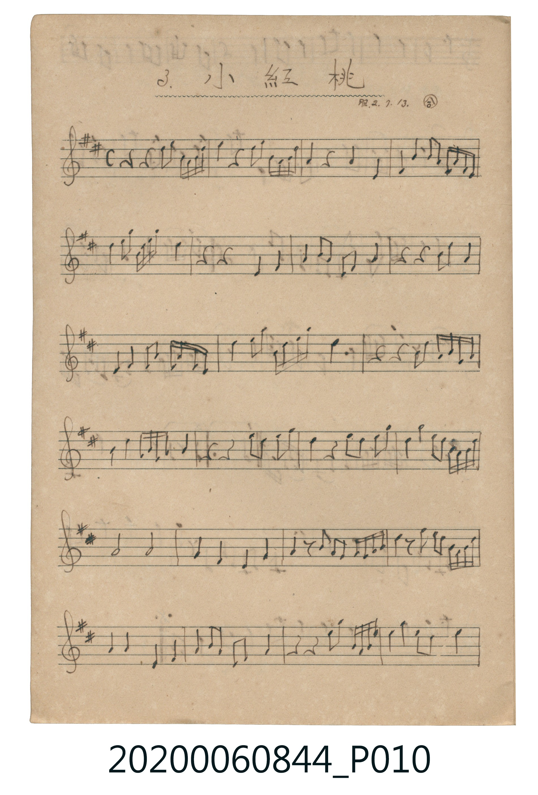
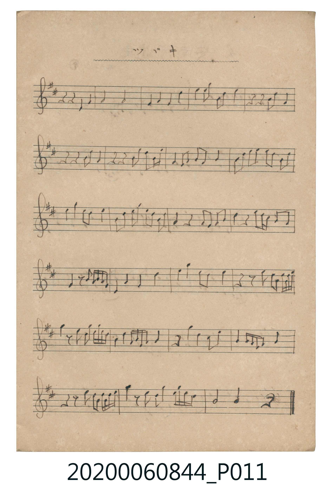

# 小紅桃

> Re:Shōka 使用 AI 協助辨識與重建樂譜，可能會有錯誤。歡迎回報。

- **鋼琴伴奏版**：<br><audio controls src="xiaohongtao.mp3"></audio>

- 曲：伝統曲 (合調・昭2.7.13.抄)

## 說明

3. 小紅桃 (Xiaohongtao)
Source: 唱歌帖 支那曲 (NMTH 2020.006.0844, Vol. IX) — P010.jpg–P011.jpg
Annotation: 昭2.7.13.・合
Notation: Handwritten 5-line staff (2 sharps = D major, 4/4 time, 47 bars)


## 歌詞

```text
（TMD 檔案未包含歌詞註解）
```

## ABC

<div class="abc-score" data-abc-src="xiaohongtao.abc" aria-label="五線譜載入中"></div>

[下載 ABC 原始檔](xiaohongtao.abc)

## TMD 檔案連結

- [主旋律 TMD 檔案](xiaohongtao.tmd) [[在 TMD Studio 編輯](https://tmdlang.github.io/Tmd-TS/#tmd=s7IKdvYPcrWy4qpTUCpJTLdSSM7PyUlNLsnMz7MqzsjPTkzOyFeCS5bl55TmploBqXgDS4RwcX5pUXIqXH18Xn5JalJ-fjZCRUFRfllqXmIeUFVuYl5pcXJRZkFJfHJ-QSVCTWpZZkoqSEVqSmZJflFmYg6SxalFxWAngW2KLylKzIOYARREqAJqSs_MswLKAk0AyiTmxKcmFpfEJxZnJgKVaWkpPN3Q_3xL67OFzQpaWlyKtgqWRlz2tgouXDYm-iZ2IHOezd70fs-sJ3vmPt-6EchW0Hg6oePFqv2Pm3c_m7HWSM9cz9BY71lXi6YSF5e-loIttQCXgoKCsR6S8zQiMhPzM_Lz0ksS8zVBssGQMFZ4OmXjs7U9T3dMU3g2Zf3LpsVgR_r5hngoGBkYGegZGJjpGViYmOgohOXn6Cl4RmgqPGqYohBgYGigl1WQ_qhhMpBpCGKCDHXMA0ZVIjiyFRD-A3oW6GuQvB9c1iMxL6W8KLOkJDVPwVQ3JzMvVaG4JDEtTUHDSKE4I7GooFgBGI4KuYlZ-UU6CsDQVCjJzE0FsswVkhKLisFeoDyYoEBBS5-LCymArAKA8ZvvUGNQUw2yR8HG0EzLDsyqUajOLahVMFDQBUMYbRgHJIxAhJmCKRAD-TUQPkFVpmiKYHxDKA00B6wBIQPSbAwUhauAugykBmwF2GSgPcZxED4yrMF0O5QGWQNRYQy1DETDVIBkYQ7ANAOmEq4C6iSYmcjyEK9APABxNHrYYLoeS2AiaYQECEoAgARAQYzmeaizYM5BiRi4brBVNQjLiVMFdyCaC1AiGQbR-egOg8WJWTzMdJhCsBKQiyARBApEIxS_Qp0EUoJwJzY3weyC0Zh2ITkKlhxgSQFZI2ZywJYSkaIQNSBRwoHolEUwRDF0wv0JV4EWPiguhzsWu--wOQldHSK_QtjYTUKOH2Rnw0IdphvhbBAP4UZg0CLph6mEuQksAVYCzVtYAx2mCyPBIBmIkWmQkwXEeyB10HQHS2sIdyOHFCgFgRSCVCCXZAgXoacxjJyMza04khNqVoAXvYgYhrkKM9_AFSOKPkScIPyIaScIorkQHm0Ic7DlX_SwIsoHkChGV4awHaIFd66BObmGq5aLS9dOAakuVABylbkA)]
- [鋼琴伴奏 TMD 檔案](xiaohongtao_piano.tmd) [[在 TMD Studio 編輯](https://tmdlang.github.io/Tmd-TS/#tmd=s7IKdvYPcrWy4tLSUni6of_5ltZnC5sVNB43T3nctOhxc9-TPVueLu1_snuGpoKWFpeirYKlEZe9rYILl42JvokdV52C0rPZm97vmfVkz9znWzcC2QoaTyd0vFi1_3Hz7mcz1hrpmesZGus962rRVOLi0tdSsKUW4FJQUDDWQ3ZzRGZifkZ-XnpJYr6mwqOGKQoBmYl5-QqOycn5uQWJeZm5qXklIF3B-aVFyalWCk-nbHy2tufpjmkKz6asf9m0GOx4P98QDwUjAyMDPQMDMz0DCxMTHYWw_Bw9Bc8IqKEGhgZ6WQXpjxomA5mGICbIUMe8vPySxJLM_DwrBYS_gYEADA2QPOUehgIFLX0uLiSvWoF96VBjUFMNskfBxtBMyw7MqlGozi2oVTBQ0AVDGG0YBySMQISZgikQA_k1ED5BVaZoimB8QygNNAesASED0mwMFIWrgLoMpAZsBdhkoD3GcRA-MqzBdDuUBlkDUWEMtQxEw1SAZGEOwDQDphKuAuokmJnI8hCvQDwAcTR62GC6HktgImmEBAhKAIAEQEGM5nmos2DOQYkYuG6wVTUIy4lTBXcgmgtQIhkG0fnoDoPFiVk8zHSYQrASkIsgEQQKRCMUv0KdBFKCcCc2N8HsgtGYdiE5CpYcYEkBWSNmcsCWEpGiEDUgUcKB6JRFMEQxdML9CVeBFj4oLoc7FrvvsDkJXR0iv0LY2E1Cjh9kZ8NCHaYb4WwQD-FGYNAi6YephLkJLAFWAs1bWAMdpgsjwSAZiJFpkJMFxHsgddB0B0trCHcjhxQoBYEUglQgl2QIF6GnMYycjM2tOJITalaAF72IGIa5CjPfwBUjij5EnCD8iGknCKK5EB5tCHOw5V_0sCLKB5AoRleGsB2iBXeugTm5hqsWS0UY5IGjKsRWE2oba8OrMCAbkWzN47WN4FKElSPL4FKNiBUUw3EZiqIFlkHQ5LGpRbUKn49RnIHqB2LY-A3H5ny8_sZuBT5fYg0p3DGHXTmxFsDjGikq8NmCJ3BJVI4Rarg9QlLYYvEIrgAgM6Vgzx9U8A92dxHwEM7Uhz0hY4184hxPWS4hPR9SFh9ERjqhMEL3BvFlLbpKnGFMnLvJTHn4MjhRBRc5duEsFygrDdH9QkbBS3QdhTtyiM8aJOVv0mtPMrIUobgg3nx88UKa_3FaQ2aGQU932NtTPsjtKRN4c8oACA3jgf2weFBLDUgicYEMA7AYkAGRhEqB-LD-P5ALFQIpgBsI4UAZWCVhfSqEPNgaqGEwa6BugnORpMGOhOVymCK4vWhcEANuCJqzEGZATUZ3PDw40E1BVo9iCtw7IB_DHYusH2eAoIcZHmcgzECLFZRYBXFgOlC0YxfA7wwUfUgxjSNeoEbAlSH5BG4KWoBgCVO0pIclWSEHOQ4PoZqM5CqUYAD7CpyDdO0UkDKRApCrzAUA)]

## 分析

```text
================================================================================
📊 TMD Song Profile: [ 小紅桃 ]
================================================================================
⏱  Duration:       2:02 (122.6s), 47 measures total
🎼 Key & Tempo:    首調基準 D, != 92.0 BPM, <4/4>
   - 分析範圍：      由實際發聲的音符與和弦推測調性；播放脈絡另行呈現
🎤 人聲音域:    B3 (MIDI 59) – F#5 (MIDI 78) [跨度: 19 個半音 / 1.6 個八度, 難度: challenging]
   - 最低音:  B3 in [Xiaohongtao #1 @ m.17, 0:43]
   - 最高音: F#5 in [Xiaohongtao #1 @ m.5, 0:11]
   - 適合: soprano, mezzo-soprano, tenor, baritone
🏛  結構:      Xiaohongtao (122.6s)
⚡ 編曲密度:        Peak 1 軌道同時演奏
🗝  調性診斷：       D 大調（純淨自然大調，未偵測到可信轉調）
   - 風格氣質:    純淨自然大調（陽光明朗、易唱易記，無明顯調外色彩）
   - 轉調歷程:    全曲維持單一推測調性（未偵測到可信轉調）
   - 核心骨幹音:  D, A, B, E, F#
   - 調性數值:    D 大調 [相關度: 0.83, 穩定度: Moderate, 自然音純度: 100.0%]
   - 候選調性 (K-S): D 大調 (0.83), A 大調 (0.73), B 小調 (0.71)
   - 五度圈歷程:   +2
   - 各段落調性細節:
     • [Xiaohongtao #1]: D 大調 (r: 0.83, 自然音純度: 100.0%)

  [ 五度圈游移軌跡 ]
               C  
         F            G  
      Bb              [D ]*
      Eb               A  
         Ab           E  
            Db       B  
               F# 
     (* = active key center)

  [ 十二半音累積音高分佈 ]
     C  :                            0.0%
     C# :                            0.0%
     D  : ████████████████████████  24.8%
     D# :                            0.0%
     E  : ████████████████          16.7%
     F  :                            0.0%
     F# : ██████████████            14.6%
     G  :                            0.0%
     G# :                            0.0%
     A  : ██████████████████████    23.1%
     A# :                            0.0%
     B  : ████████████████████      20.8%
--------------------------------------------------------------------------------
Assignment 軌道音域：
  - Piano         : B3 – F#5 (19 個半音 / 1.6 個八度, 263 個音符)
================================================================================
```


## 原書掃描頁






