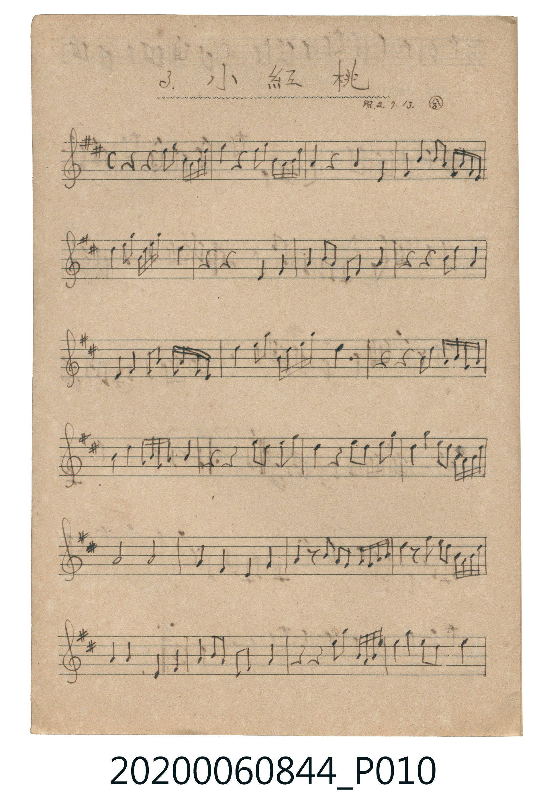
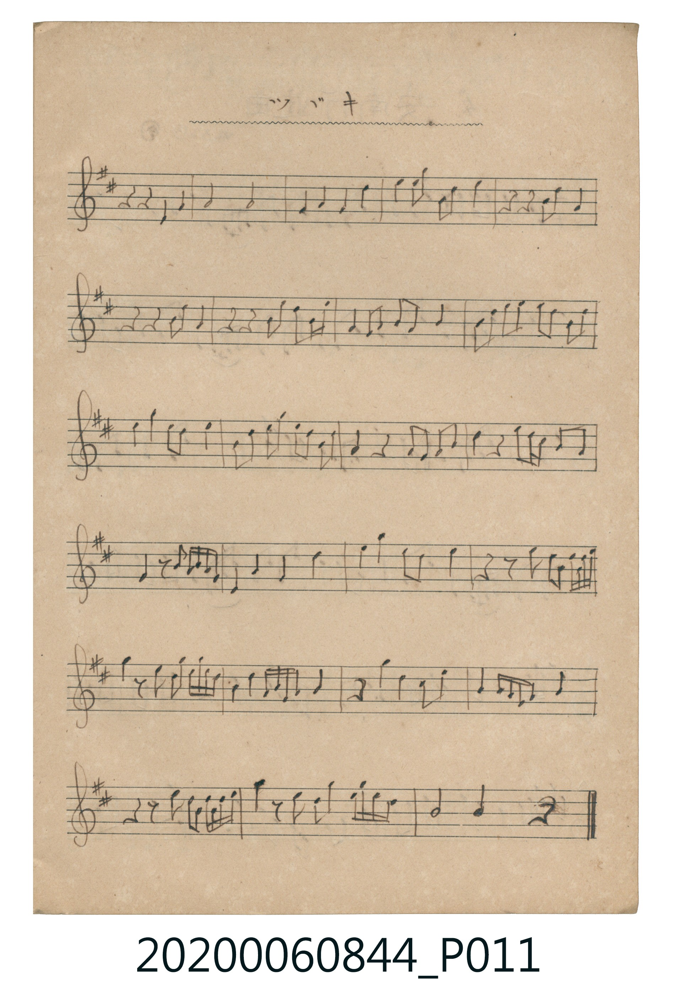

# 小紅桃

> Re:Shōka 使用 AI 協助辨識與重建樂譜，可能會有錯誤。歡迎回報。

- **鋼琴伴奏版**：<br><audio controls src="xiaohongtao.mp3"></audio>

- 曲：伝統曲 (合調・昭2.7.13.抄)

## 說明

3. 小紅桃 (Xiaohongtao)
Source: 唱歌帖 支那曲 (NMTH 2020.006.0844, Vol. IX) — P010.jpg–P011.jpg
Annotation: 昭2.7.13.・合
Notation: Handwritten 5-line staff (2 sharps = D major, 4/4 time, 47 bars)


## 歌詞

```text
（TMD 檔案未包含歌詞註解）
```

## ABC

<div class="abc-score" data-abc-src="xiaohongtao.abc" aria-label="五線譜載入中"></div>

[下載 ABC 原始檔](xiaohongtao.abc)

## TMD 檔案連結

- [主旋律 TMD 檔案](xiaohongtao.tmd) [[在 TMD Studio 編輯](https://tmdlang.github.io/Tmd-TS/#tmd=s7IKdvYPcrWy4qpTUCpJTLdSSM7PyUlNLsnMz7MqzsjPTkzOyFeCS5bl55TmploBqXgDS4RwcX5pUXIqXH18Xn5JalJ-fjZCRUFRfllqXmIeUFVuYl5pcXJRZkFJfHJ-QSVCTWpZZkoqSEVqSmZJflFmYg6SxalFxWAngW2KLylKzIOYARREqAJqSs_MswLKAk0AyiTmxKcmFpfEJxZnJqIoK8nITy9KLMiotMrILAbZlQxUmp2Yl4jup_iCxPRUqwADQwOETElGKjAMUlNKkxMh1mtpKTzd0P98S-uzhc0KWlpcirYKlkZc9rYKLlw2JvomdiCdz2Zver9n1pM9c59v3QhkK2g8ndDxYtX-x827n81Ya6RnrmdorPesq0VTiYtLX0vBllqAS0FBwVgPyXkaEZmJ-Rn5eeklifmaINlgSNwpPJ2y8dnanqc7pik8m7L-ZdNisCP9fEM8FIwMjAz0DAzM9AwsTEx0FMLyc_QUPCM0FR41TFEAhYxeVkH6o4bJQKYhiAky1DEPmATAoWOlgPAf0LNAX4Pk_eCyHol5KeVFmSUlqXkKpro5mXmpCsUliWlpChpGCsUZiUUFxQrAcFTITczKL9JRAIamQklmbiqQZa6QlFhUDPYC5cEEBQpa-lxcSAFkFQBMN_kONQY11SB7FGwMzbTswKwahercgloFAwVdMITRhnFAwghEmCmYAjGQXwPhE1RliqYIxjeE0kBzwBoQMiDNxkBRuAqoy0BqwFaATQbaYxwH4SPDGky3Q2mQNRAVxlDLQDRMBUgW5gBMM2Aq4SqgToKZiSwP8QrEAxBHo4cNpuuxBCaSRkiAoAQASAAUxGiehzoL5hyUiIHrBltVg7CcOFVwB6K5ACWSYRCdj-4wWJyYxcNMhykEKwG5CBJBoEA0QvEr1EkgJQh3YnMTzC4YjWkXkqNgyQGWFJA1YiYHbCkRKQpRAxIlHIhOWQRDFEMn3J9wFWjhg-JyuGOx-w6bk9DVIfIrhI3dJOT4QXY2LNRhuhHOBvEQbgQGLZJ-mEqYm8ASYCXQvIU10GG6MBIMkoEYmQY5WUC8B1IHTXewtIZwN3JIgVIQSCFIBXJJhnARehrDyMnY3IojOaFmBXjRi4hhmKsw8w1cMaLoQ8QJwo-YdoIgmgvh0YYwB1v-RQ8ronwAiWJ0ZQjbIVpw5xqYk2u4arm4dO0UkOpCBSBXmQsA)]
- [鋼琴伴奏 TMD 檔案](xiaohongtao_piano.tmd) [[在 TMD Studio 編輯](https://tmdlang.github.io/Tmd-TS/#tmd=s7IKdvYPcrWy4qpTUCpJTLdSyC8qychPL0osyKi0ysgsLskvykxOzInPTsxLVIIrKs4vLUpOjS9ITE-1CjAwNEDIlGSk5qZapaaUJieWZObnKXFpaSk83dD_fEvrs4XNChqPm6c8blr0uLnvyZ4tT5f2P9k9Q1NBS4tL0VbB0ojL3lbBhcvGRN_EDmTcs9mb3u-Z9WTP3OdbNwLZChpPJ3S8WLX_cfPuZzPWGumZ6xka6z3ratFU4uLS11KwpRbgUlBQMNZDdnNEZmJ-Rn5eeklivqbCo4YpCgGZiXn5Co7Jyfm5BYl5mbmpeSUgXcHgQLFSeDpl47O1PU93TFN4NmX9y6bFYMf7-YZ4KBgZGBnoGRiY6RlYmJjoKITl5-gpeEZADQUGo15WQfqjhslApiGICTLUMS8vvwQclFYKCH8DAwEYGiB5yj0MBQpa-lxcSF61AvvSocagphpkj4KNoZmWHZhVo1CdW1CrYKCgC4Yw2jAOSBiBCDMFUyAG8msgfIKqTNEUwfiGUBpoDlgDQgak2RgoClcBdRlIDdgKsMlAe4zjIHxkWIPpdigNsgaiwhhqGYiGqQDJwhyAaQZMJVwF1EkwM5HlIV6BeADiaPSwwXQ9lsBE0ggJEJQAAAmAghjN81BnwZyDEjFw3WCrahCWE6cK7kA0F6BEMgyi89EdBosTs3iY6TCFYCUgF0EiCBSIRih-hToJpAThTmxugtkFozHtQnIULDnAkgKyRszkgC0lIkUhakCihAPRKYtgiGLohPsTrgItfFBcDncsdt9hcxK6OkR-hbCxm4QcP8jOhoU6TDfC2SAewo3AoEXSD1MJcxNYAqwEmrewBjpMF0aCQTIQI9MgJwuI90DqoOkOltYQ7kYOKVAKAikEqUAuyRAuQk9jGDkZm1txJCfUrAAvehExDHMVZr6BK0YUfYg4QfgR004QRHMhPNoQ5mDLv-hhRZQPIFGMrgxhO0QL7lwDc3INVy2WijDIA0dViK0m1DbWhldhQDYi2ZrHaxvBpQgrR5bBpRoRKyiG4zIURQssg6DJY1OLahU-H6M4A9UPxLDxG47N-Xj9jd0KfL7EGlK4Yw67cmItgMc1UlTgswVP4JKoHCPUcHuEpLDF4hFcAUBmSsGeP6jgH-zuIuAhnKkPe0LGGvnEOZ6yXEJ6PqQsPoiMdEJhhO4N4stadJU4w5g4d5OZ8vBlcKIKLnLswlkuUFYaovuFjIKX6DoKd-QQnzVIyt-k155kZClCcUG8-fjihTT_47SGzAyDnu6wt6d8kNtTJvDmlAEQGsYD-2HxoJYakETiAhkGYDEgAyIJlQLxYf1_IBcqBFIANxDCgTKwSsL6VAh5sDVQw2DWQN0E5yJJgx0Jy-UwRXB70bggBtwQNGchzICajO54eHCgm4KsHsUUuHdAPoY7Flk_zgBBDzM8zkCYgRYrKLEK4sB0oGjHLoDfGSj6kGIaR7xAjYArQ_IJ3BS0AMESpmhJD0uyQg5yHB5CNRnJVSjBAPYVOAfp2ikgZSIFIFeZCwA)]

## 分析

```text
================================================================================
📊 TMD Song Profile: [ 小紅桃 ]
================================================================================
⏱  Duration:       2:02 (122.6s), 47 measures total
🎼 Key & Tempo:    首調基準 D, != 92.0 BPM, <4/4>
   - 分析範圍：      由實際發聲的音符與和弦推測調性；播放脈絡另行呈現
🎤 人聲音域:    B3 (MIDI 59) – F#5 (MIDI 78) [跨度: 19 個半音 / 1.6 個八度, 難度: challenging]
   - 最低音:  B3 in [Xiaohongtao #1 @ m.17, 0:43]
   - 最高音: F#5 in [Xiaohongtao #1 @ m.5, 0:11]
   - 適合: soprano, mezzo-soprano, tenor, baritone
🏛  結構:      Xiaohongtao (122.6s)
⚡ 編曲密度:        Peak 1 軌道同時演奏
🗝  調性診斷：       D 大調（純淨自然大調，未偵測到可信轉調）
   - 風格氣質:    純淨自然大調（陽光明朗、易唱易記，無明顯調外色彩）
   - 轉調歷程:    全曲維持單一推測調性（未偵測到可信轉調）
   - 核心骨幹音:  D, A, B, E, F#
   - 調性數值:    D 大調 [相關度: 0.83, 穩定度: Moderate, 自然音純度: 100.0%]
   - 候選調性 (K-S): D 大調 (0.83), A 大調 (0.73), B 小調 (0.71)
   - 五度圈歷程:   +2
   - 各段落調性細節:
     • [Xiaohongtao #1]: D 大調 (r: 0.83, 自然音純度: 100.0%)

  [ 五度圈游移軌跡 ]
               C  
         F            G  
      Bb              [D ]*
      Eb               A  
         Ab           E  
            Db       B  
               F# 
     (* = active key center)

  [ 十二半音累積音高分佈 ]
     C  :                            0.0%
     C# :                            0.0%
     D  : ████████████████████████  24.8%
     D# :                            0.0%
     E  : ████████████████          16.7%
     F  :                            0.0%
     F# : ██████████████            14.6%
     G  :                            0.0%
     G# :                            0.0%
     A  : ██████████████████████    23.1%
     A# :                            0.0%
     B  : ████████████████████      20.8%
--------------------------------------------------------------------------------
Assignment 軌道音域：
  - Piano         : B3 – F#5 (19 個半音 / 1.6 個八度, 263 個音符)
================================================================================
```


## 原書掃描頁






