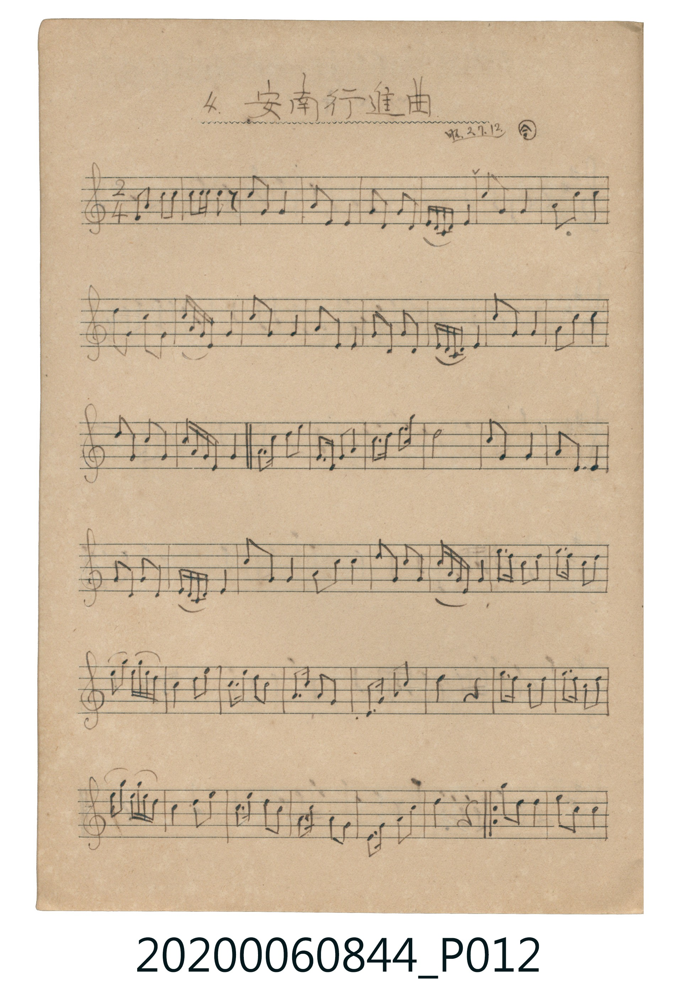
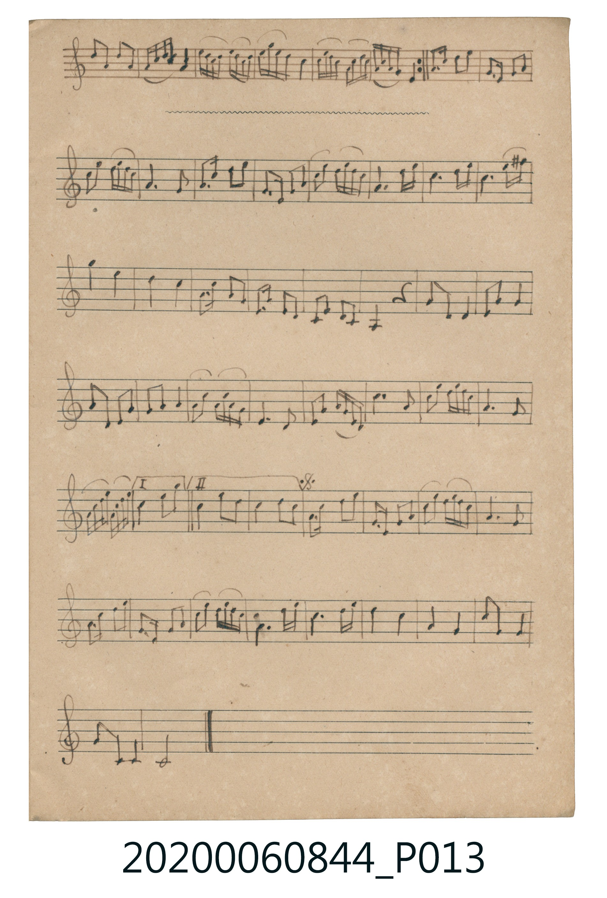

# 安南行進曲

> Re:Shōka 使用 AI 協助辨識與重建樂譜，可能會有錯誤。歡迎回報。

- **鋼琴伴奏版**：<br><audio controls src="annan_koshinkyoku.mp3"></audio>

- 曲：伝統曲 (合調・昭2.7.12.抄)

## 說明

4. 安南行進曲 (Annan Kōshinkyoku)
Source: 唱歌帖 支那曲 (NMTH 2020.006.0844, Vol. IX) — P012.jpg–P013.jpg
Annotation: 昭.2.7.12.・合
Notation: Handwritten 5-line staff (C major, 2/4 time, 95 bars)


## 歌詞

```text
（TMD 檔案未包含歌詞註解）
```

## ABC

<div class="abc-score" data-abc-src="annan_koshinkyoku.abc" aria-label="五線譜載入中"></div>

[下載 ABC 原始檔](annan_koshinkyoku.abc)

## TMD 檔案連結

- [主旋律 TMD 檔案](annan_koshinkyoku.tmd) [[在 TMD Studio 編輯](https://tmdlang.github.io/Tmd-TS/#tmd=s7IKdvYPcrWy4qpTUCpJTLdSSM7PyUlNLsnMz7MqzsjPTkzOyFeCS5bl55TmploBqXgDS4RwcX5pUXIqXH18Xn5JalJ-fjZCRUFRfllqXmIeUFVuYl5pcXJRZkFJfHJ-QSVCTWpZZkoqSEVqSmZJflFmYg6SxalFxWAngW2KLylKzIOYARREqAJqSs_MswLKAk0AyiTmxKcmFpfEJxZnJgKVaWkpPF3X-bR3-ouFPS8bNj2bvUlBS4tL0VbB0MCCy95WwZnLxkjfxA5kHFDu_Z5ZT_bMfb51I0idxtMJHS9W7X_cvPvZjLVGeuZ6hkZ6z7paNJW4uPS1FGypBbgUFBRM9DBcqeGYBww7Be-jvcUZmXnZlfnZpZogpcGQcFd4OmXjs7U9T3dMU3g2Zf3LpsVgPX6-IR4KRgZGBnoGBmZ6BhYmJjoKYfk5egqeEZoKjxqmKAQYAD2RVZD-qGEykGkMYoIMBdqVX5IITgAKQM_qQX0L9DowDEAK_ODSHol5KeVFmSUlqXkKpro5mXmpCsUliWlpChrOCrmJWflFOgrAAFUoycxN1VGwNFVISiwqBjuc8pCCAgUtfS4ucOh458PDxioAGN35DjUGNdUgyxRsDM207MCsGoXq3LRaBVMFXQXDOCBhBmPUAJlAhhlQygDIBSmoAZMgCKMhIkZQDBaBmgoSN4aqBNEgEWOgKkOESrBdIHmEaSCVIHmQCEgWZhrYRchGgjRDDERoxjQOpgOEqeM4mMMgQQQ1DlMppuOMgWy4RpgikCDEPFTXgUMeGBLIarH5DSXg4YFniGEeaX4DBzxmGME9ixnuUPdCNJvB4gvDu1AfQVOVMUb4wQMC1UiYf0GakOISS5AimQdKs3BTIEIohmJ1D6ZL4CYS4R4j9PiEOwQGYcaBrUULHngSx56gYckUnilRTYT7AckzcCbCQXAhqEFAhyAJYuZhDF_Dwhw1HYIVIdkMk8WW72BBjkhnoHyAbCIs7cMNRC550GMGNaWBDYcEHIJvDBEEUyCIlK3g4Y9uLCjQYP5EBD0sh0E1Q4MMlLPM4sFCsMiGZU54hMMDBBJ8qNkX4UNY9kMLWlj0IFwH9QlcKUgE4l5IXoeEAcwpiOSEFqxI8YISXygpBFk_tnIJNYlgjReIn7GWgYhShlxXYhSqsDCFVRS4yh2YQagZFlUEM4XA3YGeB5HTC0IlrEQGYVCagcjBYA1XLReXrh2oiYFSYSsAxZS5AA)]
- [鋼琴伴奏 TMD 檔案](annan_koshinkyoku_piano.tmd) [[在 TMD Studio 編輯](https://tmdlang.github.io/Tmd-TS/#tmd=s7IKdvYPcrWy4tLSUni6rvNp7_QXC3teNmx6NnuTgsbj5imPmxY9bu57smfL06X9T3bP0FTQ0uJStFUwNLDgsrdVcOayMdI3seOqU1ACani_Z9aTPXOfb90I1vx0QseLVfsfN-9-NmOtkZ65nqGR3rOuFk0lLi59LQVbagEuBQUFEz1Mpzvm5SXmKXgf7S3OyMzLrszPLtVUeNQwRSEgMzEvX8ExOTk_tyAxLzM3Na8EZERwfmlRcqqVwtMpG5-t7Xm6Y5rCsynrXzYtBpvl5xvioWBkYGSgZ2BgpmdgYWKioxCWn6On4BkBNdQA6LmsgvRHDZOBTGMQE2Qo0A35JYklmfl5VgrAQNCDhgIwSIBhA1JAufehQEFLn4sL7GXvfLiHrcB-dagxqKkGWaZgY2imZQdm1ShU56bVKpgq6CoYxgEJMxijBsgEMsyAUgZALkhBDZgEQRgNETGCYrAI1FSQuDFUJYgGiRgDVRkiVILtAskjTAOpBMmDRECyMNPALkI2EqQZYiBCM6ZxMB0gTB3HwRwGCSKocZhKMR1nDGTDNcIUgQQh5qG6DhzywJBAVovNbygBDw88QwzzSPMbOOAxwwjuWcxwh7oXotkMFl8Y3oX6CJqqjDHCDx4QqEbC_AvShBSXWIIUyTxQmoWbAhFCMRSrezBdAjeRCPcYoccn3CEwCDMObC1a8MCTOPYEDUum8EyJaiLcD0iegTMRDoILQQ0COgRJEDMPY_gaFuao6RCsCMlmmCy2fAcLckQ6A-UDZBNhaR9uIHLJgx4zqCkNbDgk4BB8Y4ggmAJBpGwFD390Y0GBBvMnIuhhOQyqGRpkoJxlFg8WgkU2LHPCIxweIJDgQ82-CB_Csh9a0MKiB-E6qE_gSkEiEPdC8jokDGBOQSQntGBFiheU-EJJIcj6sZVLqEkEa7xA_Iy1DESUMuS6EqNQhYUprKLAVe7ADELNsKgimCkE7g70PIicXhAqYSUyCIPSDEQOBmu4anHV1kEeOOrrgloFQ21jbZj1htom2kjuReIhqwLJIOtBljGP1zaCc1E48NjEqReZh6qVBKdgJB681uEyk2SPD5Tn8OmkVAZfUBLtBTwJgqTQpDzMiLKOxJDBG-E4XIgj7lDNJN02HG7H4TfibMMdxjjcTpRtRJQcuJ0IqxZhVmFoI6aUonUGx-1nPDmAqNISd7wR52_8viMQB5R4nFAywRIweKSILFAIpUvKDIWnRawxhycsSSkTSQtNPIaSXtURKr-IKYtIi1byyxTS6zpq-I5WtpFTF1CjniOyMIVBPC1OH-QWpwm8wWkYr2ASHw9kgEggByxiChYBkWAWQilEAs5A1mOGTSVIEKwAw3SSzYSLw81EYWC1Hq4H7hUQFySCUyXMVnSHYlqGqRnJpRAVKGpR3IxkKrpSuFPg5mAohpkGsh6h3QDRmcKIS2LCH81XmCoRVsGMwmYkwlFYDUf3ESKhoCUELGpR_QQ31QCH_SixjtUBeBIqWqSiqMTGwh5TmIkVn7mEVGJJVfgTK3JCgJYOunag8WqUAkIBKKbMBQA)]

## 分析

```text
================================================================================
📊 TMD Song Profile: [ 安南行進曲 ]
================================================================================
⏱  Duration:       1:45 (105.6s), 95 measures total
🎼 Key & Tempo:    首調基準 C, != 108.0 BPM, <2/4>
   - 分析範圍：      由實際發聲的音符與和弦推測調性；播放脈絡另行呈現
🎤 人聲音域:    A3 (MIDI 57) – E5 (MIDI 76) [跨度: 19 個半音 / 1.6 個八度, 難度: challenging]
   - 最低音:  A3 in [AnnanKoshinkyoku #1 @ m.67, 1:14]
   - 最高音: E5 in [AnnanKoshinkyoku #1 @ m.62, 1:08]
   - 適合: soprano, mezzo-soprano, contralto, tenor, baritone, bass
🏛  結構:      AnnanKoshinkyoku (105.6s)
⚡ 編曲密度:        Peak 1 軌道同時演奏
🗝  調性診斷：       G 調性不明確（純淨自然大調，未偵測到可信轉調）
   - 風格氣質:    純淨自然大調（陽光明朗、易唱易記，無明顯調外色彩）
   - 轉調歷程:    全曲維持單一推測調性（未偵測到可信轉調）
   - 核心骨幹音:  G, A, C, E, D
   - 調性數值:    G 調性不明確 [相關度: 0.72, 穩定度: Ambiguous, 自然音純度: 100.0%]
   - 候選調性 (K-S): G 大調 (0.72), C 大調 (0.70), A 小調 (0.68)
   - 五度圈歷程:   +1
   - 各段落調性細節:
     • [AnnanKoshinkyoku #1]: G 調性不明確 (r: 0.72, 自然音純度: 100.0%)

  [ 五度圈游移軌跡 ]
               C  
         F           [G ]*
      Bb               D  
      Eb               A  
         Ab           E  
            Db       B  
               F# 
     (* = active key center)

  [ 十二半音累積音高分佈 ]
     C  : █████████████             15.8%
     C# :                            0.0%
     D  : ███████████               13.4%
     D# :                            0.0%
     E  : █████████████             15.7%
     F  :                            0.0%
     F# :                            0.0%
     G  : ████████████████████████  28.2%
     G# :                            0.0%
     A  : ███████████████████████   26.9%
     A# :                            0.0%
     B  :                            0.0%
--------------------------------------------------------------------------------
Assignment 軌道音域：
  - Piano         : A3 – E5 (19 個半音 / 1.6 個八度, 370 個音符)
================================================================================
```


## 原書掃描頁






