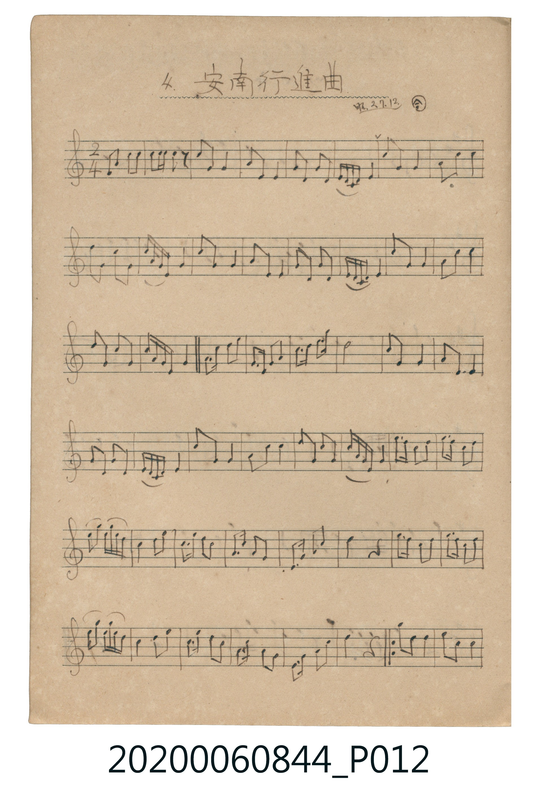
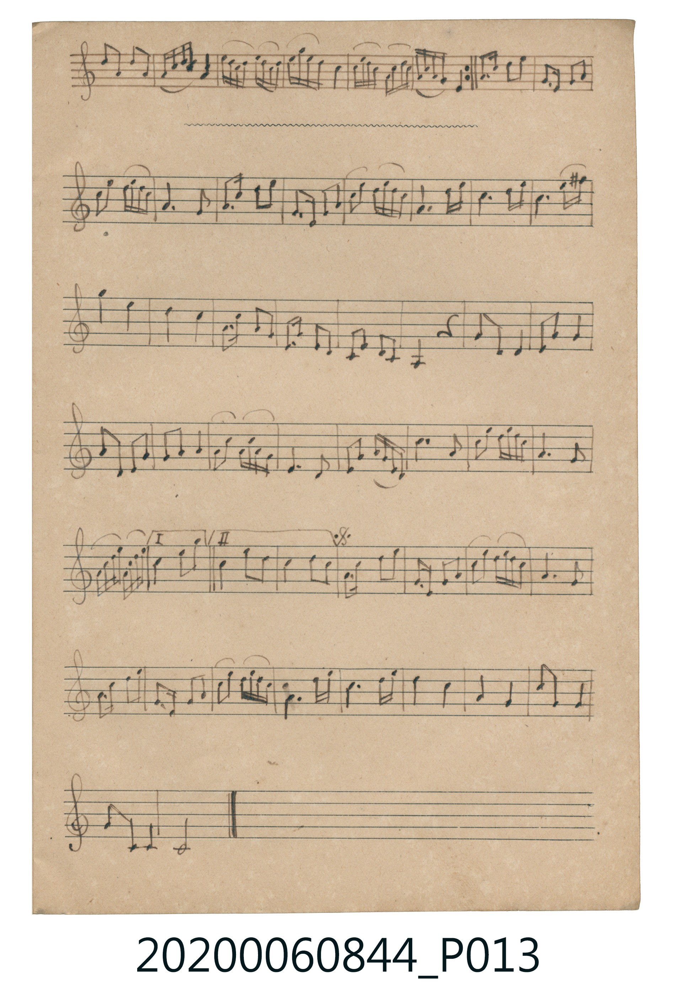

# 安南行進曲

> Re:Shoka 使用 AI 協助辨識與重建樂譜，可能會有錯誤。歡迎回報。

<audio controls src="annan_koshinkyoku.mp3"></audio>

- 曲：伝統曲 (合調・昭2.7.12.抄)

## 說明

4. 安南行進曲 (Annan Kōshinkyoku)
Source: 唱歌帖 支那曲 (NMTH 2020.006.0844, Vol. IX) — P012.jpg–P013.jpg
Annotation: 昭.2.7.12.・合
Notation: Handwritten 5-line staff (C major, 2/4 time, 95 bars)

## 歌詞

```text
（TMD 檔案未包含歌詞註解）
```

## ABC

```abc
X:1
T:安南行進曲
C:曲：伝統曲 (合調・昭2.7.12.抄)
M:2/4
L:1/16
Q:1/4=108
K:C
V:V1 name="Melody" snm="Mel"
[V:V1]
!mf! G2 c2 A2 c2 | A c A G z2 G2 | G4 G4 | G2 D2 D4 |
G2 E2 G2 E2 | G E D C D4 | A2 G2 G4 | E2 D2 G2 A2 |
c2 G2 E2 G2 | A G E D G4 | A2 G2 G4 | G2 E2 E4 |
G2 E2 G2 E2 | G E D C D4 | A2 G2 G4 | E2 G2 A2 c2 |
A2 G2 G4 | A G E D G4 | E G A2 c4 | A E G2 A4 |
G A c2 d4 | A2 G2 G4 | G2 D2 D4 | E2 D2 C4 |
G E D C D4 | A2 G2 G4 | E2 G2 A2 A2 | G2 E2 G2 E2 |
A G E D G4 | A A c2 A2 A A | c2 A2 c4 | A2 d2 c A G E |
A2 G2 A4 | A A c2 A4 | G A G2 E4 | E G A2 c4 |
A2 z2 A A c2 | A2 A A c2 A2 | A2 d2 c A G E | A2 G2 A4 |
A A c2 A4 | G A G2 E4 | D E G2 A4 | A2 z6 |
d2 A2 c4 | c2 G2 G4 | A2 G2 G2 E2 | G A c A G4 |
c A G E c A G E | c A G E A4 | c A G E G A c d | c A G E D4 |
G A c2 A4 | E G A2 G4 | G2 c2 c A G E | G4 E4 |
G2 d2 c2 A2 | G A E2 G4 | c2 d c A G E2 | G4 A4 |
c2 A2 c2 d2 | A2 c2 d2 e2 | e4 d4 | c4 A4 |
E A A2 G2 E2 | G A E2 D4 | C E D2 C D A,2 | z4 G2 D2 |
D4 E G A2 | G2 D2 D2 E2 | G2 A2 A4 | G2 c2 A G E D |
E4 D4 | E2 A2 G E D C | A4 G4 | A2 d c A G E2 |
G4 E4 | E G A c d4 | A2 c2 d4 | A2 c2 A4 |
c2 A2 c2 A2 | E G A2 c4 | A2 E2 G4 | A2 d c A G E2 |
G4 E4 | E G A2 c4 | A E D2 E2 G2 | A2 d2 c A G E |
E4 A4 | A4 A4 | c4 A4 | G4 G4 |
A2 G2 E4 | G2 D2 C2 C2 | C8 |
```

## TMD 檔案連結

- [主旋律 TMD 檔案](annan_koshinkyoku.tmd) [[在 TMD Studio 編輯](https://tmdlang.github.io/Tmd-TS/#tmd=s7IKdvYPcrWy4qpTUCpJTLdSSM7PyUlNLsnMz7MqzsjPTkzOyFeCS5bl55TmploBqXgDS4RwcX5pUXIqXH18Xn5JalJ-fjZCRUFRfllqXmIeUFVuYl5pcXJRZkFJfHJ-QSVCTWpZZkoqSEVqSmZJflFmYg6SxalFxWAngW2KLylKzIOYARRU4tLSUni6rvNp7_QXC3teNmx6NnuTgpYWl6KtgqGBBZe9rYIzl42RvokdyDSg3Ps9s57smft860aQOo2nEzperNr_uHn3sxlrjfTM9QyN9J51tWgqcXHpaynYUgtwKSgomOhhuFLDMQ8YKAreR3uLMzLzsivzs0s1QUqDIQGq8HTKxmdre57umKbwbMr6l02LwXr8fEM8FIwMjAz0DAzM9AwsTEx0FMLyc_QUPCM0FR41TFEIMAB6Iqsg_VHDZCDTGMQEGQq0K78kERyzCkDP6kF9C_Q6MAxACvzg0h6JeSnlRZklJal5Cqa6OZl5qQrFJYlpaQoazgq5iVn5RToKwABVKMnMTdVRsDRVSEosKgY7nPKQggIFLX0uLnDoeOfDw8bKNzUnP6XSocagRqEaZJ2CjaGZlh2YBRTJTatVMFXQVTCMAxJmMEYNkAlkmAGlDIBckIIaMAmCMBoiYgTFYBGoqSBxY6hKEA0SMQaqMkSoBNsFkkeYBlIJkgeJgGRhpoFdhGwkSDPEQIRmTONgOkCYOo6DOQwSRFDjMJViOs4YyIZrhCkCCULMQ3UdOOSBIYGsFpvfUAIeHniGGOaR5jdwwGOGEdyzmOEOdS9EsxksvjC8C_URNFUZY4QfPCBQjYT5F6QJKS6xBCmSeaA0CzcFIoRiKFb3YLoEbiIR7jFCj0-4Q2AQZhzYWrTggSdx7AkalkzhmRLVRLgfkDwDZyIcBBeCGgR0CJIgZh7G8DUszFHTIVgRks0wWWz5DhbkiHQGygfIJsLSPtxA5JIHPWZQUxrYcEjAIfjGEEEwBYJI2Qoe_ujGggIN5k9E0MNyGFQzNMhAOcssHiwEi2xY5oRHODxAIMGHmn0RPoRlP7SghUUPwnVQn8CVgkQg7oXkdUgYwJyCSE5owYoULyjxhZJCkPVjK5dQkwjWeIH4GWsZiChlyHUlRqEKC1NYRYGr3IEZhJphUUUwUwjcHeh5EDm9IFTCSmQQBqUZiBwM1nDVcnHp2oEaGShVtgJQTJkLAA)]
- [鋼琴伴奏 TMD 檔案](annan_koshinkyoku_piano.tmd) [[在 TMD Studio 編輯](https://tmdlang.github.io/Tmd-TS/#tmd=s7IKdvYPcrWy4tLSUni6rvNp7_QXC3teNmx6NnuTgsbj5imPmxY9bu57smfL06X9T3bP0FTQ0uJStFUwNLDgsrdVcOayMdI3seOqU1ACani_Z9aTPXOfb90I1vx0QseLVfsfN-9-NmOtkZ65nqGR3rOuFk0lLi59LQVbagEuBQUFEz1Mpzvm5SXmKXgf7S3OyMzLrszPLtVUeNQwRSEgMzEvX8ExOTk_tyAxLzM3Na8EZERwfmlRcqqVwtMpG5-t7Xm6Y5rCsynrXzYtBpvl5xvioWBkYGSgZ2BgpmdgYWKioxCWn6On4BkBNdQA6LmsgvRHDZOBTGMQE2Qo0A35JYklmfl5VgrAQNCDhgIwSIBhA1JAufehQEFLn4sL7GXvfLiHrXxTc_JTKh1qDGoUqkHWKdgYmmnZgVlAkdy0WgVTBV0FwzggYQZj1ACZQIYZUMoAyAUpqAGTIAijISJGUAwWgZoKEjeGqgTRIBFjoCpDhEqwXSB5hGkglSB5kAhIFmYa2EXIRoI0QwxEaMY0DqYDhKnjOJjDIEEENQ5TKabjjIFsuEaYIpAgxDxU14FDHhgSyGqx-Q0l4OGBZ4hhHml-Awc8ZhjBPYsZ7lD3QjSbweILw7tQH0FTlTFG-MEDAtVImH9BmpDiEkuQIpkHSrNwUyBCKIZidQ-mS-AmEuEeI_T4hDsEBmHGga1FCx54EseeoGHJFJ4pUU2E-wHJM3AmwkFwIahBQIcgCWLmYQxfw8IcNR2CFSHZDJPFlu9gQY5IZ6B8gGwiLO3DDUQuedBjBjWlgQ2HBByCbwwRBFMgiJSt4OGPbiwo0GD-RAQ9LIdBNUODDJSzzOLBQrDIhmVOeITDAwQSfKjZF-FDWPZDC1pY9CBcB_UJXClIBOJeSF6HhAHMKYjkhBasSPGCEl8oKQRZP7ZyCTWJYI0XiJ-xloGIUoZcV2IUqrAwhVUUuModmEGoGRZVBDOFwN2BngeR0wtCJaxEBmFQmoHIwWANVy2W-hrcNgnywFVhF9QqGGoba8PsN9Q20UZyMBIPWRVIBlkPsox5vLYRnIvCgUcnTr3IPFStJDgFI_XgtQ6XmSR7fKA8h08npTL4gpJoL-BJECSFJuVhRpR1JIYM3gjH4UIccYdqJum24XA7Dr8RZxvuMMbhdqJsI6LkwO1EWL0IswpDGzGlFK0zOG4_48kBRJWWuOONOH_j9x2BOKDE44SSCZaAwSNFZIFCKF1SZig8LWKNOTxhSUqZSFpo4jGU9KqOUPlFTFlEWrSSX6aQXtdRw3e0so2cuoAa9RyRhSkM4mly-uBqchqCujcgaBIPY9UgseHSSCpNkVQi2Eii6EYja8AqiN8-M-JMRihDMoRon9DczVjVY3UzAUEigwOrfVijC6EAoZJkk7H5HF9AE-9J4h2BEdLIphAwm0D4Y7iasNFYgwmr2_Aajs2FiIDA7gz0RhlCPaH8TN38QjAWiTEZuxexOY84J2MPPDI8gi8GsRdMBAsVoswmFIdYXQ0fvyIyPAiUFEQGCIUFNZ5MTsBkUkSJzYnEF9bku5saJpNQ6lFSWOMvVGAQ3CbRtQNNlKE0SxSAYspcAA)]

## 分析

```text
================================================================================
📊 TMD Song Profile: [ 安南行進曲 ]
================================================================================
⏱  Duration:       1:45 (105.6s), 95 measures total
🎼 Key & Tempo:    首調基準 C, != 108.0 BPM, <2/4>
   - 分析範圍：      由實際發聲的音符與和弦推測調性；播放脈絡另行呈現
🎤 人聲音域:    A3 (MIDI 57) – E5 (MIDI 76) [跨度: 19 個半音 / 1.6 個八度, 難度: challenging]
   - 最低音:  A3 in [AnnanKoshinkyoku #1 @ m.67, 1:14]
   - 最高音: E5 in [AnnanKoshinkyoku #1 @ m.62, 1:08]
   - 適合: soprano, mezzo-soprano, contralto, tenor, baritone, bass
🏛  結構:      AnnanKoshinkyoku (105.6s)
⚡ 編曲密度:        Peak 1 軌道同時演奏
🗝  調性診斷：       G 調性不明確（純淨自然大調，未偵測到可信轉調）
   - 風格氣質:    純淨自然大調（陽光明朗、易唱易記，無明顯調外色彩）
   - 轉調歷程:    全曲維持單一推測調性（未偵測到可信轉調）
   - 核心骨幹音:  G, A, C, E, D
   - 調性數值:    G 調性不明確 [相關度: 0.72, 穩定度: Ambiguous, 自然音純度: 100.0%]
   - 候選調性 (K-S): G 大調 (0.72), C 大調 (0.70), A 小調 (0.68)
   - 五度圈歷程:   +1
   - 各段落調性細節:
     • [AnnanKoshinkyoku #1]: G 調性不明確 (r: 0.72, 自然音純度: 100.0%)

  [ 五度圈游移軌跡 ]
               C  
         F           [G ]*
      Bb               D  
      Eb               A  
         Ab           E  
            Db       B  
               F# 
     (* = active key center)

  [ 十二半音累積音高分佈 ]
     C  : █████████████             15.8%
     C# :                            0.0%
     D  : ███████████               13.4%
     D# :                            0.0%
     E  : █████████████             15.7%
     F  :                            0.0%
     F# :                            0.0%
     G  : ████████████████████████  28.2%
     G# :                            0.0%
     A  : ███████████████████████   26.9%
     A# :                            0.0%
     B  :                            0.0%
--------------------------------------------------------------------------------
Assignment 軌道音域：
  - Melody        : A3 – E5 (19 個半音 / 1.6 個八度, 370 個音符)
================================================================================
```


## 原書掃描頁






