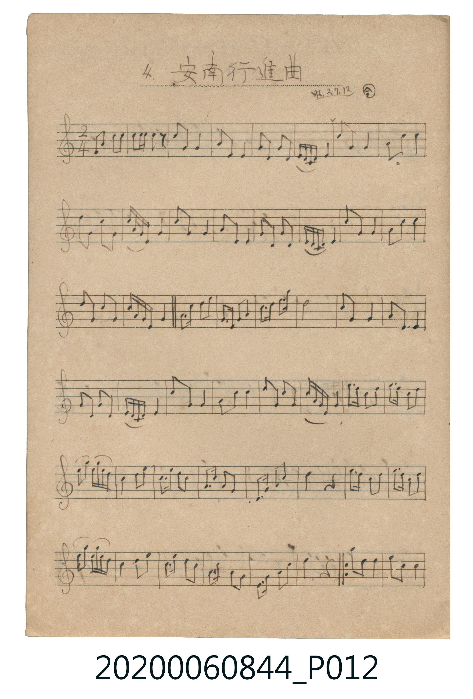
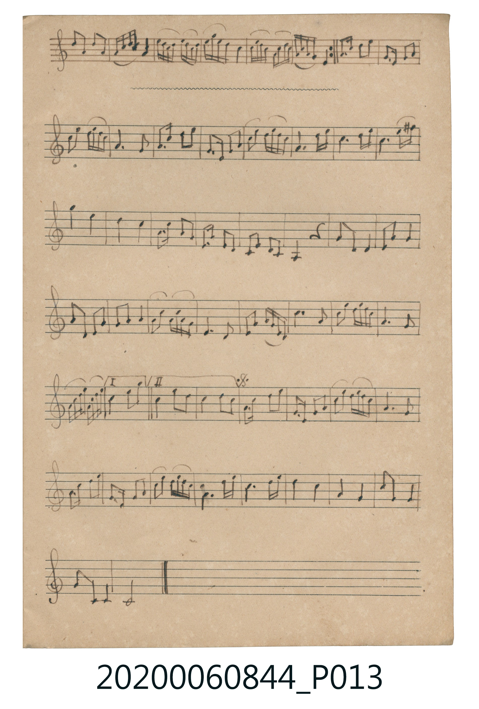

# 安南行進曲

> Re:Shōka 使用 AI 協助辨識與重建樂譜，可能會有錯誤。歡迎[回報](https://github.com/TMDLang/reshoka/issues)。

- **鋼琴伴奏版**：<br><audio controls src="annan_koshinkyoku.mp3"></audio>

- 曲：伝統曲 (合調・昭2.7.12.抄)

## 說明

4. 安南行進曲 (Annan Kōshinkyoku)
Source: 唱歌帖 支那曲 (NMTH 2020.006.0844, Vol. IX) — P012.jpg–P013.jpg
Annotation: 昭.2.7.12.・合
Notation: Handwritten 5-line staff (C major, 2/4 time, 95 bars)


## 歌詞

```text
（TMD 檔案未包含歌詞註解）
```

## ABC

<div class="abc-score" data-abc-src="annan_koshinkyoku.abc" aria-label="五線譜載入中"></div>

[下載 ABC 原始檔](annan_koshinkyoku.abc)

## TMD 檔案連結

- [主旋律 TMD 檔案](annan_koshinkyoku.tmd) [[在 TMD Studio 編輯](https://tmdlang.github.io/Tmd-TS/#tmd=s7IKdvYPcrWy4qpTUCpJTLdSSM7PyUlNLsnMz7MqzsjPTkzOyFeCS5bl55TmploBqXgDS4RwcX5pUXIqXH18Xn5JalJ-fjZCRUFRfllqXmIeUFVuYl5pcXJRZkFJfHJ-QSVCTWpZZkoqSEVqSmZJflFmYg6SxalFxWAngW2KLylKzIOYARREqAJqSs_MswLKAk0AyiTmxKcmFpfEJxZnJqIoK8nITy9KLMiotMrILAbZlQxUmp2Yl4jup_iCxPRUqwADQyOETElGKjAMcjNzMksSi4Du19JSeLqu82nv9BcLe142bHo2e5OClhaXoq2CoYEFl72tgjOXjZG-iR1IP1Du_Z5ZT_bMfb51I0idxtMJHS9W7X_cvPvZjLVGeuZ6hkZ6z7paNJW4uPS1FGypBbgUFBRM9DBcqeGYB4wSBe-jvcUZmXnZlfnZpZogpcGQ6FR4OmXjs7U9T3dMU3g2Zf3LpsVgPX6-IR4KRgZGBnoGBmZ6BhYmJjoKYfk5egqeEZoKjxqmKIACSy-rIP1Rw2Qg0xjEBBkKtCu_JBGcrhSAntWD-hbodWAYgBT4waU9EvNSyosyS0pS8xRMdXMy81IViksS09IUNJwVchOz8ot0FIABqlCSmZuqo2BpqpCUWFQMdjjlIQUFClr6XFzg0PHOh4eNVQAwFeU71BjUVIMsU7AxNNOyA7NqFKpz02oVTBV0FQzjgIQZjFEDZAIZZkApAyAXpKAGTIIgjIaIGEExWARqKkjcGKoSRINEjIGqDBEqwXaB5BGmgVSC5EEiIFmYaWAXIRsJ0gwxEKEZ0ziYDhCmjuNgDoMEEdQ4TKWYjjMGsuEaYYpAghDzUF0HDnlgSCCrxeY3lICHB54hhnmk-Q0c8JhhBPcsZrhD3QvRbAaLLwzvQn0ETVXGGOEHDwhUI2H-BWlCikssQYpkHijNwk2BCKEYitU9mC6Bm0iEe4zQ4xPuEBiEGQe2Fi144Ekce4KGJVN4pkQ1Ee4HJM_AmQgHwYWgBgEdgiSImYcxfA0Lc9R0CFaEZDNMFlu-gwU5Ip2B8gGyibC0DzcQueRBjxnUlAY2HBJwCL4xRBBMgSBStoKHP7qxoECD-RMR9LAcBtUMDTJQzjKLBwvBIhuWOeERDg8QSPChZl-ED2HZDy1oYdGDcB3UJ3ClIBGIeyF5HRIGMKcgkhNasCLFC0p8oaQQZP3YyiXUJII1XiB-xloGIkoZcl2JUajCwhRWUeAqd2AGoWZYVBHMFAJ3B3oeRE4vCJWwEhmEQWkGIgeDNVy1XFy6dqAmBkqFrQAUU-YCAA)]
- [鋼琴伴奏 TMD 檔案](annan_koshinkyoku_piano.tmd) [[在 TMD Studio 編輯](https://tmdlang.github.io/Tmd-TS/#tmd=s7IKdvYPcrWy4qpTUCpJTLdSyC8qychPL0osyKi0ysgsLskvykxOzInPTsxLVIIrKs4vLUpOjS9ITE-1CjAwNELIlGSk5qZa5WbmZJYkFlUqcWlpKTxd1_m0d_qLhT0vGzY9m71JQeNx85THTYseN_c92bPl6dL-J7tnaCpoaXEp2ioYGlhw2dsqOHPZGOmb2IEMBWp4v2fWkz1zn2_dCNb8dELHi1X7HzfvfjZjrZGeuZ6hkd6zrhZNJS4ufS0FW2oBLgUFBRM9TKc75uUl5il4H-0tzsjMy67Mzy7VVHjUMEUhIDMxL1_BMTk5P7cgMS8zNzWvBGREMDicrBSeTtn4bG3P0x3TFJ5NWf-yaTHYLD_fEA8FIwMjAz0DAzM9AwsTEx2FsPwcPQXPCKihwJDVyypIf9QwGcg0BjFBhgLdkF-SWJKZn2elAAwEPWgoAIMEGDYgBZR7HwoUtPS5uMBe9s6He9gK7FeHGoOaapBlCjaGZlp2YFaNQnVuWq2CqYKugmEckDCDMWqATCDDDChlAOSCFNSASRCE0RARIygGi0BNBYkbQ1WCaJCIMVCVIUIl2C6QPMI0kEqQPEgEJAszDewiZCNBmiEGIjRjGgfTAcLUcRzMYZAgghqHqRTTccZANlwjTBFIEGIequvAIQ8MCWS12PyGEvDwwDPEMI80v4EDHjOM4J7FDHeoeyGazWDxheFdqI-gqcoYI_zgAYFqJMy_IE1IcYklSJHMA6VZuCkQIRRDsboH0yVwE4lwjxF6fMIdAoMw48DWogUPPIljT9CwZArPlKgmwv2A5Bk4E-EguBDUIKBDkAQx8zCGr2FhjpoOwYqQbIbJYst3sCBHpDNQPkA2EZb24QYilzzoMYOa0sCGQwIOwTeGCIIpEETKVvDwRzcWFGgwfyKCHpbDoJqhQQbKWWbxYCFYZMMyJzzC4QECCT7U7IvwISz7oQUtLHoQroP6BK4UJAJxLySvQ8IA5hREckILVqR4QYkvlBSCrB9buYSaRLDGC8TPWMtARClDrisxClVYmMIqClzlDswg1AyLKoKZQuDuQM-DyOkFoRJWIoMwKM1A5GCwhqsWV20d5IGjvi6oVTDUNtaGWW-obaKN5F4kHrIqkAyyHmQZ83htIzgXhQOPTZx6kXmoWklwCkbiwWsdLjNJ9vhAeQ6fTkpl8AUl0V7AkyBICk3Kw4wo60gMGbwRjsOFOOIO1UzSbcPhdhx-I8423GGMw-1E2UZEyYHbibBqEWYVhjZiSilaZ3DcfsaTA4gqLXHHG3H-xu87AnFAiccJJRMsAYNHisgChVC6pMxQeFrEGnN4wpKUMpG00MRjKOlVHaHyi5iyiLRoJb9MIb2uo4bvaGUbOXUBNeo5IgtTGMTT4vRBbnGawBuchvEKJvHxQAaIBHLAIqZgERAJZiGUQiTgDGQ9ZthUggTBCjBMJ9lMuDjcTBQGVuvheuBeAXFBIjhVwmxFdyimZZiakVwKUYGiFsXNSKaiK4U7BW4OhmKYaSDrEdoNEJ0pjLgkJvzRfIWpEmEVzChsRiIchdVwdB8hEgpaQsCiFtVPcFMNcNiPEutYHYAnoaJFKopKbCzsMYWZWPGZS0glllSFP7EiJwRo6aBrBxqvRikgFIBiylwA)]

## 分析

```text
================================================================================
📊 TMD Song Profile: [ 安南行進曲 ]
================================================================================
⏱  Duration:       1:45 (105.6s), 95 measures total
🎼 Key & Tempo:    首調基準 C, != 108.0 BPM, <2/4>
   - 分析範圍：      由實際發聲的音符與和弦推測調性；播放脈絡另行呈現
🎤 人聲音域:    A3 (MIDI 57) – E5 (MIDI 76) [跨度: 19 個半音 / 1.6 個八度, 難度: challenging]
   - 最低音:  A3 in [AnnanKoshinkyoku #1 @ m.67, 1:14]
   - 最高音: E5 in [AnnanKoshinkyoku #1 @ m.62, 1:08]
   - 適合: soprano, mezzo-soprano, contralto, tenor, baritone, bass
🏛  結構:      AnnanKoshinkyoku (105.6s)
⚡ 編曲密度:        Peak 1 軌道同時演奏
🗝  調性診斷：       G 調性不明確（純淨自然大調，未偵測到可信轉調）
   - 風格氣質:    純淨自然大調（陽光明朗、易唱易記，無明顯調外色彩）
   - 轉調歷程:    全曲維持單一推測調性（未偵測到可信轉調）
   - 核心骨幹音:  G, A, C, E, D
   - 調性數值:    G 調性不明確 [相關度: 0.72, 穩定度: Ambiguous, 自然音純度: 100.0%]
   - 候選調性 (K-S): G 大調 (0.72), C 大調 (0.70), A 小調 (0.68)
   - 五度圈歷程:   +1
   - 各段落調性細節:
     • [AnnanKoshinkyoku #1]: G 調性不明確 (r: 0.72, 自然音純度: 100.0%)

  [ 五度圈游移軌跡 ]
               C  
         F           [G ]*
      Bb               D  
      Eb               A  
         Ab           E  
            Db       B  
               F# 
     (* = active key center)

  [ 十二半音累積音高分佈 ]
     C  : █████████████             15.8%
     C# :                            0.0%
     D  : ███████████               13.4%
     D# :                            0.0%
     E  : █████████████             15.7%
     F  :                            0.0%
     F# :                            0.0%
     G  : ████████████████████████  28.2%
     G# :                            0.0%
     A  : ███████████████████████   26.9%
     A# :                            0.0%
     B  :                            0.0%
--------------------------------------------------------------------------------
Assignment 軌道音域：
  - Piano         : A3 – E5 (19 個半音 / 1.6 個八度, 370 個音符)
================================================================================
```


## 原書掃描頁






