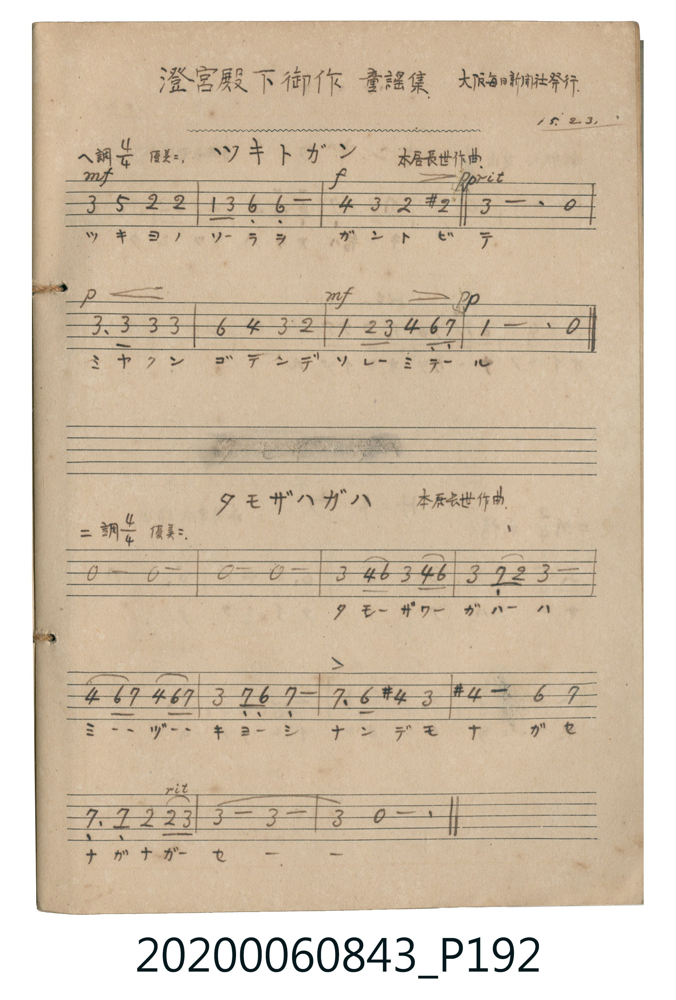

# ツキトガン (月與雁)

> Re:Shōka 使用 AI 協助辨識與重建樂譜，可能會有錯誤。歡迎[回報](https://github.com/TMDLang/reshoka/issues)。

- **鋼琴伴奏版**：<br><audio controls src="tsuki_to_gan.mp3"></audio>

- 詞：澄宮崇仁親王
- 曲：本居長世

## 說明

ツキトガン (月與雁)
Source: 唱歌帖 (2020.006.0843), P192.jpg (top)
Marginalia: 澄宮殿下御作 童謡集 大阪毎日新聞社發行 15.2.3.
Composer: 本居長世作曲 / Lyricist: 澄宮崇仁親王 (澄宮殿下御作)
Tempo / Expression: 優美ニ


## 歌詞

```text
1.
マンマルナ オツキサマ ヒガシノヤマカラ デマシタヨ

2.
おつきさまの なかのほら かりがさんば とんでゆく
```

## ABC

<div class="abc-score" data-abc-src="tsuki_to_gan.abc" aria-label="五線譜載入中"></div>

[下載 ABC 原始檔](tsuki_to_gan.abc)

## TMD 檔案連結

- [主旋律 TMD 檔案](tsuki_to_gan.tmd) [[在 TMD Studio 編輯](https://tmdlang.github.io/Tmd-TS/#tmd=s7IKdvYPcrWy4qpTUCpJTLdSSM7PyUlNLsnMz7MqzsjPTkzOyFeCS5bl55TmploBqXhDA4RwcX5pUXJqfEFieqpVgKGlUSK6FNyo-Lz8ktSk_PxshIqCovyy1LzEPKCq3MS80uLkosyCkvjk_IJKhJrUssyUVJCK1JTMkvyizMQcJDelFhWDXQtxRElRYh7EDKAgQlVJRirQ4Yl5mbnIeiGieYklpUWpCFGgBemZeVYliZlAZ8cDcXlifG5iZl5OYl4KsqqSjPz0osSCjEqrjMxikLOSE3PisxPzgN7X0lJ43NzyuGnt4-aOx01rHjdvVtB4NqfjRUf7y9mNmgpaWlyKtgoWJlz2tgpuIBNfrJz3fs-sZ_tanq5b93RL-5PdjS-WrXre1w227tnsTSDJOWuebmx9OXX7kx3TlLhsTPRN7Li49LW4FBTwWQWSDobEgcLTKRufre15umOagoaRgZGBnoGBmZ6BhYmxpo4CKNb0sgrSFTRK8gvAmnwTi4CBkJiTmWilAHHXs3X7n-zofrpv4ZO9cxSer176Ys3Cl7PbFJ4uWf5yxqpn6_ueTV_6bNqGF43zni_Z93zmnhcLexQMTfWM9Iz1QOY55-cW5BenFgFNQ_II0Cig7xT0FXwqgcEHDEWYZciBAPQPhgPAbgxJBZoJ1OxaUVCUWgxOBQpPW1Y939f3uLmbC6QCbGyxFYhpCHbG4-Z5wBACk6sfN3cpPG5aBQ29pq1AUaD8JFAgNm1_3Aw0ZAlIYRNQ4UqgRDuYs_1x0_7HzSvAphtBjGzsety45HFj7-PGqY8b9z1uXAcUWvW4sRvIety4-3FTJ5Df_bgJqKoHpKRp8uPGDUChFWDW8sdNbY8b-7m09Lm4fIGJzCogMzEv36HGoKYaZLiCjYWWHZhRo2CsoKtgCsRGUFyjYAgkQaJm8TCiRsEEKgZWpQ4WAnFh0AAkgmQgSDGIBuEaBTMgiWwAxAojIB8kCrTBPB4qhmpeLReXrh0wzWTmKQBpZS4A)]
- [鋼琴伴奏 TMD 檔案](tsuki_to_gan_piano.tmd) [[在 TMD Studio 編輯](https://tmdlang.github.io/Tmd-TS/#tmd=s7IKdvYPcrWy4qpTUCpJTLdSyC8qychPL0osyKi0ysgsLskvykxOzInPTsxLVIIrKs4vLUpOjS9ITE-1CjC0NELIlGSk5qZaJRaXFOXn5edWKnFpaSk8bm553LT2cXPH46Y1j5s3K2g8m9PxoqP95exGTYVHDVMUAjIT8_IVHJOT83MLEvMyc1PzShS0tLgUbRUsTLjsbRXcQKa_WDnv_Z5Zz_a1PF237umW9ie7G18sW_W8rxts9bPZm0CSc9Y83dj6cur2JzumKXHZmOib2HFx6WtxKSiQ4wSQtmCwP60Unk7Z-Gxtz9Md0xQ0jAyMDPQMDMz0DCxMjDV1FEDe18sqSFfQKMkv0ARp8k0sSs_MS8zJTLRSgLj32br9T3Z0P9238MneOQrPVy99sWbhy9ltCk-XLH85Y9Wz9X3Ppi99Nm3Di8Z5z5fsez5zz4uFPQqGpnpGesZ6IPOcgW7KL04tApqG5EGgUUBfK-gr-FQCYwgYUTDLkAMH6E8MB2hyaelzcfkmZuZZgX3tUGNQUw2yR8HGQssOzKhRMFbQVTAFYiMorlEwBJIgUbN4GFGjYAIVA6tSBwuBuDBoABJBMhCkGESDcI2CGZBENgBihRGQDxIF2mAeDxVDNa8W2fFBHlidb6gNMhVIaoM8YR6vDbIAStUomMZrg4yFKDKO1wb7BkYDHQZUpw1yA0gdWA1IBEpBfAmUAZoGDiQwCySLYCH7G24GyKNwDpwBcqqJNigoMG1FGAh3Mih04AphQQR0OVQaGwtLoPkgB5oJItDiQcgUjGA8oB1AVKNgBOYBSSACuQaKDOD-BMoCQxSsCpguwOoghkGlgHwYB0gDSZBWoKt07YD5JTNPAYlW5gIA)]

## 分析

```text
================================================================================
📊 TMD Song Profile: [ ツキトガン 月與雁 ]
================================================================================
⏱  Duration:       0:22 (22.9s), 8 measures total
🎼 Key & Tempo:    首調基準 F, != 84.0 BPM, <4/4>
   - 分析範圍：      由實際發聲的音符與和弦推測調性；播放脈絡另行呈現
🎤 人聲音域:    D4 (MIDI 62) – D5 (MIDI 74) [跨度: 12 個半音 / 1.0 個八度, 難度: easy]
   - 最低音:  D4 in [Main #1 @ m.2, 0:04]
   - 最高音: D5 in [Main #1 @ m.6, 0:14]
   - 適合: soprano, mezzo-soprano, contralto, tenor, baritone, bass
🏛  結構:      Main (22.9s)
⚡ 編曲密度:        Peak 1 軌道同時演奏
🗝  調性診斷：       D 調性不明確（純淨自然大調，未偵測到可信轉調）
   - 風格氣質:    純淨自然大調（陽光明朗、易唱易記，無明顯調外色彩）
   - 轉調歷程:    全曲維持單一推測調性（未偵測到可信轉調）
   - 核心骨幹音:  A, F, G, D, A#
   - 調性數值:    D 調性不明確 [相關度: 0.62, 穩定度: Ambiguous, 自然音純度: 96.7%]
   - 候選調性 (K-S): D 小調 (0.62), A 小調 (0.62), F 大調 (0.56)
   - 五度圈歷程:   +2
   - 各段落調性細節:
     • [Main #1]: D 調性不明確 (r: 0.62, 自然音純度: 96.7%, 調外音: G#)

  [ 五度圈游移軌跡 ]
               C  
         F            G  
      Bb              [D ]*
      Eb               A  
         Ab           E  
            Db       B  
               F# 
     (* = active key center)

  [ 十二半音累積音高分佈 ]
     C  : ██                         3.3%
     C# :                            0.0%
     D  : ███████                   11.7%
     D# :                            0.0%
     E  : █                          1.7%
     F  : ██████████                16.7%
     F# :                            0.0%
     G  : █████████                 15.0%
     G# : ██                         3.3%
     A  : ████████████████████████  38.3%
     A# : ██████                    10.0%
     B  :                            0.0%
--------------------------------------------------------------------------------
Assignment 軌道音域：
  - Piano         : D4 – D5 (12 個半音 / 1.0 個八度, 28 個音符)
================================================================================
```


## 原書掃描頁




