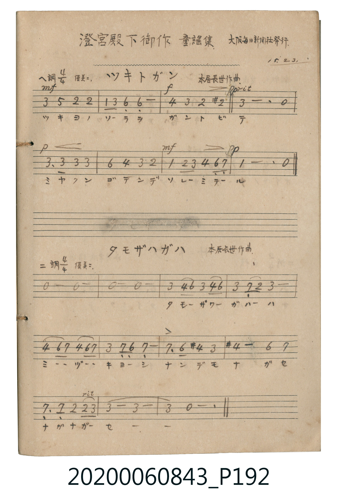

# ツキトガン (月與雁)

<audio controls src="tsuki_to_gan.mp3"></audio>

- 詞：澄宮崇仁親王
- 曲：本居長世

## 說明

ツキトガン (月與雁)
Source: 唱歌帖 (2020.006.0843), P192.jpg (top)
Marginalia: 澄宮殿下御作 童謡集 大阪毎日新聞社發行 15.2.3.
Composer: 本居長世作曲 / Lyricist: 澄宮崇仁親王 (澄宮殿下御作)
Tempo / Expression: 優美ニ

## 歌詞

```text
1.
マンマルナ オツキサマ ヒガシノヤマカラ デマシタヨ

2.
おつきさまの なかのほら かりがさんば とんでゆく
```

## ABC

```abc
X:1
T:ツキトガン 月與雁
C:曲：本居長世
M:4/4
L:1/16
Q:1/4=84
K:F
V:V1 name="Vocal" snm="Voc"
[V:V1]
A4 c4 G4 G4 | F4 A4 D4 D4 | B4 A4 G4 ^G4 | A12 z4 |
A6 A2 A4 A4 | d4 B4 A4 G4 | F4 G2 A2 B4 D2 _E2 | F12 z4 |
```

## TMD 檔案連結

- [主旋律 TMD 檔案](tsuki_to_gan.tmd) [[在 TMD Studio 編輯](https://tmdlang.github.io/Tmd-TS/#tmd=s7IKdvYPcrWy4tLSUnjc3PK4ae3j5o7HTWseN29W0Hg2p-NFR_vL2Y2aClpaXIq2ChYmXPa2Cm5cdQpKL1bOe79n1rN9LU_XrXu6pf3J7sYXy1Y97-tWAkk-m70JJDlnzdONrS-nbn-yY5oSl42JvokdF5e-FpeCAj6rQNLB-aVFyalWCk-nbHy2tufpjmkKGkYGRgZ6BgZmegYWJsaaOgoBhpZGelkF6QoaJfkFYE2-iUXpmXmJOZmJVgoQdz1bt__Jju6n-xY-2TtH4fnqpS_WLHw5u03h6ZLlL2esera-79n0pc-mbXjROO_5kn3PZ-55sbBHwdBUz0jPWA9knnN-bkF-cWoR0DQkjwCNAvpOQV_Bp7IoMzmzuARmGXIgAP2D4QCwG0NSgWYCNbtWFBSlFhdn5ucBPdmy6vm-vsfN3VwgFWBji61ATEOwMx43zwOGEJhc_bi5S-Fx0ypo6DVtBYoC5SeBArFp--NmoCFLQAqbgApXAiXawZztj5v2P25eATbdCGJkY9fjxiWPG3sfN0593LjvceM6oNCqx43dQNbjxt2PmzqB_O7HTUBVPSAlTZMfN24ACq0As5Y_bmp73NjPpaXPxeWbmJlnFZafnJjjUGNQo1ANMl3BxkLLDsyoUTBW0FUwBWIjKK5RMASSIFGzeBhRo2ACFQOrUgcLgbgwaAASQTIQpBhEg3CNghmQRDYAYoURkA8SBdpgrhMPFUQ1sJaLS9cOmGoy8xSAtDIXAA)]
- [鋼琴伴奏 TMD 檔案](tsuki_to_gan_piano.tmd) [[在 TMD Studio 編輯](https://tmdlang.github.io/Tmd-TS/#tmd=s7IKdvYPcrWy4tLSUnjc3PK4ae3j5o7HTWseN29W0Hg2p-NFR_vL2Y2aCo8apigEZCbm5Ss4Jifn5xYk5mXmpuaVKGhpcSnaKliYcNnbKrhx1SkovVg57_2eWc_2tTxdt-7plvYnuxtfLFv1vK9bCST5bPYmkOScNU83tr6cuv3JjmlKXDYm-iZ2XFz6WlwKCuQ4AaQtOL-0KDnVSuHplI3P1vY83TFNQcPIwMhAz8DATM_AwsRYU0chwNDSSC-rIF1BoyS_QBOkyTexKD0zLzEnM9FKAeLeZ-v2P9nR_XTfwid75yg8X730xZqFL2e3KTxdsvzljFXP1vc9m7702bQNLxrnPV-y7_nMPS8W9igYmuoZ6RnrgcxzBropvzi1CGgakgeBRgF9raCv4FNZlJmcWVwCsww5cID-xHCAJpeWPheXb2JmnlVYfnJijkONQY1CNcgiBRsLLTswo0bBWEFXwRSIjaC4RsEQSIJEzeJhRI2CCVQMrEodLATiwqABSATJQJBiEA3CNQpmQBLZAIgVRkA-SBRog7lOPFQQ1cBaqPPBkRbkgd0Dhtogc4GkNsgbQKO0QXbA6BoF03htkMkQZcbx2mAfwWig44DqtEHuAKkDqwGJQCmIT4EyIOPAIQVhguSRmMjehxsD8i-cA2eA3GuiDQoRTIuRTIQ7GxRKcJXwoAI6HyqPjYUl8HxwBR4oEMCEKdBgGIksbgYWgZA1CkZgGixhBCeAjkXSDCGRgwSsHAQRpgJTFFgZknkoVoMgRA5FGMIBM-Ge1LUDZsTMPAUgrcwFAA)]

## 分析

```text
================================================================================
📊 TMD Song Profile: [ ツキトガン 月與雁 ]
================================================================================
⏱  Duration:       0:22 (22.9s), 8 measures total
🎼 Key & Tempo:    首調基準 F, != 84.0 BPM, <4/4>
   - 分析範圍：      由實際發聲的音符與和弦推測調性；播放脈絡另行呈現
🎤 人聲音域:    D4 (MIDI 62) – D5 (MIDI 74) [跨度: 12 個半音 / 1.0 個八度, 難度: easy]
   - 最低音:  D4 in [Main #1 @ m.2, 0:04]
   - 最高音: D5 in [Main #1 @ m.6, 0:14]
   - 適合: soprano, mezzo-soprano, contralto, tenor, baritone, bass
🏛  結構:      Main (22.9s)
⚡ 編曲密度:        Peak 1 軌道同時演奏
🗝  調性診斷：       D 調性不明確（純淨自然大調，未偵測到可信轉調）
   - 風格氣質:    純淨自然大調（陽光明朗、易唱易記，無明顯調外色彩）
   - 轉調歷程:    全曲維持單一推測調性（未偵測到可信轉調）
   - 核心骨幹音:  A, F, G, D, A#
   - 調性數值:    D 調性不明確 [相關度: 0.61, 穩定度: Ambiguous, 自然音純度: 95.0%]
   - 候選調性 (K-S): D 小調 (0.61), A 小調 (0.59), F 大調 (0.55)
   - 五度圈歷程:   +2
   - 各段落調性細節:
     • [Main #1]: D 調性不明確 (r: 0.61, 自然音純度: 95.0%, 調外音: D#, G#)

  [ 五度圈游移軌跡 ]
               C  
         F            G  
      Bb              [D ]*
      Eb               A  
         Ab           E  
            Db       B  
               F# 
     (* = active key center)

  [ 十二半音累積音高分佈 ]
     C  : ██                         3.3%
     C# :                            0.0%
     D  : ███████                   11.7%
     D# : █                          1.7%
     E  :                            0.0%
     F  : ██████████                16.7%
     F# :                            0.0%
     G  : █████████                 15.0%
     G# : ██                         3.3%
     A  : ████████████████████████  38.3%
     A# : ██████                    10.0%
     B  :                            0.0%
--------------------------------------------------------------------------------
Assignment 軌道音域：
  - Vocal         : D4 – D5 (12 個半音 / 1.0 個八度, 28 個音符)
================================================================================
```


## 原書掃描頁




