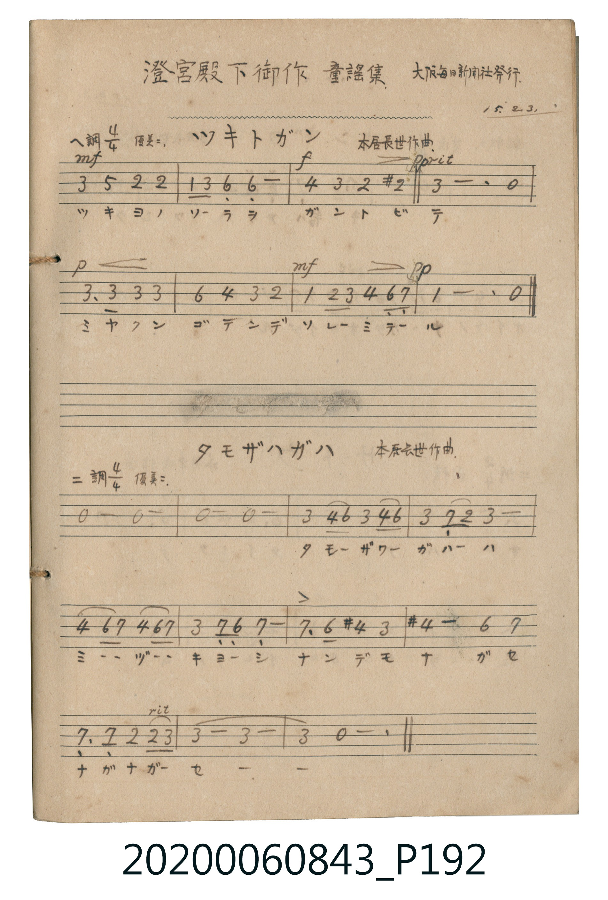

# タモザハガハ (田母澤川)

> Re:Shōka 使用 AI 協助辨識與重建樂譜，可能會有錯誤。歡迎回報。

- **鋼琴伴奏版**：<br><audio controls src="tamozawa_gawa.mp3"></audio>

- 詞：澄宮崇仁親王
- 曲：本居長世

## 說明

タモザハガハ (田母澤川)
Source: 唱歌帖 (2020.006.0843), P192.jpg (bottom)
Marginalia: 澄宮殿下御作 童謡集 大阪毎日新聞社發行 15.2.3.
Composer: 本居長世作曲 / Lyricist: 澄宮崇仁親王 (澄宮殿下御作)
Tempo / Expression: 優美ニ


## 歌詞

```text
1.
タモザハガハハ ザーザーザー アメノフルヨウニ ナガレテル
```

## ABC

<div class="abc-score" data-abc-src="tamozawa_gawa.abc" aria-label="五線譜載入中"></div>

[下載 ABC 原始檔](tamozawa_gawa.abc)

## TMD 檔案連結

- [主旋律 TMD 檔案](tamozawa_gawa.tmd) [[在 TMD Studio 編輯](https://tmdlang.github.io/Tmd-TS/#tmd=s7IKdvYPcrWy4qpTUCpJTLdSSM7PyUlNLsnMz7MqzsjPTkzOyFeCS5bl55TmploBqXhDA4RwcX5pUXJqfEFieqpVgKGlURK6FNyo-Lz8ktSk_PxshIqCovyy1LzEPKCq3MS80uLkosyCkvjk_IJKhJrUssyUVJCK1JTMkvyizMQcJDelFhWDXQtxRElRYh7EDKAgQlVJRirQ4XmJJaVFqeii5YklqUUIQaD56Zl5ViWJmUBXxwNxeWJ8bmJmXk5iXooSl5aWwuOm_Y-bFz1u2va4uf9x0xogqaDxfMqGZ-t7n-1b8nT7XE0FLS0uRVsFCxMue1sFF5DBL1bOe79n1rN9LU_XrXu6pf3J7sYXy1Y97-sG2_ps9iaQ5Jw1Tze2vpy6_cmOaUpcNib6JnZcXPpaXAoKhC0EKQqGhLTC0ykbn63tebpjmoKGkYGRgZ6BgZmegYWJsaaOAihu9LIK0hU0kvJLSvJzwfp8E4uA3k3MyUy0UoA48Nm6_U92dD_dt_DJ3jkKz1cvfbFm4cvZbQpPlyx_OWPVs_V9z6YvfTZtw4vGec-X7Hs-c8-LhT0KhqZ6RnrGeiDznPNzC_KLU4uApiH5CGgU0JsK-go-lUWZyZnFJTDLkENDQQPTAWA3hqQCzQRqdq0oKEotBke3wtOWVc_39T1u7uYCqQAbW2wFYhqCnYEZZqBgA_P3IJNAoUWPmxc-bgYaNfVx8-rHzSseNy0DGqvwuLkLrBGI2oASXFr6XFy-wHRgFZafnJjjUGNQUw2ySMHGQssOzKhRMFDQBUMYjU3EGEiaKJjBaYiIebyCEZgBVgQ1zgTINlMwh9NwpWbxIBJmIpQJFDRRB9IgNUC9ICZYGKQFyVCoarCFumBLIcaCINwBYBbMzRAn1XJx6doBU0tmngKQVuYCAA)]
- [鋼琴伴奏 TMD 檔案](tamozawa_gawa_piano.tmd) [[在 TMD Studio 編輯](https://tmdlang.github.io/Tmd-TS/#tmd=s7IKdvYPcrWy4tLSUnjctP9x86LHTdseN_c_bloDJBU0nk_Z8Gx977N9S55un6up8KhhikJAZmJevoJjcnJ-bkFiXmZual6JgpYWl6KtgoUJl72tggtXnYLSi5Xz3u-Z9Wxfy9N1655uaX-yu_HFslXP-7qVQJLPZm8CSc5Z83Rj68up25_smKbEZWOib2LHxaWvxaWgQL5DQJqD80uLklOtFJ5O2fhsbc_THdMUNIwMjAz0DAzM9AwsTIw1dRQCDC2N9LIK0hU0kvJLSvJzNUH6fBOL0jPzEnMyE60UIA5_tm7_kx3dT_ctfLJ3jsLz1UtfrFn4cnabwtMly1_OWPVsfd-z6UufTdvwonHe8yX7ns_c82Jhj4KhqZ6RnrEeyDxnoLPyi1OLgKYh-RRoFND7CvoKPpVFmcmZxSUwy5BDSUED0wGaXFr6XFy-iZl5VmH5yYk5DjUGNdUgexRsLLTswIwaBQMFXTCE0dhEjIGkiYIZnIaImMcrGIEZYEVQ40yAbDMFczgNV2oWDyJhJkKZQEETdSANUgPUC2KChUFakAyFqgZbqAu2FGIsCMIdAGbB3AxxUi3U9-BoD_LA6n-IuwyBuhEs3KLahtqwQEDhIMmBXWmuEw_mIAcNUIWRNixcUDiouoE2mgK1A42Aew2ZD5SGaAaFFlwfzHhYEAJFtUHBCBLSRg5LZKOAlpmCedqIcIWbCPE4GhdJHk9Q-yAHtQkiqMHWQkhsPCOgdRAKwjcGYqg81ASgFNCdyPpBasCRj2IaWAnYCKBZUL0QFTD1mLZD_AP2ia4dMGtn5ikAaWUuAA)]

## 分析

```text
================================================================================
📊 TMD Song Profile: [ タモザハガハ 田母澤川 ]
================================================================================
⏱  Duration:       0:31 (31.4s), 11 measures total
🎼 Key & Tempo:    首調基準 D, != 84.0 BPM, <4/4>
   - 分析範圍：      由實際發聲的音符與和弦推測調性；播放脈絡另行呈現
🎤 人聲音域:    B3 (MIDI 59) – C#5 (MIDI 73) [跨度: 14 個半音 / 1.2 個八度, 難度: moderate]
   - 最低音:  B3 in [Main #1 @ m.6, 0:15]
   - 最高音: C#5 in [Main #1 @ m.5, 0:12]
   - 適合: soprano, mezzo-soprano, contralto, tenor, baritone, bass
🏛  結構:      Main (31.4s)
⚡ 編曲密度:        Peak 1 軌道同時演奏
🗝  調性診斷：       F# 大調（流行色彩大調，未偵測到可信轉調）
   - 風格氣質:    流行大調（略帶和弦色彩音與裝飾副屬和弦）
   - 轉調歷程:    全曲維持單一推測調性（未偵測到可信轉調）
   - 核心骨幹音:  F#, C#, B, G, G#
   - 調性數值:    F# 大調 [相關度: 0.80, 穩定度: Moderate, 自然音純度: 84.8%]
   - 候選調性 (K-S): F# 大調 (0.80), F# 小調 (0.69), B 大調 (0.54)
   - 五度圈歷程:   +6
   - 各段落調性細節:
     • [Main #1]: F# 大調 (r: 0.80, 自然音純度: 84.8%, 調外音: E, G)

  [ 五度圈游移軌跡 ]
               C  
         F            G  
      Bb               D  
      Eb               A  
         Ab           E  
            Db       B  
              [F#]*
     (* = active key center)

  [ 十二半音累積音高分佈 ]
     C  :                            0.0%
     C# : ████████████████          25.8%
     D  :                            0.0%
     D# :                            0.0%
     E  : ████                       6.1%
     F  :                            0.0%
     F# : ████████████████████████  37.9%
     G  : ██████                     9.1%
     G# : ██████                     9.1%
     A  :                            0.0%
     A# :                            0.0%
     B  : ████████                  12.1%
--------------------------------------------------------------------------------
Assignment 軌道音域：
  - Vocal         : B3 – C#5 (14 個半音 / 1.2 個八度, 35 個音符)
================================================================================
```


## 原書掃描頁




