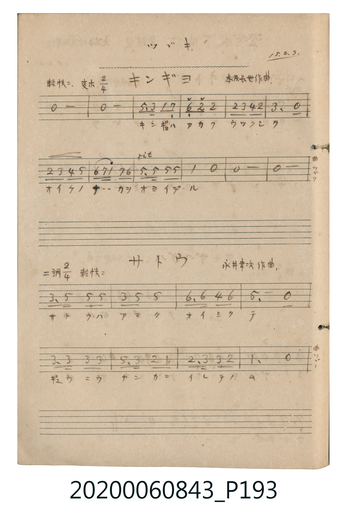

# キンギヨ（金魚）

> Re:Shōka 使用 AI 協助辨識與重建樂譜，可能會有錯誤。歡迎回報。

- **鋼琴伴奏版**：<br><audio controls src="kingyo.mp3"></audio>

- 詞：澄宮崇仁親王（澄宮殿下御作 童謡集・大阪毎日新聞社発行）
- 曲：本居長世
- 《唱歌帖》第十冊（2020.006.0843）P193.jpg 上半（大正 15. 2. 3. 抄）

## 說明


- 出處：《唱歌帖》第十冊（2020.006.0843）P193.jpg 上半（大正 15. 2. 3. 抄）
- 調性與拍號：調號 ?= E,，拍號 <2/4>，速度 != 108


## 歌詞

```text
> [!NOTE]
> **原頁資訊與歌詞全文**（對應 `P193.jpg` 上半頁，承接前頁 `P192.jpg` 總題）：
> - **出處與抄寫日期**：頁頂記「`ツヅキ.`」、右上角記「`15. 2. 3.`」（大正 15 年 2 月 3 日抄），承接前頁 `P192.jpg` 頁頂總題「`澄宮殿下御作 童謡集 大阪毎日新聞社発行.`」；曲名記「`キンギヨ`」（大字「`ヨ`」），右記「`本居長世作曲.`」，左記「`軽快ニ. 変ホ 2/4`」（降 E 大調，`?= E,`，`<2/4>`）。
> - **前後空拍與「曲ツヅク」標註**：原抄本第 1–2 小節為鋼琴前奏空拍 `| 0 — | 0 — |`，歌唱自第 3 小節進入至第 10 小節止，第 11–12 小節復記空拍 `| 0 — | 0 — ||` 並於右欄外註「`曲ツヅク`」（表示原譜尚有間奏或後續器樂／段落延伸）。第 4 小節 `6_ 2` 上方附斷奏楔形記號 `ˇ ˇ`，第 7 小節上方附漸強記號 `<`，第 9 小節上方標 `rit`。
> - **校訂與手抄原貌說明**：
>   1. **歌詞正本清源**：舊轉錄註解曾誤植與原頁無關之「キンギョガ ニゲタ…」偽詞，今依 `P193.jpg` 譜下親筆片假名歌詞完整錄入（「`キンギョハ アカク ウツクシク / オイケノ ナーカニ オヨイデ ル`」；第 8 小節首字「`ナ`」有重描修正痕跡）。
>   2. **第 8 小節與第 10 小節音高與節奏修正**：第 8 小節原譜明確記作雙底線十六分音符 `6 7` 圓滑連結單底線八分音符 `1^`，後接兩個八分音符 `7 6`（即 `<16*>` 之 `| 6 7 1^ - 7 - 6 - |`）；第 10 小節為四分音符加四分休止符 `| 1 - - - 0 - - - |`（原譜 `1` 無高音點，自第 9 小節 `5` 下行五度收於中音主音 `E♭4` 自然溫潤；若作高音 `1^` = `E♭5` 則為上行四度終止，此處從原譜記號作 `1`）。
>
> キンギョハ　アカク　ウツクシク
> オイケノ　ナーカニ　オヨイデ　ル
> （曲ツヅク）
```

## ABC

<div class="abc-score" data-abc-src="kingyo.abc" aria-label="五線譜載入中"></div>

[下載 ABC 原始檔](kingyo.abc)

## TMD 檔案連結

- [主旋律 TMD 檔案](kingyo.tmd) [[在 TMD Studio 編輯](https://tmdlang.github.io/Tmd-TS/#tmd=s7IKdvYPcrWy4qpTUCpJTLdSSM7PyUlNLsnMz7MqzsjPTkzOyFeCS5bl55TmploBqXhDA4RwcX5pUXJqfEFieqpVgKGlcSK6FNyo-Lz8ktSk_PxshIqCovyy1LzEPKCq3MS80uLkosyCkvjk_IJKhJrUssyUVJCK4uTEvPiy1KLMtMzUFCR3pRYVg10McUhJUWIexBygIEJVflFJRn56UWJBRqVVRmZxSX5RZnJiTnx2Yh6Sg0syUoE-TMzLzE3MQdaamZ6ZZ1WSmAn0STwQlyfG5yZm5uUk5gGdoaWl8Lhp7ePmzY-b1j1uXvF-T8fL9okv1856v6dTQUuLS9FWwdDAgsveVsFVh8vGSN_EDmTui5Xz3u-Z9Wxfy9N1655uaX-yu_HFslXP-7qBuiGCz9btf7Kj--m-hU_2zlF4vnrpizULX85ue9y8--mS5S9nrHq2vu_Z9KXPpm140Tjv-ZJ9z2fuerGwB2gj2NHPZm8CGT5nzdONrS-nbn-yYxpY-HFD19MpG5-t7Xm6Y9rjhu7na9Y87W182tYFtNPIwMhAz8DATM_AwsQYaAwoHvWyCtIVnuzoetoLUgG09tnaxQqGpnoKRnoKxnoKz7pawPZx6Wsp2FILcCkoKNgpRCv6-Ye4xkI4WlpP--a_XND4YnP7ixVdLzragR4Aht7T1hXPprVraYGctqH3WXunQgLM0QlQVwM1vd_T86xz_7O-pU87e4FcsBojiJrnO_a-BAcZMKggNumC7Grf9WLmVJAtXS1P168GhfGc-SBbZgG1v1zQ9GLFjMcNPQmPm1seN7cCo10v4XFD7-OGxqf9m4GWvlg-CaoAHk4geeTgU3i6c4uCkcKzOR0Kxgog48HBiMedEHshrgWZjC95KOBJHFCXzAYmjqcTemH-QEq4CJc-XTsd4kmoGMh5QA9C9SCnK6DtQPOgRvc83b4MqubF7r1P969-3NytB3RS5-Pm2QrAhA-14OXMXgVXkEtfrNoP1JQAzhkJIBY4dwBZnY8bmpCipLP36b6e5yt3PevuBUYM0HiglbAIWA8089mKmS9W7AZHEjCpAAMU6EJg4lYwfNQw2Ujh6Yb-5-sbnjftetm95_mELSDTlvZDTFNIqFEwUHjUMEUBToPcAcohUza-aF8FMsQYasDLhk1PW5e-aN8MNtkAKvps7SKgBrAQyDZDmHVP960EhgROW2pASXTZs2l7gKH6bE3L0yXTgB4Ahy2Sz6DB9WLhiudLdgE99mLtnKcbgLm68-W0yUAvPOuYBgqWXT1PZ654tqLp_Z7-Z-u2vpiw9-nubU_27IAEIshhJlAnKSSYxSsYgfPGs2k7X85seTZtO8iYpVOe7l0EdOyLmfMVEk63K5xuB4UBSKc5VCdCx54dT_dsh6m1gamzRFEHjA2FhKLMEqDzkSLx2YKFL1Y0gfJVZzcoawG9s6nnxapVz2b0gSMOolJBwVAPpBicw4H5BRiRz3a0Pts1AazmRUfXi72dL3tagIH1YvniZ7P3vVi15NkSUKKAFBHPWxa-nD7nyc5uYFAipezlj5vWKADT4uOmTY-b9j9qWAYM2KeNe8FFcM-T3V1P9s1FLjyA4QzMWqDieG3b8872p43twPwCLXTW9TybugXoAmBSAEYNWg5a_ri5H1gVLHrctBoYfUDWMlBcApNo03YQXx8osupx05LHTRsfN_cBHdT1uHkPSG1zN1imeQVIsrkdKLMamldBoWsBS4DLpsHzZRdIHpQS2nuf9fc_2b8OGFbPp099sX0hcuZRAJVAWlrIhgCDCiX9vpy_-eXqGSBRYJpdCjUJHNjIuiCJDxhVzxftAsY-MNO_nD3z6a6pz7fPAtUgrWufdrQBTXq-ZhkwkSmYJyg8nTP52e6JLxsWP9864em0dVClrauR1BnGgZIPMAWDCr3WlU8bulHlzRXMgAo6nvZuBqY0QzMtO2DK3dkNyktAGxQM44CpyhyIzYAYlGmBRRQ4tOA-A2b4p7Nnww182rUAwn2yZyIw04KtqFEwBOoGQQMoDTKpA-JboAuBdQQwQa2eAQqk3aC0Ai0SYOldIcEUlJ26gYXrk11Tnu5a9mzKNmCefrJjLVDHkx27gaRCguujmWtNgIkKqLVl27Ndq5_tXQJ06ovupaBQBJsNDgsFW4hSoIlPO9uBjgfVJgt7QG7etez51iZIQfNs7RJg7fR03zyIGyE5EVQDAB2LFPOQ6EdLmY8bGuBpE8xGSZ0wLYgEClKDlETBWhCJFCy7GqIL1GZBKreADgGJU94YgAIFLX0uLu_MvPTKfKuAzMS8fIcag5pqkBUK4IQBZoGKVkgcwiA2EVMwbQyOd_N4sBCwUNQF1scQDFYFNs-HOAOBYQxmAQMayAaFNJjTD5VcBOI1rQaT6-HmQx0MstAYiE2glteAeTAIsgtVDcjx2FI_zL3AGAVb3gK3Dhi1UIfALEeYDIxMsIolYHIjWGcfRKa5C6oS6nRg-YTkbEgYmoJpiJMwchExQYdwNcgdIFtWwFwDLAIh7gDZTrrBtVxcunYKkASjAGQpcwEA)]
- [鋼琴伴奏 TMD 檔案](kingyo_piano.tmd) [[在 TMD Studio 編輯](https://tmdlang.github.io/Tmd-TS/#tmd=s7IKdvYPcrWy4qpTUCpJTLdSSM7PyUlNLsnMz7MqzsjPTkzOyFeCS5bl55TmploBqXhDA4RwcX5pUXJqfEFieqpVgKGlcSK6FNyo-Lz8ktSk_PxshIqCovyy1LzEPKCq3MS80uLkosyCkvjk_IJKhJrUssyUVJCK4uTEvPiy1KLMtMzUFCR3pRYVg10McUhJUWIexBygIEJVflFJRn56UWJBRqVVRmZxSX5RZnJiTnx2Yh6SgxOLgJrTU3NT80qsCjIT8_LjE5OT83MLEvMyQWIIhSUZQEVWIOHEHGQ7MtMz86xKEjOBXo4H4vLE-NzEzLycxDyge7W0FB43rX3cvPlx07rHzSve7-l42T7x5dpZ7_d0KmhpcSnaKhgaWHDZ2yq46nDZGOmb2IHMfbFy3vs9s57ta3m6bt3TLe1Pdje-WLbqeV83UDdE8Nm6_U92dD_dt_DJ3jkKz1cvfbFm4cvZbY-bdz9dsvzljFXP1vc9m7702bQNLxrnPV-y7_nMXS8W9gBtBDv62exNIMPnrHm6sfXl1O1PdkwDCz9u6Ho6ZeOztT1Pd0x73ND9fM2ap72NT9u6gHYaGRgZ6BkYmOkZWJgYA40BRbheVkG6wpMdXU97QSqA1j5bu1jB0FRPwUhPwVhP4VlXC9g-Lu_MvPTKfKsAULg61BjUVHMpAIGNoZmWHZhVo2CgoIsCsYmYgmljBUMgaR4PFjIDUUZQDFYFNs-HOAOBcQJmASMGyAbGzHIwpx8quQjEa1oNJtfDzYc6GGShMRCbQC2vAfNgEGQXqhqQ44HuVTBXMIwDuR-IzZDd-7hpGdjyFrh1j5u2Qx0Csxxh8uOmVWAVS8DkRrDOPohMcxdUJdTpzd3IzoaEoSmYhjgJFJowg3EFFIYIwtUgd4BsWQFzTXM71B0g20k3uBY1tQR5YE8v1bkFtQqG2sbaIE8AaSBpHq9tBOaCGBCvwcVBvo3XBnkVEn4wnaD4gUoAKWiiMonXBqcrM4hGKIXwdw3MSLj5oAiG2woyDywBDmkYB2IvNo2GYJcArdUGpQ5jbXD6MNIGpRCQEKqtUFebovoWaoJxvDbUM6jhDvMtXCmGAJqr4VrRo8MHOTos4LFhGA_UD8FG8Qg-kDJA4YEoUPiCOUZAygwkAEuaCDUQdaimIEkDKZApMC7IPGRDgE4g0iVABjRmQB7VtVOA-FUByFLmAgA)]

## 分析

```text
================================================================================
📊 TMD Song Profile: [ キンギヨ（金魚） ]
================================================================================
⏱  Duration:       0:13 (13.3s), 12 measures total
🎼 Key & Tempo:    首調基準 E,, != 108.0 BPM, <2/4>
   - 分析範圍：      由實際發聲的音符與和弦推測調性；播放脈絡另行呈現
🎤 人聲音域:    C4 (MIDI 60) – D#5 (MIDI 75) [跨度: 15 個半音 / 1.2 個八度, 難度: moderate]
   - 最低音:  C4 in [Kingyo #1 @ m.4, 0:03]
   - 最高音: D#5 in [Kingyo #1 @ m.8, 0:08]
   - 適合: soprano, mezzo-soprano, contralto, tenor, baritone, bass
🏛  結構:      Kingyo (13.3s)
⚡ 編曲密度:        Peak 1 軌道同時演奏
🗝  調性診斷：       A# 大調（流行色彩大調，未偵測到可信轉調）
   - 風格氣質:    流行大調（略帶和弦色彩音與裝飾副屬和弦）
   - 轉調歷程:    全曲維持單一推測調性（未偵測到可信轉調）
   - 核心骨幹音:  A#, F, G, D#, C
   - 調性數值:    A# 大調 [相關度: 0.87, 穩定度: High, 自然音純度: 93.1%]
   - 候選調性 (K-S): A# 大調 (0.87), D# 大調 (0.75), G 小調 (0.72)
   - 五度圈歷程:   -2
   - 各段落調性細節:
     • [Kingyo #1]: A# 大調 (r: 0.87, 自然音純度: 93.1%, 調外音: G#)

  [ 五度圈游移軌跡 ]
               C  
         F            G  
     [Bb]*              D  
      Eb               A  
         Ab           E  
            Db       B  
               F# 
     (* = active key center)

  [ 十二半音累積音高分佈 ]
     C  : █████████                  8.6%
     C# :                            0.0%
     D  : █████████                  8.6%
     D# : ███████████████           13.8%
     E  :                            0.0%
     F  : ██████████████████████    20.7%
     F# :                            0.0%
     G  : ████████████████████      19.0%
     G# : ███████                    6.9%
     A  :                            0.0%
     A# : ████████████████████████  22.4%
     B  :                            0.0%
--------------------------------------------------------------------------------
Assignment 軌道音域：
  - Piano         : C4 – D#5 (15 個半音 / 1.2 個八度, 26 個音符)
================================================================================
```


## 原書掃描頁




