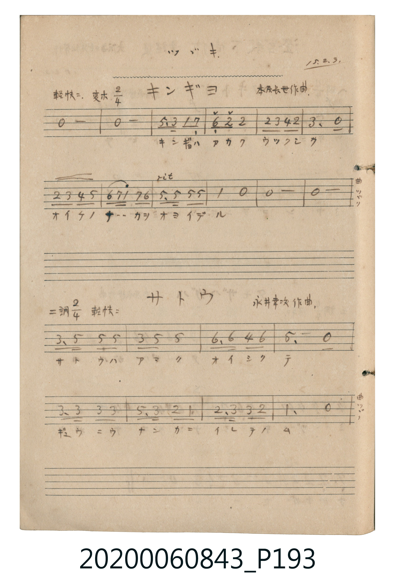

# キンギョ (金魚)

> Re:Shōka 使用 AI 協助辨識與重建樂譜，可能會有錯誤。歡迎回報。

- **鋼琴伴奏版**：<br><audio controls src="kingyo.mp3"></audio>

- 詞曲作者：未在 TMD metadata 中提供

## 說明

キンギョ (金魚)
Source: 唱歌帖 (2020.006.0843), P193.jpg (top)
Marginalia: ツヅキ. 15.2.3. (澄宮殿下御作 童謡集)
Composer: 本居長世作曲 / Lyricist: 澄宮崇仁親王 (澄宮殿下御作)
Tempo / Expression: 軽快ニ.


## 歌詞

```text
1.
キンギョガ ニゲタ ハスノハノ カゲヘ ニゲタ トラヘヨウ
```

## ABC

<div class="abc-score" data-abc-src="kingyo.abc" aria-label="五線譜載入中"></div>

[下載 ABC 原始檔](kingyo.abc)

## TMD 檔案連結

- [主旋律 TMD 檔案](kingyo.tmd) [[在 TMD Studio 編輯](https://tmdlang.github.io/Tmd-TS/#tmd=s7IKdvYPcrWy4qpTUCpJTLdSSM7PyUlNLsnMz7MqzsjPTkzOyFeCS5bl55TmploBqXhDA4RwcX5pUXJqfEFieqpVgKGlcSK6FNyo-Lz8ktSk_PxshIqCovyy1LzEPKCq3MS80uLkosyCkvjk_IJKhJrUssyUVJCK1JTMkvyizMQcJDelFhWDXQtxRElRYh7EDKAgQlVJRirQ4Yl5mbnIeoFGpWfmWZUkZgIdGA_E5YnxuYmZeTmJeSlKXFpaCo-b1j5u3vy4ad3j5uUKGi_bJ75cO0tTQUuLS9FWwdDAgsveVsFVh8vGSN_EjotLX4tLQQG7FpBEMCQoFJ5O2fhsbc_THdMUNIwMjAz0DAzM9AwsTIw1dRRAgaeXVZCuoFGSXwDW5JtYBHRhYk5mopXC4-aWx82tQPP1FAxN9Yz0jPUUNJ7ta3m6bt2zdfuf7Oh-um_hk71zFJ6vXvpizcKXs9vABjjn5xbkF6cWWSk8m7Pm6cbWl1O3P9kxDaju2exNCvoKPpVFmcmZxSVAabBJT7e0P9nd-GLZqud93dhMB5sZkgo0E6jZtaKgKLUYHPoKL3bvfbp_9ePmbj0ukBKwucVWIKahHnqwPG5aA_RM9-OmTY-b9gNZ_Y-bdj5u7gMxmvuAKleDZJpnoKjpeNy8Eij2uHnF46ZlXFr6XFy-wIiyCstPTsxxqDGoqQZZomBjaKZlB2bVKBgo6KJAbCKmYNpYwRBImseDhcxAlBEUg1VBzQPxjYHYBCpXA-bBIMhsVDUgs4HGgUwGYsM4MMMMbhzEalMwDVEKVoLsRqL8wFXLxaVrB0womXkKQFqZCwA)]
- [鋼琴伴奏 TMD 檔案](kingyo_piano.tmd) [[在 TMD Studio 編輯](https://tmdlang.github.io/Tmd-TS/#tmd=s7IKdvYPcrWy4tLSUnjctPZx8-bHTeseNy9X0HjZPvHl2lmaCo8apigEZCbm5Ss4Jifn5xYk5mXmpuaVKGhpcSnaKhgaWHDZ2yq46nDVKSi9WDnv_Z5Zz_a1PF237umW9ie7G18sW_W8r1sJJPls9iaQ5Jw1Tze2vpy6_cmOaUpcNkb6JnZcXPpaXAoKpFkP0hCcX1qUnGql8HTKxmdre57umKagYWRgZKBnYGCmZ2BhYqypoxBgaGmsl1WQrqBRkl-gCdLkm1iUnpmXmJOZaKXwuLnlcXMr0F49BUNTPSM9Yz0FDYjrn63b_2RH99N9C5_snaPwfPXSF2sWvpzdBjbAGeiI_OLUIisFZL8A1QE9qKCv4FNZlJmcWVwClMYIB2yma3Jp6XNx-SZm5lmF5Scn5jjUGNRUg-xRsDE007IDs2oUDBR0USA2EVMwbaxgCCTN48FCZiDKCIrBqqDmgfjGQGwClasB82AQZDaqGpDZQONAJgOxYRyYYQY3DmK1KZiGKAUrQXYjUX7gqoUGBTjGgzywB4ahtrE2yBYgDXKHTry2EZgPZkFsR8iAXBSvDQoTiK9gmkF-g0oAKaBSsKwJUAs40MwgWqEUctDBTEW2HRRECNtBxoIlMRkQN-AyAuY2kCtNtEGhDfSYNijEjbUxwhzhb1CYo4UC1BigcRCNqDEBswehFFMEyRsomlGjyAc5iiwQMQQKQlNomAI5ICaQMoBJAQljoBA4vBWMoBgRxBCd2PVDmVAKYgKUA2LiNALiCWTTQBSyFMhnunbAAiIzTwFIK3MBAA)]

## 分析

```text
================================================================================
📊 TMD Song Profile: [ キンギョ 金魚 ]
================================================================================
⏱  Duration:       0:13 (13.3s), 12 measures total
🎼 Key & Tempo:    首調基準 E,, != 108.0 BPM, <2/4>
   - 分析範圍：      由實際發聲的音符與和弦推測調性；播放脈絡另行呈現
🎤 人聲音域:    C4 (MIDI 60) – D#5 (MIDI 75) [跨度: 15 個半音 / 1.2 個八度, 難度: moderate]
   - 最低音:  C4 in [Main #1 @ m.4, 0:03]
   - 最高音: D#5 in [Main #1 @ m.8, 0:08]
   - 適合: soprano, mezzo-soprano, contralto, tenor, baritone, bass
🏛  結構:      Main (13.3s)
⚡ 編曲密度:        Peak 1 軌道同時演奏
🗝  調性診斷：       A# 大調（流行色彩大調，未偵測到可信轉調）
   - 風格氣質:    流行大調（略帶和弦色彩音與裝飾副屬和弦）
   - 轉調歷程:    全曲維持單一推測調性（未偵測到可信轉調）
   - 核心骨幹音:  A#, F, G, D#, C
   - 調性數值:    A# 大調 [相關度: 0.87, 穩定度: High, 自然音純度: 92.9%]
   - 候選調性 (K-S): A# 大調 (0.87), G 小調 (0.72), D# 大調 (0.68)
   - 五度圈歷程:   -2
   - 各段落調性細節:
     • [Main #1]: A# 大調 (r: 0.87, 自然音純度: 92.9%, 調外音: G#)

  [ 五度圈游移軌跡 ]
               C  
         F            G  
     [Bb]*              D  
      Eb               A  
         Ab           E  
            Db       B  
               F# 
     (* = active key center)

  [ 十二半音累積音高分佈 ]
     C  : █████████                  8.9%
     C# :                            0.0%
     D  : █████████                  8.9%
     D# : ███████████               10.7%
     E  :                            0.0%
     F  : ██████████████████████    21.4%
     F# :                            0.0%
     G  : ████████████████████      19.6%
     G# : ███████                    7.1%
     A  :                            0.0%
     A# : ████████████████████████  23.2%
     B  :                            0.0%
--------------------------------------------------------------------------------
Assignment 軌道音域：
  - Vocal         : C4 – D#5 (15 個半音 / 1.2 個八度, 26 個音符)
================================================================================
```


## 原書掃描頁




