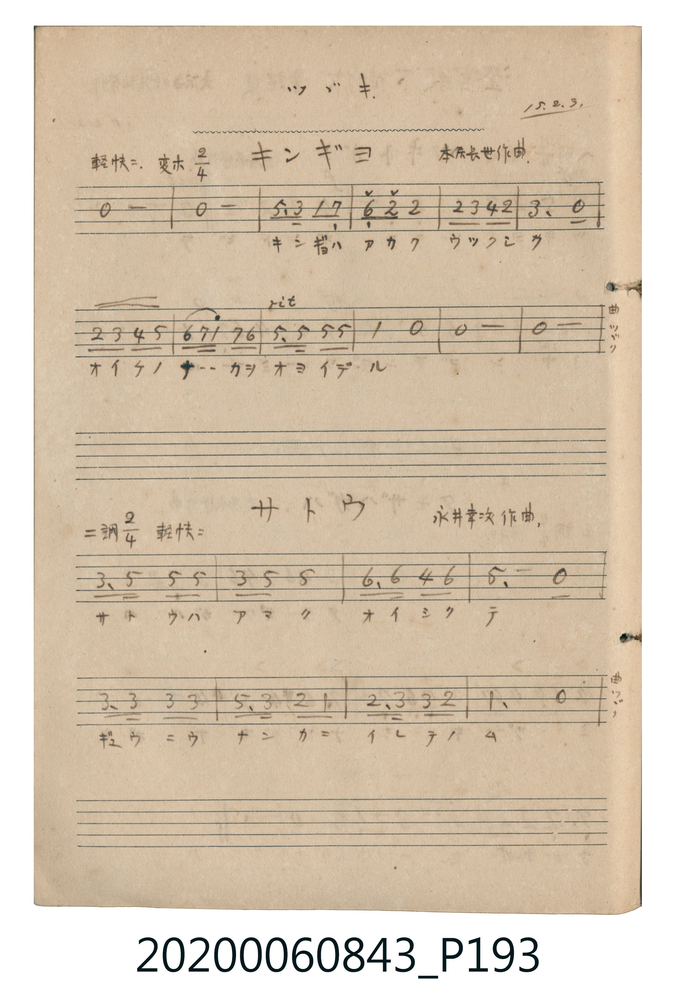

# サトウ (砂糖)

> Re:Shōka 使用 AI 協助辨識與重建樂譜，可能會有錯誤。歡迎回報。

- **鋼琴伴奏版**：<br><audio controls src="satou.mp3"></audio>

- 詞：澄宮崇仁親王
- 曲：永井幸次

## 說明

サトウ (砂糖)
Source: 唱歌帖 (2020.006.0843), P193.jpg (bottom)
Marginalia: ツヅキ. 15.2.3. (澄宮殿下御作 童謡集)
Composer: 永井幸次作曲 / Lyricist: 澄宮崇仁親王 (澄宮殿下御作)
Tempo / Expression: 軽快ニ


## 歌詞

```text
1.
シロイサトウハ アマイナ ユキモサトウナラ ヨイニナ
```

## ABC

<div class="abc-score" data-abc-src="satou.abc" aria-label="五線譜載入中"></div>

[下載 ABC 原始檔](satou.abc)

## TMD 檔案連結

- [主旋律 TMD 檔案](satou.tmd) [[在 TMD Studio 編輯](https://tmdlang.github.io/Tmd-TS/#tmd=s7IKdvYPcrWy4qpTUCpJTLdSSM7PyUlNLsnMz7MqzsjPTkzOyFeCS5bl55TmploBqXhDA4RwcX5pUXJqfEFieqpVgKGlcRK6FNyo-Lz8ktSk_PxshIqCovyy1LzEPKCq3MS80uLkosyCkvjk_IJKhJrUssyUVJCK1JTMkvyizMQcJDelFhWDXQtxRElRYh7EDKAgQlVJRirQ4eX5RUg2Aw1Kz8yzKknMBDovHojLE-NzEzPzchLzUpBVlWTkpxclFmRUWmVkFoOsT07Mic9OzEtU4tLSUnjctPVxc8fjpmUKGs8XND3fPE1TQUuLS9FWwdDAgsveVsEFZNKLlfPe75n1bF_L03Xrnm5pf7K78cWyVc_7usHWPJu9CSS5YceTXVOf7tzxbM1CJS4bI30TOy4ufS0uBQUsVoBEgyFBq_B0ysZna3ue7pimoGFkYGSgZ2BgpmdgYWKsqaMAigy9rIJ0BY2k_JKS_FywPt_EIqC3E3MyE60UHje3PG5ufdy0Vk_B0FTPSM9YT0ED4spn6_Y_2dH9dN_CJ3vnKDxfvfTFmoUvZ7eBDXDOzy3IL04tslJAdjNQHdAjCvoKPpXAEAIGFFAaw7_YTAebGZIKNBOo2bWioCi1GByhCi927326f_Xj5m4ukAqwscVWIKahHiRUtj9uXvu4aQk8eB439wNFFz1ungcSbe4Cem8Z0G-PmxchKel63LwSKLECrKQbyOfS0ufi8gXGu1VAZmJevkONQU01yHwFG0MzLTswq0bBWEEXCE2BEETqQkVgPBCsUTAD02YKJmASJAKTM4CpQTHNGEyDMEylsYIRkDQEi4BYMDUgdg1YHNW0Wi4uXTtghGbmKQBpZS4A)]
- [鋼琴伴奏 TMD 檔案](satou_piano.tmd) [[在 TMD Studio 編輯](https://tmdlang.github.io/Tmd-TS/#tmd=s7IKdvYPcrWy4qpTUCpJTLdSyC8qychPL0osyKi0ysgsLskvykxOzInPTsxLVIIrKs4vLUpOjS9ITE-1CjC0NEbIlGSk5qZapaaUJieWZObnKXFpaSk8btr6uLnjcdMyBY3nC5qeb56mqfCoYYpCQGZiXr6CY3Jyfm5BYl5mbmpeiYKWFpeirYKhgQWXva2CC8jUFyvnvd8z69m-lqfr1j3d0v5kd-OLZaue93WDrXw2exNIcsOOJ7umPt2549mahUpcNkb6JnZcXPpaXAoKJFgNUh0M9paVwtMpG5-t7Xm6Y5qChpGBkYGegYGZnoGFibGmjgLIt3pZBekKGkn5JSX5uZogfb6JRemZeYk5mYlWCo-bWx43tz5uWqunYGiqZ6RnrKegAXH9s3X7n-zofrpv4ZO9cxSer176Ys3Cl7PbwAY4A92RX5xaZKWA7BegOqAHFfQVfCqBkQCMC6A0RjhgM12TS0ufi8s3MTPPCuxThxqDmmqQPQo2hmZadmBWjYKxgi4QmgIhiNSFisB4IFijYAamzRRMwCRIBCZnAFODYpoxmAZhmEpjBSMgaQgWAbFgakDsGrA4qmm1yA4P8sDudNN4bUNtmPuBLG2QXTAaSRpdCuIpQ20TbZjHzEBKQb6DCYKkUTWh-xTJcmMEB85AGACSB5oP8ilIFuY0c4gQum6oMDAk47WhyhEsHOHjgxw-FvDgMYwHOR9EoLJNQBSYAIubxoPNhfkLQ5dRPIgGuRnsQgxtQKfo2gETf2aeApBW5gIA)]

## 分析

```text
================================================================================
📊 TMD Song Profile: [ サトウ 砂糖 ]
================================================================================
⏱  Duration:       0:08 (8.9s), 8 measures total
🎼 Key & Tempo:    首調基準 D, != 108.0 BPM, <2/4>
   - 分析範圍：      由實際發聲的音符與和弦推測調性；播放脈絡另行呈現
🎤 人聲音域:    D4 (MIDI 62) – B4 (MIDI 71) [跨度: 9 個半音 / 0.8 個八度, 難度: easy]
   - 最低音:  D4 in [Main #1 @ m.6, 0:06]
   - 最高音: B4 in [Main #1 @ m.3, 0:02]
   - 適合: soprano, mezzo-soprano, contralto, tenor, baritone, bass
🏛  結構:      Main (8.9s)
⚡ 編曲密度:        Peak 1 軌道同時演奏
🗝  調性診斷：       F# 小調（純淨自然小調，未偵測到可信轉調）
   - 風格氣質:    純淨自然小調（陰鬱抒情、旋律集中，無明顯調外色彩）
   - 轉調歷程:    全曲維持單一推測調性（未偵測到可信轉調）
   - 核心骨幹音:  A, F#, E, D, B
   - 調性數值:    F# 小調 [相關度: 0.81, 穩定度: Moderate, 自然音純度: 96.4%]
   - 候選調性 (K-S): F# 小調 (0.81), A 大調 (0.71), D 大調 (0.69)
   - 五度圈歷程:   +6
   - 各段落調性細節:
     • [Main #1]: F# 小調 (r: 0.81, 自然音純度: 96.4%, 調外音: G)

  [ 五度圈游移軌跡 ]
               C  
         F            G  
      Bb               D  
      Eb               A  
         Ab           E  
            Db       B  
              [F#]*
     (* = active key center)

  [ 十二半音累積音高分佈 ]
     C  :                            0.0%
     C# :                            0.0%
     D  : ████████                  10.7%
     D# :                            0.0%
     E  : █████████                 12.5%
     F  :                            0.0%
     F# : ███████████████████████   30.4%
     G  : ███                        3.6%
     G# :                            0.0%
     A  : ████████████████████████  32.1%
     A# :                            0.0%
     B  : ████████                  10.7%
--------------------------------------------------------------------------------
Assignment 軌道音域：
  - Piano         : D4 – B4 (9 個半音 / 0.8 個八度, 25 個音符)
================================================================================
```


## 原書掃描頁




