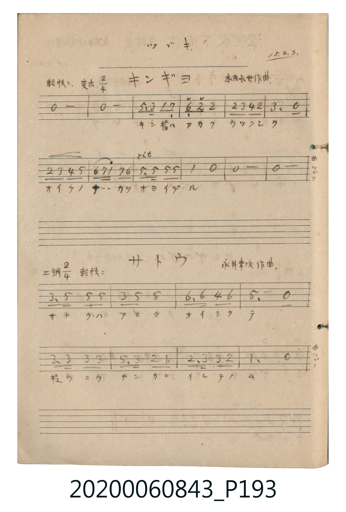

# サトウ (砂糖)

<audio controls src="satou.mp3"></audio>

- 詞曲作者：未在 TMD metadata 中提供

## 說明

サトウ (砂糖)
Source: 唱歌帖 (2020.006.0843), P193.jpg (bottom)
Marginalia: ツヅキ. 15.2.3. (澄宮殿下御作 童謡集)
Composer: 永井幸次作曲 / Lyricist: 澄宮崇仁親王 (澄宮殿下御作)
Tempo / Expression: 軽快ニ

## 歌詞

```text
1.
シロイサトウハ アマイナ ユキモサトウナラ ヨイニナ
```

## ABC

```abc
X:1
T:サトウ 砂糖
M:2/4
L:1/16
Q:1/4=108
K:D
V:V1 name="Melody" snm="Mel"
[V:V1]
F3 A A2 A2 | F2 A2 A4 | B3 B G2 B2 | A4 z4 |
F3 F F2 F2 | A3 F E2 D2 | E3 F F2 E2 | D4 z4 |
```

## TMD 檔案連結

- [主旋律 TMD 檔案](satou.tmd) [[在 TMD Studio 編輯](https://tmdlang.github.io/Tmd-TS/#tmd=s7IKdvYPcrWy4tLSUnjctPVxc8fjpmUKGs8XND3fPE1TQUuLS9FWwdDAgsveVsGFy8ZI38SOi0tfi0tBAYtykGhwfmlRcqqVwtMpG5-t7Xm6Y5qChpGBkYGegYGZnoGFibGmjkKAoaWxXlZBuoJGUn5JSX4uWJ9vYlF6Zl5iTmailcLj5pbHza2Pm9bqKRia6hnpGespaDzb1_J03bpn6_Y_2dH9dN_CJ3vnKDxfvfTFmoUvZ7eBDXDOzy3IL04tslJ4tmHHk11Tn-7c8WwNSN2z2ZsU9BV8KosykzOLS4DSYJOebml_srvxxbJVz_u6sZkONjMkFWgmULNrRUFRanFxZn6elcKL3Xuf7l_9uLmbC6QCbGyxFYhpqAcJle2Pm9c-bloCD57Hzf1A0UWPm-eBRJu7gN5bBvTb4-ZFSEq6HjevBEqsACvpBvK5tPS5uHwTM_OsfFNz8lMqHWoMahSqQTYo2BiaadmBWTUKxgq6QGgKhCBSFyoC44FgjYIZmDZTMAGTIBGYnAFMDYppxmAahGEqjRWMgKQhWATEgqkBsWvA4qim1XJx6doBozQzTwFIK3MBAA)]
- [鋼琴伴奏 TMD 檔案](satou_piano.tmd) [[在 TMD Studio 編輯](https://tmdlang.github.io/Tmd-TS/#tmd=s7IKdvYPcrWy4tLSUnjctPVxc8fjpmUKGs8XND3fPE1T4VHDFIWAzMS8fAXH5OT83ILEvMzc1LwSBS0tLkVbBUMDCy57WwUXLhsjfRM7Li59LS4FBRKMAakOzi8tSk61Ung6ZeOztT1Pd0xT0DAyMDLQMzAw0zOwMDHW1FEIMLQ01ssqSFfQSMovKcnP1QTp800sSs_MS8zJTLRSeNzc8ri59XHTWj0FQ1M9Iz1jPQWNZ_tanq5b92zd_ic7up_uW_hk7xyF56uXvliz8OXsNrABzkB35BenFlkpPNuw48muqU937ni2BqTu2exNCvoKPpVFmcmZxSVAabBJT7e0P9nd-GLZqud93dhM1-TS0ufi8k3MzLPyTc3JT6l0qDGoUagG2aRgY2imZQdm1SgYK-gCoSkQgkhdqAiMB4I1CmZg2kzBBEyCRGByBjA1KKYZg2kQhqk0VjACkoZgERALpgbErgGLo5pWC3U6OJKCPHC43TRe21Ab5gEgSxtkGYxGkkaXgvjKUNtEG-YzM5BSkPdggiBpVE3oXkWy3BjBgTMQBoDkgeaDvAqShTnNXAcihq4dJg4MzHhtqAYEC0cQ-eAKIsN4qAY4A7uYiQ6MjWBBVZqCBdC9j9dgIxADzAN6FW4egoXDZKCXdO2AOSkzTwFIK3MBAA)]

## 分析

```text
================================================================================
📊 TMD Song Profile: [ サトウ 砂糖 ]
================================================================================
⏱  Duration:       0:08 (8.9s), 8 measures total
🎼 Key & Tempo:    首調基準 D, != 108.0 BPM, <2/4>
   - 分析範圍：      由實際發聲的音符與和弦推測調性；播放脈絡另行呈現
🎤 人聲音域:    D4 (MIDI 62) – B4 (MIDI 71) [跨度: 9 個半音 / 0.8 個八度, 難度: easy]
   - 最低音:  D4 in [Main #1 @ m.6, 0:06]
   - 最高音: B4 in [Main #1 @ m.3, 0:02]
   - 適合: soprano, mezzo-soprano, contralto, tenor, baritone, bass
🏛  結構:      Main (8.9s)
⚡ 編曲密度:        Peak 1 軌道同時演奏
🗝  調性診斷：       F# 小調（純淨自然小調，未偵測到可信轉調）
   - 風格氣質:    純淨自然小調（陰鬱抒情、旋律集中，無明顯調外色彩）
   - 轉調歷程:    全曲維持單一推測調性（未偵測到可信轉調）
   - 核心骨幹音:  A, F#, E, D, B
   - 調性數值:    F# 小調 [相關度: 0.81, 穩定度: Moderate, 自然音純度: 96.4%]
   - 候選調性 (K-S): F# 小調 (0.81), A 大調 (0.71), D 大調 (0.69)
   - 五度圈歷程:   +6
   - 各段落調性細節:
     • [Main #1]: F# 小調 (r: 0.81, 自然音純度: 96.4%, 調外音: G)

  [ 五度圈游移軌跡 ]
               C  
         F            G  
      Bb               D  
      Eb               A  
         Ab           E  
            Db       B  
              [F#]*
     (* = active key center)

  [ 十二半音累積音高分佈 ]
     C  :                            0.0%
     C# :                            0.0%
     D  : ████████                  10.7%
     D# :                            0.0%
     E  : █████████                 12.5%
     F  :                            0.0%
     F# : ███████████████████████   30.4%
     G  : ███                        3.6%
     G# :                            0.0%
     A  : ████████████████████████  32.1%
     A# :                            0.0%
     B  : ████████                  10.7%
--------------------------------------------------------------------------------
Assignment 軌道音域：
  - Melody        : D4 – B4 (9 個半音 / 0.8 個八度, 25 個音符)
================================================================================
```


## 原書掃描頁




