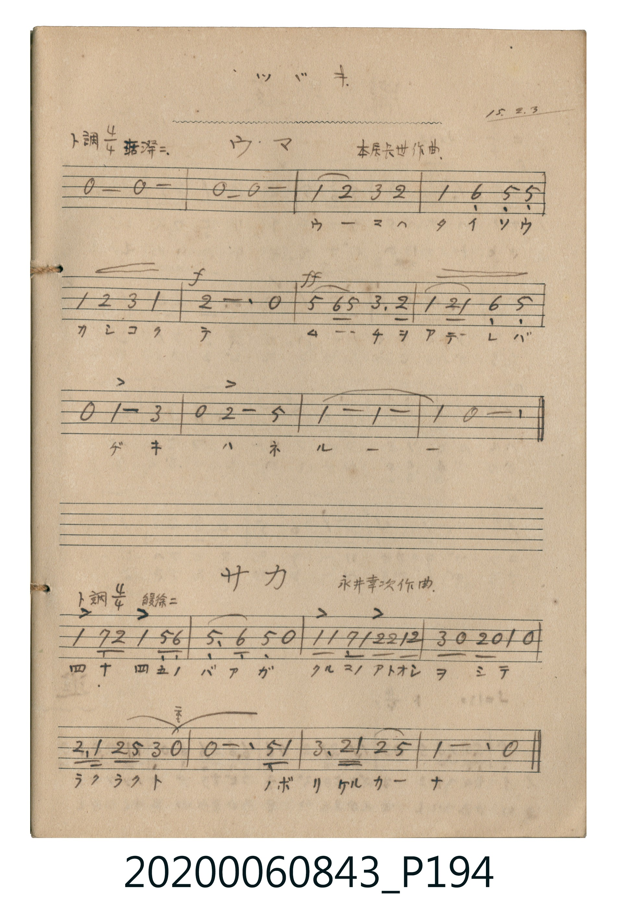

# ウ・マ (馬)

> Re:Shōka 使用 AI 協助辨識與重建樂譜，可能會有錯誤。歡迎[回報](https://github.com/TMDLang/reshoka/issues)。

- **鋼琴伴奏版**：<br><audio controls src="uma.mp3"></audio>

- 詞：澄宮崇仁親王
- 曲：本居長世

## 說明

ウ・マ (馬)
Source: 唱歌帖 (2020.006.0843), P194.jpg (top)
Marginalia: ツヅキ. 15.2.3 (澄宮殿下御作 童謡集)
Composer: 本居長世作曲 / Lyricist: 澄宮崇仁親王 (澄宮殿下御作)
Tempo / Expression: 活潑ニ


## 歌詞

```text
1.
ウマノセナカヘ マタガッテ パカパカハシッテ ユキタイナ
```

## ABC

<div class="abc-score" data-abc-src="uma.abc" aria-label="五線譜載入中"></div>

[下載 ABC 原始檔](uma.abc)

## TMD 檔案連結

- [主旋律 TMD 檔案](uma.tmd) [[在 TMD Studio 編輯](https://tmdlang.github.io/Tmd-TS/#tmd=s7IKdvYPcrWy4qpTUCpJTLdSSM7PyUlNLsnMz7MqzsjPTkzOyFeCS5bl55TmploBqXhDA4RwcX5pUXJqfEFieqpVgKGlSSK6FNyo-Lz8ktSk_PxshIqCovyy1LzEPKCq3MS80uLkosyCkvjk_IJKhJrUssyUVJCK1JTMkvyizMQcJDelFhWDXQtxRElRYh7EDKAgQlVJRirQ4Yl5mbnIeoFGpWfmWZUkZgIdGA_E5YnxuYmZeTmJeSnIqkoy8tOLEgsyKq0yMotBDkhOzInPTswDelRLS-Fx07LHzbsfN89T0Hi5bI2mgpYWl6KtgqGRAZe9rYI7yJgXK-e93zPr2b6Wp-vWPd3S_mR344tlq573dYPteDZ7E0hyzpqnG1tfTt3-ZMc0JS4bE30TOy4ufS0uBQV080FCwZBgVXg6ZeOztT1Pd0xT0DAyMDLQMzAw0zOwMDHW1FEARYReVkG6gkZJfgFYk29iEdC3iTmZiVYKj5tbHje3Pm5aq6dgaKpnpGesoAFx3rN1-5_s6H66b-GTvXMUnq9e-mLNwpez28D6nfNzC_KLU4usFJAdC1QH9IGCvoJPJTBcgMEDlMbwKDbTwWaGpALNBGp2rSgoSi0GR6TCsy27n-2d-Li5mwukAmxssRWIaagHD455j5v7HjcBA6XrcdPqx80zgB6a97hp_-OmNY-bmx83twH5E8EyELL_cdN2uMQyoLfBapcAtXNp6XNx-QLj3CogMzEv36HGoKYaZIuCjYWWHZhRo2CgoIsCsYkYAkkjIDaG0hARs3ggYQonaqAGIisGsWvAPBgEGV6jYArSDiRBakCqYboMkQyFmQfSAZIFQZB6iAjMTJBJEN0gCKMhIsgeqeGq5eLStQOmk8w8BSCtzAUA)]
- [鋼琴伴奏 TMD 檔案](uma_piano.tmd) [[在 TMD Studio 編輯](https://tmdlang.github.io/Tmd-TS/#tmd=s7IKdvYPcrWy4qpTUCpJTLdSyC8qychPL0osyKi0ysgsLskvykxOzInPTsxLVIIrKs4vLUpOjS9ITE-1CjC0NEHIlGSk5qZapaaUJieWZObnKXFpaSk8blr2uHn34-Z5Chovl63RVHjUMEUhIDMxL1_BMTk5P7cgMS8zNzWvREFLi0vRVsHQyIDL3lbBHWTki5Xz3u-Z9Wxfy9N1655uaX-yu_HFslXP-7rB9j2bvQkkOWfN042tL6duf7JjmhKXjYm-iR0Xl74Wl4ICsfaClAaDPWSl8HTKxmdre57umKagYWRgZKBnYGCmZ2BhYqypowDyp15WQbqCRkl-gSZIk29iUXpmXmJOZqKVwuPmlsfNrY-b1uopGJrqGekZK2hAnP1s3f4nO7qf7lv4ZO8cheerl75Ys_Dl7DawfmegG_KLU4usFJA9AVQH9JmCvoJPJTDogTEAlMYIAGyma3Jp6XNx-SZm5lmBfelQY1BTDbJHwcZCyw7MqFEwUNBFgdhEDIGkERAbQ2mIiFk8kDCFEzVQA5EVg9g1YB4MggyvUTAFaQeSIDUg1TBdhkiGwswD6QDJgiBIPUQEZibIJIhuEITREBFkj9Rw1SIHRZAHUmAYmsFDwzhe2zReG24dnIeNhUsF6abAHAoMGIQgkGkerw33J1BCGxJc6FIouoAGg4MQbjEWNixkibYMEawY6nDyEH4CGqUNiiZwBGmbaJuB1KLbAkkHaJ4BCUBDC6unkJMImlNhEMUSFJVIboVBkBDcqejRCIPYRdFVo2ciuDrUdOiDnA5N4MnQMB6UByAkEs8AmxQwZIAkEMEzIEwFSAzEhCCoZhMUzXABJM1whKQZ1R0wHsSTYC_p2gFLv8w8BSCtzAUA)]

## 分析

```text
================================================================================
📊 TMD Song Profile: [ ウ・マ 馬 ]
================================================================================
⏱  Duration:       0:24 (24.0s), 12 measures total
🎼 Key & Tempo:    首調基準 G, != 120.0 BPM, <4/4>
   - 分析範圍：      由實際發聲的音符與和弦推測調性；播放脈絡另行呈現
🎤 人聲音域:    D4 (MIDI 62) – E5 (MIDI 76) [跨度: 14 個半音 / 1.2 個八度, 難度: moderate]
   - 最低音:  D4 in [Main #1 @ m.4, 0:07]
   - 最高音: E5 in [Main #1 @ m.7, 0:12]
   - 適合: soprano, mezzo-soprano, contralto, tenor, baritone, bass
🏛  結構:      Main (24.0s)
⚡ 編曲密度:        Peak 1 軌道同時演奏
🗝  調性診斷：       G 大調（純淨自然大調，未偵測到可信轉調）
   - 風格氣質:    純淨自然大調（陽光明朗、易唱易記，無明顯調外色彩）
   - 轉調歷程:    全曲維持單一推測調性（未偵測到可信轉調）
   - 核心骨幹音:  G, A, D, B, E
   - 調性數值:    G 大調 [相關度: 0.81, 穩定度: High, 自然音純度: 100.0%]
   - 候選調性 (K-S): G 大調 (0.81), D 大調 (0.64), G 小調 (0.52)
   - 五度圈歷程:   +1
   - 各段落調性細節:
     • [Main #1]: G 大調 (r: 0.81, 自然音純度: 100.0%)

  [ 五度圈游移軌跡 ]
               C  
         F           [G ]*
      Bb               D  
      Eb               A  
         Ab           E  
            Db       B  
               F# 
     (* = active key center)

  [ 十二半音累積音高分佈 ]
     C  :                            0.0%
     C# :                            0.0%
     D  : ███████████               16.2%
     D# :                            0.0%
     E  : █████                      7.4%
     F  :                            0.0%
     F# :                            0.0%
     G  : ████████████████████████  36.8%
     G# :                            0.0%
     A  : █████████████████         26.5%
     A# :                            0.0%
     B  : █████████                 13.2%
--------------------------------------------------------------------------------
Assignment 軌道音域：
  - Piano         : D4 – E5 (14 個半音 / 1.2 個八度, 30 個音符)
================================================================================
```


## 原書掃描頁




