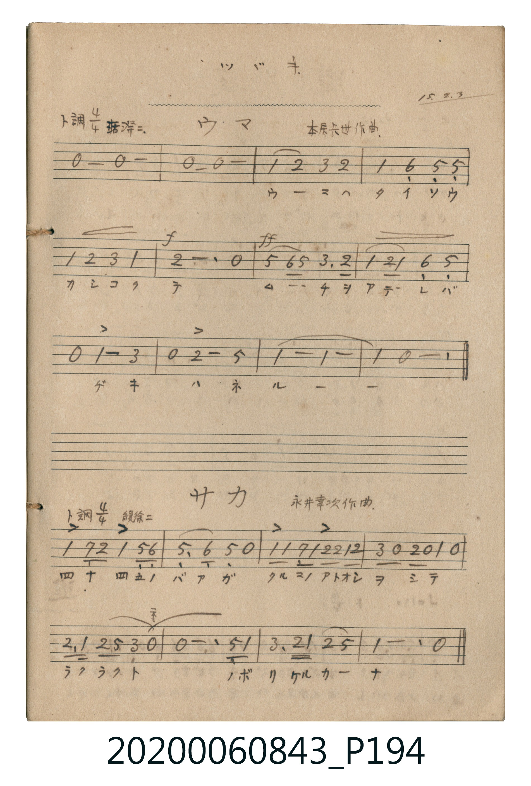

# ウ・マ (馬)

<audio controls src="uma.mp3"></audio>

- 詞：澄宮崇仁親王
- 曲：本居長世

## 說明

ウ・マ (馬)
Source: 唱歌帖 (2020.006.0843), P194.jpg (top)
Marginalia: ツヅキ. 15.2.3 (澄宮殿下御作 童謡集)
Composer: 本居長世作曲 / Lyricist: 澄宮崇仁親王 (澄宮殿下御作)
Tempo / Expression: 活潑ニ

## 歌詞

```text
1.
ウマノセナカヘ マタガッテ パカパカハシッテ ユキタイナ
```

## ABC

```abc
X:1
T:ウ・マ 馬
C:曲：本居長世
M:4/4
L:1/16
Q:1/4=120
K:G
V:V1 name="Vocal" snm="Voc"
[V:V1]
z16 | z16 | G4 A4 B4 A4 | G4 E4 D4 D4 |
G4 A4 B4 G4 | A12 z4 | d4 e2 d2 B6 A2 | G4 A2 G2 E4 D4 |
z4 G8 B4 | z4 A8 d4 | G8 G8 | G4 z12 |
```

## TMD 檔案連結

- [主旋律 TMD 檔案](uma.tmd) [[在 TMD Studio 編輯](https://tmdlang.github.io/Tmd-TS/#tmd=s7IKdvYPcrWy4tLSUnjctOxx8-7HzfMUNF4uW6OpoKXFpWirYGhkwGVvq-DOVaeg9GLlvPd7Zj3b1_J03bqnW9qf7G58sWzV875uJZDks9mbQJJz1jzd2Ppy6vYnO6YpcdmY6JvYcXHpa3EpKKCbDxIKzi8tSk61Ung6ZeOztT1Pd0xT0DAyMDLQMzAw0zOwMDHW1FEIMLQ00csqSFfQKMkvAGvyTSxKz8xLzMlMtFJ43NzyuLn1cdNaPQVDUz0jPWMFDYjznq3b_2RH99N9C5_snaPwfPXSF2sWvpzdBtbvnJ9bkF-cWmSlgOxYoDqgDxT0FXwqizKTM4tLgNIYHsVmOtjMkFSgmUDNrhUFRanFxZn5eUDtW3Y_2zvxcXM3F0gF2NhiKxDTUA8eHPMeN_c9bgIGStfjptWPm2cAPTTvcdP-x01rHjc3P25uA_IngmUgZP_jpu1wiWVAb4PVLgFq59LS5-LyTczMswrLT07McagxqFGoBlmjYGNopmUHZtUoGCjo4oXEqDCEsoygtDEaH6HCLB7KMMVg1EAdhMswmHgNXAYdwhxao2AKsw5kAZIZMHNRbQGxMR0Gcw_MVJgOGISZiVCB7i6YKxC2wSA6H6ECV2DXcNVycenaAVN6Zp4CkFbmAgA)]
- [鋼琴伴奏 TMD 檔案](uma_piano.tmd) [[在 TMD Studio 編輯](https://tmdlang.github.io/Tmd-TS/#tmd=s7IKdvYPcrWy4tLSUnjctOxx8-7HzfMUNF4uW6Op8KhhikJAZmJevoJjcnJ-bkFiXmZual6JgpYWl6KtgqGRAZe9rYI7V52C0ouV897vmfVsX8vTdeuebml_srvxxbJVz_u6lUCSz2ZvAknOWfN0Y-vLqduf7JimxGVjom9ix8Wlr8WloECsvSClwfmlRcmpVgpPp2x8trbn6Y5pChpGBkYGegYGZnoGFibGmjoKAYaWJnpZBekKGiX5BZogTb6JRemZeYk5mYlWCo-bWx43tz5uWqunYGiqZ6RnrKABcfazdfuf7Oh-um_hk71zFJ6vXvpizcKXs9vA-p2BbsgvTi2yUkD2BFAd0GcK-go-lUWZyZnFJUBpjADAZroml5Y-F5dvYmaeVVh-cmKOQ41BjUI1yCIFG0MzLTswq0bBQEEXLyRGhSGUZQSljdH4CBVm8VCGKQajBuogXIbBxGvgMugQ5tAaBVOYdSALkMyAmYtqC4iN6TCYe2CmwnTAIMxMhAp0d8FcgbANBtH5CBW4AruGqxYameAkG-SBIzqN47VN47VhpiF42Fi4VJBuClLIIwSBTHOdeG1YqIBktGGBhiaHog9oNDw2wNZgYcMih3jrEMkHUyEeLsJnQNO0YTFqqG2iDUtbKBaBICSBIVkJS2O4PIae0pC0wiCKJSgqkR0Lg2AxuGPRoxMGsYuiqyYyQfrgSpCG8IylA2NhEcKvDikSSDXNDFMdnAEvcfAYilCMJIuNhcWNJkS6EZ8GDDfiYRByIrHBjVUd3nSgawes_TLzFIC0MhcA)]

## 分析

```text
================================================================================
📊 TMD Song Profile: [ ウ・マ 馬 ]
================================================================================
⏱  Duration:       0:24 (24.0s), 12 measures total
🎼 Key & Tempo:    首調基準 G, != 120.0 BPM, <4/4>
   - 分析範圍：      由實際發聲的音符與和弦推測調性；播放脈絡另行呈現
🎤 人聲音域:    D4 (MIDI 62) – E5 (MIDI 76) [跨度: 14 個半音 / 1.2 個八度, 難度: moderate]
   - 最低音:  D4 in [Main #1 @ m.4, 0:07]
   - 最高音: E5 in [Main #1 @ m.7, 0:12]
   - 適合: soprano, mezzo-soprano, contralto, tenor, baritone, bass
🏛  結構:      Main (24.0s)
⚡ 編曲密度:        Peak 1 軌道同時演奏
🗝  調性診斷：       G 大調（純淨自然大調，未偵測到可信轉調）
   - 風格氣質:    純淨自然大調（陽光明朗、易唱易記，無明顯調外色彩）
   - 轉調歷程:    全曲維持單一推測調性（未偵測到可信轉調）
   - 核心骨幹音:  G, A, D, B, E
   - 調性數值:    G 大調 [相關度: 0.81, 穩定度: High, 自然音純度: 100.0%]
   - 候選調性 (K-S): G 大調 (0.81), D 大調 (0.64), G 小調 (0.52)
   - 五度圈歷程:   +1
   - 各段落調性細節:
     • [Main #1]: G 大調 (r: 0.81, 自然音純度: 100.0%)

  [ 五度圈游移軌跡 ]
               C  
         F           [G ]*
      Bb               D  
      Eb               A  
         Ab           E  
            Db       B  
               F# 
     (* = active key center)

  [ 十二半音累積音高分佈 ]
     C  :                            0.0%
     C# :                            0.0%
     D  : ███████████               16.2%
     D# :                            0.0%
     E  : █████                      7.4%
     F  :                            0.0%
     F# :                            0.0%
     G  : ████████████████████████  36.8%
     G# :                            0.0%
     A  : █████████████████         26.5%
     A# :                            0.0%
     B  : █████████                 13.2%
--------------------------------------------------------------------------------
Assignment 軌道音域：
  - Vocal         : D4 – E5 (14 個半音 / 1.2 個八度, 30 個音符)
================================================================================
```


## 原書掃描頁




