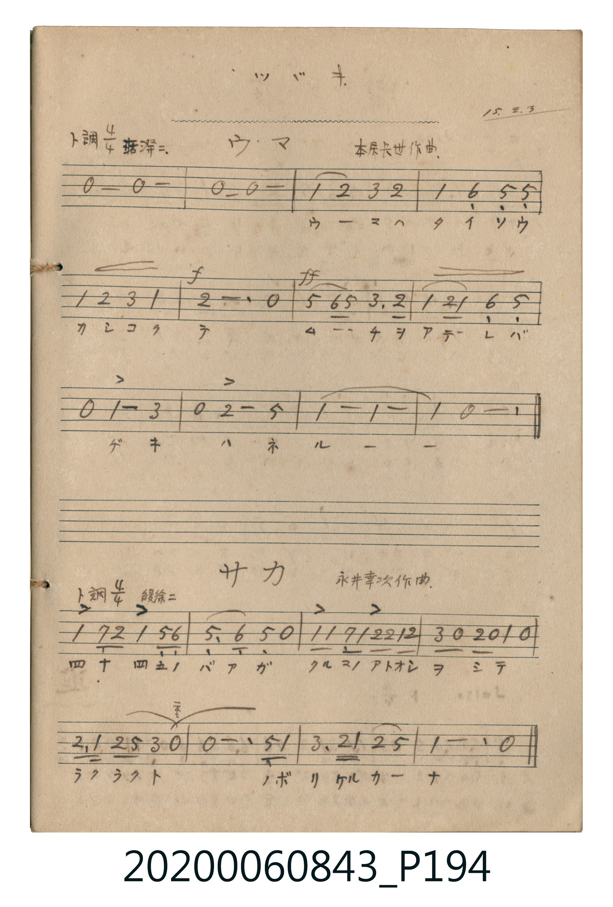

# サカ (坂)

> Re:Shōka 使用 AI 協助辨識與重建樂譜，可能會有錯誤。歡迎回報。

- **鋼琴伴奏版**：<br><audio controls src="saka.mp3"></audio>

- 詞：澄宮崇仁親王
- 曲：永井幸次

## 說明

サカ (坂)
Source: 唱歌帖 (2020.006.0843), P194.jpg (bottom)
Marginalia: ツヅキ. 15.2.3 (澄宮殿下御作 童謡集)
Composer: 永井幸次作曲 / Lyricist: 澄宮崇仁親王 (澄宮殿下御作)
Tempo / Expression: 緩徐ニ


## 歌詞

```text
1.
ナガイサカ ウンコラショト ノボッタラ イキガハズンダ
```

## ABC

<div class="abc-score" data-abc-src="saka.abc" aria-label="五線譜載入中"></div>

[下載 ABC 原始檔](saka.abc)

## TMD 檔案連結

- [主旋律 TMD 檔案](saka.tmd) [[在 TMD Studio 編輯](https://tmdlang.github.io/Tmd-TS/#tmd=s7IKdvYPcrWy4qpTUCpJTLdSSM7PyUlNLsnMz7MqzsjPTkzOyFeCS5bl55TmploBqXhDA4RwcX5pUXJqfEFieqpVgKGlSRK6FNyo-Lz8ktSk_PxshIqCovyy1LzEPKCq3MS80uLkosyCkvjk_IJKhJrUssyUVJCK1JTMkvyizMQcJDelFhWDXQtxRElRYh7EDKAgQhVQU3pmnlVJYibQKfFAXJ4Yn5uYmZeTmJeixKWlpfC4aevjptUKGk_nNmkqaGlxKdoqmJtx2dsquIPMeLFy3vs9s57ta3m6bt3TLe1Pdje-WLbqeV832IJnszeBJDfseLJr6tOdO56tWajEZWOib2LHxaWvxaWggGI2iB8MCRSFp1M2Plvb83THNAUNIwMjAz0DAzM9AwsTY00dBVAw6mUVpCtoJOWXlOTngvX5JhYBPZGYk5lopfC4ueVxc-vjprV6CoamekZ6xgoaEOc9W7f_yY7up_sWPtk7R-H56qUv1ix8ObsNrN85P7cgvzi1yEoB2bFAdUAfKOgr-FQWZSZnFpcApTE8is10sJkhqUAzgZpdKwqKUovBMaHwfPvKp_smPG7u5gKpABtbbAViGuqBg6O563HTmsdNS6Dh8rhp2ePmzY-bNj9uXvm4afvj5uWPmzuAqvoeN8953Nz8uGk_UAKoCqh-LUhjc__jpl0gHc0NXFr6XFy-wHi0CstPTsxxqDGoqQZZoWBjaKZlB2bVKBgq6IKheTyQMAJimIApSMAMRNRA2GAelIWABlAaYhIIg00CMUCmwUwE0TUKxlANIB6IBsnADAAbAnUUSB4kC6JNgRikD9UyZF3IEOw-kLEQy0BWwTwEMRRiIMLF2CDcGq5aLi5dO2DSysxTANLKXAA)]
- [鋼琴伴奏 TMD 檔案](saka_piano.tmd) [[在 TMD Studio 編輯](https://tmdlang.github.io/Tmd-TS/#tmd=s7IKdvYPcrWy4tLSUnjctPVx02oFjadzmzQVHjVMUQjITMzLV3BMTs7PLUjMy8xNzStR0NLiUrRVMDfjsrdVcOeqU1B6sXLe-z2znu1rebpu3dMt7U92N75Ytup5X7cSSPLZ7E0gyQ07nuya-nTnjmdrFipx2Zjom9hxcelrcSkoEGUnSF1wfmlRcqqVwtMpG5-t7Xm6Y5qChpGBkYGegYGZnoGFibGmjkKAoaWJXlZBuoJGUn5JSX6uJkifb2JRemZeYk5mopXC4-aWx82tj5vW6ikYmuoZ6RkraECc_Wzd_ic7up_uW_hk7xyF56uXvliz8OXsNrB-Z6Az8otTi6wUkD0BVAf0mYK-gk9lUWZyZnEJUBojALCZrsmlpc_F5ZuYmWcVlp-cmONQY1BTDbJHwcbQTMsOzKpRMFTQBUPzeCBhBMQwAVOQgBmIqIGwwTwoCwENoDTEJBAGmwRigEyDmQiiaxSMoRpAPBANkoEZADYE6iiQPEgWRJsCMUgfqmXIupAh2H0gYyGWgayCeQhiKMRAhIuxQbg1XLXQAASnlCAP7EFoHK9tGq-NCDdtcx2QK4AMkJXoskACGqpgGbAoUADBwRa2UBMQFNwKBB9sGyoTTRJijjYsFpBkQFyEQ7FFCZJiUAAjccG0NihU4aZjOh4ujGIO1tCBxB6SJiOsIQw3AmE_xDpUxfh4OOLZBzmeLRA5BRzi4HAHM8EEVBhBgMxEFoRogJBgcQMwxwDCRAlhJJXoRuGw1gxJC5IVmKaAPKhrByyhMvMUgLQyFwA)]

## 分析

```text
================================================================================
📊 TMD Song Profile: [ サカ 坂 ]
================================================================================
⏱  Duration:       0:25 (25.3s), 8 measures total
🎼 Key & Tempo:    首調基準 G, != 76.0 BPM, <4/4>
   - 分析範圍：      由實際發聲的音符與和弦推測調性；播放脈絡另行呈現
🎤 人聲音域:    D4 (MIDI 62) – D5 (MIDI 74) [跨度: 12 個半音 / 1.0 個八度, 難度: easy]
   - 最低音:  D4 in [Main #1 @ m.1, 0:02]
   - 最高音: D5 in [Main #1 @ m.5, 0:13]
   - 適合: soprano, mezzo-soprano, contralto, tenor, baritone, bass
🏛  結構:      Main (25.3s)
⚡ 編曲密度:        Peak 1 軌道同時演奏
🗝  調性診斷：       G 大調（純淨自然大調，未偵測到可信轉調）
   - 風格氣質:    純淨自然大調（陽光明朗、易唱易記，無明顯調外色彩）
   - 轉調歷程:    全曲維持單一推測調性（未偵測到可信轉調）
   - 核心骨幹音:  G, D, A, B, F#
   - 調性數值:    G 大調 [相關度: 0.85, 穩定度: High, 自然音純度: 100.0%]
   - 候選調性 (K-S): G 大調 (0.85), D 大調 (0.70), G 小調 (0.63)
   - 五度圈歷程:   +1
   - 各段落調性細節:
     • [Main #1]: G 大調 (r: 0.85, 自然音純度: 100.0%)

  [ 五度圈游移軌跡 ]
               C  
         F           [G ]*
      Bb               D  
      Eb               A  
         Ab           E  
            Db       B  
               F# 
     (* = active key center)

  [ 十二半音累積音高分佈 ]
     C  :                            0.0%
     C# :                            0.0%
     D  : ██████████████            22.3%
     D# :                            0.0%
     E  : ██                         3.2%
     F  :                            0.0%
     F# : ███                        4.3%
     G  : ████████████████████████  39.4%
     G# :                            0.0%
     A  : █████████████             21.3%
     A# :                            0.0%
     B  : ██████                     9.6%
--------------------------------------------------------------------------------
Assignment 軌道音域：
  - Vocal         : D4 – D5 (12 個半音 / 1.0 個八度, 33 個音符)
================================================================================
```


## 原書掃描頁




