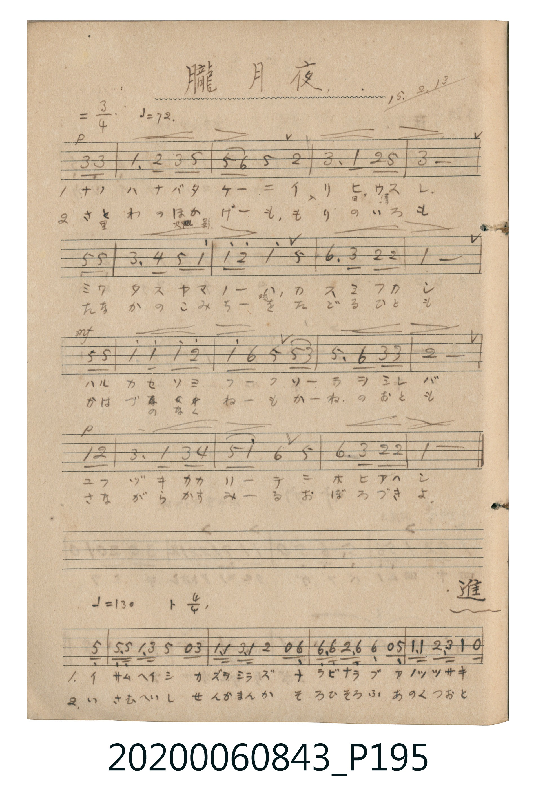

# 朧月夜 (朦朧月夜)

> Re:Shōka 使用 AI 協助辨識與重建樂譜，可能會有錯誤。歡迎回報。

- **鋼琴伴奏版**：<br><audio controls src="oborozukiyo.mp3"></audio>

- 詞曲作者：未在 TMD metadata 中提供

## 說明

朧月夜 (朦朧月夜)
Source: 唱歌帖 (2020.006.0843), P195.jpg (top)
Marginalia: 15.2.13 (大正15年2月13日)
Composer: 岡野貞一 / Lyricist: 高野辰之 (尋常小學唱歌 第六學年)


## 歌詞

```text
1.
ナノハナバタケニ イリヒウスレ ミワタスヤマノハ カスミフカシ
ハルカゼソヨフク ソラヲミレバ ユフヅキカカリテ ニホヒアハシ

2.
さとわのひかげも もりにきえて たづねんこみちも こけむしたり
かはづのなくねも かねのおとも さながらかすめる おぼろづきよ
```

## ABC

<div class="abc-score" data-abc-src="oborozukiyo.abc" aria-label="五線譜載入中"></div>

[下載 ABC 原始檔](oborozukiyo.abc)

## TMD 檔案連結

- [主旋律 TMD 檔案](oborozukiyo.tmd) [[在 TMD Studio 編輯](https://tmdlang.github.io/Tmd-TS/#tmd=s7IKdvYPcrWy4qpTUCpJTLdSSM7PyUlNLsnMz7MqzsjPTkzOyFeCS5bl55TmploBqXhDA4RwcX5pUXJqfEFieqpVgKGlaSK6FNyo-Lz8ktSk_PxshIqCovyy1LzEPKCq3MS80uLkosyCkvjk_IJKhJrUssyUVJCK1JTMkvyizMQcJDelFhWDXQtxRElRYh7EDKAgQlVJRirQ4eWpiUBGEbpwcWpicX5eMUIYaEV6Zp5Vbn5eUinQ6ZgSqZlZmfElqRUlEL9oaSk8m7P82ZyOp0vmKGg8m7MMztNU0NLiUrRVMDfisrdVcOGyMdY3sePi0tfiUlDAqQckFwwJOIWnUzY-W9vzdMc0BQ0jAyMDPQMDMz0DCxNjTR0FUFDrZRWkK2iU5BeANfkmFgGdl5iTmWilYGiqZ6RnaKyg8XTJ8mdrFxuaPt25xQhogaHxs-lLwaqd83ML8otTi4CWbFr4sr3vxaZ5T3Y0KOgr-FQWZSZnFpdYKbxcPQMksW_Dk53dQJM2dD_dsePphv6na3dA3KXwfM2ap61rQfydWzS5QKaCNRdbgZiGeiDycXPX4-a-x839YMaEx037HzdtfNzcrfC4acnj5lWPmyc9blr2uGnn4-Y1QLXzHzevBysB8oHS8yBagWpXg4WA0lPB7O0Qo4GGAjlAtOdx097HzSvA0uuByoGclY-bN4F1rAFaC1S7DCTZ3Pq4aS1Yx2qw5W1Aie7HzbPBzlgEMhBoNMhsI4jjG6c-blzxuKn_ceO6x42bHjd2P24EKmwC2tD0uKnrcePqx429jxs7HjcuA6qd_7hx6eNGoPGTHzcC0f7HjQvBakGciY-bGh43TgcpauqCGA00az1YB9DoVY8bgXYAtYKUAyXWgkWBFgAtBwkBnQFU0vO4qRMsPfNxU-PjJmAYgpQA_Q50A9Cc3sdNHVxa-lxcvonAVBqWn5yY41BjUFMNsk7BxkLLDsyoUTBQ0AVDQyCuAZNGQGwM5pmCZcyAtDFUDgRB8jVQ3SA2QjdIly5YtRGSejMks0AyQLOgumEqILpBZoEwSCXELBAPIQfiGwNlYbpB5oLUQtQbxkGtgjgWm9PN4oEMoMug-mE2oLoWBGu4arm4dO2AeSgzTwFIK3MBAA)]
- [鋼琴伴奏 TMD 檔案](oborozukiyo_piano.tmd) [[在 TMD Studio 編輯](https://tmdlang.github.io/Tmd-TS/#tmd=s7IKdvYPcrWy4tLSUng2Z_mzOR1Pl8xR0Hg2Zxmcp6nwqGGKQkBmYl6-gmNycn5uQWJeZm5qXomClhaXoq2CuRGXva2CC5eNsb6JHReXvhaXggLJZoH0BOeXFiWnWik8nbLx2dqepzumKWgYGRgZ6BkYmOkZWJgYa-ooBBhamuplFaQraJTkF2iCNPkmFqVn5iXmZCZaKRia6hnpGRoraDxdsvzZ2sWGpk93bjECWmxo_Gz6UrBqZ6CN-cWpRUBLNi182d73YtO8JzsaFPQVfCqLMpMzi0usFF6ungGS2Lfhyc5uLi19Li7fxMw8q7D85MQchxpdw5pqkDkKNhZadmBGjYKBgi4YGgJxDZg0AmJjMM8ULGMGpI2hciAIkq-B6gaxEbpBunTBqo2Q1JshmQWSAZoF1Q1TAdENMguEQSohZoF4CDkQ3xgoC9MNMhekFqLeMA5qFcSx2JxuFg9kAF0G1Q-zAdW1oPCo4aqFBhw4roM8iAk603htEANImevEa4M9AhTRhoQkkNZGdRJUOTjAEFpgbkMSQrUBbB4ijI3jtZEMMtQ20YaENsI-YIjBzEIEPJo2mOlIDocxwTTYKCT70fwIljSDuRY1kmBOgjkIGllAHjjCYNLQaMIdSmhxh80p2EIES2z6oMSmCVJsgiDQEfEKpjpA2-IhbKAb4SyQONwFQDbIfGQpCNMEwUTWABYAqYfohGuAW2YEEgYSMA0gc4ASIC1mQCaUi-EokByqo5DcAtQM8r2uHbCkycxTQKKVuQA)]

## 分析

```text
================================================================================
📊 TMD Song Profile: [ 朧月夜 朦朧月夜 ]
================================================================================
⏱  Duration:       0:45 (45.0s), 18 measures total
🎼 Key & Tempo:    首調基準 D, != 72.0 BPM, <3/4>
   - 分析範圍：      由實際發聲的音符與和弦推測調性；播放脈絡另行呈現
🎤 人聲音域:    B3 (MIDI 59) – D5 (MIDI 74) [跨度: 15 個半音 / 1.2 個八度, 難度: moderate]
   - 最低音:  B3 in [Main #1 @ m.16, 0:38]
   - 最高音: D5 in [Main #1 @ m.14, 0:32]
   - 適合: soprano, mezzo-soprano, contralto, tenor, baritone, bass
🏛  結構:      Main (45.0s)
⚡ 編曲密度:        Peak 1 軌道同時演奏
🗝  調性診斷：       D 大調（純淨自然大調，未偵測到可信轉調）
   - 風格氣質:    純淨自然大調（陽光明朗、易唱易記，無明顯調外色彩）
   - 轉調歷程:    全曲維持單一推測調性（未偵測到可信轉調）
   - 核心骨幹音:  D, E, A, F#, B
   - 調性數值:    D 大調 [相關度: 0.85, 穩定度: High, 自然音純度: 100.0%]
   - 候選調性 (K-S): D 大調 (0.85), A 大調 (0.70), B 小調 (0.54)
   - 五度圈歷程:   +2
   - 各段落調性細節:
     • [Main #1]: D 大調 (r: 0.85, 自然音純度: 100.0%)

  [ 五度圈游移軌跡 ]
               C  
         F            G  
      Bb              [D ]*
      Eb               A  
         Ab           E  
            Db       B  
               F# 
     (* = active key center)

  [ 十二半音累積音高分佈 ]
     C  :                            0.0%
     C# :                            0.0%
     D  : ████████████████████████  32.7%
     D# :                            0.0%
     E  : █████████████████         23.1%
     F  :                            0.0%
     F# : ████████████              16.3%
     G  :                            0.0%
     G# :                            0.0%
     A  : ██████████████            19.2%
     A# :                            0.0%
     B  : ██████                     8.7%
--------------------------------------------------------------------------------
Assignment 軌道音域：
  - Vocal         : B3 – D5 (15 個半音 / 1.2 個八度, 54 個音符)
================================================================================
```


## 原書掃描頁




