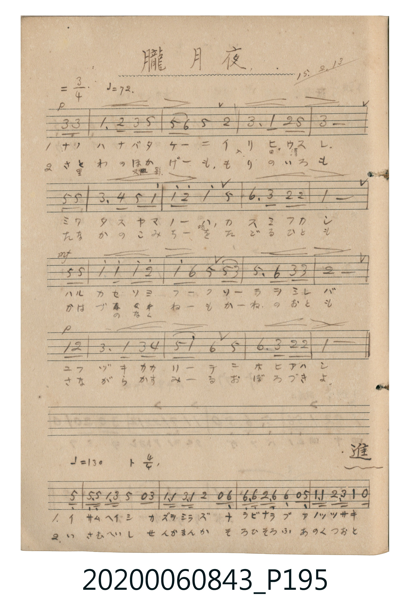

# 朧月夜（朦朧月夜）

> Re:Shōka 使用 AI 協助辨識與重建樂譜，可能會有錯誤。歡迎回報。

- **鋼琴伴奏版**：<br><audio controls src="oborozukiyo.mp3"></audio>
- **NEUTRINO 歌聲合成版**：<br><audio controls src="oborozukiyo_neutrino.mp3"></audio>

- 作詞：高野辰之／作曲：岡野貞一（《尋常小學唱歌》第六學年）
- 日治時期公學校《唱歌帳》第十冊（2020.006.0843・P195 上半・大正15年2月13日抄）

## 說明

> [!NOTE]
> **原頁資訊與歌詞全文**（對應 `P195.jpg` 上半）：
> - **出處與抄寫日期**：標題下記「`15. 2. 13`」（大正 15 年 2 月 13 日），為岡野貞一作曲、高野辰之作詞之文部省唱歌〈朧月夜〉手抄簡譜。
> - **調性與拍號**：`ニ 3/4`（D 大調 3/4 拍，`?= D`, `<3/4>`），速度標記 `♩= 72.`，弱起處標有 `p`、第 8 小節末弱起標有 `mf`、第 12 小節末弱起標有 `p`。
> - **手抄頁面細節**：
>   1. 第 3 小節第 3 拍「ウス」原刊本五線譜（參見《新定兒童唱歌》尋常科第六學年 `P007.jpg`）為 `2 5_`（E4–A3），手抄簡譜 `5` 下方未點低音點（作 `3. 1 2 5`），此處忠實依手抄面記為 `5`。
>   2. 第 5 小節「ミワタス」、第 9 小節「ハルカセ」手抄本未加濁點；第二段第 14 小節原詞「かすめる」手抄本作「かすみーる」（`5 1^` 連音唱「みー」）。
>
> **1.**
> ナノハナバタケニ　イリヒウスレ
> ミワタスヤマノハ　カスミフカシ
> ハルカセソヨフク　ソラヲミレバ
> ユフヅキカカリテ　ニホヒアハシ
>
> **2.**
> さとわのほかげも　もりのいろも
> たなかのこみちを　たどるひとも
> かはづのなくねも　かねのおとも
> さながらかすみーる　おぼろづきよ


## 歌詞

```text
（TMD 檔案未包含歌詞註解）
```

## ABC

<div class="abc-score" data-abc-src="oborozukiyo.abc" aria-label="五線譜載入中"></div>

[下載 ABC 原始檔](oborozukiyo.abc)

## TMD 檔案連結

- [主旋律 TMD 檔案](oborozukiyo.tmd) [[在 TMD Studio 編輯](https://tmdlang.github.io/Tmd-TS/#tmd=s7IKdvYPcrWy4qpTUCpJTLdSSM7PyUlNLsnMz7MqzsjPTkzOyFeCS5bl55TmploBqXhDA4RwcX5pUXJqfEFieqpVgKGlaSK6FNyo-Lz8ktSk_PxshIqCovyy1LzEPKCq3MS80uLkosyCkvjk_IJKhJrUssyUVJCK4uTEvPiy1KLMtMzUFCR3pRYVg10McUhJUWIexBygIEJVflFJRn56UWJBRqVVRmZxSX5RZnJiTnx2Yh6Sg0syUoE-LE9NBDKK0IWLUxOL8_OKkY3MTM_Ms8rNz0sqBfoRUyI1MyszviS1ogTiaS0thWdzlj-b0_F0yZz3ezqezVmGxO1U0NLiUrRVMDfisrdVcOGyMdY3sQOZ-GTvnBcr573fM-vl6hkv2_te7NvwZGf3-z39QPFnszcBxZ9uWggS3zTvyY4GoLGPG7qebuh-umPH0w39T9fueDpl47O1PY8bup-vWfO0dS1IZOcWoHVg1z6bvvTZpt3PZjY9mzP_aesaoOSzBQtBBoA1Pd2xGaqvt_FpWxfQbCMDIwM9AwMzPQMLE-PHzbtB8a3wZEfX094uIO_pkuXP1i42NAVaYAT0lqExyPiuFrBlXPpaCrbUAlwKCgp2CtGKfv4hrrEQjpbW0775Lxc0vtjc_mJF14uOdqD7gcH2tHXFs2ntWlpAtz_d0PusvVMhAeRmvayC9ASow4HOAwYixBRdkDntu17MnAoyoavl6frVID_MmQ8yYdazFTNfLux5sqP7xYoZjxt6EgxN9RSM9BQMjRMeN_SCbAD7X8HQVAEYAgpGwMjuAEoqAE0A29HzvGkXclxBIvBxQyNyxEJiG8gAOvtl84rncxphEQhML9DE8rih81lnN9B5zzcsfLEWyG1CuP7Fqv3PGpaDXN_d-2ImxN0Jj5u7FYDJKQHoRhcFoCuBikB8BaAaoLMSQOktQUchAZzkgIpAbn3ZMP_prmVAHwP9qpDwaOZKUMrUA0r2PN2z8cXW7cAgAko-mwMM0AKg9xuBqUTBQgGY5J6vb3g2ZzVEEUxFbhpMiaERLjUgU5D8AfEgMEJfzl30fMsGoA6wVyAKFBQM9RRAxhlDTYOwgd4BRsvjpmWPm3YCYwSYIJ52dD2bs-bJrinPt88ChhQojvqbXyzrBibxZ9M2PF0362nrpOerl8LzCCTjPF8-ETmzAJOMgYE5OMkAwwYYiQoJRgqm8aDQdDV51DDZ0RgSZMhxopBgCkpfwFjc-WzOqpe75z3Z2_dy_mYgA6gLGMcKCcbAhANMI6bQ8H62dgkwSJ_uX_B0_bIn--ZCvT93ETD4wTaaIoJHAZToQD4GpjOw70Gebp7_uHn946b9EK9DQ9sSWUH_4-bVj5uAaDdQAcR8YNgAXfe0a8Gz_Y1gp80G6nqyq-fZuq3gyDKB6geGJDBRgkxp7H7cOPNxU-PjJmAYIkwB-ggh27j_cfMeiAKgZxNMFQzjEhReNiwG-h8Y0GB1YBUg6U6Yr2C52FAPWAyC2Y-bgWVKH9jdQMYEsN82AlPy44aGx01LHjevetw8CRrXzWtgWpBCoRmoZh7UBJAWoM-BgkAFU8Hs7TAtSOHStPdx8wqwgvVgLUDuysfNm8C61gDdANOyDKSmufVx01qwxtVgx7SBtACd1zwb7LBFIJOhtsA8Z4TwXOPUx40rHjf1P25c97hxNzjkgJqawNY2PW7qAou3PG7qBXJhWuY_blwFVgmUmgwKxMaFj5smgbSApFaCgrxxE9hYuBagyPrHjUvBWoB6gdYBnQy2BSS1FiwOtAtZC9BhQJXAbNSJEZ9AXUDFQHYv2Eyg2zpAuigv0KFAQUufi8s_Kb8ov6o0O7My3yosH1hHO9ToGtZUgyxSsLHQAgemArbaBJQngMXqi4U9ChqQskVBWwGWhHUUYOU-tNjXxGIA0HqQ4TUKBsAyCISrC2qB5YoxUMQQyNMF5ldjYK6rAWIzIAbxdYE8Y7AcODfDebpANpAHNs_HsEYhHigCwsDEDMR9QHXA9AFWBxGZoABMtiDRpo1gsW4Q2bQEbD4weUFVTgKKLQPinWDRNVCbgOkTiNfDbDNCsq1xKhCvAJsLta1xHRDvBiUNkGjjJLA9TXASpLILSWULkN8LFgXJQsSBtjWuAtqGPyZ29YBjgrwIgASiCTAIDeNAoR-nYBQHIkHBCnKkGVjeGBjkRvDIAUZXblotWriDQhXsamCYAYsEIJ4HDrs-cLiBwgSYf6H-3okUmsBwA4qDRLfDQ7kfiIFi8FAGhSEipCYDMTgGGxeCTQWHLDCswGY3roS6ohvI3gSPE0SYgsRBMUggdXdSEKbg4AOmU3BAAoMTLAJJx6bgNA5i6QJFICkelLbBgQrMA6C0jRymoBAD-QaYjpr2AkMF7BtgmIHE1oPJvdCUC_V3M9DP4HBdAxadAA9TYGoG6kMO06VIYboKiPvB4bcWkU7BoQ4Tg6kE5iGMMAWlfYLp9Ons2RSnU0MgbQIOQHCI4k-koHIFKSybW6FhuRYcrtBUB87xwDoFTEL92zwbGmagUmAROD0ip09QfkcOxx6ouZ3Q1DUTHGag3ABKhaDwAeVzkNgeqMpecOgDy3WwuR0o5tZycenaKSCVzdE-hrEK6EJGYCFlLgA)]
- [鋼琴伴奏 TMD 檔案](oborozukiyo_piano.tmd) [[在 TMD Studio 編輯](https://tmdlang.github.io/Tmd-TS/#tmd=s7IKdvYPcrWy4qpTUCpJTLdSSM7PyUlNLsnMz7MqzsjPTkzOyFeCS5bl55TmploBqXhDA4RwcX5pUXJqfEFieqpVgKGlaSK6FNyo-Lz8ktSk_PxshIqCovyy1LzEPKCq3MS80uLkosyCkvjk_IJKhJrUssyUVJCK4uTEvPiy1KLMtMzUFCR3pRYVg10McUhJUWIexBygIEJVYhFQPD01NzWvxKogMzEvPz4xOTk_tyAxLxMkhlCYX1SSkZ9elFiQUWmVkVlckl-UmZyYE5-dmIfks5IMoElWqSmlyYkQa7S0FJ7NWf5sTsfTJXPe7-l4NmcZnPu4effL7j3PJ2x5smfL06X9zzs73u_pVNDS4lK0VTA34rK3VXDhsjHWN7EDmf5k75wXK-e93zPr5eoZL9v7Xuzb8GRn9_s9_UDxZ7M3AcWfbloIEt8078mOBrB7nk1f-mzT7mczm57Nmf-0dc3TtTueLVj4uKHr6ZSNz9b2PN2x-XFD9_M1a572Nj5t6wI6zcjAyEDPwMBMz8DCxBjoNlCcKTzZ0fW0twvIe7pk-bO1iw1Nn-7cYgR0vqExyPiuFqCLlbi4_JPyi_KrSrMzK_OtwvKBoeJQo2tYU82lAAQ2Flp2YEaNgoGCLhhXF9QqGANhjYIhkKerYARkmwJ5pgpmQAzi6wJ5xmA5QyAPJAfh6QLZQB7YPB_DGoV4oAgIP27uAuI-oLrHzf1gdRCRCQqPm_aDRJs2gsW6QWTTErD5j5tXQVVOAootA-KdYNE1UJseN88H4vUw24yQbGucCsQrwOZCbWtcB8S7gbgbJNo4CWxPE5wEqexCUtkC5PeCRUGyEHGgbY2rgLZBAwviYROgdw3jQCEVp2AUByJBQQAy0AwsbwwMHiN4QAKDNjetFi2MQCEAtgHov8fNS4B4HtiffWA_gtz_uGk11I07kXwO9CNQHCS6HR4i_UAMFIOHCMi_CF9NBmJwaDcuBJsKDgWgv8BmN66EuqIbyN4EDz-E_0HioNCG-h_sVWD8gz0N9DpYBJI-TMFpB8TSBYpAUhIozYADAJi2QGkG2f8g34FsBsZP016gD8A2A_0HElsPJvdCUwTUjc1A94HDYA1YdALc_8BUAtSH7P-lSP5fBcT9YL-uRcQ_OIRgYjCVwLSJ4X9QmsKIf0MgbQL2LNj3-CMflLeQ_N3cCvX3WnAYQGMTnOofN7eBSajbmmdD_QfKCYvA8Ywc76A0j-znHqi5ndBYmwn2HyiVgWIX5BdQWgeJ7YGq7AWH1ONGSJrvQDG3FrX8CACVwUEexJYgpvHasELEUBsopA0uLICkGZAPCizzeG1IeQKShgQpWAikDiYEDEqgWrBeWOqDyphAZcB50AREAZMimIboARlsog2LDrDBYALJYdBMiW4D2ExoCocZDLUCmKbBRkPSOYQNSukgR4FwDcxTmAke2ZsgFijtgAwAWwJyJtGOhiQmbJHjgxI5JkiRYwB2jQHIFfEKxvFA45CYWNggBpCCOx3MAyoAOi9ewQwiB2JClcL1gAMUVSNQF1AhTDXYDCTjQJqMgPqArgMbhKIPbAuQgGjFaiHQS6Cg0LVTQAqNaB_DWAV0ISOwkDIXAA)]

## 分析

```text
================================================================================
📊 TMD Song Profile: [ 朧月夜（朦朧月夜） ]
================================================================================
⏱  Duration:       1:20 (80.0s), 32 measures total
🎼 Key & Tempo:    首調基準 D, != 72.0 BPM, <3/4>
   - 分析範圍：      由實際發聲的音符與和弦推測調性；播放脈絡另行呈現
🎤 人聲音域:    D4 (MIDI 62) – E5 (MIDI 76) [跨度: 14 個半音 / 1.2 個八度, 難度: moderate]
   - 最低音:  D4 in [Oborozukiyo[L1] #1 @ m.2, 0:02]
   - 最高音: E5 in [Oborozukiyo[L1] #1 @ m.7, 0:15]
   - 適合: soprano, mezzo-soprano, contralto, tenor, baritone, bass
🏛  結構:      Oborozukiyo[L1] (40.0s) -> Oborozukiyo[L2] (40.0s)
⚡ 編曲密度:        Peak 1 軌道同時演奏
🗝  調性診斷：       D 大調（純淨自然大調，未偵測到可信轉調）
   - 風格氣質:    純淨自然大調（陽光明朗、易唱易記，無明顯調外色彩）
   - 轉調歷程:    全曲維持單一推測調性（未偵測到可信轉調）
   - 核心骨幹音:  D, F#, A, E, B
   - 調性數值:    D 大調 [相關度: 0.89, 穩定度: High, 自然音純度: 100.0%]
   - 候選調性 (K-S): D 大調 (0.89), A 大調 (0.70), F# 小調 (0.67)
   - 五度圈歷程:   +2 -> +2
   - 各段落調性細節:
     • [Oborozukiyo[L1] #1]: D 大調 (r: 0.86, 自然音純度: 100.0%)
     • [Oborozukiyo[L2] #1]: D 大調 (r: 0.89, 自然音純度: 100.0%)

  [ 五度圈游移軌跡 ]
               C  
         F            G  
      Bb              [D ]*
      Eb               A  
         Ab           E  
            Db       B  
               F# 
     (* = active key center)

  [ 十二半音累積音高分佈 ]
     C  :                            0.0%
     C# :                            0.0%
     D  : ████████████████████████  26.0%
     D# :                            0.0%
     E  : ██████████████            15.6%
     F  :                            0.0%
     F# : █████████████████████     22.9%
     G  : ██                         2.1%
     G# :                            0.0%
     A  : ████████████████████      21.9%
     A# :                            0.0%
     B  : ███████████               11.5%
--------------------------------------------------------------------------------
Assignment 軌道音域：
  - Vocal         : D4 – E5 (14 個半音 / 1.2 個八度, 122 個音符)
================================================================================
```


## 原書掃描頁




