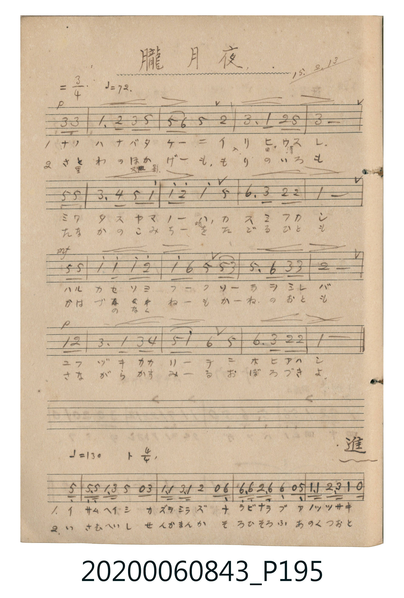
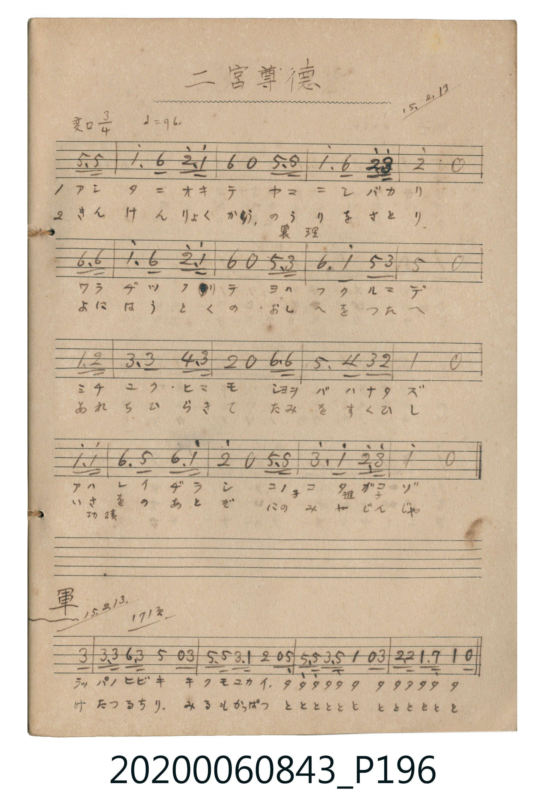

# 進軍（進軍）

> Re:Shōka 使用 AI 協助辨識與重建樂譜，可能會有錯誤。歡迎回報。

- **鋼琴伴奏版**：<br><audio controls src="shingun.mp3"></audio>

- 作詞：山崎兵藏／作曲：小山作之助（《共益唱歌》卷一第20首）
- 日治時期公學校《唱歌帳》第十冊（2020.006.0843・P195 下半跨頁至 P196 下半・大正15年2月13日抄）
- 原載：一條慎三郎 編《新編 小學校・公學校 唱歌教材集》尋常科三・四學年第25首（原書第171頁）

## 說明


- 出處：日治時期公學校《唱歌帳》第十冊（2020.006.0843- P195 下半跨頁至 P196 下半- 大正15年2月13日抄）
- 出處：原載：一條慎三郎 編《新編 小學校- 公學校 唱歌教材集》尋常科三- 四學年第25首（原書第171頁）
- 調性與拍號：調號 ?= G，拍號 <4/4>，速度 != 130


## 歌詞

```text
> [!NOTE]
> **原頁資訊與歌詞全文**（對應 `P195.jpg` 下半跨頁至 `P196.jpg` 下半）：
> - **跨頁結構與出處考證**：`P195.jpg` 最下段右端題「`進`」（旁記 `♩= 130`、`ト 4/4`），對頁 `P196.jpg` 最下段左端題「`軍`」（旁記 `15. 2. 13. 171頁`）。兩頁最下段實為同一首跨頁連續抄錄之 8 小節簡譜：右頁（`P195.jpg`）為弱起至第 4 小節第 4 拍前半休止符（`0_`），左頁（`P196.jpg`）自第 4 小節末八分弱起音 `3`（「ラッ」／「け」）接續至第 8 小節終止線。頁碼「171頁」完全對應一條慎三郎編《新編 小學校・公學校 唱歌教材集》尋常科三・四學年用第 25 首〈進軍〉（原載《共益唱歌》卷一第 20 首）。
> - **手抄頁面細節**：
>   1. 第 1 小節第 2 拍手抄簡譜作附點八分加十六分 `1. 3=`（與一條《唱歌教材集》一致）。
>   2. 第二段第 5 小節原刊本「けたつる（蹴立つる）」之「た」無濁點，手抄本亦忠實記作「た つ る」。
>   3. 第 6 小節末弱起音 `5_` 與第 7 小節 `5_. 5_= 3. 5_=` 下方均清楚點有低音點。
>
> **1.**
> イサムヘイシ　カズヲシラズ
> ナラビナラブ　アノツツサキ
> ラッパノヒビキ　キクモユカイ
> タタタタタ　タタタタタ
>
> **2.**
> いさむへいし　せんかまんか
> そろひそろふ　あのくつおと
> けたつるちり　みるもかっぱつ
> ととととと　ととととと
```

## ABC

<div class="abc-score" data-abc-src="shingun.abc" aria-label="五線譜載入中"></div>

[下載 ABC 原始檔](shingun.abc)

## TMD 檔案連結

- [主旋律 TMD 檔案](shingun.tmd) [[在 TMD Studio 編輯](https://tmdlang.github.io/Tmd-TS/#tmd=s7IKdvYPcrWy4qpTUCpJTLdSSM7PyUlNLsnMz7MqzsjPTkzOyFeCS5bl55TmploBqXhDA4RwcX5pUXJqfEFieqpVgKGlaRK6FNyo-Lz8ktSk_PxshIqCovyy1LzEPKCq3MS80uLkosyCkvjk_IJKhJrUssyUVJCK4uTEvPiy1KLMtMzUFCR3pRYVg10McUhJUWIexBygIEJVflFJRn56UWJBRqVVRmZxSX5RZnJiTnx2Yl4iQlFJRirQh7mZOZkliUVITgAqTs_MsypJzCwHOiE_LS0zOTMxB0M-NzUzKzO-JLWiBOJLLS2Flw2bXuzufb-nA8boVNDS4lK0VTA0NuCyt1Vw57Ix0TexA5n0ZO-cFyvnvd8z6-nGjU-39D1t3fpiev_7Pf1A8WezN4HEN_QDpYDcJzu7n3atBBr6uKHraevG57O7nk7Z-Gxtz-OG7qe925_saHi-Zo2Rwctl04DWgR35bPrSZ5t2P5vZ9GzO_Keta56u3fFswUKQZrC2pzs2A3UC9TztbXza1gU018jAyEDPwMBMz8DCxPhx825QvCo82QE0vevF9hUvFzS-aN-sABQ0gwoClTxdsvzZ2sWGpk93bjF6NqfD0BhkZ1cLzAVP--a_2NMJ9ATQdc8WzX3W2vdkR-fL5j6F59tXAB3ybNoGIEMB5EOI24AGwtypAHHls6kzn82d8HJ2G8iXG7qf7tjxfPlEoCEgpbNnA5UCbQb52xTs7w6ghc9m7wAKGJobAh0MdgeXvpaCLbUAl4KCgp1CtKKff4hrLISjpQW0FRQ6m9tfrOh60dEOdDYwSp-2rng2rV1LC-SqDb3P2jsVEkABqpdVkJ6AEaogKTNkKaDLgcEGsUAXaAVE6fOtE54t7wZa8bR914uZU180NL9Y2wmyYhaS2c_mNADNeLZu69P-zc9Xr3-5EJhCehKAKTHhcQMoTT6b3vhixQyFhEczV4ITJFC4MeFxc4cCMEkmgO3tAToYaBuyqxCGbl-GMBSYttEMNTTVUzDSAxoLxOAoAJn4uKHpaetKIAdhyvplz5t2PZ3QA0wYwJiD-O5lw-Lnu3qAyedlTwswsStYgFLG8_UNzzcsfLF2Digr9G8GR2oHwrdA00EG7dn4Yut2YEACY17BBKYNzH7W3fu0sxcYok_2THy2dtHzNctA-g3iYT7dvgxhJMSvQIkX7auQTXo2Z_XT1tVPO9og9rycD4wwY6A6YE7sedy88nFzMzgQ-kHcxolgduezvqVAz0CdBPfJ1iaQG7bPAoYIKDoX7QFqgYQTUNfTdT3ARANJLGgZhrr5ZcoKkKOMTBWAQf-4AVpIPW4AhgcoAwFzLJ4SRsHIAKQNEquI9PmssxsUccBInLvo-ZYNQL-CkyVEgYKCoZ4CSK8hUtQYgaIGog0SwcAi7uXMlpe7gTkHHNZdC0AlU-taIBuYrvQUjG1BQQ5M_JCwgRdkyF4GSr1o34LsOAVQcgTa9wSYstZtBVlsCnUE0KtPO7qezVkDjbbG-Y8blzxu6gZZAgyk1d0wLtCwXmB6BCubD2Q_b1n4bH8j0KHA9APxANCQJ7uWPd2_AJiugdkA6BOIYgWgEQpAM4CakBwEzBsgd5ghpS5EujKNT1AA-hGkwByqACSop2AabwvSCaTAZcSzaTufzm1_tqP12dJZQKc8m9P5ZG8f0AQgG2YVrHgy1ANWPmD24yagj7Y-bl7wuHkGmL39cUPD46bVj5t2PW7eBOICU3PTLqjiZmAJD0zck2EMYFoBKl70uLnvcXMLCAGNaloLUwzOBs0TwbKTQLqa1oLVr33ctP5xM1DXMrBFS2Au2Y-CQCpRRFB8YITwQWPL48apj5saHjfuALOng7Q2zn7cNPlxIzDG9kEYMMVzHzf1Pm7cBGNsBStuety47nFjPyh6G7seN66AKUYkgceNCx83dYEVA93S_bgJqAUouPhx40agApj6FSgIpBhFBKSM8goHChS09Lm4gjMy89JL86zC8oGNGIcaXcOaapAlCjaGZlrgsFLAVtUpQIpNUM0NLjPhNUwHJNkpaEPy5qOGybACD9RgweoEkB01CgbALI8Lm8YDiRqwQh_DGgUQDxcGJgaEWiMCahtbwGqhLgDbArbMEMwwBuZqEA1xgzFIKVTGEMwD0UZIKsxQXQlMyWApYM4A4hkQNtB1wBwB1QRx72qwwcAcAlW9Ca4CmP7h4lDVzV0ovgMmW6i5DUD2Dggb6CtgEkbW1TgbasdkqIpuIN4H1TkZzEdWPRc5VMC-AnsO4lcgAyqEHDfwgIEoMobykYIOES5AX0F8B7QZ7B-oT5unoYTLIoibgQ07iAqgr4AY4uatQLwWJVxAJQVq0DT1Qj0LDFCwl0Aae4FsSLTAPNsEsaZxHVR1P7h8hbC7QBkSRfVERNBgzxbgqh_coEXNFuBKApgbYLU2gdwASV_GwPIcV0qEiJhiTYlo-QVYgkLDsA-IJyFCHzUMwTxQwK2HqlgExMugAbcamrMQqvejBjewYoIEGrhygrIXAtmQGIYFIFgXQkVTEyj1AUtBqIaN8NCHaQCFP5YsCvE2PK8ihwwkJIygMuaoSkAYOY-C3APxDTY2il-JVI0U9uBwgSQgEI2NjeJNIlVDbKjl4tK1U4AW39E-hrEKyFwjMFeZCwA)]
- [鋼琴伴奏 TMD 檔案](shingun_piano.tmd) [[在 TMD Studio 編輯](https://tmdlang.github.io/Tmd-TS/#tmd=s7IKdvYPcrWy4qpTUCpJTLdSSM7PyUlNLsnMz7MqzsjPTkzOyFeCS5bl55TmploBqXhDA4RwcX5pUXJqfEFieqpVgKGlaRK6FNyo-Lz8ktSk_PxshIqCovyy1LzEPKCq3MS80uLkosyCkvjk_IJKhJrUssyUVJCK4uTEvPiy1KLMtMzUFCR3pRYVg10McUhJUWIexBygIEJVYhFQPD01NzWvxKogMzEvPz4xOTk_tyAxLxMkpsSlpaXwsmHTi9297_d0QBiPm3e_7N7zfMKWJ3u2PF3a_7yz4_2eTgUtLS5FWwVDYwMue1sFdy4bE30TO5AtT_bOebFy3vs9s55u3Ph0S9_T1q0vpve_39MPFH82exNIfEM_UArIfbKz-2nXSrDTnk1f-mzT7mczm57Nmf-0dc3TtTueLVj4uKHr6ZSNz9b2PN2x-XFD9_M1a572Nj5t6wI6zMjAyEDPwMBMz8DCxBjoPlCAP2qYDKTMFJ7s6H7a2wUUfLpk-bO1iw1Nn-7cYvRsToehMciWrhag45W4uIIzMvPSS_OswvKTE3McanQNa6q5FIDAxtBMyw7MqlEwUNDFiU3jgUQNWKGPYY0CiIcLP25aglBrREBtYwtYLdQFYFvAlhmCGcYKpmAa4gZjkFKojCGYB6KNkFSYobrycdNWsNTj5gVAPAPCBrrucdN2qCaIe1eDDX7ctAuqehNcxePmlXBxqOrmLhTfPW6cCjW3AcjeAWEDffW4cTqyrsbZUDsmQ1V0A_E-qM7JYD6y6rnIoQL2FdhzEL8CGVAh5LiBBwxEkTGUjxR0iHAB-griO6DNYP9Afdo8DSVcFkHc3NwHVQH0FRBD3LwViNeihMvKx83NqEHT1Av1LDBAwV4CaewFsiHRAvNsE8SaxnVQ1f1ADEpCIHYXEK9AUT0ROWggicBYwQxKYyYXiIgp1uSClqgfN4PMBnmlD4gnIYII1aNgHsh366EqFgHxMqjvVkOTP0L1ftQwaZwP9RkoGUIi_XHjQiAbEg0wX4J1IVQ0NYGSyOPGxVANG-FBBNMACiQs-QjibXiGQg4ZSEgYQWXMUZWAMHJGArkH4htsbBS_EqkaKezB4QKJZRCNjY3iTSJVQ2yoRRR-AaAKIMiDsuIPOXRN47VhBZWhtrE2ltQHU2AIUgBlAQXN47VxlFs1Cibx2ogcbwZTCGQjJFDyPZIdcGOBOQEmil4AAAsKqEtAjjbRhmUd7B5AiJri9QGOAIJpQQ4rtPCBG2SEUAJMjMbx2mg6IEkSPTp9UKLTBCk2IRDuaZCRIBIoBKLM4kFOAnOhKoyAPJAoiIYqAimAaEGYAkFQBVA1OBSApJCMADpd104B6vpoH8NYBWSuEZirzAUA)]

## 分析

```text
================================================================================
📊 TMD Song Profile: [ 進軍（進軍） ]
================================================================================
⏱  Duration:       0:29 (29.5s), 16 measures total
🎼 Key & Tempo:    首調基準 G, != 130.0 BPM, <4/4>
   - 分析範圍：      由實際發聲的音符與和弦推測調性；播放脈絡另行呈現
🎤 人聲音域:    D4 (MIDI 62) – E5 (MIDI 76) [跨度: 14 個半音 / 1.2 個八度, 難度: moderate]
   - 最低音:  D4 in [Shingun[L1] #1 @ m.1, 0:01]
   - 最高音: E5 in [Shingun[L1] #1 @ m.6, 0:09]
   - 適合: soprano, mezzo-soprano, contralto, tenor, baritone, bass
🏛  結構:      Shingun[L1] (14.8s) -> Shingun[L2] (14.8s)
⚡ 編曲密度:        Peak 1 軌道同時演奏
🗝  調性診斷：       G 大調（純淨自然大調，未偵測到可信轉調）
   - 風格氣質:    純淨自然大調（陽光明朗、易唱易記，無明顯調外色彩）
   - 轉調歷程:    全曲維持單一推測調性（未偵測到可信轉調）
   - 核心骨幹音:  G, D, B, A, E
   - 調性數值:    G 大調 [相關度: 0.87, 穩定度: Moderate, 自然音純度: 100.0%]
   - 候選調性 (K-S): G 大調 (0.87), D 大調 (0.75), B 小調 (0.68)
   - 五度圈歷程:   +1 -> +1
   - 各段落調性細節:
     • [Shingun[L1] #1]: G 大調 (r: 0.82, 自然音純度: 100.0%)
     • [Shingun[L2] #1]: G 大調 (r: 0.87, 自然音純度: 100.0%)

  [ 五度圈游移軌跡 ]
               C  
         F           [G ]*
      Bb               D  
      Eb               A  
         Ab           E  
            Db       B  
               F# 
     (* = active key center)

  [ 十二半音累積音高分佈 ]
     C  :                            0.0%
     C# :                            0.0%
     D  : ███████████████████████   24.1%
     D# :                            0.0%
     E  : ████████████              12.5%
     F  :                            0.0%
     F# : █                          0.9%
     G  : ████████████████████████  25.0%
     G# :                            0.0%
     A  : ███████████████           16.1%
     A# :                            0.0%
     B  : █████████████████████     21.4%
--------------------------------------------------------------------------------
Assignment 軌道音域：
  - Vocal         : D4 – E5 (14 個半音 / 1.2 個八度, 96 個音符)
================================================================================
```


## 原書掃描頁






