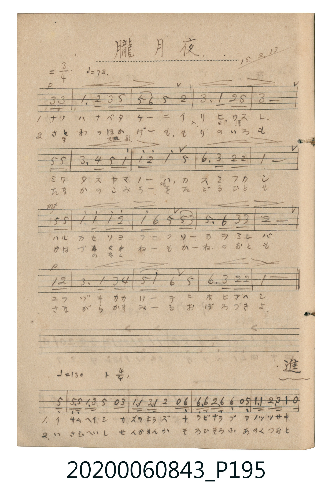
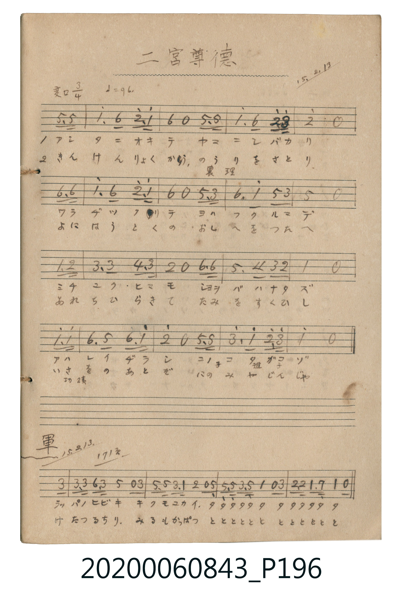

# 進軍 (進軍)

<audio controls src="shingun.mp3"></audio>

- 詞曲作者：未在 TMD metadata 中提供

## 說明

進軍 (進軍)
Source: 唱歌帖 (2020.006.0843), P195.jpg (bottom) – P196.jpg (bottom)
Marginalia: 15.2.13. 171頁 (大正15年2月13日)

## 跨冊／重複收錄參照

> 同名異曲（各冊收錄之不同詞曲版本）

- **[同名異曲]** 《新定兒童唱歌》尋常科第三學年用（2020.006.0847.0003）：[**〈進軍〉**](../../../shintei_jido_shoka/grade_3_2020.006.0847.0003/4_17_shingun/index.md)（`F` / `2/4` — [原始 TMD](../../../shintei_jido_shoka/grade_3_2020.006.0847.0003/4_17_shingun/shingun.tmd)）
- **[同名異曲]** 《新定兒童唱歌》高等科男子用（2020.006.0848）：[**〈進軍〉**](../../../shintei_jido_shoka/koto_boys_2020.006.0848/2_2_02_shingun/index.md)（`G` / `4/4` — [原始 TMD](../../../shintei_jido_shoka/koto_boys_2020.006.0848/2_2_02_shingun/shingun.tmd)）
- 總表：[跨冊重複與同名歌曲總索引](../../../duplicate_songs.md)

## 歌詞

```text
1.
マルセイユノタミ イザタチテ ススメヤススメ ツルギヲバヌキ
トキノコエヲアゲ イザススメ ミクニノタメニ イザススメ

2.
よものあだども うちはらひ すすめやتすすめ つるぎをばぬき
ときのこゑをあげ いざすすめ みくにのために いざすすめ
```

## ABC

```abc
X:1
T:進軍 進軍
M:4/4
L:1/16
Q:1/4=130
K:G
V:V1 name="Vocal" snm="Voc"
[V:V1]
z14 D2 | G2 G2 A2 A2 d2 B2 G2 G2 | A3 F D4 z6 D2 | G2 G2 A2 A2 B4 z2 B2 |
A2 G2 A2 B2 G4 z2 G2 | d2 d2 d2 B G A4 z2 A2 | B2 B2 B2 d B A4 z2 D2 | G3 A B3 c d4 z2 G2 |
B4 A4 G4 z4 |
```

## TMD 檔案連結

- [主旋律 TMD 檔案](shingun.tmd) [[在 TMD Studio 編輯](https://tmdlang.github.io/Tmd-TS/#tmd=s7IKdvYPcrWy4tLSUnjZsOnF7l4FDQitqaClxaVoq2BobMBlb6vgzmVjom9ix8Wlr8WloICuFiQUnF9alJxqpfB0ysZna3ue7pimoGFkYGSgZ2BgpmdgYWKsqaMQYGhpqpdVkK6gkZRfUpKfq6nwqGEySNQMRRRkmm9iUXpmXmJOZqKVgqGpnpGeobGegqG54csFjQoaT5csf7Z2saHp051bjJ7N6TA0fjZ9qSYXSJtPZVFmcrEViGmoByIfN8973Lz6cdPux01LHjcve9zc97hp_-Pm-QogftM2MKfxcXMbkL8ThJoXPm4GSkDZQO0tYO3rHjdvetw84XFzz-OmtRBzO4AssHGbHzetAEk3LXrctAluLsKE-Y-b1j9u7oZZDbSgG10V2O1GEAc3AQ1uety47nEjkFzwuHElkKvwuLHtcePCx43rHzd1Pm4E2tI4E4SaGh83tdxYBecBxYHmdj9uBFo16XHjhseNax439oKNbVwBZIGNnfy4aSJYGmj-JKBEy-PGacgm7H_c2P-4cTVYLdDtjUA2uiouLX0uLt_EzDyrsPzkxByHGoMahWqQNQo2hmZadmBWjYKBgi5OaBoPJGoUDIEkCBtBsSkQG0PFQLgGLKqrYB4P0QGCyMbiMAZkBEwpiF0DdRFIDqYOZg1MHcQ6kANg2BgoBrEeogLErgHrg2FTIImsAsk5IOUQZ5iADUOxBuocmDNhRiA7BwRruGq5uHTtgJkhM08BSCtzAQA)]
- [鋼琴伴奏 TMD 檔案](shingun_piano.tmd) [[在 TMD Studio 編輯](https://tmdlang.github.io/Tmd-TS/#tmd=s7IKdvYPcrWy4tLSUnjZsOnF7l4FDQitqfCoYYpCQGZiXr6CY3Jyfm5BYl5mbmpeiYKWFpeirYKhsQGXva2CO5eNib6JHReXvhaXggKxZoCUBueXFiWnWik8nbLx2dqepzumKWgYGRgZ6BkYmOkZWJgYa-ooBBhamuplFaQraCTll5Tk54LMmwwSNUMRBZnmm1iUnpmXmJOZaKVgaKpnpGdorKdgaG74ckGjgsbTJcufrV1saPp05xajZ3M6DI2fTV-qyaWlz8Xlm5iZZxWWn5yY41BjUKNQDTJKwcbQTMsOzKpRMFDQxQlN44FEjYIhkARhIyg2BWJjqBgI14BFdRXM4yE6QBDZWBzGgIyAKQWxa6AuAsnB1MGsgamDWAdyAAwbA8Ug1kNUgNg1YH0wbAokkVUgOQekHOIME7BhKNZAnQNzJswIZOeAYA1XLTSYwekgyIP8gDaN1waZjqDMdeK1wSGOYBpqG2uD_Q5UpA32HkQ1NGQQCqHxAeKjuZhEG-E2YYssNHU4dBrHa0NlUSMS5hl0GhSpKF5BjlsUn6MxgDqx6EP1LMgcJD-ZwG3FFvsonkczGtNXWNKDDznpASQHDB1YxJnCoxAuBGcAnQiXRbCQDSdsGMLpUE9jMRFTMRbHYDqAfFUUug4UC7p2wGIzM08BSCtzAQA)]

## 分析

```text
================================================================================
📊 TMD Song Profile: [ 進軍 進軍 ]
================================================================================
⏱  Duration:       0:16 (16.6s), 9 measures total
🎼 Key & Tempo:    首調基準 G, != 130.0 BPM, <4/4>
   - 分析範圍：      由實際發聲的音符與和弦推測調性；播放脈絡另行呈現
🎤 人聲音域:    D4 (MIDI 62) – D5 (MIDI 74) [跨度: 12 個半音 / 1.0 個八度, 難度: easy]
   - 最低音:  D4 in [Main #1 @ m.1, 0:01]
   - 最高音: D5 in [Main #1 @ m.2, 0:02]
   - 適合: soprano, mezzo-soprano, contralto, tenor, baritone, bass
🏛  結構:      Main (16.6s)
⚡ 編曲密度:        Peak 1 軌道同時演奏
🗝  調性診斷：       G 大調（純淨自然大調，未偵測到可信轉調）
   - 風格氣質:    純淨自然大調（陽光明朗、易唱易記，無明顯調外色彩）
   - 轉調歷程:    全曲維持單一推測調性（未偵測到可信轉調）
   - 核心骨幹音:  G, A, B, D, C
   - 調性數值:    G 大調 [相關度: 0.76, 穩定度: Moderate, 自然音純度: 100.0%]
   - 候選調性 (K-S): G 大調 (0.76), D 大調 (0.72), B 小調 (0.57)
   - 五度圈歷程:   +1
   - 各段落調性細節:
     • [Main #1]: G 大調 (r: 0.76, 自然音純度: 100.0%)

  [ 五度圈游移軌跡 ]
               C  
         F           [G ]*
      Bb               D  
      Eb               A  
         Ab           E  
            Db       B  
               F# 
     (* = active key center)

  [ 十二半音累積音高分佈 ]
     C  : █                          0.9%
     C# :                            0.0%
     D  : ██████████████████        20.9%
     D# :                            0.0%
     E  :                            0.0%
     F  :                            0.0%
     F# : █                          0.9%
     G  : ████████████████████████  27.3%
     G# :                            0.0%
     A  : ████████████████████████  27.3%
     A# :                            0.0%
     B  : ████████████████████      22.7%
--------------------------------------------------------------------------------
Assignment 軌道音域：
  - Vocal         : D4 – D5 (12 個半音 / 1.0 個八度, 48 個音符)
================================================================================
```


## 原書掃描頁






