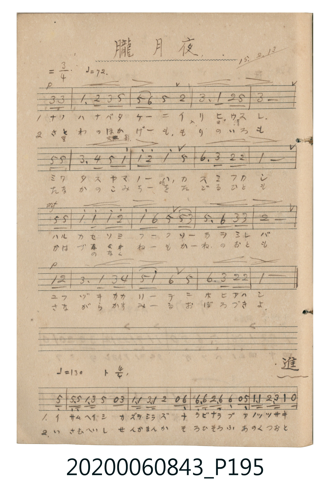
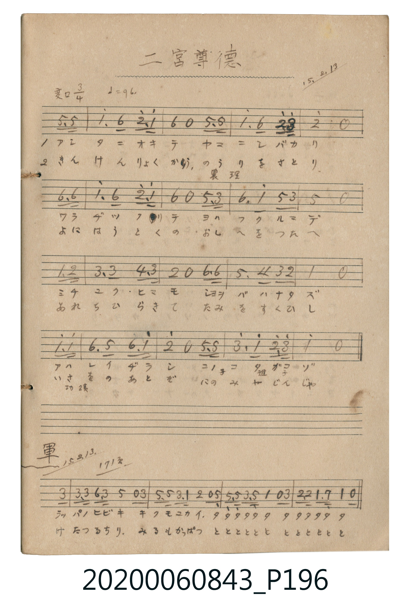

# 進軍（進軍）

> Re:Shōka 使用 AI 協助辨識與重建樂譜，可能會有錯誤。歡迎回報。

- **鋼琴伴奏版**：<br><audio controls src="shingun.mp3"></audio>
- **NEUTRINO 歌聲合成版**：<br><audio controls src="shingun_neutrino.mp3"></audio>

- 作詞：山崎兵藏／作曲：小山作之助（《共益唱歌》卷一第20首）
- 日治時期公學校《唱歌帳》第十冊（2020.006.0843・P195 下半跨頁至 P196 下半・大正15年2月13日抄）
- 原載：一條慎三郎 編《新編 小學校・公學校 唱歌教材集》尋常科三・四學年第25首（原書第171頁）

## 說明


- 出處：日治時期公學校《唱歌帳》第十冊（2020.006.0843- P195 下半跨頁至 P196 下半- 大正15年2月13日抄）
- 出處：原載：一條慎三郎 編《新編 小學校- 公學校 唱歌教材集》尋常科三- 四學年第25首（原書第171頁）
- 調性與拍號：調號 ?= G，拍號 <4/4>，速度 != 130


## 歌詞

```text
> [!NOTE]
> **原頁資訊與歌詞全文**（對應 `P195.jpg` 下半跨頁至 `P196.jpg` 下半）：
> - **跨頁結構與出處考證**：`P195.jpg` 最下段右端題「`進`」（旁記 `♩= 130`、`ト 4/4`），對頁 `P196.jpg` 最下段左端題「`軍`」（旁記 `15. 2. 13. 171頁`）。兩頁最下段實為同一首跨頁連續抄錄之 8 小節簡譜：右頁（`P195.jpg`）為弱起至第 4 小節第 4 拍前半休止符（`0_`），左頁（`P196.jpg`）自第 4 小節末八分弱起音 `3`（「ラッ」／「け」）接續至第 8 小節終止線。頁碼「171頁」完全對應一條慎三郎編《新編 小學校・公學校 唱歌教材集》尋常科三・四學年用第 25 首〈進軍〉（原載《共益唱歌》卷一第 20 首）。
> - **手抄頁面細節**：
>   1. 第 1 小節第 2 拍手抄簡譜作附點八分加十六分 `1. 3=`（與一條《唱歌教材集》一致）。
>   2. 第二段第 5 小節原刊本「けたつる（蹴立つる）」之「た」無濁點，手抄本亦忠實記作「た つ る」。
>   3. 第 6 小節末弱起音 `5_` 與第 7 小節 `5_. 5_= 3. 5_=` 下方均清楚點有低音點。
>
> **1.**
> イサムヘイシ　カズヲシラズ
> ナラビナラブ　アノツツサキ
> ラッパノヒビキ　キクモユカイ
> タタタタタ　タタタタタ
>
> **2.**
> いさむへいし　せんかまんか
> そろひそろふ　あのくつおと
> けたつるちり　みるもかっぱつ
> ととととと　ととととと
```

## ABC

<div class="abc-score" data-abc-src="shingun.abc" aria-label="五線譜載入中"></div>

[下載 ABC 原始檔](shingun.abc)

## TMD 檔案連結

- [主旋律 TMD 檔案](shingun.tmd) [[在 TMD Studio 編輯](https://tmdlang.github.io/Tmd-TS/#tmd=s7IKdvYPcrWy4qpTUCpJTLdSSM7PyUlNLsnMz7MqzsjPTkzOyFeCS5bl55TmploBqXhDA4RwcX5pUXJqfEFieqpVgKGlaRK6FNyo-Lz8ktSk_PxshIqCovyy1LzEPKCq3MS80uLkosyCkvjk_IJKhJrUssyUVJCK4uTEvPiy1KLMtMzUFCR3pRYVg10McUhJUWIexBygIEJVflFJRn56UWJBRqVVRmZxSX5RZnJiTnx2Yl4iQlFJRirQh7mZOZkliUVITgAqTs_Ms8pNzczKjC9JrShB9QVUuiQxsxzowvy0tMzkzMQcJS4tLYWXDZte7O59v6cDxuhU0NLiUrRVMDQ24LK3VXDnsjHRN7EDGfVk75wXK-e93zPr6caNT7f0PW3d-mJ6__s9_UDxZ7M3gcQ39AOlgNwnO7ufdq0EGvq4oetp68bns7ueTtn4bG3P44bup73bn-xoeL5mjZHBy2XTgNaBXfls-tJnm3Y_m9n0bM78p61rnq7d8WzBQpBmsLanOzYDdQL1PO1tfNrWBTTXyMDIQM_AwEzPwMLE-HHzblC8KjzZATS968X2FS8XNL5o36wAFDSDCgKVPF2y_NnaxYamT3duMXo2p8PQGGRnVwvMBU_75r_Y0wn0BNB1zxbNfdba92RH58vmPoXn21cAHfJs2gYgQwHkQ4jbgAbC3KkAceWzqTOfzZ3wcnYbyJcbup_u2PF8-USgISCls2cDlQJtBvnbFOzvDqCFz2bvAAoYmhsCHQx2B5e-loIttQCXgoKCnUK0op9_iGsshKOlBbQVFDqb21-s6HrR0Q50NjBKn7aueDatXUsL5KoNvc_aOxUSQAGql1WQnoARqiApM2QpoMuBwQaxQBdoBUTp860Tni3vBlrxtH3Xi5lTXzQ0v1jbCbJiFpLZz-Y0AM14tm7r0_7Nz1evf7kQmEJ6EoApMeFxAyhNPpve-GLFDIWERzNXghMkULgx4XFzhwIwSSaA7e0BOhhoG7KrEIZuX4YwFJi20Qw1NNVTMNIDGgvE4CgAmfi4oelp60ogB2HK-mXPm3Y9ndADTBjAmIP47mXD4ue7eoDJ52VPCzCxK1iAUsbz9Q3PNyx8sXYOKCv0bwZHagfCt0DTQQbt2fhi63ZgQAJjXsEEpg3Mftbd-7SzFxiiT_ZMfLZ20fM1y0D6DeJhPt2-DGEkxK9AiRftq5BNejZn9dPW1U872iD2vJwPjDBjoDpgTux53LzycXMzOBD6QdzGiWB257O-pUDPQJ0E98nWJpAbts8ChggoOhftAWqBhBNQ19N1PcBEA0ksaBmGuvllygqQo4xMFYBB_7gBWkg9bgCGBygDAXMsnhJGwcgApA0Sq4j0-ayzGxRxwEicu-j5lg1Av4KTJUSBgoKhngJIryFS1BiBogaiDRLBwCLu5cyWl7uBOQcc1l0LQCVT61ogG5iu9BSMbUFBDkz8kLCBF2TIXgZKvWjfguw4BVByBNr3BJiy1m0FWWwKdQTQq087up7NWQONtsb5jxuXPG7qBlkCDKTV3TAu0LBeYHoEK5sPZD9vWfhsfyPQocD0A_EA0JAnu5Y93b8AmK6B2QDoE4hiBaARCkAzgJqQHATMGyB3mCGlLkS6Mo1PUAD6EaTAHKoAJKinYBpvC9IJpMBlxLNpO5_ObX-2o_XZ0llApzyb0_lkbx_QBCAbZhWseDLUA1Y-YPbjJqCPtj5uXvC4eQaYvf1xQ8PjptWPm3Y9bt4E4gJTc9MuqOJmYAkPTNyTYQxgWgEqXvS4ue9xcwsIAY1qWgtTDM4GzRPBspNAuprWgtWvfdy0_nEzUNcysEVLYC7Zj4JAKlFEUHxghPBBY8vjxqmPmxoeN-4As6eDtDbOftw0-XEjMMb2QRgwxXMfN_U-btwEY2wFK2563LjucWM_KHobux43roApRiSBx40LHzd1gRUD3dL9uAmoBSi4-HHjRqACmPoVKAikGEUEpIzyCgcKFLT0ubiCMzLz0kvzrMLygY0Yhxpdw5pqkCUKNoZmWuCwUsBW1SlAik1QzQ0uM-E1TAck2SloQ_Lmo4bJsAIP1GDB6gSQHTUKBsAsjwubxgOJGrBCH8MaBRAPFwYmBoRaIwJqG1vAaqEuANsCtswQzDAG5moQDXGDMUgpVMYQzAPRRkgqzFBdCUzJYClgzgDiGRA20HXAHAHVBHHvarDBwBwCVb0JrgKY_uHiUNXNXSi-AyZbqLkNQPYOCBvoK2ASRtbVOBtqx2Soim4g3gfVORnMR1Y9FzlUwL4Cew7iVyADKoQcN_CAgSgyhvKRgg4RLkBfQXwHtBnsH6hPm6ehhMsiiJuBDTuICqCvgBji5q1AvBYlXEAlBWrQNPVCPQsMULCXQBp7gWxItMA82wSxpnEdVHU_uHyFsLtAGRJF9URE0GDPFuCqH9ygRc0W4EoCmBtgtTaB3ABJX8bA8hxXSoSImGJNiWj5BViCQsOwD4gnIUIfNQzBPFDArYeqWATEy6ABtxqasxCq96MGN7BiggQauHKCshcC2ZAYhgUgWBdCRVMTKPUBS0Goho3w0IdpAIU_liwK8TY8ryKHDCQkjKAy5qhKQBg5j4LcA_ENNjaKX4lUjRT24HCBJCAQjY2N4k0iVUNsqOXi0rVTgBbf0T6GsQrIXCMwV5kLAA)]
- [鋼琴伴奏 TMD 檔案](shingun_piano.tmd) [[在 TMD Studio 編輯](https://tmdlang.github.io/Tmd-TS/#tmd=s7IKdvYPcrWy4qpTUCpJTLdSSM7PyUlNLsnMz7MqzsjPTkzOyFeCS5bl55TmploBqXhDA4RwcX5pUXJqfEFieqpVgKGlaRK6FNyo-Lz8ktSk_PxshIqCovyy1LzEPKCq3MS80uLkosyCkvjk_IJKhJrUssyUVJCK4uTEvPiy1KLMtMzUFCR3pRYVg10McUhJUWIexBygIEJVYhFQPD01NzWvxKogMzEvPz4xOTk_tyAxLxMkhlCYX1SSkZ9elFiQUWmVkVlckl-UmZyYE5-dmJeIUFSSATTJKjczJ7MksQjoVi0thZcNm17s7n2_pwPCeNy8-2X3nucTtjzZs-Xp0v7nnR3v93QqaGlxKdoqGBobcNnbKrhz2Zjom9iBDH2yd86LlfPe75n1dOPGp1v6nrZufTG9__2efqD4s9mbQOIb-oFSQO6Tnd1Pu1aCXfJs-tJnm3Y_m9n0bM78p61rnq7d8WzBwscNXU-nbHy2tufpjs2PG7qfr1nztLfxaVsX0GFGBkYGegYGZnoGFibGQPeBYutRw2QgZabwZEf3094uoODTJcufrV1saPp05xajZ3M6DI1BtnS1AB2vxMUVnJGZl16aZxWWDwwShxpdw5pqLgUgsDE007IDs2oUDBR0cWLTeCBRA1boY1ijAOLhwo-bliDUGhFQ29gCVgt1AdgWsGWGYIaxgimYhrjBGKQUKmMI5oFoIyQVZqiufNy0FSz1uHkBEM-AsIGue9y0HaoJ4t7VYIMfN-2Cqt4EV_G4eSVcHKq6uQvFd48bp0LNbQCyd0DYQF89bpyOrKtxNtSOyVAV3UC8D6pzMpiPrHoucqiAfQX2HMSvQAZUCDlu4AEDUWQM5SMFHSJcgL6C-A5oM9g_UJ82T0MJl0UQNzf3QVUAfQXEEDdvBeK1KOGy8nFzM2rQNPVCPQsMULCXQBp7gWxItMA82wSxpnEdVHU_EIOSEIjdBcQrUFRPRA4aSCIwVjCD0pjJBSJiijW5oCXqx80gs0Fe6QPiSYggQvUomAfy3XqoikVAvAzqu9XQ5I9QvR81TBrnQ30GSoaQSH_cuBDIhkQDzJdgXQgVTU2gJPK4cTFUw0Z4EME0gAIJSz6CeBueoZBDBhISRlAZc1QlIIyckUDugfgGGxvFr0SqRgp7cLhAYhlEY2OjeJNI1RAbahGFXwCo9gjyoKz4Qw5d03htWEFlqG2sjSX1wRQYghRAWUBB83htHOVWjYJJvDYix5vBFALZCAmUfI9kB9xYYE6AiaIXAMCCAuoSkKNNtGFZB7sHEKKmeH2AI4BgWpDDCi184AYZIZQAE6NxvDaaDkiSRI9OH5ToNEGKTQiEexpkJIgECoEos3iQk8BcqAojIA8kCqKhikAKIFoQpkAQVAFUDQ4FICkkI4BO17VTgLo-2scwVgGZawTmKnMBAA)]

## 分析

```text
================================================================================
📊 TMD Song Profile: [ 進軍（進軍） ]
================================================================================
⏱  Duration:       0:29 (29.5s), 16 measures total
🎼 Key & Tempo:    首調基準 G, != 130.0 BPM, <4/4>
   - 分析範圍：      由實際發聲的音符與和弦推測調性；播放脈絡另行呈現
🎤 人聲音域:    D4 (MIDI 62) – E5 (MIDI 76) [跨度: 14 個半音 / 1.2 個八度, 難度: moderate]
   - 最低音:  D4 in [Shingun[L1] #1 @ m.1, 0:01]
   - 最高音: E5 in [Shingun[L1] #1 @ m.6, 0:09]
   - 適合: soprano, mezzo-soprano, contralto, tenor, baritone, bass
🏛  結構:      Shingun[L1] (14.8s) -> Shingun[L2] (14.8s)
⚡ 編曲密度:        Peak 1 軌道同時演奏
🗝  調性診斷：       G 大調（純淨自然大調，未偵測到可信轉調）
   - 風格氣質:    純淨自然大調（陽光明朗、易唱易記，無明顯調外色彩）
   - 轉調歷程:    全曲維持單一推測調性（未偵測到可信轉調）
   - 核心骨幹音:  G, D, B, A, E
   - 調性數值:    G 大調 [相關度: 0.87, 穩定度: Moderate, 自然音純度: 100.0%]
   - 候選調性 (K-S): G 大調 (0.87), D 大調 (0.75), B 小調 (0.68)
   - 五度圈歷程:   +1 -> +1
   - 各段落調性細節:
     • [Shingun[L1] #1]: G 大調 (r: 0.82, 自然音純度: 100.0%)
     • [Shingun[L2] #1]: G 大調 (r: 0.87, 自然音純度: 100.0%)

  [ 五度圈游移軌跡 ]
               C  
         F           [G ]*
      Bb               D  
      Eb               A  
         Ab           E  
            Db       B  
               F# 
     (* = active key center)

  [ 十二半音累積音高分佈 ]
     C  :                            0.0%
     C# :                            0.0%
     D  : ███████████████████████   24.1%
     D# :                            0.0%
     E  : ████████████              12.5%
     F  :                            0.0%
     F# : █                          0.9%
     G  : ████████████████████████  25.0%
     G# :                            0.0%
     A  : ███████████████           16.1%
     A# :                            0.0%
     B  : █████████████████████     21.4%
--------------------------------------------------------------------------------
Assignment 軌道音域：
  - Vocal         : D4 – E5 (14 個半音 / 1.2 個八度, 96 個音符)
================================================================================
```


## 原書掃描頁






