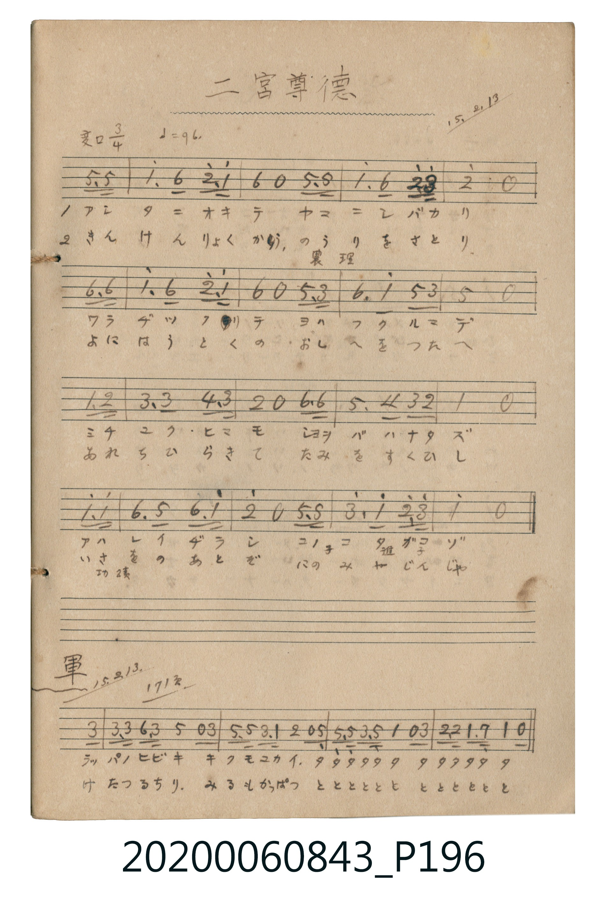

# 二宮尊徳（二宮尊德）

> Re:Shōka 使用 AI 協助辨識與重建樂譜，可能會有錯誤。歡迎[回報](https://github.com/TMDLang/reshoka/issues)。

- **鋼琴伴奏版**：<br><audio controls src="ninomiya_sontoku.mp3"></audio>
- **NEUTRINO 歌聲合成版**：<br><audio controls src="ninomiya_sontoku_neutrino.mp3"></audio>

- 作詞：桑田春風／作曲：田村虎藏
- 日治時期公學校《唱歌帳》第十冊（2020.006.0843・P196 上半・大正15年2月13日抄）
- 原載：一條慎三郎 編《新編 小學校・公學校 唱歌教材集》高等科一・二學年第2首

## 說明

> [!NOTE]
> **原頁資訊與歌詞全文**（對應 `P196.jpg` 上半）：
> - **出處與抄寫日期**：標題上記「`15. 2. 13`」（大正 15 年 2 月 13 日），抄自一條慎三郎編《新編 小學校・公學校 唱歌教材集》高等科一・二學年第 2 首〈二宮尊德〉（桑田春風作詞、田村虎藏作曲；非 1911 年《尋常小學唱歌》之〈二宮金次郎〉）。
> - **調性與拍號**：`変ロ 3/4`（降 B 大調 3/4 拍，`?= B,`, `<3/4>`），速度標記 `♩= 96`。
> - **首調八度對照**：手抄簡譜以無點 `1` 表 Bb3（對應 TMD `?= B,` 之 `1_`），上方加高音點 `1̇` 表 Bb4（對應 TMD `1`）；全曲音域為 Bb3（`1_`）至 D5（`3`）。
> - **手抄頁面細節**：
>   1. 第 10 小節第一段「書（しょ）をば」手抄片假名作大字「シヨ」。
>   2. 第二段保留歷史假名遣「きんけんりょくかう（勤儉力行）」「はうとく（報德）」「おしへ（教へ）」「いさを（功）」。
>
> **1.**
> アシタニオキテ　ヤマニシバカリ
> ワラヂツクリテ　ヨハフクルマデ
> ミチユクヒマモ　シヨヲバハナタズ
> アハレイヂラシ　コノコタガコゾ
>
> **2.**
> きんけんりょくかう　のうりをさとり
> よにはうとくの　おしへをつたへ
> あれちひらきて　たみをすくひし
> いさをのあとぞ　にのみやじんじゃ


## 歌詞

```text
（TMD 檔案未包含歌詞註解）
```

## ABC

<div class="abc-score" data-abc-src="ninomiya_sontoku.abc" aria-label="五線譜載入中"></div>

[下載 ABC 原始檔](ninomiya_sontoku.abc)

## TMD 檔案連結

- [主旋律 TMD 檔案](ninomiya_sontoku.tmd) [[在 TMD Studio 編輯](https://tmdlang.github.io/Tmd-TS/#tmd=s7IKdvYPcrWy4qpTUCpJTLdSSM7PyUlNLsnMz7MqzsjPTkzOyFeCS5bl55TmploBqXhDA4RwcX5pUXJqfEFieqpVgKGlGboM3KT4vPyS1KT8_GyEioKi_LLUvMQ8oKrcxLzS4uSizIKS-OT8gkqEmtSyzJRUkIri5MS8-LLUosy0zNQUJGelFhWDHQxxR0lRYh7EHKAgQlV-UUlGfnpRYkFGpVVGZnFJflFmcmJOfHZiXiJCUUlGKtCDuflFiTnIOjPTM_OAonlJpUCvYEqkZmZlxpekVpSg-g0qXZKYCdQVD8TlifG5iZl5OYl5QNdraSk82dXzdN26pxu6nu7b_H5PBxJ3-_s9nQpaWlyKtgqWZlz2tgpOOlw2xvomdiDDn-yd82LlvPd7Zj1bOPH5lA3PZix9uWjF-z39QPFnszcBxUGCcye-mNn3Yno_2DnPpi99tmn3s5lNz-bMf9q65unaHc8WLHzc0PV0ysZna3ue7tj8uKH7-Zo1T3sbn7Z1AV1iZGBkoGdgYKZnYGFi_Lh5NyhWFZ7s6Hra2wXkPV2y_NnaxYamT3duMXo2p8PQGGR8VwvQyWDLnvbNf7GnE-iMJzsani2a-6y178mOzpfNfQrPt68A2vls2gYgQ-Hphn6oM4AGwpykAHHQs6kzn82d8HJ2G9BZL1fPeL628_nyiUDTgEpBYbR2B9BmoHONXi6bpsTFpa-lYEstwKWgoGCnEK3o5x_iGgvhaGkBPfRyQeOLze0vVnS96GgHOhAY_E9bVzyb1q6lBQytpxt6n7V3KiSAQkkvqyA9ARpUwAABhgLEFF2QOe27XsycCjKhq-Xp-tWgUJszH2TCrGcrZr5c2APU9WLFjMcNPQmGpnoKRnoKhsYJjxt6QTaAQ1zB0FQB6HMFIwVgqAMlFYAmgO3oARr4on0VWnhTO7iB9gID_HEDSjp93AC0vwM5IUJS5-OGRuRUCEuas1_OnadgaGloCPIIKAFu6H66YwfEcRDHAN3wZGc33JaX7ROfrVkI9A3Yos7HDU2I8Hyxav-zhuWg8OzufTETEpIJT5d0Pm5eqwDMKwlAh72c2avgpAAMPqBakJgCUCkwvBLAOSpBRyEBnKmAKkGh-LJh_tNdy4BxAYwFhYRHM1eCMh8wBpCsBAYA0KSnrauBCoHR_rx1OST-OruBUfB8w8IXa-c82b30ecvCl7vnKSQYJii8WLhCwSnJGJFKQnxdFKDWKwA9ClQUD7UeGP3Ppu182rUAGAcv52-GmHCmHWaGCZoZhhBts0EJcfYmoIan8-c_b9oFtQ1q7Iv2zQoupiC-MYiL4heIo4Ep--XcRc-3bHi-vgHsF4gCBQVDPQVQpBsagNIOUBLIASWwdVuBCfTZ7B1AMx83Tn_c1A4ytmnS48YNwKQKDYfO9qeN7U8n9AJjHRj0T9dOB2p53LT9cTMwQfbC3aAASuIgU3f1AE19sn_uc2A6XLv9af8miO6XjYtB-hp7HzdNftw4EUQ2dQEtfNzY_7ix-3FjGyhAupc8bel82jX7xcIesP-AxgO1rAfKPm5cAVQJUrNgI6RAhcl2gRzeCPIBMOWDGXCplseNU4G-Aenqmg8Th7gXVhoY6gHLZTD7cdMikK-a9j9u7n7ctOpx09rHzcA8BMw3Sx43zwMLAv084XHT6sfNq6Bamtc_bl75uLnpcXPL4yYgexVMy4rHzf2Pm4GWAwWB6oHa22Fa5j9ubnzcvAwsNQkstQikBRKgzZtAVoD0AsNm_-OmXQi3gQTXPG4COgZo3UqQepCuzY-BmQlIghQDZYGMfSj-M0L4D3fQg0xqXAdigMSBsT8VFNxNXTDLgWljNXI0gBSDtECDHqxlyePG-UA2zK6mx03ACFj4uHHT46ZOkNWNy8BagGqALgWqB0YV0JxNQBNgWqCxBXZJE9giYLkD1AK0GigC1AVUMAPsBSDZDNJFeQ0BBQpa-lxcfpl5-bmZlYnB-Xkl-dmlVgGZiXn5DjW6hjXVIMsUbAzNtMDhqoCtjgKn_R0NwJSroPF0z8YXW7craCuYQHObjgKsNoFWJppYDAC6AWR4jYIBMEODIIw2jYdRNWAVPoY1ChAhXTgNTCFQejtMlREWVY29UFWTgaqg1hlCJUHQDKTSCMw0BEqBuTicgkufMVAKwkJog5oDpBA-ACZZJAOA-QvsrlVQ960FmgLMTOjub14CpeeB5UF64CYAfQ6SmQDlrQargJiHbMJ6KL0SKZyAuQLFpMlgEpRHIAKN_SDDwHkF3bzGdVC6DaSkqQvFnElgmalQFStQVCBirgMqD3QxJE5wpq9dPeD0RV6yIiOejUHxDJeEqIZKAqV0gZJQhQidhhABI5Sobm5CDpbmFrC3YRGxCkdUr4DS4LBvhgQiLMhAeoElK5icB3YIsITFMGE-lG5EiWqIvbDoA9kLihrkeIZEKXIkQyINWFiB5XeguAUSyaCECSzeIG6Bq0CYAAkBYKlIMJJ3dFIQyeBogUEwxwQpKoGxghpbSBkTEZUgCNYF1g_WA0w9GBENJZGjeRlKwEAiCRQ8iBwLKaWQUz-o3oMq2QRWAsnAsDjsB5Og8IcUGKAstAvDEGjhB0orSDG9ENmkxk1glZ1QXi84nmAORsQTNM007gfbBHE8TG4mmAS7CGwayITpGCaAUjck2xOI6aezQQ0dcmMaJVuC4w4qAsrQ6AUwcrltjKQPFImIYhtWQqBXQMhRvAY5RJrAqR6au8FFKrQYRo2dzVD5PrA8hAeTA8UpsOkCVwlSsQ_NBBiNFLdoMQPKsfA8BiloG0HlAmrMgMoLiGqQPEr10wQukxpnQHnA6hHEA7YzcDqllotL104BrdEQ7WMYq4BN2AgsrMwFAA)]
- [鋼琴伴奏 TMD 檔案](ninomiya_sontoku_piano.tmd) [[在 TMD Studio 編輯](https://tmdlang.github.io/Tmd-TS/#tmd=s7IKdvYPcrWy4qpTUCpJTLdSSM7PyUlNLsnMz7MqzsjPTkzOyFeCS5bl55TmploBqXhDA4RwcX5pUXJqfEFieqpVgKGlGboM3KT4vPyS1KT8_GyEioKi_LLUvMQ8oKrcxLzS4uSizIKS-OT8gkqEmtSyzJRUkIri5MS8-LLUosy0zNQUJGelFhWDHQxxR0lRYh7EHKAgQlViEVA8PTU3Na_EqiAzMS8_PjE5OT-3IDEvEySGUJhfVJKRn16UWJBRaZWRWVySX5SZnJgTn52Yl4hQVJIBNMkqNaU0ORFijZaWwpNdPU_XrXu6oevpvs3v93Qgcbc_bt79snvP8wlbnuzZ8nRp__POjvd7OhW0tLgUbRUszbjsbRWcdLhsjPVN7EA2PNk758XKee_3zHq2cOLzKRuezVj6ctGK93v6geLPZm8CioME5058MbPvxfR-sJueTV_6bNPuZzObns2Z_7R1zdO1O54tWPi4oevplI3P1vY83bH5cUP38zVrnvY2Pm3rArrNyMDIQM_AwEzPwMLEGOg4ULQpPNnR9bS3C8h7umT5s7WLDU2f7txi9GxOh6ExyPiuFqCTlbi4_DLz8nMzKxOD8_NK8rNLrQJAYelQo2tYU82lAAQ2hmZadmBWjYKBgi4YwmjTeBhVA1bhY1ijABHShdOPmxZB6e0wVUZYVDX2QlVNBqqCWmcIlQRBM5BKIzDTECgF5uJwCi59xkApCAuhDWoOkEL44HHTfiQDHjd3g921Cuq-tUBTHje3obu_eQmUngeWB-mBmwD0OUhmApS3GqwCYh6yCeuh9EqkcHrcOBHFpMlgsutxUztEoLEfZFhj9-NGDBc1roPSbSAlTV0o5kwCy0yFqliBogIRcx1QeaCLKYgTY1CcwCUhqqGSQCldoCRUIUKnIUTACCVampuQvdDcAnYiLNBW4YiWFVAaHE7NEA_DvAfS-7h5NZicB3bI42ZIuCKbMB9KN6JEC8ReWFCD7AUFI3KcQIIfOUIgAfy4cTpYfgeKWyARAkpEjxtBNiKrQJgACYHHTT2ICAEHIQyCOSZIwQ4MQdSQRUrwiGAHQbAusH6wHmBMY0QKlESOkmUonoAEKMgriJwAyf3IqQpYesJiZRNYCSRjwMK7H0yCwgqSEUFJcxeGIdBCBRSvSLGyENmkxk1glZ1QXi84TGEORoQpNH4b94NtgjgeJjcTTIJdBDYNZMJ0DBNAKRGSneCxgpLcweEMFQFlFPRCCLnsMkbSBwpwRNEFy3nohTBydKxBdn0TODVBcw24WIEWRaghuRkq3weWh_BgcqDwf9wEMRUkB1KxD80EGI0UD2ihCMoJ8LQLKWwaQfkNNRRB-RCiGiSPUgQ3gfN64wwoD1hFgHiPm5pxOqUWR8UW5EFm1QbKaNqm8doY5Z9JvLZZvDaiFDSM1wYL4TYPl0lAMXOYSaAIR-bjrrGo5DBwaYGmBKITVBprg-2AKAPlAvN4oMlQIWTD0MttsJGYJRTYHoS1ENNw-xPZATBIuLgC6kAtsbD6D2woijgorJDDDnscgkJcGz2zoscgasxgZlxcqdQHJZWaICVSEET4Jh5oQzwwAEAOMgGSYFm4uClYHEQSowvEAmGQPFgXpjYYRpaGC4KFIFxkfUAjIfJgBqhCwuJMVI3AUNG1U0ALmGgfw1gFbMJGYGFlLgA)]

## 分析

```text
================================================================================
📊 TMD Song Profile: [ 二宮尊徳（二宮尊德） ]
================================================================================
⏱  Duration:       1:00 (60.0s), 32 measures total
🎼 Key & Tempo:    首調基準 B,, != 96.0 BPM, <3/4>
   - 分析範圍：      由實際發聲的音符與和弦推測調性；播放脈絡另行呈現
🎤 人聲音域:    A#3 (MIDI 58) – D5 (MIDI 74) [跨度: 16 個半音 / 1.3 個八度, 難度: moderate]
   - 最低音:  A#3 in [NinomiyaSontoku[L1] #1 @ m.9, 0:16]
   - 最高音: D5 in [NinomiyaSontoku[L1] #1 @ m.4, 0:07]
   - 適合: soprano, mezzo-soprano, contralto, tenor, baritone, bass
🏛  結構:      NinomiyaSontoku[L1] (30.0s) -> NinomiyaSontoku[L2] (30.0s)
⚡ 編曲密度:        Peak 1 軌道同時演奏
🗝  調性診斷：       A# 調性不明確（純淨自然大調，未偵測到可信轉調）
   - 風格氣質:    純淨自然大調（陽光明朗、易唱易記，無明顯調外色彩）
   - 轉調歷程:    全曲維持單一推測調性（未偵測到可信轉調）
   - 核心骨幹音:  A#, G, F, C, D
   - 調性數值:    A# 調性不明確 [相關度: 0.82, 穩定度: Ambiguous, 自然音純度: 100.0%]
   - 候選調性 (K-S): A# 大調 (0.82), G 小調 (0.80), F 大調 (0.64)
   - 五度圈歷程:   -2 -> -2
   - 各段落調性細節:
     • [NinomiyaSontoku[L1] #1]: A# 調性不明確 (r: 0.80, 自然音純度: 100.0%)
     • [NinomiyaSontoku[L2] #1]: A# 調性不明確 (r: 0.82, 自然音純度: 100.0%)

  [ 五度圈游移軌跡 ]
               C  
         F            G  
     [Bb]*              D  
      Eb               A  
         Ab           E  
            Db       B  
               F# 
     (* = active key center)

  [ 十二半音累積音高分佈 ]
     C  : ████████████████          16.9%
     C# :                            0.0%
     D  : █████████████             13.7%
     D# : ███                        3.1%
     E  :                            0.0%
     F  : █████████████████         18.1%
     F# :                            0.0%
     G  : ██████████████████████    23.1%
     G# :                            0.0%
     A  :                            0.0%
     A# : ████████████████████████  25.0%
     B  :                            0.0%
--------------------------------------------------------------------------------
Assignment 軌道音域：
  - Piano         : A#3 – D5 (16 個半音 / 1.3 個八度, 112 個音符)
================================================================================
```


## 原書掃描頁




