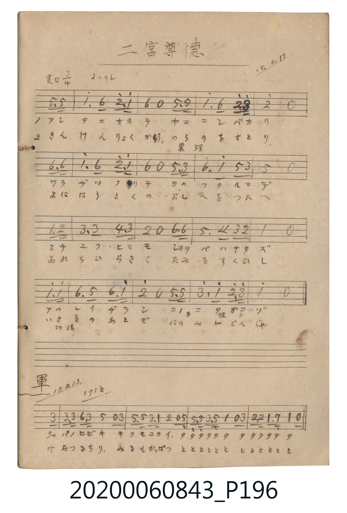

# 二宮尊徳 (二宮尊德)

> Re:Shōka 使用 AI 協助辨識與重建樂譜，可能會有錯誤。歡迎回報。

- **鋼琴伴奏版**：<br><audio controls src="ninomiya_sontoku.mp3"></audio>

- 詞曲作者：未在 TMD metadata 中提供

## 說明

二宮尊徳 (二宮尊德)
Source: 唱歌帖 (2020.006.0843), P196.jpg (top)
Marginalia: 15.2.13 (大正15年2月13日)


## 歌詞

```text
1.
シバカリナハナヒ ワラジヲツクリ オヤノテツダヒ オトトノセワヤ
キャウダイ仲ヨク 孝行ツクス 手本ハ二宮金次郎

2.
ほねをりひとより ひときはまさり こころづくしも ひとにはこえて
のちにはめぐみの ひかりをよもに しきしは二宮尊徳翁
```

## ABC

<div class="abc-score" data-abc-src="ninomiya_sontoku.abc" aria-label="五線譜載入中"></div>

[下載 ABC 原始檔](ninomiya_sontoku.abc)

## TMD 檔案連結

- [主旋律 TMD 檔案](ninomiya_sontoku.tmd) [[在 TMD Studio 編輯](https://tmdlang.github.io/Tmd-TS/#tmd=s7IKdvYPcrWy4qpTUCpJTLdSSM7PyUlNLsnMz7MqzsjPTkzOyFeCS5bl55TmploBqXhDA4RwcX5pUXJqfEFieqpVgKGlGboM3KT4vPyS1KT8_GyEioKi_LLUvMQ8oKrcxLzS4uSizIKS-OT8gkqEmtSyzJRUkIrUlMyS_KLMxBwkJ6UWFYMdC3FDSVFiHsQMoCBCFVBTemaeVW5-XlIp0DFKXFpaCk929Txdt-7phq6n-zYraCDxtmsqaGlxKdoqWJpx2dsqOOlw2Rjrm9hxcelrcSko4NMHkg6GeFnh6ZSNz9b2PN0xTUHDyMDIQM_AwEzPwMLEWFNHARRGelkF6QoaJfkFYE2-iUVA9yXmZCZaKRia6hnpGRoraDxdsvzZ2sWGpk93bjF6NqfD0PjZ9KWaXCDlPpVFmcnFViCmoR6IfNy0_XHzhMdNqx83r3rc3PW4uR9MTlJ43Lz-cfPKx007Hjdvetzc8rgJyF0FVA5UteRxc9_j5jaQaHMDWC1ItAOM-h437QZrXQIxfe3j5sWPm5aBFDYtebIbaNQKoFEKT9fOfbGwB2pu006FZ53dz-asAdoOCZWX7ROfrVn4srkP7GgjiEsbdz9uXPu4adLjpq7HjZseNwIN6gCygRJgTmPv48b1jxv3PW6cChGdDEJNQNGljxv7HzdOf9zUBFe7GqwWqKLjceMyiOnrHjcuhEo0NT5unPC4cT9QEKKjG2QnyGaghU1ARUDR6WALgeR65Gh9vr-RS0ufi8s3EZhowvKTE3McagxqFKpBVijYWGjZgRk1CgYKumBsGg9CNQqGQLaughGQNgNxgWIgvi6QbwTkGoPZpkAayIOaANEB0oNQgakfyDOE8Y2gJqKbADYVygPZZwzSANMPZCHsB5kP0w00GaIE1QsQaxBaEAbgsh4UDDVctVxcunbA1JyZpwCklbkA)]
- [鋼琴伴奏 TMD 檔案](ninomiya_sontoku_piano.tmd) [[在 TMD Studio 編輯](https://tmdlang.github.io/Tmd-TS/#tmd=s7IKdvYPcrWy4tLSUniyq-fpunVPN3Q93bdZQQOJt11T4VHDFIWAzMS8fAXH5OT83ILEvMzc1LwSBS0tLkVbBUszLntbBScdLhtjfRM7Li59LS4FBXLMA2kLzi8tSk61Ung6ZeOztT1Pd0xT0DAyMDLQMzAw0zOwMDHW1FEIMLQ008sqSFfQKMkv0ARp8k0sSs_MS8zJTLRSMDTVM9IzNFbQeLpk-bO1iw1Nn-7cYvRsToeh8bPpSzW5tPS5uHwTM_OswvKTE3McagxqFKpBRijYWGjZgRk1CgYKumBsGg9CNQqGQLaughGQNgNxgWIgvi6QbwTkGoPZpkAayIOaANEB0oNQgakfyDOE8Y2gJqKbADYVygPZZwzSANMPZCHsB5kP0w00GaIE1QsQaxBaEAbgsh4UDDVctdAwA8dZkAdxoWYcr20ar40WdmBBlOADqdHGFobI-mEhiaQYq5HQEIUJAZWb68Rro3sO1WRICCOLwcIZaJU2alijOBY5wIHaMcIc1Rokt6CZg2Y0UY7GEi8-BOIFrEXBEB5UOiAWkgCYgcQ3hSiAJQiYMCFjTKACEO0QEgQJGYRuPcwcHO6B2IvFHKgych0EClNdO2CJkpmngEQrcwEA)]

## 分析

```text
================================================================================
📊 TMD Song Profile: [ 二宮尊徳 二宮尊德 ]
================================================================================
⏱  Duration:       0:31 (31.9s), 17 measures total
🎼 Key & Tempo:    首調基準 B,, != 96.0 BPM, <3/4>
   - 分析範圍：      由實際發聲的音符與和弦推測調性；播放脈絡另行呈現
🎤 人聲音域:    F4 (MIDI 65) – G5 (MIDI 79) [跨度: 14 個半音 / 1.2 個八度, 難度: moderate]
   - 最低音:  F4 in [Main #1 @ m.1, 0:01]
   - 最高音: G5 in [Main #1 @ m.11, 0:20]
   - 適合: soprano, mezzo-soprano, tenor, baritone
🏛  結構:      Main (31.9s)
⚡ 編曲密度:        Peak 1 軌道同時演奏
🗝  調性診斷：       A# 大調（純淨自然大調，未偵測到可信轉調）
   - 風格氣質:    純淨自然大調（陽光明朗、易唱易記，無明顯調外色彩）
   - 轉調歷程:    全曲維持單一推測調性（未偵測到可信轉調）
   - 核心骨幹音:  A#, F, C, D, G
   - 調性數值:    A# 大調 [相關度: 0.89, 穩定度: High, 自然音純度: 100.0%]
   - 候選調性 (K-S): A# 大調 (0.89), F 大調 (0.73), D 小調 (0.57)
   - 五度圈歷程:   -2
   - 各段落調性細節:
     • [Main #1]: A# 大調 (r: 0.89, 自然音純度: 100.0%)

  [ 五度圈游移軌跡 ]
               C  
         F            G  
     [Bb]*              D  
      Eb               A  
         Ab           E  
            Db       B  
               F# 
     (* = active key center)

  [ 十二半音累積音高分佈 ]
     C  : ██████████████            17.7%
     C# :                            0.0%
     D  : ██████████████            17.7%
     D# :                            0.0%
     E  :                            0.0%
     F  : ██████████████████        24.0%
     F# :                            0.0%
     G  : ███████                    9.4%
     G# :                            0.0%
     A  :                            0.0%
     A# : ████████████████████████  31.2%
     B  :                            0.0%
--------------------------------------------------------------------------------
Assignment 軌道音域：
  - Vocal         : F4 – G5 (14 個半音 / 1.2 個八度, 53 個音符)
================================================================================
```


## 原書掃描頁




