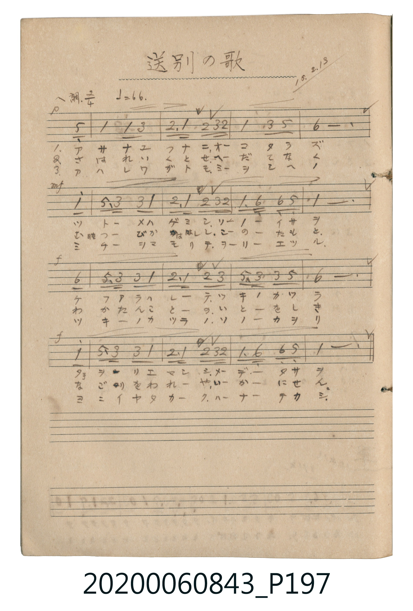

# 送別の歌 (送別之歌)

> Re:Shōka 使用 AI 協助辨識與重建樂譜，可能會有錯誤。歡迎回報。

- **鋼琴伴奏版**：<br><audio controls src="sobetsu_no_uta.mp3"></audio>

- 詞曲作者：未在 TMD metadata 中提供

## 說明

送別の歌 (送別之歌)
Source: 唱歌帖 (2020.006.0843), P197.jpg
Marginalia: 15.2.13 (大正15年2月13日)
Dynamics: Line 1: p, Line 2: mf, Line 3: f, Line 4: f


## 歌詞

```text
1.
アサナユフナニ オコタラズ ツトーメハゲミシ ソノーイサヲ
ケフアラハレーテ ツキノカツラ タヲリエマシシ メーデータサヲ

2.
さはれいくとせ へだてなば むつびかはしし このーたもと
わかたんことの いとをしかり なごりをわれや いーかにせん

3.
アハレワガトモ ミーヲタテテ ミチーヲマモリテ ヨーリユツル
ツキーノカツラノ ソノーカヲリ ヨニイヤタカク ハーナーテカシ
```

## ABC

<div class="abc-score" data-abc-src="sobetsu_no_uta.abc" aria-label="五線譜載入中"></div>

[下載 ABC 原始檔](sobetsu_no_uta.abc)

## TMD 檔案連結

- [主旋律 TMD 檔案](sobetsu_no_uta.tmd) [[在 TMD Studio 編輯](https://tmdlang.github.io/Tmd-TS/#tmd=s7IKdvYPcrWy4qpTUCpJTLdSSM7PyUlNLsnMz7MqzsjPTkzOyFeCS5bl55TmploBqXhDA4RwcX5pUXJqfEFieqpVgKGlOboM3KT4vPyS1KT8_GyEioKi_LLUvMQ8oKrcxLzS4uSizIKS-OT8gkqEmtSyzJRUkIrUlMyS_KLMxBwkJ6UWFYMdC3FDSVFiHsQMoCBCVUlGKtDdaUWZqXkpxRmZBQgZoHHpmXlW5anFJalFefG5qTn5KUhW5xeVZOSnFyUWZFRaZWQWg2xPTsyJz07MS1Ti0tJSeNnQ-LRj6ePGdc_W9ihoQHhPdnYDeZoKWlpcirYKZmZc9rYKblw2Rvomdlxc-lpcCgr4tIGkgyHBpvB0ykag0NMd0xQ0jAyMDPQMDMz0DCxMjDV1FEDhrJdVkA5S7ptYBPRDYk5mopWCoamekZ6hsYLG0yXLn61dbGj6dOcWo2dzOgyNn01fCjbcpTIvMTczudhKwSczL1XBEBgHOhCmkZVCbhqUbWylAGOaAJlcIJ0-lUDfF1uBmIZ6IPJx06LHTVsfN3c9bl72uHkqmNENFF31uGnz46b9j5tXPm7apfC4ueVxc8fj5j2Pmxc-bu5_3LTpcfP8x03bgQr3Pm7uA0k0LQGbswli6EaQWUCjgdqBypvXgLW2gc1pWgvS0bQabOZKoFqgJUDjgBaueNw8D2go2FyQPUAt7WCj90ONBpltBHF249THjesfN_U8bmx53Nj_uHHF48bZQNEdjxsXPG5c9rhx1ePGDUCzGx43LnncuPlxYzdIeeN0IAKqmgyMNpDBjUA_NAH1QtwMNAWoCigElAYioInrgGqBxq943DQJrLf7cVMXUAho9hQgCyQK1AR0Q1MLWCHIRKAJq4FOARoCdq0xPJChwQB0M5AEBuUioB_ng_24CRwEbZDwAQo1QkWBgdEM1LcKIgEMHKAokAOMJqBVq8HmQoMTKIEIUSAbOVqAoqDQhZgA9MCSx83AmAKG6OrHTeuBokBnAbUDYx0UQWDR7Vxa-lxcvonAPBWWD8wqDjUGNdUg6xRsDM207MCsGgUDBV04NI0HEjUKhlAuiDYGixhB-SDaGEgi1IDkTUFqoMaZIRkHgkCVcRhCIA0grSDNIIOwWAA1DmKNWTwIYbgPYSCmrRhWQA1EtQhdJdgnRPkBahwRPiHsB1AU1HDVcnHp2gELkMw8BSCtzAUA)]
- [鋼琴伴奏 TMD 檔案](sobetsu_no_uta_piano.tmd) [[在 TMD Studio 編輯](https://tmdlang.github.io/Tmd-TS/#tmd=s7IKdvYPcrWy4qpTUCpJTLdSyC8qychPL0osyKi0ysgsLskvykxOzInPTsxLVIIrKs4vLUpOjS9ITE-1CjC0NEfIlGSk5qZapaaUJieWZObnKXFpaSm8bGh82rH0ceO6Z2t7FDQgvCc7u4E8TYVHDVMUAjIT8_IVHJOT83MLEvMyc1PzShS0tLgUbRXMzLjsbRXcuGyM9E3suLj0tbgUFMgxDqQtGOxmK4WnUzYClT7dMU1Bw8jAyEDPwMBMz8DCxFhTRwHkFb2sgnSQct_EovTMvMSczEQrBUNTPSM9Q2MFjadLlj9bu9jQ9OnOLUbP5nQYGj-bvlSTS0ufi8s3MTPPKiwfGFQONQY11SATFGwMzbTswKwaBQMFXTg0jQcSNQqGUC6INgaLGEH5INoYSCLUgORNQWqgxpkhGQeCQJVxGEIgDSCtIM0gg7BYADUOYo1ZPAhhuA9hIKatGFZADUS1CF0l2CdE-QFqHBE-IewHUBTUcNVC4wqcSoI8iI4t43ht03htmHlQJojShvovXttcJ14b5i4kLsR5mPrBGoGkNnLEGmqbaBMVuTCNIPPhpkFtIOgaWLDCHAQMMqD7wAFnBFSH1cv4kgFexyAsw-EkpFDEahA8jIgOHXhgUhBGpIcOlgTmg5zALNDSlwHIiSDDwATQQh1wygWTKDJQXSZgGYifYSkUjwmwogLTVDxGwCILl1OwOwIW3jg9g9URQP-DQkvXDljYZuYpYKGVuQA)]

## 分析

```text
================================================================================
📊 TMD Song Profile: [ 送別の歌 送別之歌 ]
================================================================================
⏱  Duration:       0:36 (36.4s), 20 measures total
🎼 Key & Tempo:    首調基準 F, != 66.0 BPM, <2/4>
   - 分析範圍：      由實際發聲的音符與和弦推測調性；播放脈絡另行呈現
🎤 人聲音域:    C4 (MIDI 60) – F5 (MIDI 77) [跨度: 17 個半音 / 1.4 個八度, 難度: challenging]
   - 最低音:  C4 in [Main #1 @ m.1, 0:01]
   - 最高音: F5 in [Main #1 @ m.6, 0:09]
   - 適合: soprano, mezzo-soprano, contralto, tenor, baritone, bass
🏛  結構:      Main (36.4s)
⚡ 編曲密度:        Peak 1 軌道同時演奏
🗝  調性診斷：       F 大調（純淨自然大調，未偵測到可信轉調）
   - 風格氣質:    純淨自然大調（陽光明朗、易唱易記，無明顯調外色彩）
   - 轉調歷程:    全曲維持單一推測調性（未偵測到可信轉調）
   - 核心骨幹音:  F, D, G, C, A
   - 調性數值:    F 大調 [相關度: 0.85, 穩定度: Moderate, 自然音純度: 100.0%]
   - 候選調性 (K-S): F 大調 (0.85), D 小調 (0.76), C 大調 (0.54)
   - 五度圈歷程:   -1
   - 各段落調性細節:
     • [Main #1]: F 大調 (r: 0.85, 自然音純度: 100.0%)

  [ 五度圈游移軌跡 ]
               C  
        [F ]*          G  
      Bb               D  
      Eb               A  
         Ab           E  
            Db       B  
               F# 
     (* = active key center)

  [ 十二半音累積音高分佈 ]
     C  : █████████                 14.5%
     C# :                            0.0%
     D  : █████████████             19.7%
     D# :                            0.0%
     E  :                            0.0%
     F  : ████████████████████████  36.8%
     F# :                            0.0%
     G  : ██████████                15.1%
     G# :                            0.0%
     A  : █████████                 13.8%
     A# :                            0.0%
     B  :                            0.0%
--------------------------------------------------------------------------------
Assignment 軌道音域：
  - Vocal         : C4 – F5 (17 個半音 / 1.4 個八度, 57 個音符)
================================================================================
```


## 原書掃描頁




