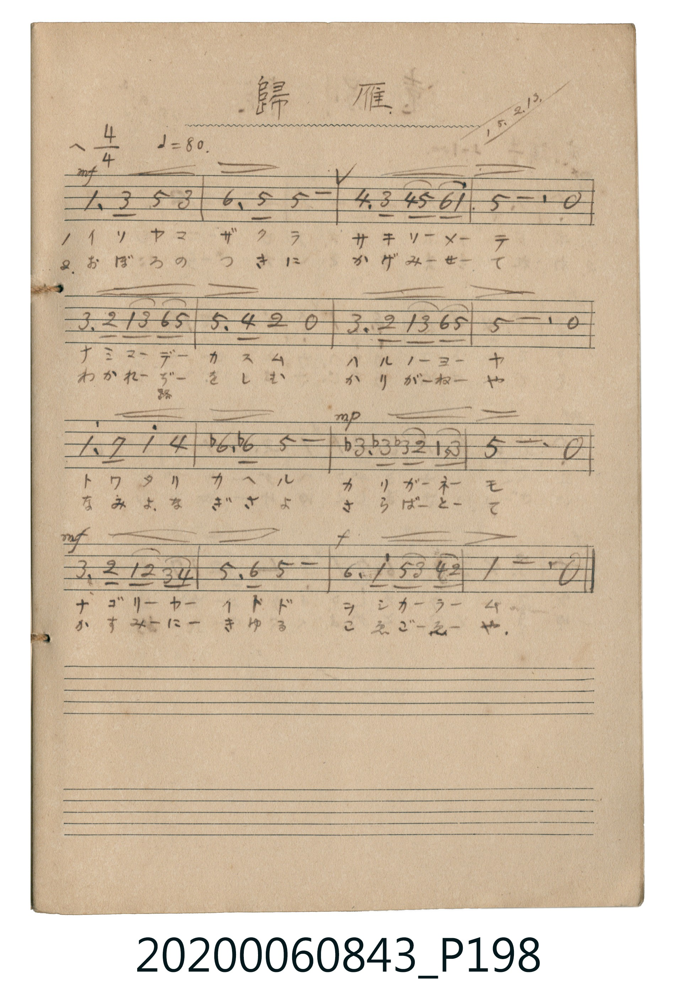

# 歸雁 (歸雁)

> Re:Shōka 使用 AI 協助辨識與重建樂譜，可能會有錯誤。歡迎回報。

- **鋼琴伴奏版**：<br><audio controls src="kigan.mp3"></audio>

- 詞曲作者：未在 TMD metadata 中提供

## 說明

歸雁 (歸雁)
Source: 唱歌帖 (2020.006.0843), P198.jpg
Marginalia: 15.2.13. (大正15年2月13日)
Dynamics: Line 1: mf, Line 3 bar 3: mp, Line 4: mf -> f


## 歌詞

```text
1.
イソヤマザクラ サキソメーテ ナミマーデカスム ハルノヨーヤ
トワタリカヘル カリガネーモ ナゴリヤイトド ヲシカラーム

2.
おぼろのつきに かげみせて わかれ路をしむ かりがねや
なみよなぎさよ さらばとて かすみにきゆる こゑごゑや
```

## ABC

<div class="abc-score" data-abc-src="kigan.abc" aria-label="五線譜載入中"></div>

[下載 ABC 原始檔](kigan.abc)

## TMD 檔案連結

- [主旋律 TMD 檔案](kigan.tmd) [[在 TMD Studio 編輯](https://tmdlang.github.io/Tmd-TS/#tmd=s7IKdvYPcrWy4qpTUCpJTLdSSM7PyUlNLsnMz7MqzsjPTkzOyFeCS5bl55TmploBqXhDA4RwcX5pUXJqfEFieqpVgKGlBboM3KT4vPyS1KT8_GyEioKi_LLUvMQ8oKrcxLzS4uSizIKS-OT8gkqEmtSyzJRUkIrUlMyS_KLMxBwkJ6UWFYMdC3FDSVFiHsQMoCBCFVBTemaeVW5-XlIp0DGYEqmZWZnxJakVJaiuyy8qychPL0osyKi0ysgsBlmenJgTn52Yl4hQVJKRCgyU1JTS5ESIrVpaCs_W7ng5u1FBA0JrKmhpcSnaKlgYcNnbKrhx2Zjom9hxcelrcSkooCsFCQVDgk3h6ZSNz9b2PN0xTUHDyMDIQM_AwEzPwMLEWFNHARTOelkF6SDlvolFQE8k5mQmWikYmuoZ6Rka6yloPF2y_NnaxYamT3duMXo2p8PQ-Nn0pWDTXSrzEnMzk4utFHwy81IVDK0UctN0IGxjhaTEIgVjoEgBVMQEJKuga6eQxgXS61MJDIFiKxDTUA9EPm5a8rhp7-PmJY-b5z1u2va4af3j5pVA0a2Pm9aCJRY-bt7zuLlN4XFz1-Pm-SBVIH7746bVj5t2Pm5eAJTof9y8-nFz3-PmFWC5JWBzmzseN69_3LT_cfMqkNrmGUBFQHOBLCB_zePmXrDaRWBzm7aARIFuADoGpK8TKLrpcdN2sPKVYIULwM43gri5setx457HTb2PG9c9blzyuBHIAJrd2P24cdLjxv2PG2c_blwGtKsfJNTU82I70B1AiemPmxrAqpqA2nseNwL91wIxbhVIV1MHmNH3uHEqkA0UBVKdjxs3PG5cATYOZPxMsPGrQTY2tT1u6gaKTn7cNPFx4xQQCTROS5-LyzcRmCLD8oEJzaHGoKYaZIWCjaGZlh2YVaNgqKALhMYKpmAaxILQMFijYAamTeEq0GGNgglUJ4gGqQLpMIxDUYKu2QDdEKhzINYbgZ0FYoOMQtYLM8kEqAaHSUSbQdg1UE-YI3wD8SqyWWY6YAaQwh1AxhA1QArMAjkd7DiIMNxV8UQ6C9mDILNAfGSHwTxohsdJkFgF-gukBGYALEwhSiBJA59zarm4gJkZlMRAmVqZCwA)]
- [鋼琴伴奏 TMD 檔案](kigan_piano.tmd) [[在 TMD Studio 編輯](https://tmdlang.github.io/Tmd-TS/#tmd=s7IKdvYPcrWy4qpTUCpJTLdSyC8qychPL0osyKi0ysgsLskvykxOzInPTsxLVIIrKs4vLUpOjS9ITE-1CjC0tEDIlGSk5qZapaaUJieWZObnKXFpaSk8W7vj5exGBQ0IranwqGGKQkBmYl6-gmNycn5uQWJeZm5qXomClhaXoq2ChQGXva2CG5eNib6JHReXvhaXggKxRoCUBoPdZqXwdMrGZ2t7nu6YpqBhZGBkoGdgYKZnYGFirKmjAHKyXlZBOki5b2JRemZeYk5mopWCoamekZ6hsZ6CxtMly5-tXWxo-nTnFqNnczoMjZ9NX6rJpaXPxeWbmJlnFZYPDBOHGoOaapARCjaGZlp2YFaNgqGCLhAaK5iCaRALQsNgjYIZmDaFq0CHNQomUJ0gGqQKpMMwDkUJumYDdEOgzoFYbwR2FogNMgpZL8wkE6AaHCYRbQZh10A9YY7wDcSryGaZ6YAZQAp3ABlD1AApMAvkdLDjIMJwV8UT6SxkD4LMAvGRHQbzoBkeJ0FiFegvkBKYAbAwhSiBJA18zqmFpi9w0g7ywJ7CjOO1TeO1YenMUNtYG-YqkLA2ZoIz1DbRhiU6ZOVYPBGvbaSNnvpg2tFSoLkOSDHMLFQeroBGciAiOcHMR01SyAaagDSCBXCZT4rJyEGAzMaZOrRNteEJF4kDTA8gSzFTMNhaeCoGWqGDJ8ghDicqPRsBQwCeplE4RIc39tSNCAUzAgkEkZSAgQBTCi4TYCkHLaYg2pCTLFA9Co9ALvBBzgUmiGI2HorA5aUOMs8oHoRAYuDwBdIgDLIGXgyB1WJVgSYH4eHWi2oziqNwW4xNNdQgkAZ0e4HBoWsHrKcy8xSQaGUuAA)]

## 分析

```text
================================================================================
📊 TMD Song Profile: [ 歸雁 歸雁 ]
================================================================================
⏱  Duration:       0:48 (48.0s), 16 measures total
🎼 Key & Tempo:    首調基準 F, != 80.0 BPM, <4/4>
   - 分析範圍：      由實際發聲的音符與和弦推測調性；播放脈絡另行呈現
🎤 人聲音域:    C4 (MIDI 60) – F5 (MIDI 77) [跨度: 17 個半音 / 1.4 個八度, 難度: challenging]
   - 最低音:  C4 in [Main #1 @ m.12, 0:33]
   - 最高音: F5 in [Main #1 @ m.3, 0:07]
   - 適合: soprano, mezzo-soprano, contralto, tenor, baritone, bass
🏛  結構:      Main (48.0s)
⚡ 編曲密度:        Peak 1 軌道同時演奏
🗝  調性診斷：       F 調性不明確（流行色彩大調，未偵測到可信轉調）
   - 風格氣質:    流行大調（略帶和弦色彩音與裝飾副屬和弦）
   - 轉調歷程:    全曲維持單一推測調性（未偵測到可信轉調）
   - 核心骨幹音:  C, F, A, A#, G
   - 調性數值:    F 調性不明確 [相關度: 0.74, 穩定度: Ambiguous, 自然音純度: 92.6%]
   - 候選調性 (K-S): F 大調 (0.74), C 大調 (0.73), C 小調 (0.61)
   - 五度圈歷程:   -1
   - 各段落調性細節:
     • [Main #1]: F 調性不明確 (r: 0.74, 自然音純度: 92.6%, 調外音: C#, G#)

  [ 五度圈游移軌跡 ]
               C  
        [F ]*          G  
      Bb               D  
      Eb               A  
         Ab           E  
            Db       B  
               F# 
     (* = active key center)

  [ 十二半音累積音高分佈 ]
     C  : ████████████████████████  40.3%
     C# : █                          1.9%
     D  : ████                       6.0%
     D# :                            0.0%
     E  :                            0.5%
     F  : █████████                 15.3%
     F# :                            0.0%
     G  : █████                      7.9%
     G# : ███                        5.6%
     A  : ███████                   12.5%
     A# : ██████                    10.2%
     B  :                            0.0%
--------------------------------------------------------------------------------
Assignment 軌道音域：
  - Vocal         : C4 – F5 (17 個半音 / 1.4 個八度, 60 個音符)
================================================================================
```


## 原書掃描頁




