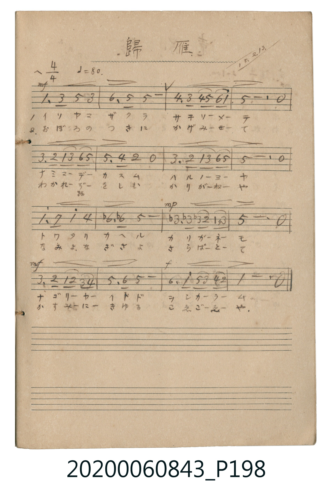

# 歸雁 (歸雁)

<audio controls src="kigan.mp3"></audio>

- 詞曲作者：未在 TMD metadata 中提供

## 說明

歸雁 (歸雁)
Source: 唱歌帖 (2020.006.0843), P198.jpg
Marginalia: 15.2.13. (大正15年2月13日)
Dynamics: Line 1: mf, Line 3 bar 3: mp, Line 4: mf -> f

## 歌詞

```text
1.
イソヤマザクラ サキソメーテ ナミマーデカスム ハルノヨーヤ
トワタリカヘル カリガネーモ ナゴリヤイトド ヲシカラーム

2.
おぼろのつきに かげみせて わかれ路をしむ かりがねや
なみよなぎさよ さらばとて かすみにきゆる こゑごゑや
```

## ABC

```abc
X:1
T:歸雁 歸雁
M:4/4
L:1/16
Q:1/4=80
K:F
V:V1 name="Vocal" snm="Voc"
[V:V1]
F3 A c4 A8 | d3 c c12 | B3 A B2 c2 d2 f6 | c8 z8 |
A3 G F2 A2 d2 c6 | c3 B G4 z8 | A3 G F2 A2 d2 c6 | c8 z8 |
f3 e f4 B8 | _d3 d c12 | _A3 A A2 G2 F2 A6 | C8 z8 |
A3 G F2 G2 A2 B6 | c3 d c12 | d3 f c2 A2 B2 G6 | F8 z8 |
```

## TMD 檔案連結

- [主旋律 TMD 檔案](kigan.tmd) [[在 TMD Studio 編輯](https://tmdlang.github.io/Tmd-TS/#tmd=s7IKdvYPcrWy4tLSUni2dsfL2Y0KGhBaU0FLi0vRVsHCgMveVsGNy8ZE38SOi0tfi0tBAV0pSCg4v7QoOdVK4emUjc_W9jzdMU1Bw8jAyEDPwMBMz8DCxFhTRyHA0NJCL6sgHaTcN7EoPTMvMScz0UrB0FTPSM_QWE9B4-mS5c_WLjY0fbpzi9GzOR2Gxs-mLwWb7lKZl5ibmVxspeCTmZeqYGilkJumA2EbKyQlFikYA0UKoCImIFkFXTuFNC6QXp_KIpBOENNQD0Q-blryuGnv4-Ylj5vnPW7a9rhp_ePmlUDRrY-b1oIlFj5u3vO4uU3hcXPX4-b5IFUgfvvjptWPm3Y-bl4AlOh_3Lz6cXPf4-YVYLklYHObOx43r3_ctP9x8yqQ2uYZQEVAc4EsIH_N4-ZesNpFYHObtoBEgW4AOgakrxMouulx03aw8pVghQvAzjeCuLmx63HjnsdNvY8b1z1uXPK4EcgAmt3Y_bhx0uPG_Y8bZz9uXAa0qx8k1NTzYjvQHUCJ6Y-bGsCqmoDaex43Av3XAjFuFUhXUweY0fe4cSqQDRQFUp2PGzc8blwBNg5k_Eyw8atBNja1PW7qBopOftw08XHjFBAJNE5Ln4vLNzEzzyosPzkxx6HGoEahGmSHgo2hmZYdmFWjYKigC4TGCqZgGsSC0DBYo2AGpk3hKtBhjYIJVCeIBqkC6TCMQ1GCrtkA3RCocyDWG4GdBWKDjELWCzPJBKgGh0lEm0HYNVBPmCN8A_EqsllmOmAGkMIdQMYQNUAKzAI5Hew4iDDcVfFEOgvZgyCzQHxkh8E8aIbHSZBYBfoLpARmACxMIUogSQOfc2q5uIC5GZTGQLlamQsA)]
- [鋼琴伴奏 TMD 檔案](kigan_piano.tmd) [[在 TMD Studio 編輯](https://tmdlang.github.io/Tmd-TS/#tmd=s7IKdvYPcrWy4tLSUni2dsfL2Y0KGhBaU-FRwxSFgMzEvHwFx-Tk_NyCxLzM3NS8EgUtLS5FWwULAy57WwU3LhsTfRM7Li59LS4FBWKNACkNzi8tSk61Ung6ZeOztT1Pd0xT0DAyMDLQMzAw0zOwMDHW1FEIMLS00MsqSAcp900sSs_MS8zJTLRSMDTVM9IzNNZT0Hi6ZPmztYsNTZ_u3GL0bE6HofGz6Us1ubT0ubh8EzPzrMLykxNzHGoMahSqQWYo2BiaadmBWTUKhgq6QGisYAqmQSwIDYM1CmZg2hSuAh3WKJhAdYJokCqQDsM4FCXomg3QDYE6B2K9EdhZIDbIKGS9MJNMgGpwmES0GYRdA_WEOcI3EK8im2WmA2YAKdwBZAxRA6TALJDTwY6DCMNdFU-ks5A9CDILxEd2GMyDZnicBIlVoL9ASmAGwMIUogSSNPA5pxaawMBpO8gDRxIzjtc2jdeGJTRDbWNtmLNAwtqYKc5Q20QbluqQlWPxRby2kTZ68oNpR0uC5jogxTCzUHm4QhrJgYj0BDMfNU0hG2gC0ggWwGU-KSYjBwEyG2fy0DbVhqdcJA4wQYAsxUzCYGvhyRhohQ6eIIc4nKgEbQQMAXiiRuEQHd7YkzciFMwIJBBEUgIGAkwpuFCApRy0mIJoQ06yQPUoPALZwAdXNjCEeR6TgbDYRIcYVUbwQIUxEPoQqkzhYggWzpIOwzayTSTSLExVlLmNuJAjKhIoCzhybcXiAYT1-MzCmiB17YBthcw8BSCtzAUA)]

## 分析

```text
================================================================================
📊 TMD Song Profile: [ 歸雁 歸雁 ]
================================================================================
⏱  Duration:       0:48 (48.0s), 16 measures total
🎼 Key & Tempo:    首調基準 F, != 80.0 BPM, <4/4>
   - 分析範圍：      由實際發聲的音符與和弦推測調性；播放脈絡另行呈現
🎤 人聲音域:    C4 (MIDI 60) – F5 (MIDI 77) [跨度: 17 個半音 / 1.4 個八度, 難度: challenging]
   - 最低音:  C4 in [Main #1 @ m.12, 0:33]
   - 最高音: F5 in [Main #1 @ m.3, 0:07]
   - 適合: soprano, mezzo-soprano, contralto, tenor, baritone, bass
🏛  結構:      Main (48.0s)
⚡ 編曲密度:        Peak 1 軌道同時演奏
🗝  調性診斷：       F 調性不明確（流行色彩大調，未偵測到可信轉調）
   - 風格氣質:    流行大調（略帶和弦色彩音與裝飾副屬和弦）
   - 轉調歷程:    全曲維持單一推測調性（未偵測到可信轉調）
   - 核心骨幹音:  C, F, A, A#, G
   - 調性數值:    F 調性不明確 [相關度: 0.74, 穩定度: Ambiguous, 自然音純度: 92.6%]
   - 候選調性 (K-S): F 大調 (0.74), C 大調 (0.73), C 小調 (0.61)
   - 五度圈歷程:   -1
   - 各段落調性細節:
     • [Main #1]: F 調性不明確 (r: 0.74, 自然音純度: 92.6%, 調外音: C#, G#)

  [ 五度圈游移軌跡 ]
               C  
        [F ]*          G  
      Bb               D  
      Eb               A  
         Ab           E  
            Db       B  
               F# 
     (* = active key center)

  [ 十二半音累積音高分佈 ]
     C  : ████████████████████████  40.3%
     C# : █                          1.9%
     D  : ████                       6.0%
     D# :                            0.0%
     E  :                            0.5%
     F  : █████████                 15.3%
     F# :                            0.0%
     G  : █████                      7.9%
     G# : ███                        5.6%
     A  : ███████                   12.5%
     A# : ██████                    10.2%
     B  :                            0.0%
--------------------------------------------------------------------------------
Assignment 軌道音域：
  - Vocal         : C4 – F5 (17 個半音 / 1.4 個八度, 60 個音符)
================================================================================
```


## 原書掃描頁




