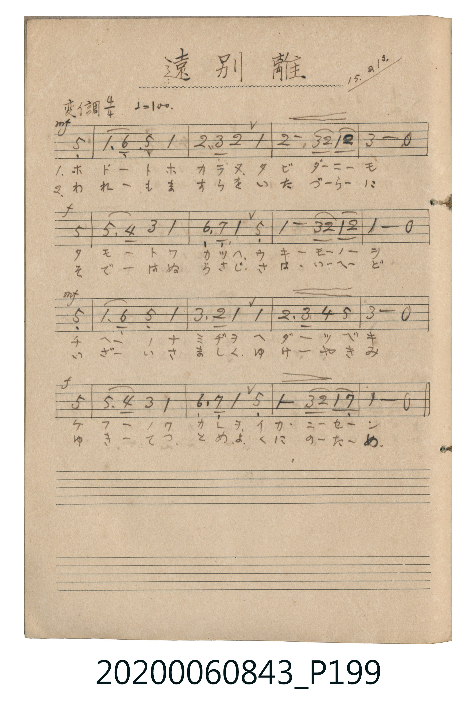

# 遠別離 (遠別離)

> Re:Shōka 使用 AI 協助辨識與重建樂譜，可能會有錯誤。歡迎回報。

- **鋼琴伴奏版**：<br><audio controls src="enbetsuri.mp3"></audio>

- 詞曲作者：未在 TMD metadata 中提供

## 說明

遠別離 (遠別離)
Source: 唱歌帖 (2020.006.0843), P199.jpg
Marginalia: 15.2.13. (大正15年2月13日)
Dynamics: Line 1: mf, Line 2: f, Line 3: mf, Line 4: f


## 歌詞

```text
1.
ホドートホカラヌ タビダニモ タモートワカツハ ウキモノヲ
チヘーノナミヂヲ ヘダツベキ ケフーノワカレヲ イカニセン

2.
われーもますらを いたづらに そでーはぬらさじ さはいへど
いざーいさましく ゆけやきみ ゆきてつとめよ くにのため
```

## ABC

<div class="abc-score" data-abc-src="enbetsuri.abc" aria-label="五線譜載入中"></div>

[下載 ABC 原始檔](enbetsuri.abc)

## TMD 檔案連結

- [主旋律 TMD 檔案](enbetsuri.tmd) [[在 TMD Studio 編輯](https://tmdlang.github.io/Tmd-TS/#tmd=s7IKdvYPcrWy4qpTUCpJTLdSSM7PyUlNLsnMz7MqzsjPTkzOyFeCS5bl55TmploBqXhDA4RwcX5pUXJqfEFieqpVgKGlJboM3KT4vPyS1KT8_GyEioKi_LLUvMQ8oKrcxLzS4uSizIKS-OT8gkqEmtSyzJRUkIrUlMyS_KLMxBwkJ6UWFYMdC3FDSVFiHsQMoCBCFVBTemaeVW5qZlZmfElqRQmqI_KLSjLy04sSCzIqrTIyi0F2JCfmxGcn5iUiFJVkpAL9nppSmpwIMVxLS-Fl44KnHUtfzl6koAFnaipoaXEp2ioYGhhw2dsqOOpw2Zjom9hxcelrcSkoYNcCkgiGhJXC0ykbn63tebpjmoKGkYGRgZ6BgZmegYWJsaaOAihw9bIK0kHKfROLgF5KzMlMtFIwNNUz0jM01lPQeLpk-bO1iw1Nn-7cYvRsToeh8bPpS8Gmu1TmJeZmJhdbKfhk5qUqGFop5KbpQNhGVgowpjGSsAlQmAuk1acSGBzFViCmoR6IfNw8-3Fz5-PmPY-bO0DsptWPm1c-bu5ReNy0_3Hz5MfNDY-bux83L4LwF8EUrgcrbHnc3A-UWPa4aS1Yru9x8yaIoY2Pm2eA1QKFuh43z3_c3ASUA0oARYEmAjXOBGoC6t34uHkqTCHE0DVghU1LwJzux027HzdvBrvdCOLgpv7HTT0gLU1Njxv3PW4EGtT5uGmSwuPGlseN8x83LgXxG1cD-XMfNy4HKWxc_7hxDVh06uPGGUAJIAUUAirf8bhxJdhQEGcaWC2QAZQGmjv9cSPIc22PGyc-bgKK9j5u3A_hA1nLHjcuedy44nFT4-OmDqD2fqCNjxvXgRzQ1Milpc_F5ZsITKQBmYl5-Q41BjXVIFsUbAzNtOzArBoFAwVdrNA0HsqoUTAE02bxCDGIiK6CEZg0BqqBsNBlINAYyIOZgpAxhtIwB9RAHQS3xBRMmsAVwgyoATkFxDCPh4thuKwGrA1kF0gERqPYh64JmwdhjoK4wQgujhkAJiiuxuI9ankMyUUwbwHVY_EfVy0Xl64dMFNn5ikAaWUuAA)]
- [鋼琴伴奏 TMD 檔案](enbetsuri_piano.tmd) [[在 TMD Studio 編輯](https://tmdlang.github.io/Tmd-TS/#tmd=s7IKdvYPcrWy4qpTUCpJTLdSyC8qychPL0osyKi0ysgsLskvykxOzInPTsxLVIIrKs4vLUpOjS9ITE-1CjC0tETIlGSk5qZapaaUJieWZObnKXFpaSm8bFzwtGPpy9mLFDTgTE2FRw1TFAIyE_PyFRyTk_NzCxLzMnNT80oUtLS4FG0VDA0MuOxtFRx1uGxM9E3suLj0tbgUFEgzCqQhGOxSK4WnUzY-W9vzdMc0BQ0jAyMDPQMDMz0DCxNjTR0FkAf0sgrSQcp9E4vSM_MSczITrRQMTfWM9AyN9RQ0ni5Z_mztYkPTpzu3GD2b02Fo_Gz6Uk0uLX0uLt_EzDwrsNUONQY11SAjFGwMzbTswKwaBQMFXazQNB7KqFEwBNNm8QgxiIiughGYNAaqgbDQZSDQGMiDmYKQMYbSMAfUQB0Et8QUTJrAFcIMqAE5BcQwj4eLYbisBqwNZBdIBEaj2IeuCZsHYY6CuMEILo4ZACYorsbiPWp5DMlFMG8B1WPxH1ctcuwHeZAd_8bx2qbx2vBAAnPhqqDiYKZ5vDYiQJD5OBXCwgqUQHAqAUloE0wuQCXasJBF0YFkLtgviEBGksHhKYirwEYh3ASVRwggBxDWGCcuBBFegrveCC1UcAW2GZCjDUuCIBloUOAKPFoHG7pPsAceWsjgTLs-yGnXBC3pGoDKFmCGASOgY8B-gzDBPAgTSAIVItIMXAcw56LwINogylEVQjWj2mWEUzmquQibEY4B-lHXDligZ-YpINHKXAA)]

## 分析

```text
================================================================================
📊 TMD Song Profile: [ 遠別離 遠別離 ]
================================================================================
⏱  Duration:       0:31 (31.2s), 13 measures total
🎼 Key & Tempo:    首調基準 A,, != 100.0 BPM, <4/4>
   - 分析範圍：      由實際發聲的音符與和弦推測調性；播放脈絡另行呈現
🎤 人聲音域:    D#4 (MIDI 63) – D#5 (MIDI 75) [跨度: 12 個半音 / 1.0 個八度, 難度: easy]
   - 最低音:  D#4 in [Main #1 @ m.1, 0:01]
   - 最高音: D#5 in [Main #1 @ m.5, 0:10]
   - 適合: soprano, mezzo-soprano, contralto, tenor, baritone, bass
🏛  結構:      Main (31.2s)
⚡ 編曲密度:        Peak 1 軌道同時演奏
🗝  調性診斷：       G# 大調（純淨自然大調，未偵測到可信轉調）
   - 風格氣質:    純淨自然大調（陽光明朗、易唱易記，無明顯調外色彩）
   - 轉調歷程:    全曲維持單一推測調性（未偵測到可信轉調）
   - 核心骨幹音:  G#, D#, A#, C, F
   - 調性數值:    G# 大調 [相關度: 0.93, 穩定度: High, 自然音純度: 100.0%]
   - 候選調性 (K-S): G# 大調 (0.93), D# 大調 (0.68), G# 小調 (0.61)
   - 五度圈歷程:   -4
   - 各段落調性細節:
     • [Main #1]: G# 大調 (r: 0.93, 自然音純度: 100.0%)

  [ 五度圈游移軌跡 ]
               C  
         F            G  
      Bb               D  
      Eb               A  
        [Ab]*          E  
            Db       B  
               F# 
     (* = active key center)

  [ 十二半音累積音高分佈 ]
     C  : █████████                 14.4%
     C# : ██                         3.3%
     D  :                            0.0%
     D# : ███████████████           23.3%
     E  :                            0.0%
     F  : ███                        4.4%
     F# :                            0.0%
     G  : █                          2.2%
     G# : ████████████████████████  36.7%
     A  :                            0.0%
     A# : ██████████                15.6%
     B  :                            0.0%
--------------------------------------------------------------------------------
Assignment 軌道音域：
  - Piano         : D#4 – D#5 (12 個半音 / 1.0 個八度, 59 個音符)
================================================================================
```


## 原書掃描頁




