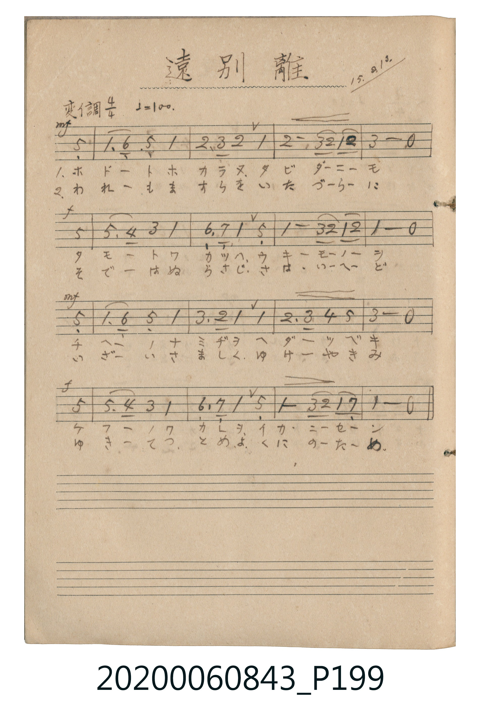

# 遠別離 (遠別離)

<audio controls src="enbetsuri.mp3"></audio>

- 詞曲作者：未在 TMD metadata 中提供

## 說明

遠別離 (遠別離)
Source: 唱歌帖 (2020.006.0843), P199.jpg
Marginalia: 15.2.13. (大正15年2月13日)
Dynamics: Line 1: mf, Line 2: f, Line 3: mf, Line 4: f

## 歌詞

```text
1.
ホドートホカラヌ タビダニモ タモートワカツハ ウキモノヲ
チヘーノナミヂヲ ヘダツベキ ケフーノワカレヲ イカニセン

2.
われーもますらを いたづらに そでーはぬらさじ さはいへど
いざーいさましく ゆけやきみ ゆきてつとめよ くにのため
```

## ABC

```abc
X:1
T:遠別離 遠別離
M:4/4
L:1/16
Q:1/4=100
K:Ab
V:V1 name="Melody" snm="Mel"
[V:V1]
z12 E4 | A3 F E4 A4 B3 c | B4 A4 B6 c B | A4 B4 c4 z4 |
E4 e3 d c4 A4 | F3 G A4 E4 A4 | c2 B2 A2 B2 A4 z4 | E4 A3 F E4 A4 |
c3 B A4 A4 B3 c | d4 e4 c4 z4 | E4 e3 d c4 A4 | F3 G A4 E4 A4 |
c2 B2 A2 G2 A4 z4 |
```

## TMD 檔案連結

- [主旋律 TMD 檔案](enbetsuri.tmd) [[在 TMD Studio 編輯](https://tmdlang.github.io/Tmd-TS/#tmd=s7IKdvYPcrWy4tLSUnjZuOBpx9KXsxcpaMCZmgpaWlyKtgqGBgZc9rYKjjpcNib6JnZcXPpaXAoK2LWAJILzS4uSU60Unk7Z-Gxtz9Md0xQ0jAyMDPQMDMz0DCxMjDV1FAIMLS31sgrSQcp9E4vSM_MSczITrRQMTfWM9AyN9RQ0ni5Z_mztYkPTpzu3GD2b02Fo_Gz6UrDpLpV5ibmZycVWCj6ZeakKhlYKuWk6ELaRlQKMaYwkbAIU5gJp9aksAmkEMQ31QOTj5tmPmzsfN-953NwBYjetfty88nFzj8Ljpv2Pmyc_bm543Nz9uHkRhL8IpnA9WGHL4-Z-oMSyx01rwXJ9j5s3QQxtfNw8A6wWKNT1uHn-4-YmoBxQAigKNBGocSZQE1DvxsfNU2EKIYauAStsWgLmdD9u2v24eTPY7UYQBzf1P27qAWlpanrcuO9xI9CgzsdNkxQeN7Y8bpz_uHEpiN-4Gsif-7hxOUhh4_rHjWvAolMfN84ASgApoBBQ-Y7HjSvBhoI408BqgQygNNDc6Y8bQZ5re9w48XETULT3ceN-CB_IWva4ccnjxhWPmxofN3UAtfcDbXzcuA7kgKZGLi19Li7fxMw8K9_UnPyUSocagxqFapA9CjaGZlp2YFaNgoGCLlZoGg9l1CgYgmmzeIQYRERXwQhMGgPVQFjoMhBoDOTBTEHIGENpmANqoA6CW2IKJk3gCmEG1ICcAmKYx8PFMFxWA9YGsgskAqNR7EPXhM2DMEdB3GAEF8cMABMUV2PxHrU8huQimLeA6rH4j6uWi0vXDpitM_MUgLQyFwA)]
- [鋼琴伴奏 TMD 檔案](enbetsuri_piano.tmd) [[在 TMD Studio 編輯](https://tmdlang.github.io/Tmd-TS/#tmd=s7IKdvYPcrWy4tLSUnjZuOBpx9KXsxcpaMCZmgqPGqYoBGQm5uUrOCYn5-cWJOZl5qbmlShoaXEp2ioYGhhw2dsqOOpw2Zjom9hxcelrcSkokGYUSENwfmlRcqqVwtMpG5-t7Xm6Y5qChpGBkYGegYGZnoGFibGmjkKAoaWlXlZBOki5b2JRemZeYk5mopWCoamekZ6hsZ6CxtMly5-tXWxo-nTnFqNnczoMjZ9NX6rJpaXPxeWbmJln5Zuak59S6VBjUKNQDTJEwcbQTMsOzKpRMFDQxQpN46GMGgVDMG0WjxCDiOgqGIFJY6AaCAtdBgKNgTyYKQgZYygNc0AN1EFwS0zBpAlcIcyAGpBTQAzzeLgYhstqwNpAdoFEYDSKfeiasHkQ5iiIG4zg4pgBYILiaizeo5bHkFwE8xZQPRb_cdVC4x-c9II8yE8AxvHapvHa8FACc-GqoOJgprlOvDYiSFAEcCuFhRcokeBWA5LRJphmgEq0YcGLogPJYLB_ECGNJIPDYxBngY1CchRUAZIIcjBhjXjiwhHhKbj7jdACBmeQmwE52rCkCJaCBgeuAKR10KH7BVcAooUOzmTsQ2oyRvjUEO5TDIYp2AHQAIGzsUgjK8QiDRfCSKCYSjAZwEKEOGXY3INpNZGWQl1IZOgYUdFmIr2LEYR4wxuYWnTtgPVkZp4CkFbmAgA)]

## 分析

```text
================================================================================
📊 TMD Song Profile: [ 遠別離 遠別離 ]
================================================================================
⏱  Duration:       0:31 (31.2s), 13 measures total
🎼 Key & Tempo:    首調基準 A,, != 100.0 BPM, <4/4>
   - 分析範圍：      由實際發聲的音符與和弦推測調性；播放脈絡另行呈現
🎤 人聲音域:    D#4 (MIDI 63) – D#5 (MIDI 75) [跨度: 12 個半音 / 1.0 個八度, 難度: easy]
   - 最低音:  D#4 in [Main #1 @ m.1, 0:01]
   - 最高音: D#5 in [Main #1 @ m.5, 0:10]
   - 適合: soprano, mezzo-soprano, contralto, tenor, baritone, bass
🏛  結構:      Main (31.2s)
⚡ 編曲密度:        Peak 1 軌道同時演奏
🗝  調性診斷：       G# 大調（純淨自然大調，未偵測到可信轉調）
   - 風格氣質:    純淨自然大調（陽光明朗、易唱易記，無明顯調外色彩）
   - 轉調歷程:    全曲維持單一推測調性（未偵測到可信轉調）
   - 核心骨幹音:  G#, D#, A#, C, F
   - 調性數值:    G# 大調 [相關度: 0.93, 穩定度: High, 自然音純度: 100.0%]
   - 候選調性 (K-S): G# 大調 (0.93), D# 大調 (0.68), G# 小調 (0.61)
   - 五度圈歷程:   -4
   - 各段落調性細節:
     • [Main #1]: G# 大調 (r: 0.93, 自然音純度: 100.0%)

  [ 五度圈游移軌跡 ]
               C  
         F            G  
      Bb               D  
      Eb               A  
        [Ab]*          E  
            Db       B  
               F# 
     (* = active key center)

  [ 十二半音累積音高分佈 ]
     C  : █████████                 14.4%
     C# : ██                         3.3%
     D  :                            0.0%
     D# : ███████████████           23.3%
     E  :                            0.0%
     F  : ███                        4.4%
     F# :                            0.0%
     G  : █                          2.2%
     G# : ████████████████████████  36.7%
     A  :                            0.0%
     A# : ██████████                15.6%
     B  :                            0.0%
--------------------------------------------------------------------------------
Assignment 軌道音域：
  - Melody        : D#4 – D#5 (12 個半音 / 1.0 個八度, 59 個音符)
================================================================================
```


## 原書掃描頁




