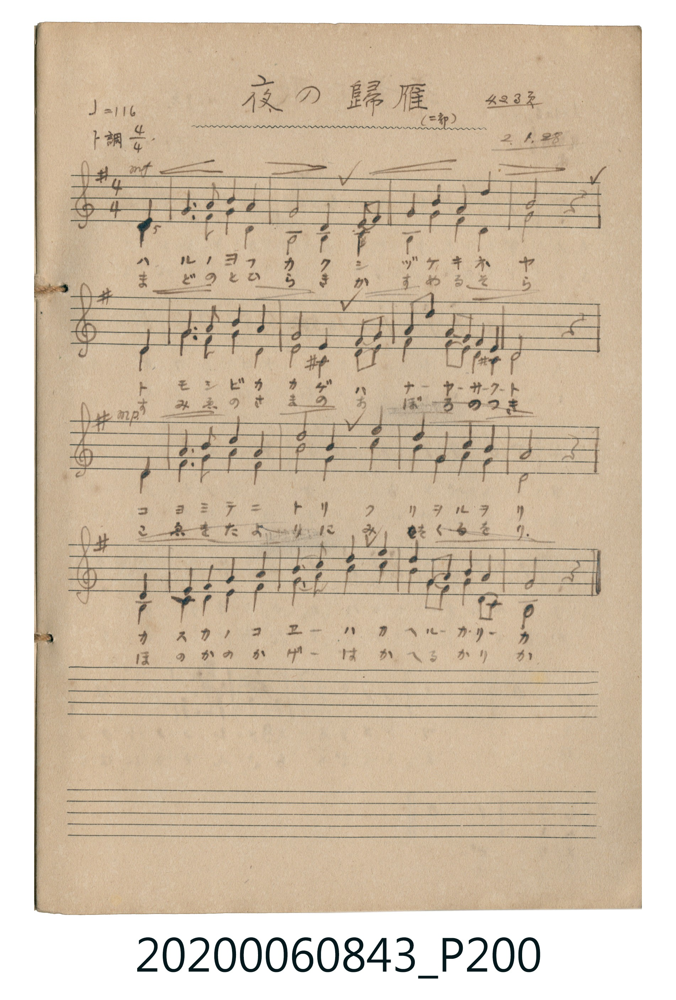

# 夜の歸雁 （二部） (夜之歸雁（二部合唱）)

<audio controls src="yoru_no_kigan.mp3"></audio>

- 詞曲作者：未在 TMD metadata 中提供

## 說明

夜の歸雁 （二部） (夜之歸雁（二部合唱）)
Source: 唱歌帖 (2020.006.0843), P200.jpg
Marginalia: 423頁 2.1.28 (昭和2年1月28日)
Dynamics: Line 1: mf, Line 3: mp

## 歌詞

```text
1.
ハルノヨフカク シヅケキネヤ トモシビカカゲ ハナーヤサクト
コヨミテニトリ フリヲルヲリ カスカノコエーハ カヘルーカリーカ

2.
まどのとひらき かすめるそら すみえのさまの おぼろのつき
こゑをたよりに みおくるをり ほのかのかげーは かへるかりか
```

## ABC

```abc
X:1
T:夜の歸雁 （二部） 夜之歸雁（二部合唱）
M:4/4
L:1/16
Q:1/4=116
K:G
V:V1 name="Alto" snm="Alt"
V:V2 name="Melody" snm="Mel"
[V:V1]
z4 z4 z4 D4 | B,6 C2 D4 B,4 | D8 D4 B,2 D2 | G4 B4 A4 =F4 |
G16 | D16 | B,6 D2 G4 G4 | =F8 ^C4 C2 D2 |
G4 G4 G4 E2 ^C2 | D16 | D16 | D6 D2 D4 D4 |
B,8 G4 B4 | A4 =F4 G4 E4 | D16 | D16 |
_A,4 ^C4 D4 D4 | D4 G4 A4 A4 | G4 D4 D4 D4 | B,12 z4 |
[V:V2]
z4 z4 z4 D4 | G6 A2 B4 G4 | A8 D4 G2 A2 | B4 d4 c4 A4 |
B16 | D16 | G6 A2 B4 d4 | A8 A4 G2 A2 |
B4 e4 d2 B2 A2 G2 | A16 | D16 | =F6 G2 A4 F4 |
G8 B4 d4 | c4 A4 B4 G4 | A16 | D16 |
D4 E4 =F4 G4 | A4 B4 c4 e4 | d4 B2 G2 A4 =F4 | G12 z4 |
```

## TMD 檔案連結

- [主旋律 TMD 檔案](yoru_no_kigan.tmd) [[在 TMD Studio 編輯](https://tmdlang.github.io/Tmd-TS/#tmd=s7IKdvYPcrWy4tLSUni6ZM7jxnXP1u54ObtR4f2ejie7el42r3i_p1NBAyj1ZGc3RAou83RCx9MpG4HymgpaWlyKtgqGhmZc9rYK7lw2Jvomdlxc-lpcCgoUGAvSHZxfWpScaqUAFHq2tufpjmkKGkYGRgZ6BgZmegYWJsaaOgoBRgYGelkF6SDlvolF6Zl5iTmZiVYKJkbGLxc0KhjpGeoZWShoPJux9umkHqOnO7cYPpvTYWTxbPpSsA0ulXmJuZnJxVYKPpl5qQqGVgq5aToQtjGQXcAFUuRTWQRSAmIa6oHIx839j5tXP27ue9y84nHz1MdNqx83rVd43LT9cXPr46aNj5vWPm7ufdy8BKiw43HzIrDEZLAqINoE0d71uHkPUMnjpq1AvUB1YHObNoNNnP-4ue1xczdY9yqg8qlA6nHzJrCdQBIoBDJoJ4gEugGoqQmoCWhaP1iieQZY4R4wG6gPxAD7wwji-MZ9jxtXAmPlceOKx42bHjd1Pm7sBYp2P26c-bip8XETkDEXKAoUmvm4cf_jxg6w2qlgfeuAol2PG4FG9oJFlwD1QgwF-m_i46ZJjxvnP27qeNwEVLQaKArUDmT1gwwFyjV1AYV2gzUCLYGQk0AObASGHoizA2w7UC1QUzeXlj4Xl29iZp6Vb2pOfkqlQ41BjUI1yDYFGwstOzCjRsFAQReOTeOBRI2CIZDUVTBSMAaSIHYNkA0SgSowBHJrwJKmQGwCVgpUBDUPJI4MayCaUIWQbQAZgrABRIMtQDLODKzKGChqiKQSrwXmOhAxkFG6UB7MSIjlukiWw_yA6WF8lkCNA0uYgQiINQgDQMaBjAa5H6gOLILiILhTQBAUATVctdAoc8wpySc6wowhbjOJhwiAuUguhgkCaYiVIIfhDhe8AQu1CigDUg7xKyywgS5QB7FAJMguJHNhGBhOIFmsRuMWAlJgFsS7sJQBUw7zESTQEZEAjhMibYKaaQTWDPEFko2wdA8JNXBqB_MQSlAjAi1Cde2ARWtmngKQVuYCAA)]
- [鋼琴伴奏 TMD 檔案](yoru_no_kigan_piano.tmd) [[在 TMD Studio 編輯](https://tmdlang.github.io/Tmd-TS/#tmd=s7IKdvYPcrWy4tLSUni6ZM7jxnXP1u54ObtR4f2ejie7el42r3i_p1NBAyj1ZGc3RAou83RCx9MpG4HymgqPGqYoBGQm5uUrOCYn5-cWJOZl5qbmlShoaXEp2ioYGppx2dsquHPZmOib2HFx6WtxKSjQwDqQqcH5pUXJqVYKQKXP1vY83TFNQcPIwMhAz8DATM_AwsRYU0chwMjAQC-rIB2k3DexKD0zLzEnM9FKwcTI-OWCRgUjPUM9IwsFjWcz1j6d1GP0dOcWw2dzOowsnk1fqsmlpc_F5ZuYmWflm5qTn1LpUGNQo1ANMkjBxkLLDsyoUTBQ0IVj03ggUaNgCCR1FYwUjIEkiF0DZINEoAoMgdwasKQpEJuAlQIVQc0DiSPDGogmVCFkG0CGIGwA0WALkIwzA6syBooaIqnEa4G5DkQMZJQulAczEmK5LpLlMD9gehifJVDjwBJmIAJiDcIAkHEgo0HuB6oDi6A4CO4UEARFQA1XLTTKHHNK8omOMGOI20ziIQJgLpKLYYJAGmIlyGG4wwVvwEKtAsqAlEP8CgtsoAvUQSwQCbILyVwYBoYTSBar0biFgBSYBfEuLGXAlMN8BAl0RCSA44RIm6BmGoE1Q3yBZCMs3UNCDZzawTyEEtSIwBah4CIgyIOEONWGRIhJvLYRUFAb5EWoIMhB2kCPAiVQYhgoCZQA5U5DiHJtUKIz0gYlQphyeKyAVRAR31BngA2GaDIEGwuOd7gLgGEGZoNomCtQbDLUBmUDkFZjYMwApSEqMbxCID2A1MLcA7UHzEZNynBXg2xEhAQwglHCAiIHdA3WQCUuvWiDJUGeAac3uFPA7oOairALYr8ROCxAIQMrFDA8AvIC1Ag86cmHiPQE1qZgCM8tMAbQZfB8i2BBVYIJiCiEhEcmZqSALEAVwW-ZEVwQ2UwTSL4FEZBciKwFn2VYfYHuWgyHQEiwsBkp1sEKfaxBh2Qo2JMQP-ENaBiER66uHbCez8xTANLKXAA)]

## 分析

```text
================================================================================
📊 TMD Song Profile: [ 夜の歸雁 （二部） 夜之歸雁（二部合唱） ]
================================================================================
⏱  Duration:       0:41 (41.4s), 20 measures total
🎼 Key & Tempo:    首調基準 G, != 116.0 BPM, <4/4>
   - 分析範圍：      由實際發聲的音符與和弦推測調性；播放脈絡另行呈現
🎤 人聲音域:    D4 (MIDI 62) – E5 (MIDI 76) [跨度: 14 個半音 / 1.2 個八度, 難度: moderate]
   - 最低音:  D4 in [Main #1 @ m.1, 0:01]
   - 最高音: E5 in [Main #1 @ m.9, 0:17]
   - 適合: soprano, mezzo-soprano, contralto, tenor, baritone, bass
🏛  結構:      Main (41.4s)
⚡ 編曲密度:        Peak 2 軌道同時演奏
🗝  調性診斷：       D 大調（流行色彩大調，未偵測到可信轉調）
   - 風格氣質:    流行大調（略帶和弦色彩音與裝飾副屬和弦）
   - 轉調歷程:    全曲維持單一推測調性（未偵測到可信轉調）
   - 核心骨幹音:  D, G, A, B, F
   - 調性數值:    D 大調 [相關度: 0.83, 穩定度: Moderate, 自然音純度: 91.4%]
   - 候選調性 (K-S): D 大調 (0.83), G 大調 (0.74), D 小調 (0.67)
   - 五度圈歷程:   +2
   - 各段落調性細節:
     • [Main #1]: D 大調 (r: 0.83, 自然音純度: 91.4%, 調外音: C, F, G#)

  [ 五度圈游移軌跡 ]
               C  
         F            G  
      Bb              [D ]*
      Eb               A  
         Ab           E  
            Db       B  
               F# 
     (* = active key center)

  [ 十二半音累積音高分佈 ]
     C  : ██                         2.3%
     C# : █                          2.0%
     D  : ████████████████████████  36.8%
     D# :                            0.0%
     E  : ██                         3.0%
     F  : ████                       5.6%
     F# :                            0.0%
     G  : ████████████              18.1%
     G# :                            0.7%
     A  : ███████████               16.1%
     A# :                            0.0%
     B  : ██████████                15.5%
--------------------------------------------------------------------------------
Assignment 軌道音域：
  - Alto          : G#3 – B4 (15 個半音 / 1.2 個八度, 56 個音符)
  - Melody        : D4 – E5 (14 個半音 / 1.2 個八度, 58 個音符)
================================================================================
```


## 原書掃描頁




