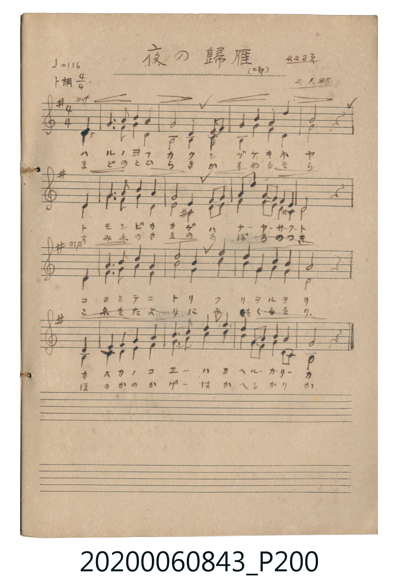

# 夜の歸雁（二部） (夜之歸雁（二部合唱）)

> Re:Shōka 使用 AI 協助辨識與重建樂譜，可能會有錯誤。歡迎回報。

- **鋼琴伴奏版**：<br><audio controls src="yoru_no_kigan.mp3"></audio>

- 楊金土手抄《唱歌帖》第 10 冊・X（國立臺灣歷史博物館典藏 2020.006.0843，P200.jpg）

## 說明

> [!NOTE]
> **原抄本資訊與校勘說明**（對應 `P200.jpg`）：
> - **曲名**：夜の歸雁（二部）
> - **調性與拍號**：ト調 4/4 拍（G 大調，弱起第 4 拍進入，二部合唱），速度 ♩= 116（首起 `mf`，第 8 小節第 4 拍轉 `mp`）
> - **欄外註記**：右上標「423頁」「2. 1. 28」（昭和 2 年 1 月 28 日抄自一條慎三郎編《新編 小學校・公學校 唱歌教材集》第 423 頁）
> - **譜面校勘**：
>   1. 原手抄五線譜每行均以第 4 拍弱起開始、行末以二分音符加四分休止符（3 拍）收束，全曲為弱起 + 16 小節（TMD 計 17 小節）。
>   2. 第 6–7 小節低聲部下加一線明確記有升記號 `#`（`4'_`，C♯4），導向屬音 D4 半終止；第 15 小節第 4 拍低聲部為八分音符圓滑線 `5_ 4_`（「リー」／「り」）。
>   3. 第二節第 14 小節原抄譜「かげーは」之「げ」筆誤作片假名「ゲー」，依原件忠實保留並註記於此。
>
> **一、**
> ハルノヨフカク　シヅケキネヤ　トモシビカカゲ　ハナーヤサクト
> コヨミテニトリ　クリヲルヲリ　カスカノコエーハ　カヘルーカリーカ
>
> **二、**
> まどのとひらき　かすめるそら　すみゑのさまの　おぼろのつき
> こゑをたよりに　みおくるをり　ほのかのかゲーは　かへるかりか


## 歌詞

```text
（TMD 檔案未包含歌詞註解）
```

## ABC

<div class="abc-score" data-abc-src="yoru_no_kigan.abc" aria-label="五線譜載入中"></div>

[下載 ABC 原始檔](yoru_no_kigan.abc)

## TMD 檔案連結

- [主旋律 TMD 檔案](yoru_no_kigan.tmd) [[在 TMD Studio 編輯](https://tmdlang.github.io/Tmd-TS/#tmd=s7IKdvYPcrWy4qpTUCpJTLdSSM7PyUlNLsnMz7MqzsjPTkzOyFeCS5bl55TmploBqXhDA4RwcX5pUXJqfEFieqpVgJEBhgzcpPi8_JLUpPz8bISKgqL8stS8xDygqtzEvNLi5KLMgpL45PyCSoSa1LLMlFSQiuLkxLz4stSizLTM1BQkZ6UWFYMdDHFHSVFiHsQcoCBCVX5RSUZ-elFiQUalVUZmcUl-UWZyYk58dmJeIkJRSUYq0IN5iSWlRanoosWpicX5ecXowol5mbmJOcj2ZKZn5lmV5oEcXQJ1qpaWwtMlcx43rnu2dsfL2Y3v93Q82dXzsnnF-z2dChpAmSc7u9Fknk7oeDplI1BeU0FLi0vRVsHQ0IzL3lbBncvGRN_EDmTds6VdL9snPp0z_1ln97OulscNXUAdz9b2PN0x7XFD9_M1axQMDRSetnU9bt4dATT36Zzu56u7X7Tvet64-Nna7U_7Nz3tnfW8c-XLJSuetu54Mb1fwcjAyEDPwMBMz8DCxPj9nh5QZOplFaQDXaHExaWvpWBLLcCloKBgpxCt6Ocf4hoL4WhpPe2bD_TGszlrXmxuf7Gi60VH-7MFC592z3ixatWzGX1aWiA_bOh91t6pkABzWQLQae_3zIKYoAs049nsTU8n9ILUzsIV4AjFL1btf9awHGRPd--LmfPBuh43dwCFFYBhrAAUBepzB8bccqAQMDye7tn4Yut2UMCCJV82bHrauhQojhZjQJGXDfOf7lqm8GjmSnDEAY15uWwaUK9CQm4a0M09IDMsFJ5u6H--vgFu3ou9QJ_lFoD8hOShNS1Pl0x7sWL3ixUzIN7q3_xkR9ezFTMfN_SYGBm_XND4uKEXyDbSUzDUUzCyAPKA1j2bsfbppB4FI4WnO7coGCo8m9MBlFJ4Nn0pMIRftK96sqPh2aK5z1r7nuzofNnc93z7CmDqeTZtA5ABctXTtTuAQQ9MN09b10DYCpCk9WzqzGdzJ7yc3QZNYEAHKABdgBqqa-e8nLsIEnVgF0OkFEDOA0UxOLE-2TXl-fZZQKXP1ve_WNjzdG77k91L4SEBCeiX07qfLu9-3NAIVPBszmqgAmBAP-1oezl_8_M1y552LXg6ezaQ-2TPxGdrFwFFgN42hkRa57Mp257NnQ-KstYVwCTxvGkXxEgFbQVDM2i4A5WH-LoovFjRoWBoDhfrfNzQBHMwMEhBTjJ71DAZpuDJ3r4XjZuAsf1kRzfQBcBwBHoDmDqfL9oFjKBnczqf9gLT7gxgalJIUAbGZEeCiXo8KMadH81cbwJJHE839D2dMPHpxjVAjyi4mCg87e16vrUJ6If3e2aDc60pesqA2wrySOtqRBjMmfxs90SgCxQSTOMVTEAWdQCTwuPmVY-b94ATQj-I29QFZiN7zRjsNWB4Qq0xBDoDbCckEwIjBqSxsftx4ySQUY3rgSYACymw4CQg-_natherljzZO-d5Z_vTxnZgngNbtAlmb8-TfXOBRj3Zve3p_gVP1y97sn_u86kzn-xYBknJz6btebZ2Ccw9sAIAGJrA2AYWd2D-4-b-x82rHzf3PW5e8bh56uOm1Y-bgM5oeNy0_XFz6-OmjY-b1j5u7n3cDDSnAZhtHzcvAktNBqsEok1gcaAhwBJwD0hZ01aQCc0dUPObNoNNnv-4ue1xczfYhFVg84FqgAEI9AvQdiAJEQQauBNEAt0D1NgE1Ag0Exi8YKnmGWDFe8BscOA3rUb12q4eZK817nvcuBJYOj1uXPG4cdPjps7HjcAAbAAH-MzHTY2Pm4CMuSBxkODMx437HzdNBKufCta7Dize9bgRaFEvWHwJ0ASY4cAQmPi4adLjxvmPmzpAsd-4Gqx-P1hLP8hwoCwoVQAFd4O1A60Dk5AYBEU3xDE7wC4BigM1doPMp7zshwIFLX0ursj8olK_fO_M9MQ8q-D8AmDNne9Qo2tYUw2ySsHGQgscgArYqh4FSI4Glt6ghLyjAVhIKGjAUrGOAqyG0MSiE2gzyNQaBQNggQXD1blptQrAXKSrUAOW9TFElQdGNkLOCE2ucR9YDmqsIZCjCyx7jcEkUAIqogsx3yxewTweKghTYgpWBuKBIMhMNKcA0xdYCpj-gHgFmDUVrAmY1KDagCkXTG6HiDe3gnkbweRasI5eqMwSJIuACR_FY8CUCTGtcR0Qg21q3AS1qRNmUyPIJGCSgIg3zgTb0QgmQWLAxIumAxJMIHXQYMIap5AyiZyoxB3mwODWBQW4IVDMCBjQRkAWkAuVqIEENMyJ1bkFGKkAWLBAg3c7kD0ZzAIFOWrQg4IImkaAdBeYBwpmYKkDjxqQDCiw4QHStBkt6PdDTZsIDn5QkEEjGZzCYNECIkE2gMT3gNVDogMiA7IVJAMSQwQ9yN2Egn5HJzlBDwpuUEo2gQc9KDVDxIChDBcBRQhIDUgUpgtHWgelOlAAzgfiNjALmtLgwQcsZlGCFcxrhkQCKFIgbJgMIsDBEYcIcGBAQwJ8EjCI5oNZ4NwApEEBDAlwsHngqAEFKzhqG0ERDU3rQL2oOiABvptwgAMbMOQEOCxFQ4IUEuSQosMEHNDIQY4tR8CKLaQQb9oJDx1QCQNPmkAaEhewxA1P-s0zEGEN1QcKaeRMgWYPOIFDkiikjECwQbpA8QUJb3ApBi9bdiBCGqIPHM4gGRAP1Z5a1CrFMadk-NQn4CIMllcUjGGlFphhgiQIUgROHFCVyLE-WqmQUamgBjw484Hzmjo0kIEiNZAQBxJADlghRHa0dkGKA_JqF3DAQkoyaLpGtJNgNQpEBFYYgmi0gAdnjNEKhtgwBxcnsLYqPNSRm1jIoY7IH0B9SCXTsK5mdO0UkGqaaB_DWAV0ISOwkDIXAA)]
- [鋼琴伴奏 TMD 檔案](yoru_no_kigan_piano.tmd) [[在 TMD Studio 編輯](https://tmdlang.github.io/Tmd-TS/#tmd=s7IKdvYPcrWy4qpTUCpJTLdSSM7PyUlNLsnMz7MqzsjPTkzOyFeCS5bl55TmploBqXhDA4RwcX5pUXJqfEFieqpVgJEBhgzcpPi8_JLUpPz8bISKgqL8stS8xDygqtzEvNLi5KLMgpL45PyCSoSa1LLMlFSQiuLkxLz4stSizLTM1BQkZ6UWFYMdDHFHSVFiHsQcoCBCVX5RSUZ-elFiQUalVUZmcUl-UWZyYk58dmJeIkJRYhFQc3pqbmpeiVVBZmJefnxicnJ-bkFiXiZIDKGwJAOoyCovsaS0KBVdtDg1sTg_rxhdGGRGYo4Sl5aWwtMlcx43rnu2dsfL2Y3v93Q82dXzsnnF-z2dChpAmSc7u9Fknk7oeDplI1BeU-FRwxSFAJDDFByRHaagpcWlaKtgaGjGZW-r4M5lY6JvYgey_9nSrpftE5_Omf-ss_tZV8vjhi6gSc_W9jzdMe1xQ_fzNWsUDA0UnrZ1PW7eHQG07-mc7ueru1-073reuPjZ2u1P-zc97Z31vHPlyyUrnrbueDG9X8HIwMhAz8DATM_AwsT4_Z4eUITrZRWkA12nxMUVmV9U6pfvnZmemGcVnF8ADMx8hxpdw5pqLgUgsLHQsgMzahQMFHThuDo3rVbBNB7IqgHL-hiiyj9u7kfIGaHJNe4Dy0GNNQRydBWMFIzBJFACKqILMd8sXsE8HioIU2IKVgbigSDITDSnPG5eDZZ63NwHxCvArKlgTY-bIDJAkab1YHI7RLy5FczbCCbXgnX0QmWWIFn0uLkDxWOPG1dCTGtcB8Rgmxo3QW3qhNnUCDLpcWM3RLxxJtiORjAJEnvcOBdNBySYQOqICCZgCOmCwsgQKGYEDBsjIAvIhUrUQMIGZmp1bgFGxD1uXgQNke1A9mQwCxRKqKEF8hU0WoF0F5gHCpnHTVvhoQmSAYUP3A9Nm9FCaz_UtIngEAP5Ehov4EQBC0kQCbIBJL4HrB4SghAZkK0gGZAYIrRA7oaHFiiEQOnFBB5aoDQDEQMGDFwEFIYgNSBRmC4cKQoUtyA_zwfiNjALGp9wHz9uXoUSEmBeMyTcQOEIYcNkEGEEDmtEGAHDBhJGk4C-mg9mgdMckAaFCSSMwOaBQxMUEuDYaATFDTRFAfWi6oCE0W7kMIKlG0goQEIJkqdMwGGDHErY0h0sPyMFUtNOuIdAWQ-eAIA0JPhgSQiewJpnIIIHqg8UOMhJD80ecDKCJARI5kGwQbpAQQwJInD2hme6HYjAgegDBw1IBsRDtacWtVR0zCkZiCIRnKVhCVHBGJaLwQwTJEGQInA0QlUix89IKRdRwwqcssEJWR0aLkCRGkggAQkgB6wQIjsyC0hwWEByNjT1ICpUWKEIEYEVDiAaLazAyW9Yl5HgfAZrh8ADCrkuRg4oRCoE6kPKsiOmpAQ3c4M8CBeWSBkMkYW1gS0XbVBImoKYkPJNG1aaAZmQTBuvDWsSQmUhesDawVohrUOIKJZyEJ99Zgj7gIUDyCKwJLjMAMqAsg1QpSmEAgtBZJGUo2URFIuhboQ42UgblHSgQkDPgN0NkwQaqA2pfyHi4EwI1gCRBdkCNQuWFSHBA7MKEkww14OSL9hncOtgwQMyFGIFuoXo4QNN0vAAwp8IfFASgQlSIoBAeFyAymJgtoFQyHwTGB8qhC6P2wwzIGkMxEZwXTD9IBEQhojA5BEmQURBCKdrQIaDOEAmLlNA0iARkFLs5sDcg8tfwBDVtVNACtRoH8NYBXQhI7CQMhcA)]

## 分析

```text
================================================================================
📊 TMD Song Profile: [ 夜の歸雁（二部） 夜之歸雁（二部合唱） ]
================================================================================
⏱  Duration:       1:06 (66.2s), 32 measures total
🎼 Key & Tempo:    首調基準 G, != 116.0 BPM, <4/4>
   - 分析範圍：      由實際發聲的音符與和弦推測調性；播放脈絡另行呈現
🎤 人聲音域:    B3 (MIDI 59) – C5 (MIDI 72) [跨度: 13 個半音 / 1.1 個八度, 難度: moderate]
   - 最低音:  B3 in [YoruNoKigan[L1] #1 @ m.3, 0:04]
   - 最高音: C5 in [YoruNoKigan[L1] #1 @ m.11, 0:22]
   - 適合: soprano, mezzo-soprano, contralto, tenor, baritone, bass
🏛  結構:      YoruNoKigan[L1] (33.1s) -> YoruNoKigan[L2] (33.1s)
⚡ 編曲密度:        Peak 2 軌道同時演奏
🗝  調性診斷：       G 大調（純淨自然大調，未偵測到可信轉調）
   - 風格氣質:    純淨自然大調（陽光明朗、易唱易記，無明顯調外色彩）
   - 轉調歷程:    全曲維持單一推測調性（未偵測到可信轉調）
   - 核心骨幹音:  G, D, B, A, F#
   - 調性數值:    G 大調 [相關度: 0.93, 穩定度: High, 自然音純度: 98.3%]
   - 候選調性 (K-S): G 大調 (0.93), D 大調 (0.79), B 小調 (0.75)
   - 五度圈歷程:   +1 -> +1
   - 各段落調性細節:
     • [YoruNoKigan[L1] #1]: G 大調 (r: 0.92, 自然音純度: 98.3%, 調外音: C#)
     • [YoruNoKigan[L2] #1]: G 大調 (r: 0.93, 自然音純度: 98.3%, 調外音: C#)

  [ 五度圈游移軌跡 ]
               C  
         F           [G ]*
      Bb               D  
      Eb               A  
         Ab           E  
            Db       B  
               F# 
     (* = active key center)

  [ 十二半音累積音高分佈 ]
     C  : ██████                     5.8%
     C# : ██                         1.7%
     D  : ███████████████████████   22.1%
     D# :                            0.0%
     E  : ████████                   7.9%
     F  :                            0.0%
     F# : █████████                  8.7%
     G  : ████████████████████████  23.3%
     G# :                            0.0%
     A  : ████████████              12.1%
     A# :                            0.0%
     B  : ███████████████████       18.3%
--------------------------------------------------------------------------------
Assignment 軌道音域：
  - Alto          : B3 – C5 (13 個半音 / 1.1 個八度, 114 個音符)
  - Soprano       : D4 – E5 (14 個半音 / 1.2 個八度, 116 個音符)
================================================================================
```


## 原書掃描頁




