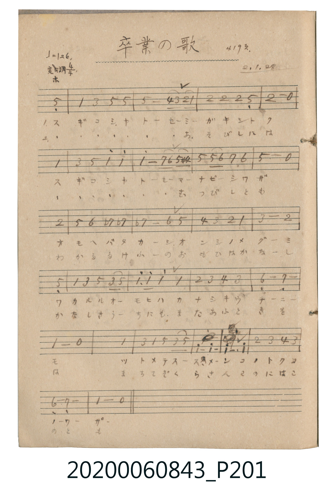

# 卒業の歌 (畢業之歌)

> Re:Shoka 使用 AI 協助辨識與重建樂譜，可能會有錯誤。歡迎回報。

<audio controls src="sotsugyo_no_uta.mp3"></audio>

- 詞曲作者：未在 TMD metadata 中提供

## 說明

卒業の歌 (畢業之歌)
Source: 唱歌帖 (2020.006.0843), P201.jpg
Marginalia: 419頁. 2.1.28 (昭和2年1月28日)

## 跨冊／重複收錄參照

> 同曲（蘆田惠之助作詞、Schulz 作曲〈卒業の歌〉；收錄於《新定兒童唱歌》高等科女子用與《唱歌帖》P201）

- **[同曲]** 《新定兒童唱歌》高等科女子用（2020.006.0849）：[**〈卒業の歌〉**](../../../shintei_jido_shoka/koto_girls_2020.006.0849/2_3_07_sotsugyo_no_uta/index.md)（`E,` / `4/4` — [原始 TMD](../../../shintei_jido_shoka/koto_girls_2020.006.0849/2_3_07_sotsugyo_no_uta/sotsugyo_no_uta.tmd)）
- 總表：[跨冊重複與同名歌曲總索引](../../../duplicate_songs.md)

## 歌詞

```text
1.
スギコシヤトーセ ミガキシトク スギコシヤトーセ マナビーシワザ
オモヘバフカーシ オンシノメグーミ ワカルルオーモヒハ カナシキウチーニーモ
ツトメテスースメン コノトクコノーワザー

2.
(すぎこしやとせ) あそびしには (すぎこしやとせ) むつびしとも
わかるるけふーの おもひはかなーし かなしきうーちにも またあふときをば
まちてぞくらさん このにはこのとも
```

## ABC

```abc
X:1
T:卒業の歌 畢業之歌
M:4/4
L:1/16
Q:1/4=126
K:Eb
V:V1 name="Vocal" snm="Voc"
[V:V1]
z4 z4 z4 B,4 | E4 G4 B4 B4 | B8 A2 G2 F2 E2 | F4 F4 F4 B,4 |
F8 z8 | E16 | G4 B4 e4 e4 | e8 d2 c2 B2 =A2 |
B4 B2 c2 d4 c4 | B8 z8 | F16 | B4 c4 _d4 d4 |
_d8 c4 B4 | A4 G4 F4 E4 | G8 F8 | B,16 |
E4 G4 B4 G2 B2 | e6 e2 e4 E4 | F4 G4 A4 G4 | C8 _D8 |
E8 z8 | E16 | G4 E4 B4 G2 B2 | e6 e2 e4 E4 |
F4 G4 A4 G4 | C8 _D8 | E8 z8 |
```

## TMD 檔案連結

- [主旋律 TMD 檔案](sotsugyo_no_uta.tmd) [[在 TMD Studio 編輯](https://tmdlang.github.io/Tmd-TS/#tmd=s7IKdvYPcrWy4qpTUCpJTLdSSM7PyUlNLsnMz7MqzsjPTkzOyFeCS5bl55TmploBqXhDA4RwcX5pUXJqfEFieqpVgJGBIboM3KT4vPyS1KT8_GyEioKi_LLUvMQ8oKrcxLzS4uSizIKS-OT8gkqEmtSyzJRUkIrUlMyS_KLMxBwkJ6UWFYMdC3FDSVFiHsQMoCBCVUlGKtDdxUAnAJ2ek5mWii6VllpcklmGbDBEPDm1KDU3Pw9spZaWwtPeSc-Wrn3cuO7Z2h4FjedTFwF5T3Z2A3maClpaXIq2CoZGZlz2tgquOlw2Jvomdlxc-lpcCgr4NIKkgyHhpPB0ykag0NMd0xQ0jAyMDPQMDMz0DCxMjDV1FEABq5dVkA5S7ptYlJ6Zl5iTmWilYGJo-XJBo56CkZ6hnpGFgsazGWufTuoxerpzi-GzOR1GFs-mL9XkAmnyqSzKTC62AjEN9UDk46adj5vWPW7a_Lhp--PmJY-bOx4373nctFvhcfP8x01rHjetBUt0PG5aj0_tvMfNXY-bJ4P5QLn1j5u2QUxf9bh50ePmGY-bJzxunvq4aTVEBUQCYk7f4-aFj5s2gCSa5wONAuoFqgIjkCKgKNCASY-b-4GagKJdIE0gVy173NwIlu6GKALb19wCdtXCx81tINeCLAOSQO5moO7NYMtAXoGxgfpATgUywKFjBA4SjceNMx839j1unPy4cfrjppbHjSseN87WVHjc2PS4ce7jxs0g4cbVjxvX41ba1PC4cQlM6YrHTU2Q0Oh_3Nj9uAmMGic-btwKckHjOqDJQF8BDd8ENBOkohHs78bpQAkwB2RI7-PGNrDoQpDdTU1AuX2PG-eDHbUVbG_v46ZJjxs3gG0CyQEVLnvcOO9xY__jps7HjcDQnwyUALp0HcT1MDbYeVr6XFy-iZl5VmH5yYk5DjUGNQrVIJMUbCy07MCMGgUDBV04No0HEjUKhkDSGMSF4howCYImQHEjoHwNkNSFY4g2qHkgARAEmQeCEOOQYQ3ccMM4GAFUBaJA0FzBDChpog43EeIMM6CELpBEdg7CDpitCDtAakCqzXVgBMw8MAcEQdIQ_5lAfQwyBuRciBNBEGYw0ECQL1HsgJqHHFzGQBLuFyAF8SHciSBlMLtqFMxgJprrwFjIZhITiiBR_PYiRQth2zHt5arl4tK1A5ZLmXkKQFqZCwA)]
- [鋼琴伴奏 TMD 檔案](sotsugyo_no_uta_piano.tmd) [[在 TMD Studio 編輯](https://tmdlang.github.io/Tmd-TS/#tmd=s7IKdvYPcrWy4tLSUnjaO-nZ0rWPG9c9W9ujoPF86iIg78nObiBPU-FRwxSFgMzEvHwFx-Tk_NyCxLzM3NS8EgUtLS5FWwVDIzMue1sFVx0uGxN9EzsuLn0tLgUFcgwEaQvOLy1KTrVSeDplI1Dp0x3TFDSMDIwM9AwMzPQMLEyMNXUUAowMDPWyCtJByn0Ti9Iz8xJzMhOtFEwMLV8uaNRTMNIz1DOyUNB4NmPt00k9Rk93bjF8NqfDyOLZ9KWaXFr6XFy-iZl5VmH5yYk5DjUGNQrVIIMUbCy07MCMGgUDBV04No0HEjUKhkDSGMSF4howCYImQHEjoHwNkNSFY4g2qHkgARAEmQeCEOOQYQ3ccMM4GAFUBaJA0FzBDChpog43EeIMM6CELpBEdg7CDpitCDtAakCqzXVgBMw8MAcEQdIQ_5lAfQwyBuRciBNBEGYw0ECQL1HsgJqHHFzGQBLuFyAF8SHciSBlMLtqFMxgJprrwFjIZhITiiBR_PYiRQth2zHt5aqFJiFwEg7yIDoRGcdrm8Zrg90HpLTBjtU21gZHO5QGWgdloaYtoAagm7QhSQs7E8lnSOKEQgzDJUBSGxxUcAbQ4TAm1sQItgqsF5QkjbRN1LVB6dIQxIAkToQKQkkUER4mYL1AXUCvIDPgsQcTAEcvVDkiGM1ANoJiFu5B1HCDJEC4JAiihRqe5I0nIiGpDinAgBScB7EU5DRkrZhOBdsAT4wQd-F0AtExDFVPvEuhVlHmXlwuRc1FPkTkIhAGehBmMpyBXcwU7gQEC54_4CKIgIOxkNIiPpuMcJuJkCLVInwuNQGzwEqBiR_OhiiACmP1M6aFsAKVyJBEWIZgAesHPOEL10x28CLEYNmdeEdgsR6U2HTtgK2FzDwFJFqZCwA)]

## 分析

```text
================================================================================
📊 TMD Song Profile: [ 卒業の歌 畢業之歌 ]
================================================================================
⏱  Duration:       0:51 (51.4s), 27 measures total
🎼 Key & Tempo:    首調基準 E,, != 126.0 BPM, <4/4>
   - 分析範圍：      由實際發聲的音符與和弦推測調性；播放脈絡另行呈現
🎤 人聲音域:    A#3 (MIDI 58) – D#5 (MIDI 75) [跨度: 17 個半音 / 1.4 個八度, 難度: challenging]
   - 最低音:  A#3 in [Main #1 @ m.1, 0:01]
   - 最高音: D#5 in [Main #1 @ m.7, 0:12]
   - 適合: soprano, mezzo-soprano, contralto, tenor, baritone, bass
🏛  結構:      Main (51.4s)
⚡ 編曲密度:        Peak 1 軌道同時演奏
🗝  調性診斷：       D# 大調（流行色彩大調，未偵測到可信轉調）
   - 風格氣質:    流行大調（略帶和弦色彩音與裝飾副屬和弦）
   - 轉調歷程:    全曲維持單一推測調性（未偵測到可信轉調）
   - 核心骨幹音:  D#, A#, F, G, C
   - 調性數值:    D# 大調 [相關度: 0.89, 穩定度: High, 自然音純度: 91.2%]
   - 候選調性 (K-S): D# 大調 (0.89), A# 大調 (0.67), D# 小調 (0.54)
   - 五度圈歷程:   -3
   - 各段落調性細節:
     • [Main #1]: D# 大調 (r: 0.89, 自然音純度: 91.2%, 調外音: C#, A)

  [ 五度圈游移軌跡 ]
               C  
         F            G  
      Bb               D  
     [Eb]*              A  
         Ab           E  
            Db       B  
               F# 
     (* = active key center)

  [ 十二半音累積音高分佈 ]
     C  : ███████                    8.2%
     C# : ███████                    8.2%
     D  : █                          1.5%
     D# : ████████████████████████  29.4%
     E  :                            0.0%
     F  : ████████████              14.9%
     F# :                            0.0%
     G  : ███████████               12.9%
     G# : ███                        3.6%
     A  :                            0.5%
     A# : █████████████████         20.6%
     B  :                            0.0%
--------------------------------------------------------------------------------
Assignment 軌道音域：
  - Vocal         : A#3 – D#5 (17 個半音 / 1.4 個八度, 79 個音符)
================================================================================
```


## 原書掃描頁




