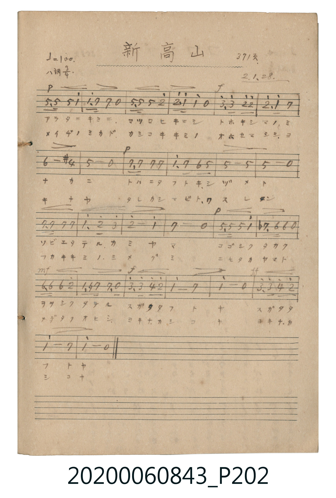

# 新高山 (新高山／玉山)

> Re:Shoka 使用 AI 辨識樂譜，可能會有錯誤。歡迎回報。

<audio controls src="niitakayama.mp3"></audio>

- 詞曲作者：未在 TMD metadata 中提供

## 說明

新高山 (新高山／玉山)
Source: 唱歌帖 (2020.006.0843), P202.jpg
Marginalia: 371頁 2.1.28. (昭和2年1月28日)
Dynamics: p, f, mf, ff

## 跨冊／重複收錄參照

> 同名異曲（各冊收錄之不同詞曲版本）

- **[同名異曲]** 《新定兒童唱歌》尋常科第五學年用（2020.006.0847.0005）：[**〈新高山〉**](../../../shintei_jido_shoka/grade_5_2020.006.0847.0005/2_06_niitakayama/index.md)（`C` / `4/4` — [原始 TMD](../../../shintei_jido_shoka/grade_5_2020.006.0847.0005/2_06_niitakayama/niitakayama.tmd)）
- 總表：[跨冊重複與同名歌曲總索引](../../../duplicate_songs.md)

## 歌詞

```text
1.
アラタニキミニ マツロヒキニシ トホキシマノ ミナカニ
トハニタフトキ シヅメト ソビエタテル カミヤマ
コゴシクタカク ヲヲシクタテル スガタタフトヤ スガタタフトヤ

2.
メイヂノミカド カシコキキミノ オホセマシシ ヨキナヤ
タレカシマビト ワスレメン フカキキミノ ミメグミ
ニヒタカヤマト メデタクオヒシ ヨキナカシコヤ ヨキナカシコヤ
```

## ABC

```abc
X:1
T:新高山 新高山／玉山
M:3/4
L:1/16
Q:1/4=100
K:C
V:V1 name="Vocal" snm="Voc"
[V:V1]
G,3 G, G,4 c4 | c3 B B4 z4 | G,3 G, G,4 d4 | d3 c c4 z4 |
e3 e d4 d4 | d3 c B4 A4 | A8 ^F4 | G8 z4 |
B,3 B, B,4 B,4 | c3 B A4 G4 | G8 G4 | G8 z4 |
B,3 B, B,4 B,4 | c3 d e4 d4 | d8 c4 | B8 z4 |
G,3 G, G,4 c4 | _B,3 A, A,4 z4 | A,3 A, A,4 d4 | C3 ^F B,4 B,2 z2 |
e3 e f4 d4 | c8 B4 | c8 z4 | e3 e f4 d4 |
c8 B4 | c8 z4 | G,3 G, G,4 c4 | c3 B B4 z4 |
G,3 G, G,4 d4 | d3 c c4 z4 | e3 e d4 d4 | d3 c B4 A4 |
A8 ^F4 | G8 z4 | B,3 B, B,4 B,4 | c3 B A4 G4 |
G8 G4 | G8 z4 | B,3 B, B,4 B,4 | c3 d e4 d4 |
d8 c4 | B8 z4 | G,3 G, G,4 c4 | _B,3 A, A,4 z4 |
A,3 A, A,4 d4 | C3 ^F B,4 B,2 z2 | e3 e f4 d4 | c8 B4 |
c8 z4 | e3 e f4 d4 | c8 B4 | c8 z4 |
```

## TMD 檔案連結

- [主旋律 TMD 檔案](niitakayama.tmd) [[在 TMD Studio 編輯](https://tmdlang.github.io/Tmd-TS/#tmd=s7IKdvYPcrWy4qpTUCpJTLdSSM7PyUlNLsnMz7MqzsjPTkzOyFeCS5bl55TmploBqXhDA4RwcX5pUXJqfEFieqpVgJGBEboM3KT4vPyS1KT8_GyEioKi_LLUvMQ8oKrcxLzS4uSizIKS-OT8gkqEmtSyzJRUkIrUlMyS_KLMxBwkJ6UWFYMdC3FDSVFiHsQMoKASl5aWwrNpG16unvF040YFDTjz_Z7-532dQIamgpYWl6KtgqGBAZe9rYIzl42xvokdF5e-FpeCAgGtIBXBEP8pPJ2y8dnanqc7piloAP1voGdgYKZnYGFirKmjAAoQvayCdJBy38Si9My8xJzMRCsFY3PDlwsaFYz0DPWMLPSANsxY-3RSj9HTnVsMn83pMLJ4Nn0p2AqXyrzE3MzkYmBQ6Sik6SjkAnFaGhdIyqeyCCQBYhrqgcjHTYseN6983LT_cXP346a1j5vnAxkKj5vnPW5uedwM5E8CiwLltgNFOx43zwbxm7aDVfQBhYDqux43rQYqARsHUtIPVg80cSqI27QWaAlQfevj5oVAPpCz93Hz5MdNK8BK2h43rwYKAfUDDVoCNBXiqM2Pm7aAdDWtB6kCSjetB5q9CYTgojC9Ox83rQGrgtnYvAS7KDgEjCDeBrqlCWhdE9ATIKtBDugEuwNkPNB2oB8hgQH0Y9MqsLd3g_wMkgaFBND1QPkukKlgBwNtAVoH1g4KmclgnzYD3bkTJAHy-WYgfypYCbLZIArolA1ABsRd3eAgB_sZHB4Qg4D628GiQBOBrgGqQHYE3Nkgn2MT5dLS5-LyTczMswrLT07McagxqFGoBtmnYGNopmUHZtUomMYr6AIhkIKydBUM46CMGhjTHAghQgZwKSwajRAaoUygfrhpcK1Qm40hEkAKrg-rATCrzeByMBYMmqgjXIUmhW6pOcStQArKArMxvAuzAWYcpsG4ZciyEuhdaHhgCwUERIobWLjgshd_zJrrQATN4kEIzQSYELIkkqsMwTQw1FE9BNKOGbkmWLwFdwcMwvyCRQrhKLxmQu0ly2SuWi4uXTtgsZuZp4BEK3MBAA)]
- [鋼琴伴奏 TMD 檔案](niitakayama_piano.tmd) [[在 TMD Studio 編輯](https://tmdlang.github.io/Tmd-TS/#tmd=s7IKdvYPcrWy4tLSUng2bcPL1TOebtyooAFnvt_T_7yvE8jQVHjUMEUhIDMxL1_BMTk5P7cgMS8zNzWvREFLi0vRVsHQwIDL3lbBmcvGWN_EjotLX4tLQYFMI0E6g_NLi5JTrRSeTtn4bG3P0x3TFDSMDIwM9AwMzPQMLEyMNXUUAoACelkF6SDlvolF6Zl5iTmZiVYKxuaGLxc0KhjpGeoZWegBbZ6x9umkHqOnO7cYPpvTYWTxbPpSTS4tfS4u38TMPKuw_OTEHIcagxqFapBBCjaGZlp2YFaNgmm8gi4QAikoS1fBMA7KqIExzYEQImQAl8Ki0QihEcoE6oebBtcKtdkYIgGk4PqwGgCz2gwuB2PBoIk6wlVoUuiWmkPcCqSgLDAbw7swG2DGYRqMW4YsK4HehYYHtlBAQKS4gYULLnvxx6y5DkTQLB6E0EyACSFLIrnKEEwDQx3VQyDtmJFrgsVbcHfAIMwvWKQQjsJrJtReskzmqoVmFHBGDfIgPqsYa5tqIwUqEtdcwQjIISrbmAAVIgUOEhdoFooNGFEMlNJGChZtc4RBKByQ04BKEcYiO85Q21gbkbkMtU3U4VwYNNQ2AgrD1QATD1CAUMI3jdeGpTJg-kDigbyPxEELN6AD4PaDnIbIacg8GER1CnY1VHEYMOyQgxsjgFG4MIiWPpBDHbfjoA7BmcpMgF5Gyr4gLnFZGBiuyC42i9eG52QUf2PkZrR0ZgbiwvMgRkJDciwMInschxKkLEK8bbDShlI7UUsAH1wlgCG8IMVgAJ2NSERwFpKnsMgiWNiMRk8YcAnsBpjB2cZwFkIMmPZgTHj4YHM6ZshAUwCxzgemRnSPYDMfq16KLccSRNgsx-synMGOLc4RvkWwEHEOD2FMBoHkgm43wnS8AUdcqBIwFt1u0gwH5SRdO2BjNTNPAYlW5gIA)]

## 分析

```text
================================================================================
📊 TMD Song Profile: [ 新高山 新高山／玉山 ]
================================================================================
⏱  Duration:       1:33 (93.6s), 52 measures total
🎼 Key & Tempo:    首調基準 C, != 100.0 BPM, <3/4>
   - 分析範圍：      由實際發聲的音符與和弦推測調性；播放脈絡另行呈現
🎤 人聲音域:    G3 (MIDI 55) – F5 (MIDI 77) [跨度: 22 個半音 / 1.8 個八度, 難度: difficult]
   - 最低音:  G3 in [Main #1 @ m.1, 0:00]
   - 最高音: F5 in [Main #1 @ m.21, 0:36]
   - 適合: mezzo-soprano, contralto, baritone, bass
🏛  結構:      Main (46.8s) -> Main (46.8s)
⚡ 編曲密度:        Peak 1 軌道同時演奏
🗝  調性診斷：       G 大調（純淨自然大調，未偵測到可信轉調）
   - 風格氣質:    純淨自然大調（陽光明朗、易唱易記，無明顯調外色彩）
   - 轉調歷程:    全曲維持單一推測調性（未偵測到可信轉調）
   - 核心骨幹音:  C, G, B, D, A
   - 調性數值:    G 大調 [相關度: 0.86, 穩定度: High, 自然音純度: 96.0%]
   - 候選調性 (K-S): G 大調 (0.86), C 大調 (0.71), E 小調 (0.54)
   - 五度圈歷程:   +1 -> +1
   - 各段落調性細節:
     • [Main #1]: G 大調 (r: 0.86, 自然音純度: 96.0%, 調外音: F, A#)
     • [Main #2]: G 大調 (r: 0.86, 自然音純度: 96.0%, 調外音: F, A#)

  [ 五度圈游移軌跡 ]
               C  
         F           [G ]*
      Bb               D  
      Eb               A  
         Ab           E  
            Db       B  
               F# 
     (* = active key center)

  [ 十二半音累積音高分佈 ]
     C  : ████████████████████████  22.3%
     C# :                            0.0%
     D  : █████████████████         15.5%
     D# :                            0.0%
     E  : ██████                     5.8%
     F  : ███                        2.9%
     F# : ██                         1.8%
     G  : ██████████████████████    20.1%
     G# :                            0.0%
     A  : ███████████               10.4%
     A# : █                          1.1%
     B  : ██████████████████████    20.1%
--------------------------------------------------------------------------------
Assignment 軌道音域：
  - Vocal         : G3 – F5 (22 個半音 / 1.8 個八度, 152 個音符)
================================================================================
```


## 原書掃描頁




