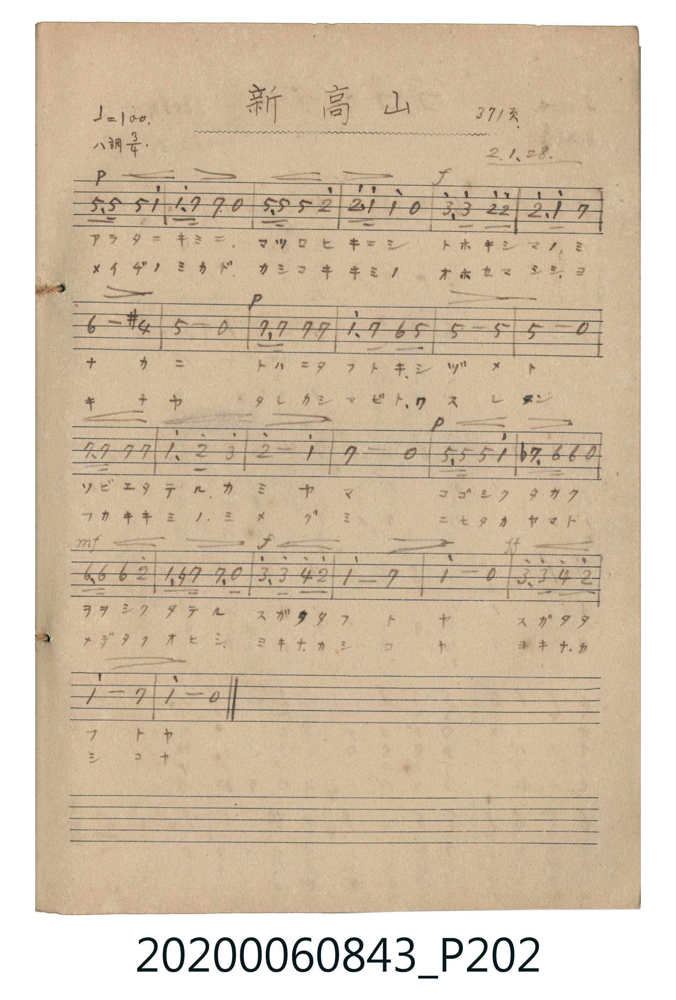

# 新高山 (新高山／玉山)

> Re:Shōka 使用 AI 協助辨識與重建樂譜，可能會有錯誤。歡迎回報。

- **鋼琴伴奏版**：<br><audio controls src="niitakayama.mp3"></audio>

- 詞曲作者：未在 TMD metadata 中提供

## 說明

新高山 (新高山／玉山)
Source: 唱歌帖 (2020.006.0843), P202.jpg
Marginalia: 371頁 2.1.28. (昭和2年1月28日)
Dynamics: p, f, mf, ff


## 歌詞

```text
1.
アラタニキミニ マツロヒキニシ トホキシマノ ミナカニ
トハニタフトキ シヅメト ソビエタテル カミヤマ
コゴシクタカク ヲヲシクタテル スガタタフトヤ スガタタフトヤ

2.
メイヂノミカド カシコキキミノ オホセマシシ ヨキナヤ
タレカシマビト ワスレメン フカキキミノ ミメグミ
ニヒタカヤマト メデタクオヒシ ヨキナカシコヤ ヨキナカシコヤ
```

## ABC

<div class="abc-score" data-abc-src="niitakayama.abc" aria-label="五線譜載入中"></div>

[下載 ABC 原始檔](niitakayama.abc)

## TMD 檔案連結

- [主旋律 TMD 檔案](niitakayama.tmd) [[在 TMD Studio 編輯](https://tmdlang.github.io/Tmd-TS/#tmd=s7IKdvYPcrWy4qpTUCpJTLdSSM7PyUlNLsnMz7MqzsjPTkzOyFeCS5bl55TmploBqXhDA4RwcX5pUXJqfEFieqpVgJGBEboM3KT4vPyS1KT8_GyEioKi_LLUvMQ8oKrcxLzS4uSizIKS-OT8gkqEmtSyzJRUkIrUlMyS_KLMxBwkJ6UWFYMdC3FDSVFiHsQMoCBCFVBTemaeVW5qZlZmfElqRQmqI6DSJYmZ5Yl58flpaZnJKJbkF5Vk5KcXJRZkVFplZBaD3JCcmBOfnZiXiFBUkpEKDJvUlNLkRIjlWloKz6ZteLl6xtONGxU04Mz3e_qf93UCGZoKWlpcirYKhgYGXPa2Cs5cNsb6JnZcXPpaXAoKBLSCVARDAlfh6ZSNz9b2PN0xTUEDGPgGegYGZnoGFibGmjoKoNjQyypIByn3TSwCejIxJzPRSsHY3PDlgkYFIz1DPSMLPaANM9Y-ndRj9HTnFsNnczqMLJ5NXwq2wqUyLzE3M7kYGE86Cmk6CrlAnJbGBZLyqQQGQrEViGmoByIfNy163LzycdP-x83dj5vWPm6eD2QoPG6e97i55XEzkD8JLAqU2w4U7XjcPBvEb9oOVtEHFAKq73rctBqoBGwcSEk_WD3QxKkgbtNaoCVA9a2PmxcC-UDO3sfNkx83rQAraXvcvBooBNQPNGgJ0FSIozY_btoC0tW0HqQKKN20Hmj2JhCCi8L07nzctAasCmZj8xLsouAQMIJ4G-iWJqB1TUBPgKwGOaAT7A6Q8UDbgX6EBAbQj02rwN7eDfIzSBoUEkDXA-W7QKaCHQy0BWgdWDsoZCaDfdoMdOdOkATI55uB_KlgJchmgyigUzYAGRB3dYODHOxncHhADALqbweLAk0EugaoAtkRcGeDfI5NlEtLn4vLNxGYW8LygXnAocagphpknYKNoZmWHZhVo2Aar6ALhEAKytJVMIyDMmpgTHMghAgZwKWwaDRCaIQygfrhpsG1Qm02hkgAKbg-rAbArDaDy8FYMGiijnAVmhS6peYQtwIpKAvMxvAuzAaYcZgG45Yhy0qgd6HhgS0UEBApbmDhgste_DFrrgMRNIsHITQTYELIkkiuMgTTwFBH9RBIO2bkmmDxFtwdMAjzCxYphKPwmgm1lyyTuWq5uHTtgKVuZp4CkFbmAgA)]
- [鋼琴伴奏 TMD 檔案](niitakayama_piano.tmd) [[在 TMD Studio 編輯](https://tmdlang.github.io/Tmd-TS/#tmd=s7IKdvYPcrWy4qpTUCpJTLdSyC8qychPL0osyKi0ysgsLskvykxOzInPTsxLVIIrKs4vLUpOjS9ITE-1CjAyMELIlGSk5qZapaaUJieWZObnKXFpaSk8m7bh5eoZTzduVNCAM9_v6X_e1wlkaCo8apiiEJCZmJev4JicnJ9bkJiXmZuaV6KgpcWlaKtgaGDAZW-r4MxlY6xvYsfFpa_FpaBAppEgncFgp1spPJ2y8dnanqc7piloAD1goGdgYKZnYGFirKmjAPKRXlZBOki5b2JRemZeYk5mopWCsbnhywWNCkZ6hnpGFnpAm2esfTqpx-jpzi2Gz-Z0GFk8m75Uk0tLn4vLNzEzzyosHxhuDjW6hjXVIIMUbAzNtOzArBoF03gFXSAEUlCWroJhHJRRA2OaAyFEyAAuhUWjEUIjlAnUDzcNrhVqszFEAkjB9WE1AGa1GVwOxoJBE3WEq9Ck0C01h7gVSEFZYDaGd2E2wIzDNBi3DFlWAr0LDQ9soYCASHEDCxdc9uKPWXMdiKBZPAihmQATQpZEcpUhmAaGOqqHQNoxI9cEi7fg7oBBmF-wSCEchddMqL1kmcxVC80o4Iwa5EF8VjHWNtVGClQkrrmCEZBDVLYxASpEChwkLtAsFBswohgopY0ULNrmCINQOCCnAZUijEV2nKG2sTYicxlqm6jDuTBoqG0EFIarASYeoAChhG8arw1LZcD0gcQDeR-JgxZuQAfA7Qc5DZHTkHkwiOoU7Gqo4jBg2CEHN0YAo3BhEC19IIc6bsdBHYIzlZkAvYyUfUFc4rIwMFyRXWwWrw3PySj-xsjNaOnMDMSF50GMhIbkWBhE9jgOJUhZhHjbYKUNpXailgA-KCWACbwAMIyHIqAbgYEFwgZIbBCGKQKKIzQhJM2ApDEQg2hgcgCFM5CAGAFyDjzA0Y0ERjLCYmDqgInj1QS1GqYJST-K82B-AtkBwiA_AV0FQSheRegBqUNyBKp7UBQg9GA4GxjounbAdk1mngISrcwFAA)]

## 分析

```text
================================================================================
📊 TMD Song Profile: [ 新高山 新高山／玉山 ]
================================================================================
⏱  Duration:       0:46 (46.8s), 26 measures total
🎼 Key & Tempo:    首調基準 C, != 100.0 BPM, <3/4>
   - 分析範圍：      由實際發聲的音符與和弦推測調性；播放脈絡另行呈現
🎤 人聲音域:    G3 (MIDI 55) – F5 (MIDI 77) [跨度: 22 個半音 / 1.8 個八度, 難度: difficult]
   - 最低音:  G3 in [Main #1 @ m.1, 0:00]
   - 最高音: F5 in [Main #1 @ m.21, 0:36]
   - 適合: mezzo-soprano, contralto, baritone, bass
🏛  結構:      Main (46.8s)
⚡ 編曲密度:        Peak 1 軌道同時演奏
🗝  調性診斷：       G 大調（純淨自然大調，未偵測到可信轉調）
   - 風格氣質:    純淨自然大調（陽光明朗、易唱易記，無明顯調外色彩）
   - 轉調歷程:    全曲維持單一推測調性（未偵測到可信轉調）
   - 核心骨幹音:  C, G, B, D, A
   - 調性數值:    G 大調 [相關度: 0.86, 穩定度: High, 自然音純度: 96.0%]
   - 候選調性 (K-S): G 大調 (0.86), C 大調 (0.71), E 小調 (0.54)
   - 五度圈歷程:   +1
   - 各段落調性細節:
     • [Main #1]: G 大調 (r: 0.86, 自然音純度: 96.0%, 調外音: F, A#)

  [ 五度圈游移軌跡 ]
               C  
         F           [G ]*
      Bb               D  
      Eb               A  
         Ab           E  
            Db       B  
               F# 
     (* = active key center)

  [ 十二半音累積音高分佈 ]
     C  : ████████████████████████  22.3%
     C# :                            0.0%
     D  : █████████████████         15.5%
     D# :                            0.0%
     E  : ██████                     5.8%
     F  : ███                        2.9%
     F# : ██                         1.8%
     G  : ██████████████████████    20.1%
     G# :                            0.0%
     A  : ███████████               10.4%
     A# : █                          1.1%
     B  : ██████████████████████    20.1%
--------------------------------------------------------------------------------
Assignment 軌道音域：
  - Vocal         : G3 – F5 (22 個半音 / 1.8 個八度, 76 個音符)
================================================================================
```


## 原書掃描頁




