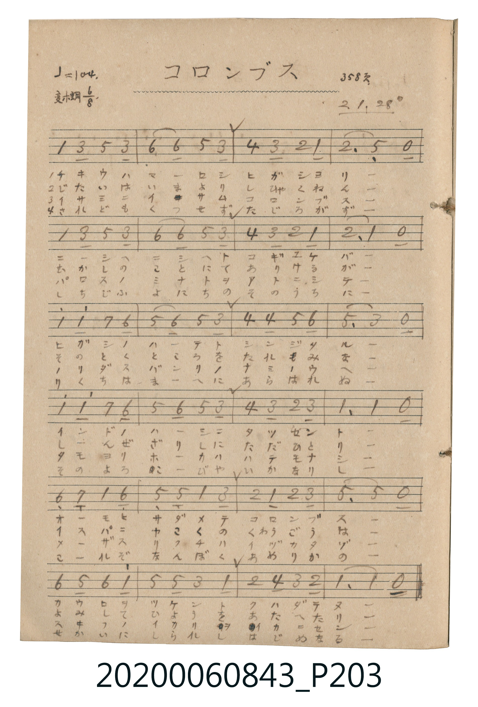

# コロンブス (哥倫布)

> Re:Shōka 使用 AI 協助辨識與重建樂譜，可能會有錯誤。歡迎回報。

- **鋼琴伴奏版**：<br><audio controls src="koronbusu.mp3"></audio>

- 詞曲作者：未在 TMD metadata 中提供

## 說明

コロンブス (哥倫布)
Source: 唱歌帖 (2020.006.0843), P203.jpg
Marginalia: 358頁 2.1.28 (昭和2年1月28日抄)


## 歌詞

```text
1.
地球は丸し東より 西へ西へと漕ぎ行けば
東のはてと信じたる 印度のはしに達せんと
思ひ定めてコロンブス 航路をつけんと企てぬ。

2.
時代は今より四百年 昔の事にてありけるが
その説く所を誰も皆 信ぜざりしに只一人
イスパニヤ国の皇后は 嘉して費用を與へたり。

3.
勇みに勇むコロンブス パロスの港を後にして
乗出す萬里の波の上 雲より外は果てもなし
目ざす陸地は何方ぞ 水夫の怒りを如何にせん。

4.
されども屈せずたじろがず 七十餘日のその中に
陸地は前にあらはれぬ その喜びやいかなりし
これぞ南北アメリカの 世界に知られし始めなる。
```

## ABC

<div class="abc-score" data-abc-src="koronbusu.abc" aria-label="五線譜載入中"></div>

[下載 ABC 原始檔](koronbusu.abc)

## TMD 檔案連結

- [主旋律 TMD 檔案](koronbusu.tmd) [[在 TMD Studio 編輯](https://tmdlang.github.io/Tmd-TS/#tmd=s7IKdvYPcrWy4qpTUCpJTLdSSM7PyUlNLsnMz7MqzsjPTkzOyFeCS5bl55TmploBqXhDA4RwcX5pUXJqfEFieqpVgJGBMboM3KT4vPyS1KT8_GyEioKi_LLUvMQ8oKrcxLzS4uSizIKS-OT8gkqEmtSyzJRUkIrUlMyS_KLMxBwkJ6UWFYMdC3FDSVFiHsQMoCBCVUlGKtDdYMmC_KIShATQtPTMPKvc_LykUqArMSTKU4tLUovy4nNTc_JTkJwENCQjP70osSCj0iojsxjkquTEnPjsxLxEJS4tLYXHTZsfN6993Awkpz1u2qmg8XTy0qcNq5_uaNZU0NLiUrRVMDQw4bK3VXDV4bIx07ew4-LS1-JSUMCnESQdDAlQhadTNj5b2_N0xzQFDSMDIwM9AwMzPQMLE2NNHQVQDOhlFaSDlPsmFgF9kZiTmWilYGxq8XJBo4KRnqGekYWCxrMZa59O6jF6unOL4bM5HUYWz6YvfdbVoskF0uZTCfROsRWIaagHIp_O2fB8QvPjxvVPdux43Dj92dyNj5s6Hjd1KbxYuv9x4w4I-bhxxbM9Ux839r1Y2PO4ceLjxg0grSC1jeuAWh83LgOqeLJ_4ePGGY8b5z9u6lZ42rvh6S6gKER6-uPG1S8bpzxunP24aTJQKVh3w9zHjZuerpv1uKkRZABa6LzoWPVi-_rHTZMeNy4BWQnW92QPWGnjmscNTWDvGIH98Gxm05Pdi0F-2N0Fcf3T2bOfz9wHDAGFZzOA1q57sqsb6ASw3iagNNhAoEgPOF4agQ5Z92LVmseN_c86G4BWvli14XFT0_NZbQpgP8153Ah0ElATyBtP-1c92dHwZNcuSJQuAbr1cfPEx83dj5uXPJ29F2jS81ntTyf0AV2j8HRGJ1jTshebdj-fsgJkckc7ODiBYdQF84MxJB66gTLAsF4NYjQBXYEaHGA71oIsa1z3bAcoXJ7uA0YF0Esg80EGPNk5_Wn7rseNM19MWPOyHSi37tnmRSCv7-hSeDl7EzRclkwDOuzZPKCXgCHe9LhxFdAAkO7ns4ExBZSb-XLmDmCSAIXl3qnPpgGtm6fwbMOWp0uANq171jAJ5G6g3cuagNJg68ExCvWJCdgnjxunPm4C2r8SaMHTjR0gJY2zQF4GJo6mXmCgA7kKT3Y0P-1tfLlkBjBxglMJKA6e7FgLNBNkBtwVTzuBOoDWAGMNGJZAfwN1r4FG2dNpQG9sftzU8rgRiIDRuQoSSxBHTAarnfe0d_rTnumPmxY9bl74uBmoAuQRoPXTnk8Fhd_z-UtBJoOUTn-6vBucFoGKukFe0tLn4vJNBBYVAZmJefkONQY11SCjFWwstOzAjBoFQwVdBWMFUzBZo2AGpM3gPBMwbQQkDYE8EK2rYBoPJAwUasDafQxrgPHaCBR53LQWiJeBWM39QMWPm-eBlQOjHCy7HSw2CcwG-h7IB8mtAIuuAqsEwXiYuUZA8cYZIDWNC4C4BcxaD1INZe8DmtEBNq0LLDodLApMIy1Aqh_MWQuSaJqMabgxSHwJWPNWoPXzwU7pBqsGiULEQWILwGKbod4AJmUwaxpYdCemuSYgh0wF6-8BslaCWU1g50FctASIZ4NZs8CiYJuB3gQmKjCrByw6C8VkMqMJpB41lrqhXoOE_AxwyIPEQCIgPki0A-HhpnVAPjg-mzaC1U7AHktNDWCnd8PjYB3YE6BgBxZ3QLwazFoGFm2Cxhiw9AKzwIEO9DbWKGoGqwEFPDiwHzf3gd0BiS6gGUDXglibwG5eBHU_wk8gtW04Igni0oXwNLYVbAbYPKB7QTIIn8yFsh83gkwDyYFEQb7CjKQ4UMjHKZiDo6cGHEGo0WQCFYPIgcTRowk9i0A8DUo_IB7YCdBogshvBrJ2gPXsB6tEdRgiMyG8sQLMAmdSKHsyLAU2TUKkS1AaBqZekDzY5EYs2RQcTX1gd6wCYnBSAEYWLLmAXQfO3jB_dIHZ82G6gAUGSBQUCViiCZhQIC6FRQikANgHCYtGsK-BEYFIWJ1gNRC3g0TXkBdJkLwE4oFyEZa8BCk8wJ7rxIwkaMRACpT9YDawUGraDdUDUglKadgiCZwugUUWsMYGew5S1ICCAcSDpFqIhyFFB6hs3ARmgUtSqErMwg4cKM2LwCUuJLJArgAVRSD7wDkUWmqDCypgMgOphuQzWFLDlo_giQpaFvfC8z5IHFKOtCCV2qBSApwckEptjAgyA9Uw5vHgYAeygTEEEgASkDIQUsIZwuMIkpFAJGocQZIrzB_ghA0t1huAGJyggP4kqYAHxxHEJzOBeCMiPoC-hGYkaFEPKTv6HzdBuMAAbZwCZYEkQBGCLS-BnAUKnm1gEpKTIAG2HsgCV7SQiIImwVZY9EFyfxMkb2BGFDRKgPkC5IZ58PwMSWx7wKKQEgGSkxrhuQ9SRK_DGVHAeAHToKoHFlGgUg1WFZmAeUZ4MhOkxAKVBZDGAsjP4EQNzjbgQEbKNpCQgCTTBqRC_nEzyG-oVRMkm4HKL0hSA_kEXKUBMw2suIckAXCpC_Q7LGPtgGcySGJFiydg9ENkJgDZoEQFCyNQ8gCFGTyJQ02Gi0KzLyzrgeIFNaagMuCsAkpUsMoG5ANQCQeJRXhhAUxJ0EoMGGeIUhpUtUJMruXi0rUD9rUy86J9DGMV4GwjJLYxEtsEzFbmAgA)]
- [鋼琴伴奏 TMD 檔案](koronbusu_piano.tmd) [[在 TMD Studio 編輯](https://tmdlang.github.io/Tmd-TS/#tmd=s7IKdvYPcrWy4qpTUCpJTLdSyC8qychPL0osyKi0ysgsLskvykxOzInPTsxLVIIrKs4vLUpOjS9ITE-1CjAyMEbIlGSk5qZapaaUJieWZObnKXFpaSk8btr8uHnt42YgOe1x004FjaeTlz5tWP10R7OmwqOGKQoBmYl5-QqOycn5uQWJeZm5qXklClpaXIq2CoYGJlz2tgquOlw2ZvoWdlxc-lpcCgrkGAjSFgx2tZXC0ykbn63tebpjmoKGkYGRgZ6BgZmegYWJsaaOAsgzelkF6SDlvolF6Zl5iTmZiVYKxqYWLxc0KhjpGeoZWShoPJux9umkHqOnO7cYPpvTYWTxbPpSTS4tfS4u38TMPCuw9Q41BjXVIGMUbCy07MCMGgVDBV0FYwVTMFmjYAakzeA8EzBtBCQNgTwQratgGg8kDBRqyNQOUo-kOw4kFKdgDtZXA9aJqt8EKgaRA4mTph9iP4gHshndfjOQZ8zjwaJANtAAkACQgHgL4mhDuBFgWYwgABsCFAPTIJ_CDAG5FeZzEzDPCMMdtcgRFOSBNYqM47VN47UhTjLUNtaG-c9Q20QbEuLIombx2kbaEK8DdZkDeXBnwXgYXqCBDQgjkazRNtWGRZkRkA2LNpjhOKwxAUYRkAlLCDA1IF9oAznUsALZJyAJhOtx-CReG5Z2wEywNDgFgVVDQhgepMghY4hmkxFUPTBxQFmYtoDSEpQJCmY0K8AhABIH-QYcXHBRmFX4PISSAn2wp0BDiAuhFDBnofGNkDIGiI89o5BpClgewxS4KnRT0U1Blqe2KeAoAUc8dlOQwwF3uEDDAUqR7hZgDOraAeuGzDwFPLQyFwA)]

## 分析

```text
================================================================================
📊 TMD Song Profile: [ コロンブス 哥倫布 ]
================================================================================
⏱  Duration:       2:46 (166.2s), 96 measures total
🎼 Key & Tempo:    首調基準 E,, != 104.0 BPM, <6/8>
   - 分析範圍：      由實際發聲的音符與和弦推測調性；播放脈絡另行呈現
🎤 人聲音域:    A#3 (MIDI 58) – D#5 (MIDI 75) [跨度: 17 個半音 / 1.4 個八度, 難度: challenging]
   - 最低音:  A#3 in [Main[L1] #1 @ m.4, 0:06]
   - 最高音: D#5 in [Main[L1] #1 @ m.9, 0:13]
   - 適合: soprano, mezzo-soprano, contralto, tenor, baritone, bass
🏛  結構:      Main[L1] (41.5s) -> Main[L2] (41.5s) -> Main[L3] (41.5s) -> Main[L4] (41.5s)
⚡ 編曲密度:        Peak 1 軌道同時演奏
🗝  調性診斷：       D# 大調（純淨自然大調，未偵測到可信轉調）
   - 風格氣質:    純淨自然大調（陽光明朗、易唱易記，無明顯調外色彩）
   - 轉調歷程:    全曲維持單一推測調性（未偵測到可信轉調）
   - 核心骨幹音:  A#, D#, G, F, C
   - 調性數值:    D# 大調 [相關度: 0.93, 穩定度: High, 自然音純度: 100.0%]
   - 候選調性 (K-S): D# 大調 (0.93), A# 大調 (0.79), C 小調 (0.62)
   - 五度圈歷程:   -3 -> -3 -> -3 -> -3
   - 各段落調性細節:
     • [Main[L1] #1]: D# 大調 (r: 0.93, 自然音純度: 100.0%)
     • [Main[L2] #1]: D# 大調 (r: 0.93, 自然音純度: 100.0%)
     • [Main[L3] #1]: D# 大調 (r: 0.93, 自然音純度: 100.0%)
     • [Main[L4] #1]: D# 大調 (r: 0.93, 自然音純度: 100.0%)

  [ 五度圈游移軌跡 ]
               C  
         F            G  
      Bb               D  
     [Eb]*              A  
         Ab           E  
            Db       B  
               F# 
     (* = active key center)

  [ 十二半音累積音高分佈 ]
     C  : ████████████              13.0%
     C# :                            0.0%
     D  : ███                        3.6%
     D# : █████████████████████     22.5%
     E  :                            0.0%
     F  : █████████████             13.8%
     F# :                            0.0%
     G  : ██████████████            14.5%
     G# : ███████                    7.2%
     A  :                            0.0%
     A# : ████████████████████████  25.4%
     B  :                            0.0%
--------------------------------------------------------------------------------
Assignment 軌道音域：
  - Piano         : A#3 – D#5 (17 個半音 / 1.4 個八度, 336 個音符)
================================================================================
```


## 原書掃描頁




