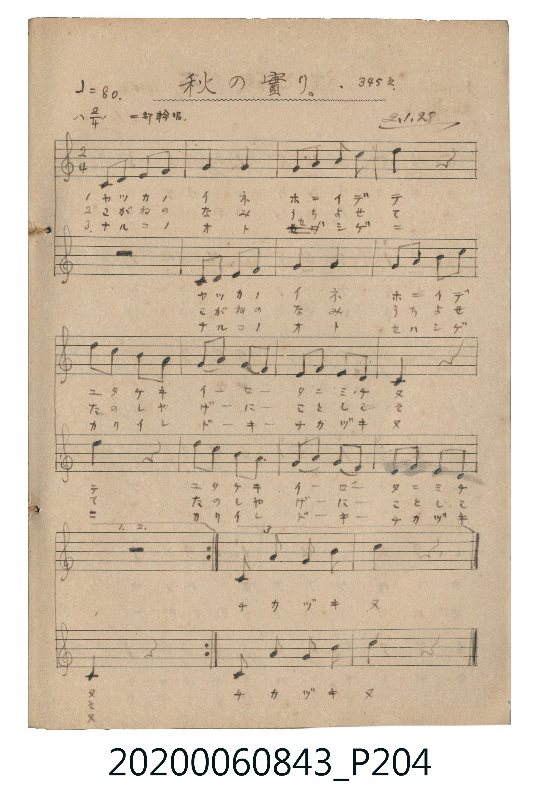

# 秋の實り。 (秋之豐收)

> Re:Shōka 使用 AI 協助辨識與重建樂譜，可能會有錯誤。歡迎[回報](https://github.com/TMDLang/reshoka/issues)。

- **鋼琴伴奏版**：<br><audio controls src="aki_no_minori.mp3"></audio>

- 詞曲作者：未在 TMD metadata 中提供

## 說明

秋の實り。 (秋之豐收)
Source: 唱歌帖 (2020.006.0843), P204.jpg
Marginalia: 345頁 2.1.28 二部輪唱. (昭和2年1月28日)


## 歌詞

```text
1.
ヤツカノイネ ホニイデテ ユタケキイロー タニミチヌ

2.
こがねのなみ うちよせて たのしやげーに ことしこそ

3.
ナルコノオト セハシゲニ カリイレドーキー チカヅキヌ
```

## ABC

<div class="abc-score" data-abc-src="aki_no_minori.abc" aria-label="五線譜載入中"></div>

[下載 ABC 原始檔](aki_no_minori.abc)

## TMD 檔案連結

- [主旋律 TMD 檔案](aki_no_minori.tmd) [[在 TMD Studio 編輯](https://tmdlang.github.io/Tmd-TS/#tmd=s7IKdvYPcrWy4qpTUCpJTLdSSM7PyUlNLsnMz7MqzsjPTkzOyFeCS5bl55TmploBqXhDA4RwcX5pUXJqfEFieqpVgJGBCboM3KT4vPyS1KT8_GyEioKi_LLUvMQ8oKrcxLzS4uSizIKS-OT8gkqEmtSyzJRUkIrUlMyS_KLMxBwkJ6UWFYMdC3FDSVFiHsQMoCBCVUlGKtDd5amJQEYRunBxamJxfl4xQhhoRXpmnlVJYmZ5Yl58flpaZjKKnflFJRn56UWJBRmVVhmZxSAnJSfmxGcn5iUqcWlpKTxf3v24cd3T9cseN3U9bmhS0AAKPNnZ_WLjhGdTtmkqaGlxKdoqWBhw2dsqOHPZGOmb2HFx6WtxKSgQ0AlSEQwJUYWnUzY-W9vzdMc0BQ0jAyMDPQMDMz0DCxNjTR0FUBToZRWkg5T7JhYBvZKYk5lopWBsYvpyQaOCkZ6hnpGFwpNdPS-bV7zYswpokp6CxrMZa59O6jF6unOL4bM5HUYWz6Yv1eQCmeBTCfRdsRWIaagHIh83L3nc3PK4afXj5r7HTUB2L1Bo9uPmbjCn_XFzG5AP9MD-x00bHzetBYuufdy8RwEkBFTVPP9xc-Pj5h6w6UYQIxsnP27sedy4Fuj5x42rHjfuBwq1PW5c-Lip43Hj7MeNy4D8-WDJ6Y-bWh43TgKa97hxNUTjCpAoiDEXbKQx1JVdj5tXP27aDHblqsfNHUD7dz9u7n_ctP1x0yagQ4B8oBdWgd235nFzJ8hIoHNBDgW6DyTXCub3cGnpc3H5JgJTRHB-ATB95TvUGNRUgyxRsLHQsgMz9LUUbNGBwvM1a57saHi_d97T2bOfbuh_vr5BQSPA2BQcOZpY1APtAZlVo2CoYKRgrGACZJkq6IIxiGWmYK5gGAdkGsUBRQxAomD1PoY1oEgB4haQn4B0H1AR0F9AFaDYAekGxhAQg_wMUtcOFmkDysQjTDECijVOBuIeIF4LxOtAqhpXgUwBRgjYlEZg3DYuBJoCDM3G2WCRZaimGINM7gJioDuaNsPdAjYFGAdgU5p2A9n9QHo7EG8Cu6Ubbgr-4Nw1BRicT3bOJSk4geEFDDdzYABCgtEUHLSgADYGBjQouKHBCSbRAxaY9pqA6bFpIxCvRQrYtVDPAOVAAds8H5RuwJ7pgXkGTKIHMVAdMGiBaRaotwUchJPAQbwaGsSgKFgBkQeyQSJzcZkHCmxwhK-CRuwasP2dIPOAboVEfCNUTSvM_VjdVwtN4o45JRSlb3AkgUqWZzNnAQMWIvyyYdPT1qXAkomY2ILHAYFsAI8iuCdIzwXwaEEyg9Q8AI8KZHeQmANolOphAUl0BkBK9vDSgbIsgJTw4SUFZZkAqZyBlxqUZQNQ4nfOT0kkq3zvBMbI860Tnm7Y96x7zYuZ8xU0jIlM6IYKZvEKpvEK5vEgDlqZTqyTceRXyk3XtQM2HjLzFJBokIUgWhmSXJFklLkA)]
- [鋼琴伴奏 TMD 檔案](aki_no_minori_piano.tmd) [[在 TMD Studio 編輯](https://tmdlang.github.io/Tmd-TS/#tmd=s7IKdvYPcrWy4qpTUCpJTLdSyC8qychPL0osyKi0ysgsLskvykxOzInPTsxLVIIrKs4vLUpOjS9ITE-1CjAyMEHIlGSk5qZapaaUJieWZObnKXFpaSk8X979uHHd0_XLHjd1PW5oUtAACjzZ2f1i44RnU7ZpKjxqmKIQkJmYl6_gmJycn1uQmJeZm5pXoqClxaVoq2BhwGVvq-DMZWOkb2LHxaWvxaWgQKaJIJ3BYJdbKTydsvHZ2p6nO6YpaBgZGBnoGRiY6RlYmBhr6iiAPKSXVZAOUu6bWJSemZeYk5lopWBsYvpyQaOCkZ6hnpGFwpNdPS-bV7zYswpokp6CxrMZa59O6jF6unOL4bM5HUYWz6Yv1eTS0ufi8k3MzLMCO8bQocagphpkqoKNhZYdmFGjYKhgpGCsYAJkmSrogjGIZaZgrmAYB2QaxQFFDECiYPU-hjUKj5uXAHGLwuOm1UC6D6jocdMSoIrHzb1g3Y-bZwNxN1j0cXM7WKQNKBOPMMUIKNY4GYh7gHgtEK8DqWpcBTKlcT_ElMY2IF4INKUDSM8GiyxDNcUYZHIXEAPd0bQZ7hawKc0dEFOadgPZ_UB6OxBvArulG24KNAiAfgT61RzoaYjXTcHBAQoUY2DggIIIGgRgEj0wlgEN3g_EG4F4LVJgrIU6ACgHCozm-UDcCHZAD8wBYBI9WIDqgMHxuHE6UG8L2NuTwMGyGhosoGBbAZEHskEic3GZBwogcCStgkbGGrD9nSDzgG6FRFYjVE0rzP1Y3VeLnJKMsKYkeOAQSFPwsIObTnqSgocXkhmkJih4GCG7g8TkhJSEYJ4nOjUhpSF49qAsPSGlInhWoSxFIWU0eLahLE2hpqQgDwKFkqE2KPkYg0loeGqbA_ngwslUGxzupiAezLFQUaAISKGJNigaQNpBLBBtpA0xFhgZQBaINo_XBscLkKkLFoQKmMZrI-IKxdU-yK42Qbg6XiHaND4WyjKEMSBCpvFQMZgrQXwTuGqEPiwsA4gDnPNTEq2C8wuKgE7AEWxm8UCDgR4AcdBKbiLiBWyBY04JDU3HH-tIFgDjChKt8PBH6McR_ibAIAUFK3KY6doB69DMvGgfYNDD2UZIbGMwG2Q2iFbmAgA)]

## 分析

```text
================================================================================
📊 TMD Song Profile: [ 秋の實り。 秋之豐收 ]
================================================================================
⏱  Duration:       0:43 (43.5s), 29 measures total
🎼 Key & Tempo:    首調基準 C, != 80.0 BPM, <2/4>
   - 分析範圍：      由實際發聲的音符與和弦推測調性；播放脈絡另行呈現
🎤 人聲音域:    G3 (MIDI 55) – D5 (MIDI 74) [跨度: 19 個半音 / 1.6 個八度, 難度: challenging]
   - 最低音:  G3 in [Coda #1 @ m.19, 0:27]
   - 最高音: D5 in [Main #1 @ m.5, 0:06]
   - 適合: mezzo-soprano, contralto, tenor, baritone, bass
🏛  結構:      Main (13.5s) -> Main (13.5s) -> Coda (3.0s) -> Main (13.5s)
⚡ 編曲密度:        Peak 2 軌道同時演奏
🗝  調性診斷：       C 大調（純淨自然大調，未偵測到可信轉調）
   - 風格氣質:    純淨自然大調（陽光明朗、易唱易記，無明顯調外色彩）
   - 轉調歷程:    全曲維持單一推測調性（未偵測到可信轉調）
   - 核心骨幹音:  G, C, D, A, E
   - 調性數值:    C 大調 [相關度: 0.89, 穩定度: Moderate, 自然音純度: 100.0%]
   - 候選調性 (K-S): C 大調 (0.89), G 大調 (0.85), A 小調 (0.54)
   - 五度圈歷程:   +1 -> +1 -> +0 -> +1
   - 各段落調性細節:
     • [Main #1]: G 調性不明確 (r: 0.86, 自然音純度: 89.3%, 調外音: F)
     • [Main #2]: G 調性不明確 (r: 0.86, 自然音純度: 89.3%, 調外音: F)
     • [Coda #1]: C 大調 (r: 0.75, 自然音純度: 100.0%)
     • [Main #3]: G 調性不明確 (r: 0.86, 自然音純度: 89.3%, 調外音: F)

  [ 五度圈游移軌跡 ]
              [C ]*
         F           [G ]*
      Bb               D  
      Eb               A  
         Ab           E  
            Db       B  
               F# 
     (* = active key center)

  [ 十二半音累積音高分佈 ]
     C  : ████████████████████      20.0%
     C# :                            0.0%
     D  : ████████████████          16.7%
     D# :                            0.0%
     E  : ██████████                10.0%
     F  : ██████████                10.0%
     F# :                            0.0%
     G  : ████████████████████████  24.4%
     G# :                            0.0%
     A  : ███████████               11.1%
     A# :                            0.0%
     B  : ████████                   7.8%
--------------------------------------------------------------------------------
Assignment 軌道音域：
  - Alto          : G3 – D5 (19 個半音 / 1.6 個八度, 77 個音符)
  - Soprano       : G3 – D5 (19 個半音 / 1.6 個八度, 77 個音符)
================================================================================
```


## 原書掃描頁




