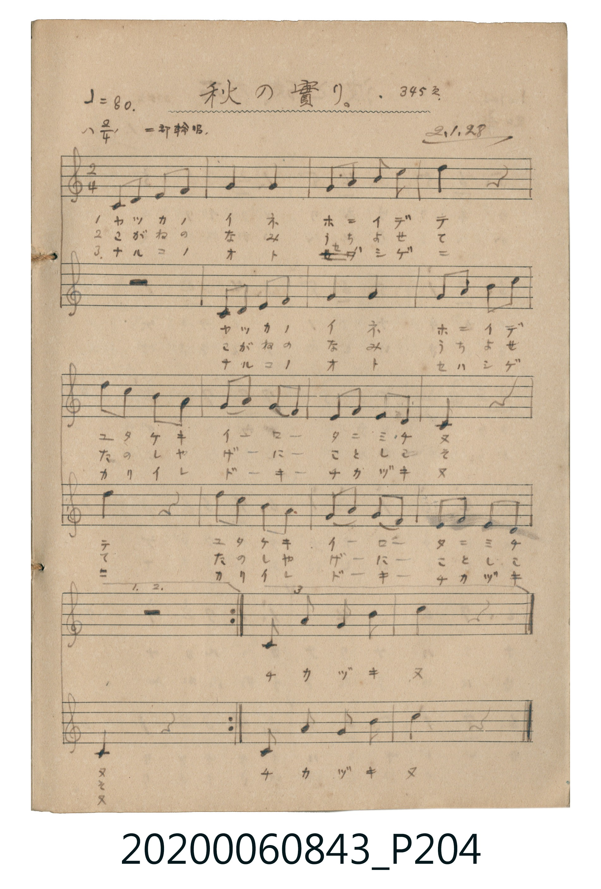

# 秋の實り。 (秋之豐收)

> Re:Shōka 使用 AI 協助辨識與重建樂譜，可能會有錯誤。歡迎回報。

- **鋼琴伴奏版**：<br><audio controls src="aki_no_minori.mp3"></audio>

- 詞曲作者：未在 TMD metadata 中提供

## 說明

秋の實り。 (秋之豐收)
Source: 唱歌帖 (2020.006.0843), P204.jpg
Marginalia: 345頁 2.1.28 二部輪唱. (昭和2年1月28日)


## 歌詞

```text
1.
ヤツカノイネ ホニイデテ ユタケキイロー タニミチヌ

2.
こがねのなみ うちよせて たのしやげーに ことしこそ

3.
ナルコノオト セハシゲニ カリイレドーキー チカヅキヌ
```

## ABC

<div class="abc-score" data-abc-src="aki_no_minori.abc" aria-label="五線譜載入中"></div>

[下載 ABC 原始檔](aki_no_minori.abc)

## TMD 檔案連結

- [主旋律 TMD 檔案](aki_no_minori.tmd) [[在 TMD Studio 編輯](https://tmdlang.github.io/Tmd-TS/#tmd=s7IKdvYPcrWy4qpTUCpJTLdSSM7PyUlNLsnMz7MqzsjPTkzOyFeCS5bl55TmploBqXhDA4RwcX5pUXJqfEFieqpVgJGBCboM3KT4vPyS1KT8_GyEioKi_LLUvMQ8oKrcxLzS4uSizIKS-OT8gkqEmtSyzJRUkIrUlMyS_KLMxBwkJ6UWFYMdC3FDSVFiHsQMoCBCVUlGKtDd5amJQEYRunBxamJxfl4xQhhoRXpmnlVJYmZ5Yl58flpaZjLYTi0thefLux83rnu6ftnjpq7HDU0KGkCBJzu7X2yc8GzKNk0FLS0uRVsFCwMue1sFZy4bI30TOy4ufS0uBQUCOkEqgiGBpfB0ysZna3ue7pimoGFkYGSgZ2BgpmdgYWKsqaMACl29rIJ0kHLfxCKgKxNzMhOtFIxNTF8uaFQw0jPUM7JQeLKr52Xzihd7VgFN0lPQeDZj7dNJPUZPd24xfDanw8ji2fSlmlwgE3wqizKTi61ATEM9EPm4ecnj5pbHTasfN_c9bgKye4FCsx83d4M57Y-b24B8oAf2P27a-LhpLVh07ePmPQogIaCq5vmPmxsfN_eATTeCGNk4-XFjz-PGtUDPP25c9bhxP1Co7XHjwsdNHY8bZz9uXAbkzwdLTn_c1PK4cRLQvMeNqyEaV4BEQYy5YCONoa7sety8-nHTZrArVz1u7gDav_txc__jpu2PmzYBHQLkA72wCuy-NY-bO0FGAp0LcijQfSC5VjC_h0tLn4vLNxEY2cH5BcCkk-9QY1BTDbJEwcZCyw7M0NdSsEUHCs_XrHmyo-H93nlPZ89-uqH_-foGBY0AY1Nw5GhiUQ-0B2RWjYKhgpGCsYIJkGWqoAvGIJaZgrmCYRyQaRQHFDEAiYLV-xjWgCIFiFtAfgLSfUBFQH8BVYBiB6QbGENADPIzSF07WKQNKBOPMMUIKNY4GYh7gHgtEK8DqWpcBTIFGCFgUxqBcdu4EGgKMDQbZ4NFlqGaYgwyuQuIge5o2gx3C9gUYByATWnaDWT3A-ntQLwJ7JZuuCn4g3PXFGBwPtk5l6TgBIYXMNzMgQEICUZTcNCCAtgYGNCg4IYGJ5hED1hg2msCpsemjUC8Filg10I9A5QDBWzzfFC6AXumB-YZMIkexEB1wKAFplmg3hZwEE4CB_FqaBCDomAFRB7IBonMxWUeKLDBEb4KGrFrwPZ3gswDuhUS8Y1QNa0w92N1Xy00iTvmlFCUvsGRBCpZns2cBQxYiPDLhk1PW5cCSyZiYgseBwSyATyK4J4gPRfAowXJDFLzADwqkN1BYg6gUaqHBSTRGQAp2cNLB8qyAFLCh5cUlGUCpHIGXmpQlg1Aid85PyWRrPK9Exgjz7dOeLph37PuNS9mzlfQMCYyoRsqmMUrmMYrmMeDOGhlOrFOxpFfKTdd1w7YeMjMU0CiQRaCaGVIckWSUeYCAA)]
- [鋼琴伴奏 TMD 檔案](aki_no_minori_piano.tmd) [[在 TMD Studio 編輯](https://tmdlang.github.io/Tmd-TS/#tmd=s7IKdvYPcrWy4tLSUni-vPtx47qn65c9bup63NCkoAEUeLKz-8XGCc-mbNNUeNQwRSEgMzEvX8ExOTk_tyAxLzM3Na9EQUuLS9FWwcKAy95WwZnLxkjfxI6LS1-LS0GBTBNBOoPzS4uSU60Unk7Z-Gxtz9Md0xQ0jAyMDPQMDMz0DCxMjDV1FAKMDEz0sgrSQcp9E4vSM_MSczITrRSMTUxfLmhUMNIz1DOyUHiyq-dl84oXe1YBTdJT0Hg2Y-3TST1GT3duMXw2p8PI4tn0pZpcWvpcXL6JmXlWYMcYOtQY1FSDTFWwsdCyAzNqFAwVjBSMFUyALFMFXTAGscwUzBUM44BMozigiAFIFKzex7BG4XHzEiBuUXjctBpI9wEVPW5aAlTxuLkXrPtx82wg7gaLPm5uB4u0AWXiEaYYAcUaJwNxDxCvBeJ1IFWNq0CmNO6HmNLYBsQLgaZ0AOnZYJFlqKYYg0zuAmKgO5o2w90CNqW5A2JK024gux9IbwfiTWC3dMNNgQYB0I9Av5oDPQ3xuik4OECBYgwMHFAQQYMATKIHxjKgwfuBeCMQr0UKjLVQBwDlQIHRPB-IG8EO6IE5AEyiBwtQHTA4HjdOB-ptAXt7EjhYVkODBRRsKyDyQDZIZC4u80ABBI6kVdDIWAO2vxNkHtCtkMhqhKpphbkfq_tqkVOSEdaUBA8cAmkKHnZw00lPUvDwQjKD1AQFDyNkd5CYnJCSEMzzRKcmpDQEzx6UpSekVATPKpSlKKSMBs82lKUp1JQU5EGgUDLUBiUfYzAJDU9tcyAfXDiZaoPD3RTEgzkWKgoUASk00QZFA0g7iAWijbQhxgIjA8gC0ebx2uB4ATJ1wYJQAdN4bURcobjaB9nVJghXxytEm8bHQlmGMAZEyDQeKgZzJYhvAleN0IeFZQBxgHN-SqJVcH5BEdAJOILNLB5oMNADIA5ayU1EvIAtcMwpoaHp-GMdyQJgXEGiFR7-CP04wt8EGKSgYEUOM107YB2amRftAwx6ONsIiW0MZoPMBtHKXAA)]

## 分析

```text
================================================================================
📊 TMD Song Profile: [ 秋の實り。 秋之豐收 ]
================================================================================
⏱  Duration:       0:43 (43.5s), 29 measures total
🎼 Key & Tempo:    首調基準 C, != 80.0 BPM, <2/4>
   - 分析範圍：      由實際發聲的音符與和弦推測調性；播放脈絡另行呈現
🎤 人聲音域:    G3 (MIDI 55) – D5 (MIDI 74) [跨度: 19 個半音 / 1.6 個八度, 難度: challenging]
   - 最低音:  G3 in [Coda #1 @ m.19, 0:27]
   - 最高音: D5 in [Main #1 @ m.5, 0:06]
   - 適合: mezzo-soprano, contralto, tenor, baritone, bass
🏛  結構:      Main (13.5s) -> Main (13.5s) -> Coda (3.0s) -> Main (13.5s)
⚡ 編曲密度:        Peak 2 軌道同時演奏
🗝  調性診斷：       C 大調（純淨自然大調，未偵測到可信轉調）
   - 風格氣質:    純淨自然大調（陽光明朗、易唱易記，無明顯調外色彩）
   - 轉調歷程:    全曲維持單一推測調性（未偵測到可信轉調）
   - 核心骨幹音:  G, C, D, A, E
   - 調性數值:    C 大調 [相關度: 0.89, 穩定度: Moderate, 自然音純度: 100.0%]
   - 候選調性 (K-S): C 大調 (0.89), G 大調 (0.85), A 小調 (0.54)
   - 五度圈歷程:   +1 -> +1 -> +0 -> +1
   - 各段落調性細節:
     • [Main #1]: G 調性不明確 (r: 0.86, 自然音純度: 89.3%, 調外音: F)
     • [Main #2]: G 調性不明確 (r: 0.86, 自然音純度: 89.3%, 調外音: F)
     • [Coda #1]: C 大調 (r: 0.75, 自然音純度: 100.0%)
     • [Main #3]: G 調性不明確 (r: 0.86, 自然音純度: 89.3%, 調外音: F)

  [ 五度圈游移軌跡 ]
              [C ]*
         F           [G ]*
      Bb               D  
      Eb               A  
         Ab           E  
            Db       B  
               F# 
     (* = active key center)

  [ 十二半音累積音高分佈 ]
     C  : ████████████████████      20.0%
     C# :                            0.0%
     D  : ████████████████          16.7%
     D# :                            0.0%
     E  : ██████████                10.0%
     F  : ██████████                10.0%
     F# :                            0.0%
     G  : ████████████████████████  24.4%
     G# :                            0.0%
     A  : ███████████               11.1%
     A# :                            0.0%
     B  : ████████                   7.8%
--------------------------------------------------------------------------------
Assignment 軌道音域：
  - Alto          : G3 – D5 (19 個半音 / 1.6 個八度, 77 個音符)
  - Soprano       : G3 – D5 (19 個半音 / 1.6 個八度, 77 個音符)
================================================================================
```


## 原書掃描頁




