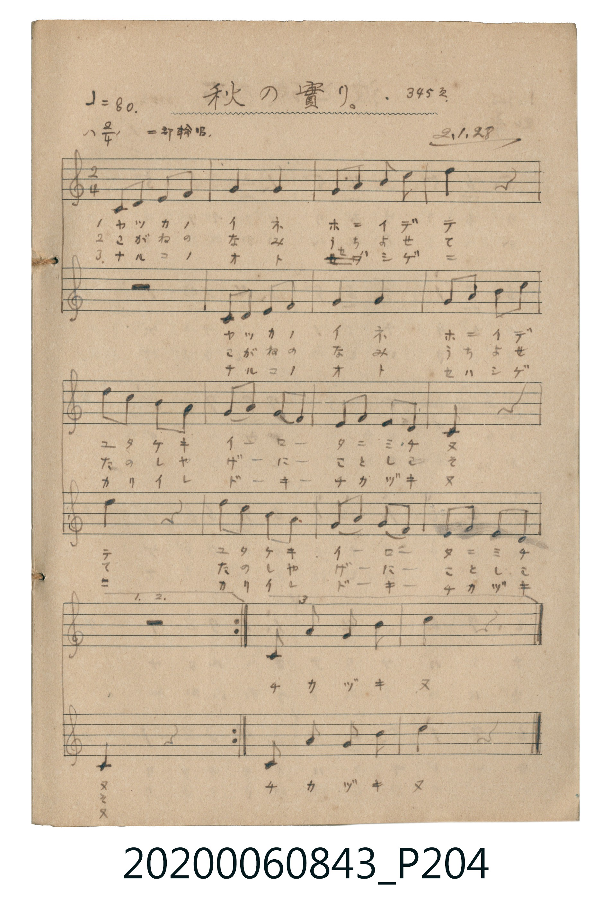

# 秋の實り。 (秋之豐收)

<audio controls src="aki_no_minori.mp3"></audio>

- 詞曲作者：未在 TMD metadata 中提供

## 說明

秋の實り。 (秋之豐收)
Source: 唱歌帖 (2020.006.0843), P204.jpg
Marginalia: 345頁 2.1.28 二部輪唱. (昭和2年1月28日)

## 歌詞

```text
1.
ヤツカノイネ ホニイデテ ユタケキイロー タニミチヌ

2.
こがねのなみ うちよせて たのしやげーに ことしこそ

3.
ナルコノオト セハシゲニ カリイレドーキー チカヅキヌ
```

## ABC

```abc
X:1
T:秋の實り。 秋之豐收
M:2/4
L:1/16
Q:1/4=80
K:C
V:V1 name="Alto" snm="Alt"
V:V2 name="Vocal" snm="Voc"
[V:V1]
z8 | C2 D2 E2 F2 | G4 G4 | A3 A c2 A2 |
c4 z4 | c2 B2 A2 G2 | A2 c2 G2 E2 | F2 G2 E2 D2 |
C4 z4 | C4 G4 | A3 B c2 z2 |
[V:V2]
C2 D2 E2 F2 | G4 G4 | A3 A c2 A2 | c4 z4 |
c2 B2 A2 G2 | A2 c2 G2 E2 | F2 G2 E2 D2 | C4 z4 |
C4 G4 | A3 B c4 | z8 |
```

## TMD 檔案連結

- [主旋律 TMD 檔案](aki_no_minori.tmd) [[在 TMD Studio 編輯](https://tmdlang.github.io/Tmd-TS/#tmd=s7IKdvYPcrWy4qpTUCpJTLdSSM7PyUlNLsnMz7MqzsjPTkzOyFeCS5bl55TmploBqXhDA4RwcX5pUXJqfEFieqpVgJGBCboM3KT4vPyS1KT8_GyEioKi_LLUvMQ8oKrcxLzS4uSizIKS-OT8gkqEmtSyzJRUkIrUlMyS_KLMxBwkJ6UWFYMdC3FDSVFiHsQMoCBCVUlGKtDd5amJQEYRunBxamJxfl6xEpeWlsLz5d2PG9c9Xb_scVPX44YmBQ2gwJOd3S82Tng2ZZumgpYWl6KtgoUBl72tgjOXjZG-iR0Xl74Wl4ICAZ0gFcGQwFB4OmXjs7U9T3dMU9AwMjAy0DMwMNMzsDAx1tRRAIWeXlZBOki5b2JRemZeYk5mopWCsYnpywWNCkZ6hnpGFgpPdvW8bF7xYs8qoEl6ChrPZqx9OqnH6OnOLYbP5nQYWTybvlSTC2SCT2VRZnKxFYhpqAciHzcvedzc8rhp9ePmvsdNQHYvUGj24-ZuMKf9cXMbkA_0wP7HTRsfN60Fi6593LxHASQEVNU8_3Fz4-PmHrDpRhAjGyc_bux53LgW6PnHjaseN-4HCrU9blz4uKnjcePsx43LgPz5YMnpj5taHjdOApr3uHE1ROMKkCiIMRdspDHUlV2Pm1c_btoMduWqx80dQPt3P27uf9y0_XHTJqBDgHygF1aB3bfmcXMnyEigc0EOBboPJNcK5vdwaelzcfkmZuZZheUnJ-Y41BjUKFSD7FCwMTTTsgOzahQMFXQVjIDYGIhNgLhGwRRIgiCMrlEwA9NmCoZxYAokBGaCoAFMFcw8kIQ5VB3ICIh2sDCIC7KnBmwTjAeyHeIOrObhcI05wgk1cE0wWMNVC_W6Y05JPg6fY2giMyyQPY7iA3LDAs3nSObhDwuQQrDPde2AGSgzTwFIK3MBAA)]
- [鋼琴伴奏 TMD 檔案](aki_no_minori_piano.tmd) [[在 TMD Studio 編輯](https://tmdlang.github.io/Tmd-TS/#tmd=s7IKdvYPcrWy4tLSUni-vPtx47qn65c9bup63NCkoAEUeLKz-8XGCc-mbNNUeNQwRSEgMzEvX8ExOTk_tyAxLzM3Na9EQUuLS9FWwcKAy95WwZnLxkjfxI6LS1-LS0GBTBNBOoPzS4uSU60Unk7Z-Gxtz9Md0xQ0jAyMDPQMDMz0DCxMjDV1FAKMDEz0sgrSQcp9E4vSM_MSczITrRSMTUxfLmhUMNIz1DOyUHiyq-dl84oXe1YBTdJT0Hg2Y-3TST1GT3duMXw2p8PI4tn0pZpcWvpcXL6JmXlWYfnJiTkONQY1CtUgUxVsDM207MCsGgVDBV0FIyA2BmITIK5RMAWSIAijaxTMwLSZgmEcmAIJgZkgaABTBTMPJGEOVQcyAqIdLAziguypAdsE44Fsh7gDq3k4XGOOcEINXBMM1nDVQr3umFOSj8PnGJrIDAtkj6P4gNywQPM5knn4wwKkEOFzcAoM8sDheeN4bdN4bZCBQMpcJ14bZDNIRBvkDDMgXxsSAkABbZB9IHkYGyZjog0LDaC4NnLqAElBBLCGFVy5EZABCiCYWTAbEKbDlcKk4I4E-h7mTLAHUGWRvAVWCDSPsEKMwAFBmMXQOID72hzhNjxSWCLFB1ekGMbDrIQxsIuZ6OAVRLDgSQkkYAoWhkiCBXAYZIRQjKQPpzget0OMR9KCQxgeRrp2wCIvM08BSCtzAQA)]

## 分析

```text
================================================================================
📊 TMD Song Profile: [ 秋の實り。 秋之豐收 ]
================================================================================
⏱  Duration:       0:16 (16.5s), 11 measures total
🎼 Key & Tempo:    首調基準 C, != 80.0 BPM, <2/4>
   - 分析範圍：      由實際發聲的音符與和弦推測調性；播放脈絡另行呈現
🎤 人聲音域:    C4 (MIDI 60) – C5 (MIDI 72) [跨度: 12 個半音 / 1.0 個八度, 難度: easy]
   - 最低音:  C4 in [Main #1 @ m.1, 0:00]
   - 最高音: C5 in [Main #1 @ m.3, 0:03]
   - 適合: soprano, mezzo-soprano, contralto, tenor, baritone, bass
🏛  結構:      Main (16.5s)
⚡ 編曲密度:        Peak 2 軌道同時演奏
🗝  調性診斷：       C 大調（純淨自然大調，未偵測到可信轉調）
   - 風格氣質:    純淨自然大調（陽光明朗、易唱易記，無明顯調外色彩）
   - 轉調歷程:    全曲維持單一推測調性（未偵測到可信轉調）
   - 核心骨幹音:  C, G, A, E, D
   - 調性數值:    C 大調 [相關度: 0.92, 穩定度: High, 自然音純度: 100.0%]
   - 候選調性 (K-S): C 大調 (0.92), A 小調 (0.69), G 大調 (0.63)
   - 五度圈歷程:   +0
   - 各段落調性細節:
     • [Main #1]: C 大調 (r: 0.92, 自然音純度: 100.0%)

  [ 五度圈游移軌跡 ]
              [C ]*
         F            G  
      Bb               D  
      Eb               A  
         Ab           E  
            Db       B  
               F# 
     (* = active key center)

  [ 十二半音累積音高分佈 ]
     C  : ████████████████████████  32.4%
     C# :                            0.0%
     D  : ████                       5.6%
     D# :                            0.0%
     E  : ██████                     8.5%
     F  : ████                       5.6%
     F# :                            0.0%
     G  : ███████████████████       25.4%
     G# :                            0.0%
     A  : ██████████████            18.3%
     A# :                            0.0%
     B  : ███                        4.2%
--------------------------------------------------------------------------------
Assignment 軌道音域：
  - Alto          : C4 – C5 (12 個半音 / 1.0 個八度, 29 個音符)
  - Vocal         : C4 – C5 (12 個半音 / 1.0 個八度, 29 個音符)
================================================================================
```


## 原書掃描頁




