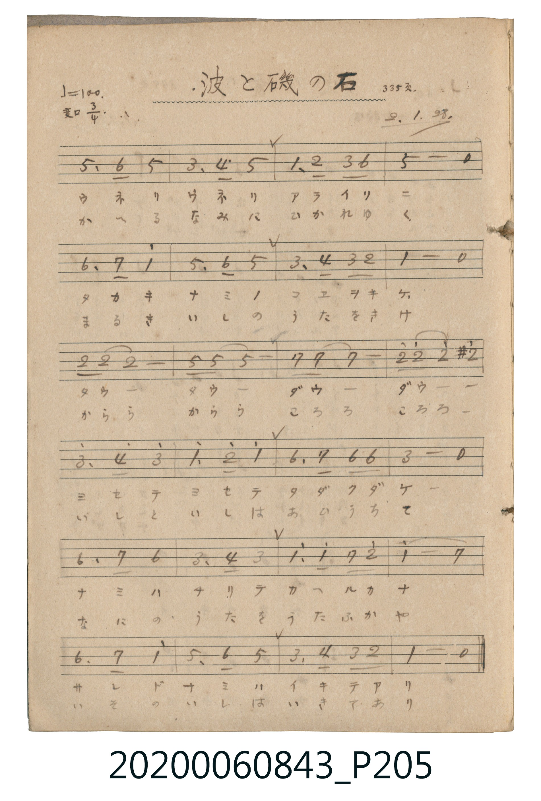

# 波と磯の石 (波浪與岸邊的石頭)

<audio controls src="nami_to_iso_no_ishi.mp3"></audio>

- 詞曲作者：未在 TMD metadata 中提供

## 說明

波と磯の石 (波浪與岸邊的石頭)
Source: 唱歌帖 (2020.006.0843), P205.jpg
Marginalia: 335頁. 2.1.28. (昭和2年1月28日)

## 歌詞

```text
1.
ウネリウネリ アライソニ タカキナミノ コエヲキケ
ダウーダウー ダウーダウー ヨセテヨセテ タダクダケ
ナミハチリテ カヘルカナ サレドナミハ イキテアリ

2.
かへるなみに ひかれゆく まるきいしの うたをきけ
かららからら ころろころろ いしといしは あひうちて
なにのうたを うたふかや いそのいしは いきてあり
```

## ABC

```abc
X:1
T:波と磯の石 波浪與岸邊的石頭
M:3/4
L:1/16
Q:1/4=100
K:Bb
V:V1 name="Vocal" snm="Voc"
[V:V1]
F3 G F8 | d3 e f8 | B3 c d2 g6 | f8 z4 |
G3 A b8 | f3 g f8 | d3 e d2 c6 | B8 z4 |
c2 c2 c8 | f2 f2 f8 | A2 A2 A8 | c'2 c'2 c'4 ^c'4 |
d'3 e' d'8 | b3 c' b8 | g3 a g2 g6 | d8 z4 |
G3 A G8 | d3 e d8 | b3 b a2 c'6 | b8 a4 |
G3 A b8 | f3 g f8 | d3 e d2 c6 | B8 z4 |
```

## TMD 檔案連結

- [主旋律 TMD 檔案](nami_to_iso_no_ishi.tmd) [[在 TMD Studio 編輯](https://tmdlang.github.io/Tmd-TS/#tmd=s7IKdvYPcrWy4tLSUni2edHjxhXPF69_3Lju-fzNChpAgWdbV73oaH-6acfLpq7ns1qAwi8XrNVU0NLiUrRVMDQw4LK3VXDS4bIx1jex4-LS1-JSUCDBHJDq4PzSouRUK4WnUzY-W9vzdMc0BQ0jAyMDPQMDMz0DCxNjTR2FACMDU72sgnSQct_EovTMvMSczEQrBWNj05cLGvUUjPQM9Yws9IAWzVj7dFKP0dOdWwyfzekwsng2fakmF0iXT2VRZnKxFYhpqAciHzcte9zc-7h5FZwBFFr0uHnl46Ylj5v2Pm7uBvL3P25a_bhp7ePmrsfN8x839wGFNj9uWvG4eRNItGkj2KDmBrARe-AM7EIrHjftftzcBmeAjQfJrweTULMgFvU_bm4EOQ2savXj5hmPm4HuADK6gPytj5vXPG7uhKsFCgFdDHRkG9gDq8D-NYJ4srH7ceOOx01ActXjxv2PG1cDhTaBRJt6Hje1PW4Eam7cB5bvfdzY8rhxOjDGgEJAmfmPmyaBRSfCDGrqBCEYAyg0-XFTLwjBGEAhiBErYIz1QKEmsI1AExc-blwGMQvoltVAi-D2wGxs3Ao2vgVi0FywEoRBQBbQrmUgE5u6uLT0ubh8EzPzrMLykxNzHGoMahSqQaYr2BiaadmBWTUKpvEKukBoFg9jIWCNgjGYNlEwxZAxBNNGYBVmKDLoag1gMlALgTaBuObxCoZxGMZCNJthsRDmFBBthMUpuC0EqYZhTNtgGFUG6DqwE6EEqqQRyN0IAhwQ6jAWzFZjiIBJHIyF4mSIEFA7ljCABKc5mEYNWkgY4PYpImihLEzNkADE6hogZY7sJxRJBASpwW4pzeOzlotL1w5YumXmKQBpZS4A)]
- [鋼琴伴奏 TMD 檔案](nami_to_iso_no_ishi_piano.tmd) [[在 TMD Studio 編輯](https://tmdlang.github.io/Tmd-TS/#tmd=s7IKdvYPcrWy4tLSUni2edHjxhXPF69_3Lju-fzNChpAgWdbV73oaH-6acfLpq7ns1qAwi8XrNVUeNQwRSEgMzEvX8ExOTk_tyAxLzM3Na9EQUuLS9FWwdDAgMveVsFJh8vGWN_EjotLX4tLQYEK5oNMCc4vLUpOtVJ4OmXjs7U9T3dMU9AwMjAy0DMwMNMzsDAx1tRRCDAyMNXLKkgHKfdNLErPzEvMyUy0UjA2Nn25oFFPwUjPUM_IQg_ogBlrn07qMXq6c4vhszkdRhbPpi_V5NLS5-LyTczMswrLT07McagxqFGoBpmkYGNopmUHZtUomMYr6AKhWTyMpatgAKVrFIzBtImCKYaMIZg2AqswQ5GBqYVBuAzUQqBNIK55vIJhHIaxEM1mWCyEOQVEG2FxCm4LQaphGBlCbINhVBmg68BOhBKokkYgdyMIcECow1gwW40hAiZxMBaKkyFCQO1YwgAUnEB7wTRq0ELCgJighbJwBSBW1wApc5ifMCQREKQGu6U0j89aaHoGZ6ggDxwp2jheG5GoERxdFDYo4WsbasNcAWRpw9yIzIYoAzONEDoMtU20QTEDo6HuxmEGeiwBnYEIM6AybXi4oXCQDTQj4EC4P-AcIMNcJ14bFLJITGjQg8IB6itoqMB56I7Fbg6akTAIzDcgUbDjsLFQ1UIMgZuGzEBVaKJtrg1OlZgMEDQFcTDyHygktRGZEJkL0oLMA4YIIuCBxuKPE1iUm2MkA9TkgBQvYJ8hOPgTBJwDjho4G1dEY5iO4hsgBQx6bVCexR54KKoREKYJtzMHbbpFKSR8cBUShrBwxWSQLGkCT7NIsqZwQYxSGi5Dvt0I0xEsbHoxsjMWfcgm0Fie4sBHBDU2FjEhgAh9bCwqhT8MYnp9YCIfmCd07YAtyMw8BSCtzAUA)]

## 分析

```text
================================================================================
📊 TMD Song Profile: [ 波と磯の石 波浪與岸邊的石頭 ]
================================================================================
⏱  Duration:       0:43 (43.2s), 24 measures total
🎼 Key & Tempo:    首調基準 B,, != 100.0 BPM, <3/4>
   - 分析範圍：      由實際發聲的音符與和弦推測調性；播放脈絡另行呈現
🎤 人聲音域:    F4 (MIDI 65) – D#6 (MIDI 87) [跨度: 22 個半音 / 1.8 個八度, 難度: difficult]
   - 最低音:  F4 in [Main #1 @ m.1, 0:00]
   - 最高音: D#6 in [Main #1 @ m.13, 0:22]
🏛  結構:      Main (43.2s)
⚡ 編曲密度:        Peak 1 軌道同時演奏
🗝  調性診斷：       A# 調性不明確（純淨自然大調，未偵測到可信轉調）
   - 風格氣質:    純淨自然大調（陽光明朗、易唱易記，無明顯調外色彩）
   - 轉調歷程:    全曲維持單一推測調性（未偵測到可信轉調）
   - 核心骨幹音:  F, A#, D, C, G
   - 調性數值:    A# 調性不明確 [相關度: 0.86, 穩定度: Ambiguous, 自然音純度: 98.5%]
   - 候選調性 (K-S): A# 大調 (0.86), F 大調 (0.84), D 小調 (0.72)
   - 五度圈歷程:   -2
   - 各段落調性細節:
     • [Main #1]: A# 調性不明確 (r: 0.86, 自然音純度: 98.5%, 調外音: C#)

  [ 五度圈游移軌跡 ]
               C  
         F            G  
     [Bb]*              D  
      Eb               A  
         Ab           E  
            Db       B  
               F# 
     (* = active key center)

  [ 十二半音累積音高分佈 ]
     C  : ████████████████          14.7%
     C# : ██                         1.5%
     D  : ██████████████████        16.5%
     D# : ██                         1.8%
     E  :                            0.0%
     F  : ████████████████████████  22.4%
     F# :                            0.0%
     G  : ███████████████           13.6%
     G# :                            0.0%
     A  : █████████                  8.1%
     A# : ███████████████████████   21.3%
     B  :                            0.0%
--------------------------------------------------------------------------------
Assignment 軌道音域：
  - Vocal         : F4 – D#6 (22 個半音 / 1.8 個八度, 69 個音符)
================================================================================
```


## 原書掃描頁




