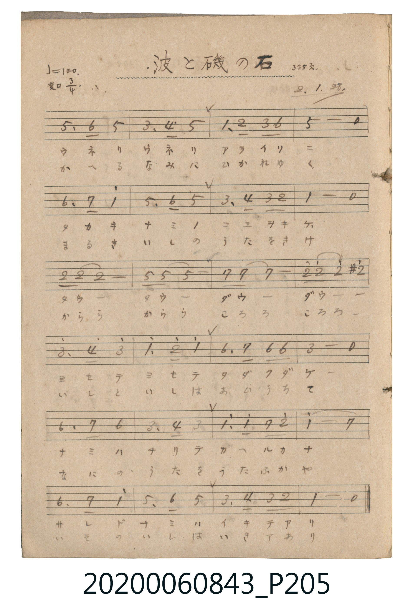

# 波と磯の石 (波浪與岸邊的石頭)

> Re:Shōka 使用 AI 協助辨識與重建樂譜，可能會有錯誤。歡迎回報。

- **鋼琴伴奏版**：<br><audio controls src="nami_to_iso_no_ishi.mp3"></audio>

- 詞曲作者：未在 TMD metadata 中提供

## 說明

波と磯の石 (波浪與岸邊的石頭)
Source: 唱歌帖 (2020.006.0843), P205.jpg
Marginalia: 335頁. 2.1.28. (昭和2年1月28日)


## 歌詞

```text
1.
ウネリウネリ アライソニ タカキナミノ コエヲキケ
ダウーダウー ダウーダウー ヨセテヨセテ タダクダケ
ナミハチリテ カヘルカナ サレドナミハ イキテアリ

2.
かへるなみに ひかれゆく まるきいしの うたをきけ
かららからら ころろころろ いしといしは あひうちて
なにのうたを うたふかや いそのいしは いきてあり
```

## ABC

<div class="abc-score" data-abc-src="nami_to_iso_no_ishi.abc" aria-label="五線譜載入中"></div>

[下載 ABC 原始檔](nami_to_iso_no_ishi.abc)

## TMD 檔案連結

- [主旋律 TMD 檔案](nami_to_iso_no_ishi.tmd) [[在 TMD Studio 編輯](https://tmdlang.github.io/Tmd-TS/#tmd=s7IKdvYPcrWy4qpTUCpJTLdSSM7PyUlNLsnMz7MqzsjPTkzOyFeCS5bl55TmploBqXhDA4RwcX5pUXJqfEFieqpVgJGBKboM3KT4vPyS1KT8_GyEioKi_LLUvMQ8oKrcxLzS4uSizIKS-OT8gkqEmtSyzJRUkIrUlMyS_KLMxBwkJ6UWFYMdC3FDSVFiHsQMoCBCVUlGKtDdeYklpUWp6KLliSWpRQhBoPnpmXlWJYmZ5Yl58flpaZnJKBbmF5Vk5KcXJRZkVFplZBaD3JOcmBOfnZiXqMSlpaXwbPOix40rni9e_7hx3fP5mxU0gALPtq560dH-dNOOl01dz2e1AIVfLlirqaClxaVoq2BoYMBlb6vgpMNlY6xvYsfFpa_FpaBAgjkg1cGQgFZ4OmXjs7U9T3dMU9AwMjAy0DMwMNMzsDAx1tRRAMWMXlZBOki5b2IR0JOJOZmJVgrGxqYvFzTqKRjpGeoZWegBLZqx9umkHqOnO7cYPpvTYWTxbPpSTS6QLp9KoF-LrUBMQz0Q-bhp2ePm3sfNq-AMoNCix80rHzctedy093FzN5C__3HT6sdNax83dz1unv-4uQ8otPlx04rHzZtAok0bwQY1N4CN2ANnYBda8bhp9-PmNjgDbDxIfj2YhJoFsaj_cXMjyGlgVasfN8943Ax0B5DRBeRvfdy85nFzJ1wtUAjoYqAj28AeWAX2rxHEk43djxt3PG4CkqseN-5_3LgaKLQJJNrU87ip7XEjUHPjPrB87-PGlseN04ExBhQCysx_3DQJLDoRZlBTJwjBGEChyY-bekEIxgAKQYxYAWOsBwo1gW0EmrjwceMyiFlAt6wGWgS3B2Zj41aw8S0Qg-aClSAMArKAdi0DmdjUxaWlz8XlmwhM7QGZiXn5DjUGNdUgwxVsDM207MCsGgXTeAVdIDSLh7EQsEbBGCJkglXSECJkFA9RBjQBWRZDgwFMCmoxVL15vIIhhtFEOgrMAtqPxVW47QWrRxBYLEYQqJJAp4LdCyVQJY1ABkIxOFjU0ew1hrgaSqM4GaIBSzggwgjMQgtiaEDg9iqadlSz0YIRm5MMIR6FeQlZCgHhYTFwEVvLxaVrByz0MvMUgLQyFwA)]
- [鋼琴伴奏 TMD 檔案](nami_to_iso_no_ishi_piano.tmd) [[在 TMD Studio 編輯](https://tmdlang.github.io/Tmd-TS/#tmd=s7IKdvYPcrWy4qpTUCpJTLdSyC8qychPL0osyKi0ysgsLskvykxOzInPTsxLVIIrKs4vLUpOjS9ITE-1CjAyMEXIlGSk5qZapaaUJieWZObnKXFpaSk827zoceOK54vXP25c93z-ZgUNoMCzratedLQ_3bTjZVPX81ktQOGXC9ZqKjxqmKIQkJmYl6_gmJycn1uQmJeZm5pXoqClxaVoq2BoYMBlb6vgpMNlY6xvYsfFpa_FpaBABfNBpgSD_WSl8HTKxmdre57umKagYWRgZKBnYGCmZ2BhYqypowDyql5WQTpIuW9iUXpmXmJOZqKVgrGx6csFjXoKRnqGekYWekAHzFj7dFKP0dOdWwyfzekwsng2fakml5Y-F5dvYmaeFdgBDjUGNdUggxRsDM207MCsGgXTeAVdIDSLh7F0FQygdI2CMUTIBKukIUTIKB6iDGgCsixcAwzCpaAWg9XrKpjHKxhiGE2ko8AsoP1YXIXbXrB6BIEMoRYjCFRJoFPB7oUSqJJGIAOhGBws6mj2GkNcDaVRnAzRgCUcEGEEZqEFMTQgiAliKAtPMGJzkiHEoyAvoUshIDwsBi5ia5GTeZAH9oRuHK-NsB3B0UVhg6zRRggAnYLCBwYJKheqHswGuhdJFsg0idcGhwUSE4sdGGaixyJQDhGkYIXasIBF5aEZDNRElOOxe9Y8Pl7bCAubHB_gMgvdXBgEZVKQxyCpDyuTIuXA2DAH2gz2MyYLBMH6tDHyMCiwtWEZGYkD1oDgQBMbNGKMCEcaInmAcg3WlEPlRAQ3CJlNeupH9oshcoDjClhULQiIFlfDIe2jlEo-yKWSCbxQMowHWQzBuHgmcJ4pEBsglbP49YJUgzBCDqEXJgeRJ5pHhKtBroVhbDaDXA3DhF0NylgIe8nzMTAedO2ArafMPAUkWpkLAA)]

## 分析

```text
================================================================================
📊 TMD Song Profile: [ 波と磯の石 波浪與岸邊的石頭 ]
================================================================================
⏱  Duration:       0:43 (43.2s), 24 measures total
🎼 Key & Tempo:    首調基準 B,, != 100.0 BPM, <3/4>
   - 分析範圍：      由實際發聲的音符與和弦推測調性；播放脈絡另行呈現
🎤 人聲音域:    A#3 (MIDI 58) – D#5 (MIDI 75) [跨度: 17 個半音 / 1.4 個八度, 難度: challenging]
   - 最低音:  A#3 in [Main #1 @ m.3, 0:03]
   - 最高音: D#5 in [Main #1 @ m.13, 0:22]
   - 適合: soprano, mezzo-soprano, contralto, tenor, baritone, bass
🏛  結構:      Main (43.2s)
⚡ 編曲密度:        Peak 1 軌道同時演奏
🗝  調性診斷：       A# 調性不明確（純淨自然大調，未偵測到可信轉調）
   - 風格氣質:    純淨自然大調（陽光明朗、易唱易記，無明顯調外色彩）
   - 轉調歷程:    全曲維持單一推測調性（未偵測到可信轉調）
   - 核心骨幹音:  F, A#, D, C, G
   - 調性數值:    A# 調性不明確 [相關度: 0.86, 穩定度: Ambiguous, 自然音純度: 98.5%]
   - 候選調性 (K-S): A# 大調 (0.86), F 大調 (0.84), D 小調 (0.72)
   - 五度圈歷程:   -2
   - 各段落調性細節:
     • [Main #1]: A# 調性不明確 (r: 0.86, 自然音純度: 98.5%, 調外音: C#)

  [ 五度圈游移軌跡 ]
               C  
         F            G  
     [Bb]*              D  
      Eb               A  
         Ab           E  
            Db       B  
               F# 
     (* = active key center)

  [ 十二半音累積音高分佈 ]
     C  : ████████████████          14.7%
     C# : ██                         1.5%
     D  : ██████████████████        16.5%
     D# : ██                         1.8%
     E  :                            0.0%
     F  : ████████████████████████  22.4%
     F# :                            0.0%
     G  : ███████████████           13.6%
     G# :                            0.0%
     A  : █████████                  8.1%
     A# : ███████████████████████   21.3%
     B  :                            0.0%
--------------------------------------------------------------------------------
Assignment 軌道音域：
  - Piano         : A#3 – D#5 (17 個半音 / 1.4 個八度, 69 個音符)
================================================================================
```


## 原書掃描頁




