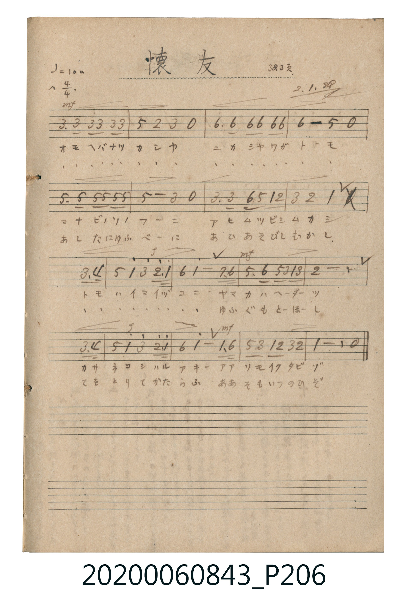

# 懐友 (懷友)

> Re:Shōka 使用 AI 協助辨識與重建樂譜，可能會有錯誤。歡迎回報。

- **鋼琴伴奏版**：<br><audio controls src="kaiyu.mp3"></audio>

- 詞曲作者：未在 TMD metadata 中提供

## 說明

懐友 (懷友)
Source: 唱歌帖 (2020.006.0843), P206.jpg
Marginalia: 323頁. 2.1.28 (昭和2年1月28日)
Dynamics: mf, f


## 歌詞

```text
1.
オモヘバナツカシヤ ユカシヤワガトーモ
マナビノソノフーニ アヒムツビシムカシ
トモハイマイヅコニ ヤマカハヘーダーツ
カサネコシハルアキー アアソモイクタビゾ

2.
(おもへばなつかしや ゆかしやわがとーも)
あしたにゆふべーに あひあそびしむかし
(ともはいまいづこに) ゆふぐもとーほーし
てをとりてかたらふ ああそもいつのひぞ
```

## ABC

<div class="abc-score" data-abc-src="kaiyu.abc" aria-label="五線譜載入中"></div>

[下載 ABC 原始檔](kaiyu.abc)

## TMD 檔案連結

- [主旋律 TMD 檔案](kaiyu.tmd) [[在 TMD Studio 編輯](https://tmdlang.github.io/Tmd-TS/#tmd=s7IKdvYPcrWy4qpTUCpJTLdSSM7PyUlNLsnMz7MqzsjPTkzOyFeCS5bl55TmploBqXhDA4RwcX5pUXJqfEFieqpVgJGBGboM3KT4vPyS1KT8_GyEioKi_LLUvMQ8oKrcxLzS4uSizIKS-OT8gkqEmtSyzJRUkIrUlMyS_KLMxBwkJ6UWFYMdC3FDSVFiHsQMoCBCVUlGKtDdaUWZqXkpxRmZBQgZoHHpmXlWuamZWZnxJakVJajOg0qXpxaXpBblxeem5uSnILksv6gkIz-9KLEgo9IqI7MY5LjkxJz47MS8RCUuLS2FZ-0TnvZ3K2g8a98OpDUVtLS4FG0VDA0MuOxtFdy4bEz0Tey4uPS1uBQU0NWChIIhwafwdMrGZ2t7nu6YpqBhZGBkoGdgYKZnYGFirKmjAApvvayCdJBy38QioGMTczITrRSMjYxfLmjUUzDSM9QzsgCaOmPt00k9Rk93bjF8NqfDyOLZ9KVgK1wq8xJzM5OLrRRy03QU0rhAYj6VQG8UW4GYhnog8nHTqsfNix43z3jcPOFxc9fj5pbHTasfN21_3LxE4XHzMjjncfP6x01rHjd3PG7eA9QA1to8D6xj8uPmvsdNe0Fk81SwdDfQWKCZkx43LwAZCFQBMmMBxDCIVqA5QBX9j5uAJs8Dk62PmzaDtYIsAwqtBkmD3AU0sAFMtkAcDDRk6-PmXpBykLFARUCRRY-b1gIVgS0GIaBzgOSSx01AZ-8Hu2AfOACMwL7WeNzY9bip6XHjjseNGx43rnrcuORxY_fjxumPm1qARrTBOY-b-h839jxuXAFyQFMTOFwfNwI1Tn_cOP9xI9BioNqtjxt3guQbV0PkNoHJuY8bN4MNaYCYBrV3Bdje9Y8bWx437gOTSx83Tgbq1YRYDDRsAlgJ2MrG3WASrPlxIzA6JoFN6AKxQabOf9zUCdQDsRdsKUgr0FCgf9aBXTKPS0ufi8s3EZjUw_KBKdihxqCmGmScgo2hmZYdmFWjYKygC4TGYBoZw2CNgimUZQSlYbIGcBVmYNoMTCNjhBnIPBCEmQk3A-oaiLgpmEbGmK6BQUzXwHwEshOk2hDJ7cgqEKIgFcgQ5hqIOhM0WWyugZmAarIhyOfxOCwx1wHJgKWB5kBUAXlgljGIAGlAiQmoq5D9gt1VNHU3hG-GEmUg7bBgBrFRgxvdBFhUITxWy8Wlawcs6jLzFIC0MhcA)]
- [鋼琴伴奏 TMD 檔案](kaiyu_piano.tmd) [[在 TMD Studio 編輯](https://tmdlang.github.io/Tmd-TS/#tmd=s7IKdvYPcrWy4qpTUCpJTLdSyC8qychPL0osyKi0ysgsLskvykxOzInPTsxLVIIrKs4vLUpOjS9ITE-1CjAyMEPIlGSk5qZapaaUJieWZObnKXFpaSk8a5_wtL9bQeNZ-3YgranwqGGKQkBmYl6-gmNycn5uQWJeZm5qXomClhaXoq2CoYEBl72tghuXjYm-iR0Xl74Wl4ICsWaAlAaDHWel8HTKxmdre57umKagYWRgZKBnYGCmZ2BhYqypowBys15WQTpIuW9iUXpmXmJOZqKVgrGR8csFjXoKRnqGekYWQNtmrH06qcfo6c4ths_mdBhZPJu-VJNLS5-LyzcxM88qLB8YMg41BjXVIHMUbAzNtOzArBoFYwVdIDQG08jYACyuC1RhCmUZQWmIDmQVZmDaDEwjY3QVCAgzE64C6hqIuCmYRsaYroFBTNfAfASyE6TaEOp2dBUIH4FUIEOYayDqTNBkkdTBXQMzAdVkQ5DP43FYYq4DkgFLA82BqALywCxjEAHSgBITUFfBXI3bVTR1N4RvhhJlIO2wYAaxUYMb3QSYDNw5XLXQdArOJ0Ee2FOqaby2oTau5IokCbISGLjaRtowXwIlwQIILkItkjO1TbRxpWSEHKpKpGDRNobbhx5jCDnMlI2sD1klAuJwLkpwwFwENhUogepprJowgsU4XhuqFTVyiM0LyG5HMgi3laBkBrQUntLAbAwHoOQTsBvBwihZBeFliFUYxQqqT3H7YcB8iZ6rYNbA0jaQAhkHtwZr7GKPQQLZzQc5u5nAc5thPAIBAxAYCSAM5BgAuSZAJjJGiEAUYDUDzgSZAKSgykHGgvlQ8xGxhpQ1YVohis2AJAxDrEc2GxbnUCeDMMgM4k1DcT1IDdTBkKAEB5-uHbA2zsxTQKKVuQA)]

## 分析

```text
================================================================================
📊 TMD Song Profile: [ 懐友 懷友 ]
================================================================================
⏱  Duration:       0:43 (43.2s), 18 measures total
🎼 Key & Tempo:    首調基準 F, != 100.0 BPM, <4/4>
   - 分析範圍：      由實際發聲的音符與和弦推測調性；播放脈絡另行呈現
🎤 人聲音域:    A3 (MIDI 57) – D5 (MIDI 74) [跨度: 17 個半音 / 1.4 個八度, 難度: challenging]
   - 最低音:  A3 in [Main #1 @ m.12, 0:27]
   - 最高音: D5 in [Main #1 @ m.3, 0:04]
   - 適合: soprano, mezzo-soprano, contralto, tenor, baritone, bass
🏛  結構:      Main (43.2s)
⚡ 編曲密度:        Peak 1 軌道同時演奏
🗝  調性診斷：       F 大調（純淨自然大調，未偵測到可信轉調）
   - 風格氣質:    純淨自然大調（陽光明朗、易唱易記，無明顯調外色彩）
   - 轉調歷程:    全曲維持單一推測調性（未偵測到可信轉調）
   - 核心骨幹音:  A, F, C, G, D
   - 調性數值:    F 大調 [相關度: 0.86, 穩定度: High, 自然音純度: 99.3%]
   - 候選調性 (K-S): F 大調 (0.86), D 小調 (0.70), C 大調 (0.64)
   - 五度圈歷程:   -1
   - 各段落調性細節:
     • [Main #1]: F 大調 (r: 0.86, 自然音純度: 99.3%, 調外音: D#)

  [ 五度圈游移軌跡 ]
               C  
        [F ]*          G  
      Bb               D  
      Eb               A  
         Ab           E  
            Db       B  
               F# 
     (* = active key center)

  [ 十二半音累積音高分佈 ]
     C  : ████████████████████      18.3%
     C# :                            0.0%
     D  : ████████████████          14.2%
     D# : █                          0.7%
     E  :                            0.0%
     F  : █████████████████████     19.0%
     F# :                            0.0%
     G  : ██████████████████        16.4%
     G# :                            0.0%
     A  : ████████████████████████  21.6%
     A# : ███████████                9.7%
     B  :                            0.0%
--------------------------------------------------------------------------------
Assignment 軌道音域：
  - Vocal         : A3 – D5 (17 個半音 / 1.4 個八度, 70 個音符)
================================================================================
```


## 原書掃描頁




