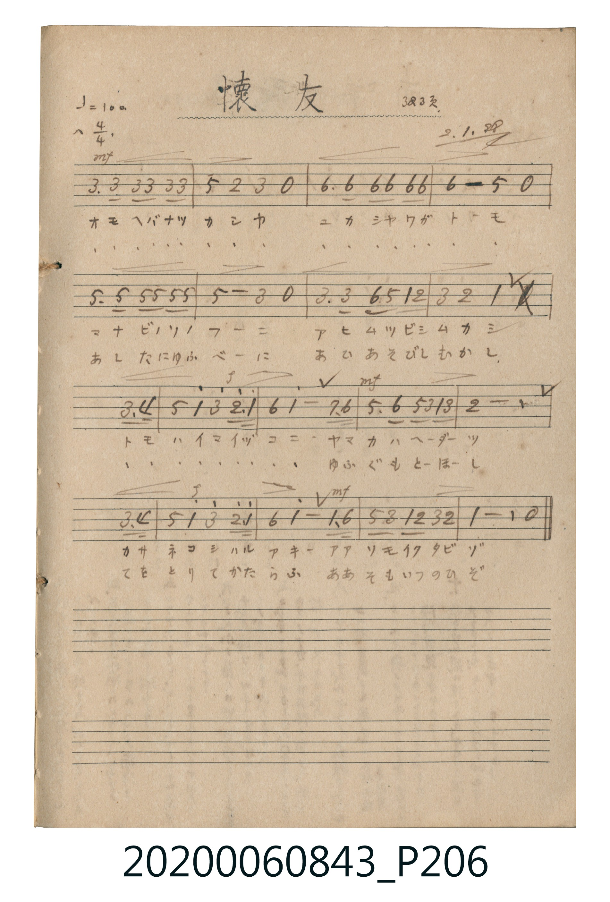

# 懐友 (懷友)

> Re:Shoka 使用 AI 協助辨識與重建樂譜，可能會有錯誤。歡迎回報。

<audio controls src="kaiyu.mp3"></audio>

- 詞曲作者：未在 TMD metadata 中提供

## 說明

懐友 (懷友)
Source: 唱歌帖 (2020.006.0843), P206.jpg
Marginalia: 323頁. 2.1.28 (昭和2年1月28日)
Dynamics: mf, f

## 跨冊／重複收錄參照

> 同曲（〈懷友〉；收錄於《新定兒童唱歌》高等科女子用與《唱歌帖》P206《小公學校唱歌教材集》抄譜）

- **[同曲]** 《新定兒童唱歌》高等科女子用（2020.006.0849）：[**〈懷友〉**](../../../shintei_jido_shoka/koto_girls_2020.006.0849/2_3_05_kaiyu/index.md)（`C` / `4/4` — [原始 TMD](../../../shintei_jido_shoka/koto_girls_2020.006.0849/2_3_05_kaiyu/kaiyu.tmd)）
- 總表：[跨冊重複與同名歌曲總索引](../../../duplicate_songs.md)

## 歌詞

```text
1.
オモヘバナツカシヤ ユカシヤワガトーモ
マナビノソノフーニ アヒムツビシムカシ
トモハイマイヅコニ ヤマカハヘーダーツ
カサネコシハルアキー アアソモイクタビゾ

2.
(おもへばなつかしや ゆかしやわがとーも)
あしたにゆふべーに あひあそびしむかし
(ともはいまいづこに) ゆふぐもとーほーし
てをとりてかたらふ ああそもいつのひぞ
```

## ABC

```abc
X:1
T:懐友 懷友
M:4/4
L:1/16
Q:1/4=100
K:F
V:V1 name="Vocal" snm="Voc"
[V:V1]
A3 A A2 A2 A2 A6 | c4 G4 A4 z4 | d3 d d2 d2 d2 d6 | d8 c4 z4 |
c3 c c2 c2 c2 c6 | c8 A4 z4 | A3 A d2 c2 F2 G6 | A4 G4 F8 |
A3 B13 | c4 F4 A4 G3 F | D4 F8 _E2 D2 | C3 D C2 A,2 F2 A6 |
G16 | A3 B13 | c4 F4 A4 G3 F | D4 F8 F3 d |
c2 A2 F2 G2 A2 G6 | F8 z8 | A3 A A2 A2 A2 A6 | c4 G4 A4 z4 |
d3 d d2 d2 d2 d6 | d8 c4 z4 | c3 c c2 c2 c2 c6 | c8 A4 z4 |
A3 A d2 c2 F2 G6 | A4 G4 F8 | A3 B13 | c4 F4 A4 G3 F |
D4 F8 _E2 D2 | C3 D C2 A,2 F2 A6 | G16 | A3 B13 |
c4 F4 A4 G3 F | D4 F8 F3 d | c2 A2 F2 G2 A2 G6 | F8 z8 |
```

## TMD 檔案連結

- [主旋律 TMD 檔案](kaiyu.tmd) [[在 TMD Studio 編輯](https://tmdlang.github.io/Tmd-TS/#tmd=s7IKdvYPcrWy4qpTUCpJTLdSSM7PyUlNLsnMz7MqzsjPTkzOyFeCS5bl55TmploBqXhDA4RwcX5pUXJqfEFieqpVgJGBGboM3KT4vPyS1KT8_GyEioKi_LLUvMQ8oKrcxLzS4uSizIKS-OT8gkqEmtSyzJRUkIrUlMyS_KLMxBwkJ6UWFYMdC3FDSVFiHsQMoCBCVUlGKtDdaUWZqXkpxRmZBUpcWloKz9onPO3vVtB41r4dSGsqaGlxKdoqGBoYcNnbKrhx2Zjom9hxcelrcSkooKsFCQVD_KbwdMrGZ2t7nu6YpqBhZGBkoGdgYKZnYGFirKmjAAoMvayCdJBy38Si9My8xJzMRCsFYyPjlwsa9RSM9Az1jCyAps5Y-3RSj9HTnVsMn83pMLJ4Nn0p2AqXyrzE3MzkYiuF3DQdhTQukJhPZRFIBMQ01AORj5tWPW5e9Lh5xuPmCY-bux43tzxuWv24afvj5iUKj5uXwTmPm9c_blrzuLnjcfMeoAaw1uZ5YB2THzf3PW7aCyKbp4Klu4HGAs2c9Lh5AchAoAqQGQsghkG0As0Bquh_3AQ0eR6YbH3ctBmsFWQZUGg1SBrkLqCBDWCyBeJgoCFbHzf3gpSDjAUqAoosety0FqgIbDEIAZ0DJJc8bgI6ez_YBfvAAWAE9rXG48aux01Njxt3PG7c8Lhx1ePGJY8bux83Tn_c1AI0og3OedzU_7ix53HjCpADmprA4fq4Eahx-uPG-Y8bgRYD1W593LgTJN-4GiK3CUzOfdy4GWxIA8Q0qL0rwPauf9zY8rhxH5hc-rhxMlCvJsRioGETwErAVjbuBpNgzY8bgdExCWxCF4gNMnX-46ZOoB6IvWBLQVqBhgL9sw7sknlcWvpcXL6JmXlWYfnJiTkONQY1CtUg8xRsDM207MCsGgVjBV0gNAbTyBgGaxRMoSwjKA2TNYCrMAPTZmAaGSPMQOaBIMxMuBlQ10DETcE0MsZ0DQxiugbmI5CdINWGSG5HVoEQBalAhjDXQNSZoMlicw3MBFSTDUE-j8dhibkOSAYsDTQHogrIA7OMQQRIA0pMQF2F7BfsrqKpuyF8M5QoA2mHBTOIjRrc6CbAogrhsVouLl07YFmXmaeARCtzAQA)]
- [鋼琴伴奏 TMD 檔案](kaiyu_piano.tmd) [[在 TMD Studio 編輯](https://tmdlang.github.io/Tmd-TS/#tmd=s7IKdvYPcrWy4tLSUnjWPuFpf7eCxrP27UBaU-FRwxSFgMzEvHwFx-Tk_NyCxLzM3NS8EgUtLS5FWwVDAwMue1sFNy4bE30TOy4ufS0uBQVizQApDc4vLUpOtVJ4OmXjs7U9T3dMU9AwMjAy0DMwMNMzsDAx1tRRCDACsrMK0kHKfROL0jPzEnMyE60UjI2MXy5o1FMw0jPUM7IA2jZj7dNJPUZPd24xfDanw8ji2fSlmlxa-lxcvomZeVZh-cmJOQ41BjUK1SCDFGwMzbTswKwaBWMFXSA0BtPI2AAsrgtUYQplGUFpiA5kFWZg2gxMI2N0FQgIMxOuAuoaiLgpmEbGmK6BQUzXwHwEshOk2hDqdnQVCB-BVCBDmGsg6kzQZJHUwV0DMwHVZEOQz-NxWGKuA5IBSwPNgagC8sAsYxAB0oASE1BXwVyN21U0dTeEb4YSZSDtsGAGsVGDG90EmAzcOVy10IQKzihBHjiSqmm8tqE2rvSKJAmyExi62kbaMG8CJcECCC5CLZI7tU20cSVlhByqSqRw0TaG24ceZQg5zKSNrA9ZJQLicC5KcMBcBDYVKIHqaayaMILFOF4bqhU1dojNDMhuRzIIt5WgdAa0FJ7UwGwMB6BkFLAbwcIoeQXhZYhVGOUKqk9x-2HAfImerWDWwNI2kAIZB7cGa-xij0EC-c0HV34zhBcBuBnAoAVHD9jXcBZcGuE0E7gkfhZ2lZgGkuRGPJJI2R-PtQivIanD4l8YhDkPPejRIV6nIVtqBmdjYyEHHzF-heUKLFGHYCHcSH9f4IxdhGlYIg4GsSZ4XTtgCyozTwGJVuYCAA)]

## 分析

```text
================================================================================
📊 TMD Song Profile: [ 懐友 懷友 ]
================================================================================
⏱  Duration:       1:26 (86.4s), 36 measures total
🎼 Key & Tempo:    首調基準 F, != 100.0 BPM, <4/4>
   - 分析範圍：      由實際發聲的音符與和弦推測調性；播放脈絡另行呈現
🎤 人聲音域:    A3 (MIDI 57) – D5 (MIDI 74) [跨度: 17 個半音 / 1.4 個八度, 難度: challenging]
   - 最低音:  A3 in [Main #1 @ m.12, 0:27]
   - 最高音: D5 in [Main #1 @ m.3, 0:04]
   - 適合: soprano, mezzo-soprano, contralto, tenor, baritone, bass
🏛  結構:      Main (43.2s) -> Main (43.2s)
⚡ 編曲密度:        Peak 1 軌道同時演奏
🗝  調性診斷：       F 大調（純淨自然大調，未偵測到可信轉調）
   - 風格氣質:    純淨自然大調（陽光明朗、易唱易記，無明顯調外色彩）
   - 轉調歷程:    全曲維持單一推測調性（未偵測到可信轉調）
   - 核心骨幹音:  A, F, C, G, D
   - 調性數值:    F 大調 [相關度: 0.86, 穩定度: High, 自然音純度: 99.3%]
   - 候選調性 (K-S): F 大調 (0.86), D 小調 (0.70), C 大調 (0.64)
   - 五度圈歷程:   -1 -> -1
   - 各段落調性細節:
     • [Main #1]: F 大調 (r: 0.86, 自然音純度: 99.3%, 調外音: D#)
     • [Main #2]: F 大調 (r: 0.86, 自然音純度: 99.3%, 調外音: D#)

  [ 五度圈游移軌跡 ]
               C  
        [F ]*          G  
      Bb               D  
      Eb               A  
         Ab           E  
            Db       B  
               F# 
     (* = active key center)

  [ 十二半音累積音高分佈 ]
     C  : ████████████████████      18.3%
     C# :                            0.0%
     D  : ████████████████          14.2%
     D# : █                          0.7%
     E  :                            0.0%
     F  : █████████████████████     19.0%
     F# :                            0.0%
     G  : ██████████████████        16.4%
     G# :                            0.0%
     A  : ████████████████████████  21.6%
     A# : ███████████                9.7%
     B  :                            0.0%
--------------------------------------------------------------------------------
Assignment 軌道音域：
  - Vocal         : A3 – D5 (17 個半音 / 1.4 個八度, 140 個音符)
================================================================================
```


## 原書掃描頁




