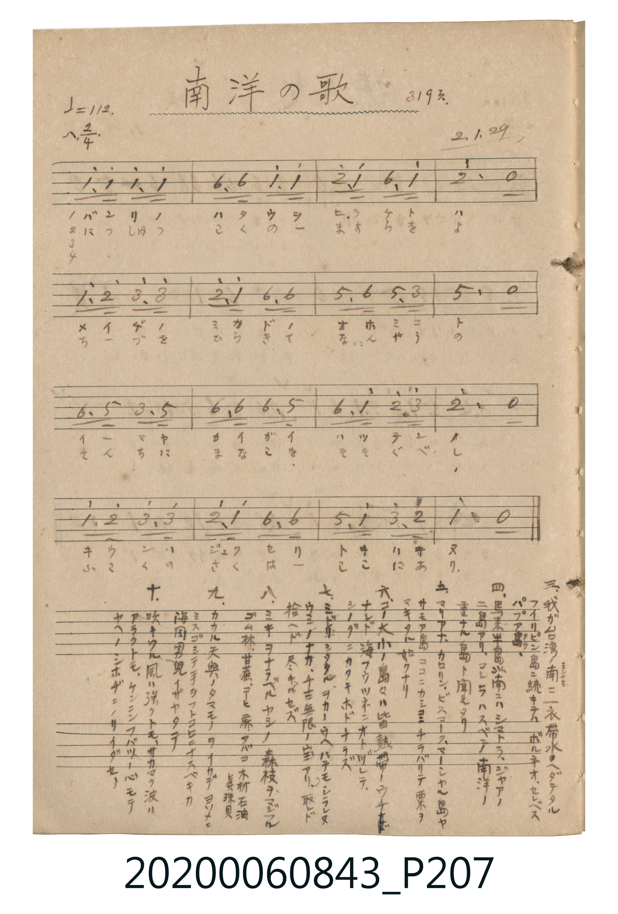

# 南洋の歌 (南洋之歌)

> Re:Shoka 使用 AI 協助辨識與重建樂譜，可能會有錯誤。歡迎回報。

<audio controls src="nanyo_no_uta.mp3"></audio>

- 詞曲作者：未在 TMD metadata 中提供

## 說明

南洋の歌 (南洋之歌)
Source: 唱歌帖 (2020.006.0843), P207.jpg
Marginalia: 319頁. 2.1.29 (昭和2年1月29日)
Lyrics (10 Verses):

## 跨冊／重複收錄參照

> 同曲（〈南洋の歌〉；收錄於《新定兒童唱歌》六年級與《唱歌帖》P207《小公學校唱歌教材集》抄譜）

- **[同曲]** 《新定兒童唱歌》尋常科第六學年用（2020.006.0847.0006）：[**〈南洋の歌〉**](../../../shintei_jido_shoka/grade_6_2020.006.0847.0006/4_03_nanyo_no_uta/index.md)（`C` / `2/4` — [原始 TMD](../../../shintei_jido_shoka/grade_6_2020.006.0847.0006/4_03_nanyo_no_uta/nanyo_no_uta.tmd)）
- 總表：[跨冊重複與同名歌曲總索引](../../../duplicate_songs.md)

## 歌詞

```text
1.
バンリノハタウヲ ヒラクトハ メイヂノミカドノ オホミコト
イーマヤカイガイ ハッテンノ キウンハジュクセリ トキハキヌ

2.
にっしゅうこくのー ますらをよ ちーづをひらきて なんやうの
とんちにまなこを そそぐべし そこにさくはー ここにあリ

3.
我が台湾ノ南ニ 一衣帯水ヲヘダテタル フィリピン島ニ續キテハ ボルネオ、セレベス パプア島

4.
馬來半島ノ南ニハ スマトラ、ジャワノ 二島アリ、コレラハスベテ南洋ノ 重ナル島ト聞エタリ

5.
マリアナ、カロリン、ビスマーク、マーシャル島ヤ サモア島 ココニカシコニ チラバリテ 粟ヲマキタル如クナリ

6.
コノ大小ノ島々ハ 皆熱帯ノウチニアレド 海風ツネニオトヅレテ、 シノグニカタキホドナラズ

7.
ミドリシタタルヲカノウヘ ハテモシラレヌウミノナカ、 千古無限ノ宝アリ、 取レド拾ヘド尽キヤセズ

8.
ミキヲナラベルヤシノ森 枝ヲマジフルゴムノ林、 甘蔗、コヒ、麻、タバコ、木材、石油、眞珠貝

9.
カカル天與ノタマモノヲ イカデヨソメニミスゴシテ 手ヲフトコロニナスベキカ 海国男兒イザヤタテ

10.
吹キクル風ハ強クトモ、 サカマク波ハアラクトモ、 ケンニンフバツノ心モテ ヤヘノシホヂニノリイダセ〜
```

## ABC

```abc
X:1
T:南洋の歌 南洋之歌
M:2/4
L:1/16
Q:1/4=112
K:C
V:V1 name="Vocal" snm="Voc"
[V:V1]
c3 c c3 c | A3 A c3 c | d3 c A3 c | d4 z4 |
c3 d e3 e | d3 c A3 A | G3 A G3 E | G4 z4 |
A3 G E3 G | A3 A A3 G | A3 c d3 e | d4 z4 |
c3 d e3 e | d3 c A3 A | G3 c e3 d | c4 z4 |
c3 c c3 c | A3 A c3 c | d3 c A3 c | d4 z4 |
c3 d e3 e | d3 c A3 A | G3 A G3 E | G4 z4 |
A3 G E3 G | A3 A A3 G | A3 c d3 e | d4 z4 |
c3 d e3 e | d3 c A3 A | G3 c e3 d | c4 z4 |
c3 c c3 c | A3 A c3 c | d3 c A3 c | d4 z4 |
c3 d e3 e | d3 c A3 A | G3 A G3 E | G4 z4 |
A3 G E3 G | A3 A A3 G | A3 c d3 e | d4 z4 |
c3 d e3 e | d3 c A3 A | G3 c e3 d | c4 z4 |
c3 c c3 c | A3 A c3 c | d3 c A3 c | d4 z4 |
c3 d e3 e | d3 c A3 A | G3 A G3 E | G4 z4 |
A3 G E3 G | A3 A A3 G | A3 c d3 e | d4 z4 |
c3 d e3 e | d3 c A3 A | G3 c e3 d | c4 z4 |
c3 c c3 c | A3 A c3 c | d3 c A3 c | d4 z4 |
c3 d e3 e | d3 c A3 A | G3 A G3 E | G4 z4 |
A3 G E3 G | A3 A A3 G | A3 c d3 e | d4 z4 |
c3 d e3 e | d3 c A3 A | G3 c e3 d | c4 z4 |
c3 c c3 c | A3 A c3 c | d3 c A3 c | d4 z4 |
c3 d e3 e | d3 c A3 A | G3 A G3 E | G4 z4 |
A3 G E3 G | A3 A A3 G | A3 c d3 e | d4 z4 |
c3 d e3 e | d3 c A3 A | G3 c e3 d | c4 z4 |
c3 c c3 c | A3 A c3 c | d3 c A3 c | d4 z4 |
c3 d e3 e | d3 c A3 A | G3 A G3 E | G4 z4 |
A3 G E3 G | A3 A A3 G | A3 c d3 e | d4 z4 |
c3 d e3 e | d3 c A3 A | G3 c e3 d | c4 z4 |
c3 c c3 c | A3 A c3 c | d3 c A3 c | d4 z4 |
c3 d e3 e | d3 c A3 A | G3 A G3 E | G4 z4 |
A3 G E3 G | A3 A A3 G | A3 c d3 e | d4 z4 |
c3 d e3 e | d3 c A3 A | G3 c e3 d | c4 z4 |
c3 c c3 c | A3 A c3 c | d3 c A3 c | d4 z4 |
c3 d e3 e | d3 c A3 A | G3 A G3 E | G4 z4 |
A3 G E3 G | A3 A A3 G | A3 c d3 e | d4 z4 |
c3 d e3 e | d3 c A3 A | G3 c e3 d | c4 z4 |
c3 c c3 c | A3 A c3 c | d3 c A3 c | d4 z4 |
c3 d e3 e | d3 c A3 A | G3 A G3 E | G4 z4 |
A3 G E3 G | A3 A A3 G | A3 c d3 e | d4 z4 |
c3 d e3 e | d3 c A3 A | G3 c e3 d | c4 z4 |
```

## TMD 檔案連結

- [主旋律 TMD 檔案](nanyo_no_uta.tmd) [[在 TMD Studio 編輯](https://tmdlang.github.io/Tmd-TS/#tmd=s7IKdvYPcrWy4qpTUCpJTLdSSM7PyUlNLsnMz7MqzsjPTkzOyFeCS5bl55TmploBqXhDA4RwcX5pUXJqfEFieqpVgJGBOboM3KT4vPyS1KT8_GyEioKi_LLUvMQ8oKrcxLzS4uSizIKS-OT8gkqEmtSyzJRUkIrUlMyS_KLMxBwkJ6UWFYMdC3FDSVFiHsQMoKASl5aWwtPe6c-2dD9uXPdsbY-CBoT3ZGc3kKepoKXFpWirYGhoxGVvq-DMZWOkb2LHxaWvxaWggE8fSDoY4jOFp1M2AoWe7pimoGFkYGSgZ2BgpmdgYWKsqaMACgq9rIJ0kHLfxKL0zLzEnMxEKwVjQ8uXCxr1FIz0DPWMLBU0ns1Y-3RSj9HTnVsMn83pMLJ8Nn2pJhdIk09lUWZysYKGoYFCGNCbqcWaViBhQz0Q-bh5wuPmzY-bVz1u7nvc3P-4af_jpmWPmzcBJSY9bl75uGn94-YOoASQv_Bx05LHzU1ghfMfN61-3NwJZCs8bgLqnQ0WAprTATYUpHDP4-Z5j5uXgBQCuU1rgCTQkP7Hzc2Pm9vAdoL0rgVbB-QArd7xuHkpyMKm3UD3ANV2gKRBEkCyB-wVI4ibG1c_blz8uHH646bWx41tjxsnP27sBwYx0E6g3L7HjTMfN3U-bpr0uKkDyF8Ickoj0OBJjxs3gSQaex83LgNKrHrcNPlxUwvYhHUQc1eAhIA6QBYAzVkFMrppElBiLhhNeNy4E2gthA9UCFQ1FWw1MJBAVgOFIKLAQFoFdrAx2MHPOiY-bux52r_h2c59QG8DU8Hj5m6FJzsaXixc_HTH-mcbtgBD_HHzjMfNDaCwAcZB82qg_6c-bloMjpkpwBB6unkbUNPzXT3g4AAGIChK5gAVPm7uBUVBQyM43NY8bgb6fidQbuLjZmAALQLqA7vEBOySl8vWPNnX9rS3C2wc1CVgs5p2guMLGNcrwWYBIwNoOdBjfQpPdvWAlDctAjkGJAeMLqA9K8FxA9Q2E-geaDoHqn7Z3vu4uQvoMLAVHS8a5z1uAoYr0E-QIDGFpjugZcAYAJrZBTYT6A-gv4Ce3QziNgPDHeKgPaAUARKBsLeDnQUxG5iemrY-bl4E8SWQsxnstG5wktsOYQMtAuoFOhWYzIGGtyk83zQfHNhAVwHTHiikny5rAidzoJshLjSDuBCkv-_pkuVPNwATbR_IxoZWUFA9n9X2vG0jMN5AOQGUeoEWAO0E-gQYKJ0Kz7Zuf7loxePmFlDEgCSA1gJDFagVKN0G9ArQZKAvgFo3wNwKzHNAvwPzEDBDAV0BzHW7wA4xhwYV0MVAGWBoAT0FVAtyNMgPoDCDuGAGJGcBUwUwMICGA_0LtAyYVIByQM3ADNsFUg20-2lv89P-Jc9bFr6cCQyRvqfr5sLjVeFp_zSIH551A5MpMDV2Pt2wF-w0YP7dDXOUBdxRIBlgSIJdDEoEQOcAFYL89mzxOoVn8-bCAhqYlqaCpJuA6XwBSHredJB9z6fMeDEFxAIH9SQg4-Wu3WAu0IcTQIINjc_mrHg2dwKQ8Xz-5mebdoIYc-Y971_wYtNcsGssoXEFNBxo_eqnS1a-6GgHBwvQDGCSAfoN6HtgcQYqg4AqgHLAxLgXVJqBEj7QEztBzgK5uk3hWSdQCOhkoGOBZQ_QTUAPAkWAYQdO5aAEsxoUv09n730-ZfvTVmAJAzQVlBLB1rWBXWRoAHbS0wlAg4EagKlkNTg99D_dA4w-SHG6CJIMtoKdBAyg9c82Ax0KzE1AEl7mQhVtBBePQGcASaDDgLEGTFl9T_cDi1Gg6jZgTAALW2BkAb0M9AQwEQELH1BGBCcYoFQDKO4a5nBp6XNx-SZm5lmF5Scn5jjUGNQoVIMcqmBjaKZlB2bVKBjGKegCIZBCsGoUzMBMMxQxIzgbIossqKtgAKVrUM0FyhtDWEAK0wwzoJgplAWhjeEimGZC9JgC1UBohDthMjARoAVQq5CtpdyVQCGoQqAauHZkc2u5uHTtgNV2Zp4CFWllLgA)]
- [鋼琴伴奏 TMD 檔案](nanyo_no_uta_piano.tmd) [[在 TMD Studio 編輯](https://tmdlang.github.io/Tmd-TS/#tmd=s7IKdvYPcrWy4tLSUnjaO_3Zlu7Hjeuere1R0IDwnuzsBvI0FR41TFEIyEzMy1dwTE7Ozy1IzMvMTc0rUdDS4lK0VTA0NOKyt1Vw5rIx0jex4-LS1-JSUCDHPJC24PzSouRUK4WnUzYClT7dMU1Bw8jAyEDPwMBMz8DCxFhTRyHAyMBcL6sgHaTcN7EoPTMvMScz0UrB2NDy5YJGPQUjPUM9I0sFjWcz1j6d1GP0dOcWw2dzOowsn01fqsmlpc_F5ZuYmWcVlp-cmONQY1CjUA0ySMHG0EzLDsyqUTCMU9AFQiCFYNUomIGZZihiRnA2RBZZUFfBAErXoJoLlDeGsIAUphlmQDFTKAtCG8NFMM2E6DEFqoHQCHfCZGAiQAugViFbS7krgUJQhUA1cO3I5tZCwxwc50EeOELdWNtUGxG2qDygsdom2jCb0eWAMtoI9yFUQiXNYZKYfkUyCagGxNZG9jSSXhSDQZ431AZqhvIQbFBUmevEaxtB-ViCF26KqYJpvDZQK5SD6kdkZcgyQHcgeRfdlTTyIVAKWSdUE4rhOOPbB1d8G8ZDNcAZQOfoYBE0gjERssC0B2djBDAWIxCqkc3ArxLdXKxuQwgiG4xgw91OHRcjRBEsJP0oUaBrByweM_MUqEgrcwEA)]

## 分析

```text
================================================================================
📊 TMD Song Profile: [ 南洋の歌 南洋之歌 ]
================================================================================
⏱  Duration:       2:51 (171.4s), 160 measures total
🎼 Key & Tempo:    首調基準 C, != 112.0 BPM, <2/4>
   - 分析範圍：      由實際發聲的音符與和弦推測調性；播放脈絡另行呈現
🎤 人聲音域:    E4 (MIDI 64) – E5 (MIDI 76) [跨度: 12 個半音 / 1.0 個八度, 難度: easy]
   - 最低音:  E4 in [Main #1 @ m.7, 0:07]
   - 最高音: E5 in [Main #1 @ m.5, 0:04]
   - 適合: soprano, mezzo-soprano, contralto, tenor, baritone, bass
🏛  結構:      Main (17.1s) -> Main (17.1s) -> Main (17.1s) -> Main (17.1s) -> Main (17.1s) -> Main (17.1s) -> Main (17.1s) -> Main (17.1s) -> Main (17.1s) -> Main (17.1s)
⚡ 編曲密度:        Peak 1 軌道同時演奏
🗝  調性診斷：       A 小調（純淨自然小調，未偵測到可信轉調）
   - 風格氣質:    純淨自然小調（陰鬱抒情、旋律集中，無明顯調外色彩）
   - 轉調歷程:    全曲維持單一推測調性（未偵測到可信轉調）
   - 核心骨幹音:  A, C, D, E, G
   - 調性數值:    A 小調 [相關度: 0.80, 穩定度: Moderate, 自然音純度: 100.0%]
   - 候選調性 (K-S): A 小調 (0.80), C 大調 (0.72), G 大調 (0.60)
   - 五度圈歷程:   +3 -> +3 -> +3 -> +3 -> +3 -> +3 -> +3 -> +3 -> +3 -> +3
   - 各段落調性細節:
     • [Main #1]: A 小調 (r: 0.80, 自然音純度: 100.0%)
     • [Main #2]: A 小調 (r: 0.80, 自然音純度: 100.0%)
     • [Main #3]: A 小調 (r: 0.80, 自然音純度: 100.0%)
     • [Main #4]: A 小調 (r: 0.80, 自然音純度: 100.0%)
     • [Main #5]: A 小調 (r: 0.80, 自然音純度: 100.0%)
     • [Main #6]: A 小調 (r: 0.80, 自然音純度: 100.0%)
     • [Main #7]: A 小調 (r: 0.80, 自然音純度: 100.0%)
     • [Main #8]: A 小調 (r: 0.80, 自然音純度: 100.0%)
     • [Main #9]: A 小調 (r: 0.80, 自然音純度: 100.0%)
     • [Main #10]: A 小調 (r: 0.80, 自然音純度: 100.0%)

  [ 五度圈游移軌跡 ]
               C  
         F            G  
      Bb               D  
      Eb              [A ]*
         Ab           E  
            Db       B  
               F# 
     (* = active key center)

  [ 十二半音累積音高分佈 ]
     C  : ███████████████████████   25.0%
     C# :                            0.0%
     D  : ███████████████████       20.5%
     D# :                            0.0%
     E  : █████████████             14.3%
     F  :                            0.0%
     F# :                            0.0%
     G  : █████████████             14.3%
     G# :                            0.0%
     A  : ████████████████████████  25.9%
     A# :                            0.0%
     B  :                            0.0%
--------------------------------------------------------------------------------
Assignment 軌道音域：
  - Vocal         : E4 – E5 (12 個半音 / 1.0 個八度, 520 個音符)
================================================================================
```


## 原書掃描頁




