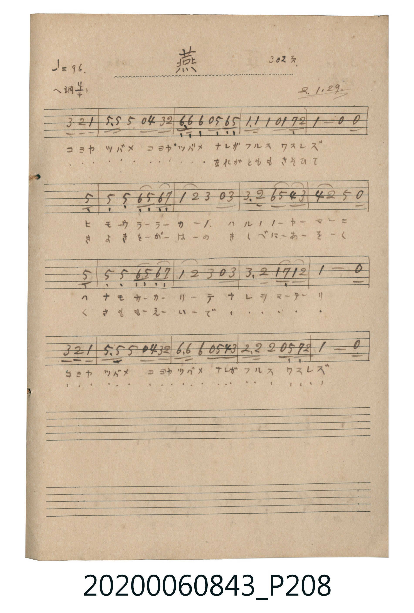

# 燕 (燕子)

<audio controls src="tsubame.mp3"></audio>

- 詞曲作者：未在 TMD metadata 中提供

## 說明

燕 (燕子)
Source: 唱歌帖 (2020.006.0843), P208.jpg
Marginalia: 302頁. 2.1.29. (昭和2年1月29日)

## 跨冊／重複收錄參照

> 同名異曲（各冊收錄之不同詞曲版本）

- **[同名異曲]** 《新定兒童唱歌》尋常科第六學年用（2020.006.0847.0006）：[**〈つばめ〉**](../../../shintei_jido_shoka/grade_6_2020.006.0847.0006/4_05_tsubame/index.md)（`E,` / `4/4` — [原始 TMD](../../../shintei_jido_shoka/grade_6_2020.006.0847.0006/4_05_tsubame/tsubame.tmd)）
- **[同名異曲]** 《新定兒童唱歌》高等科女子用（2020.006.0849）：[**〈燕〉**](../../../shintei_jido_shoka/koto_girls_2020.006.0849/1_5_02_tsubame/index.md)（`F` / `4/4` — [原始 TMD](../../../shintei_jido_shoka/koto_girls_2020.006.0849/1_5_02_tsubame/tsubame.tmd)）
- **[同名異曲]** 楊金土手抄《唱歌帖》第 7 冊・VII（2020.006.0843）：[**〈つばめ（燕子）〉**](../../vol_07/p245_tsubame/index.md)（`G` / `4/4` — [原始 TMD](../../vol_07/p245_tsubame/tsubame.tmd)）
- 總表：[跨冊重複與同名歌曲總索引](../../../duplicate_songs.md)

## 歌詞

```text
1.
コヨヤツバメ コヨヤツバメ ナレガフルス ワスレズ
ヒモウララカノ ハルノヤマニ ハナモサカリテ ナレヲマテリ
コヨヤツバメ コヨヤツバメ ナレガフルス ワスレズ

2.
(こよやつばめ こよやつばめ) なれがともも さそひて
きよきをがはの きしべにあをく くさもえいで (なれをまてり)
(こよやつばめ こよやつばめ なれがふるす わすれず)
```

## ABC

```abc
X:1
T:燕 燕子
M:4/4
L:1/16
Q:1/4=96
K:F
V:V1 name="Melody" snm="Mel"
[V:V1]
z10 A2 G2 F2 | C3 C C2 z2 B2 A2 G4 | D3 D D2 z2 C2 D2 C4 | F3 F F2 z2 F2 _E2 G4 |
F8 z8 | C16 | C2 C2 D2 C2 D2 _E6 | F4 G4 A2 z2 A4 |
A3 G d2 c2 B2 A6 | B4 G4 c8 | C16 | C2 C2 D2 C2 D2 _E6 |
F4 G4 A2 z2 A4 | A3 G F2 _E2 F2 G6 | F8 z8 | A2 G2 F12 |
C3 C C2 z2 B2 A2 G4 | D3 D D2 z2 c2 B2 A4 | G3 G G2 z2 C2 _E2 G4 | F8 z8 |
```

## TMD 檔案連結

- [主旋律 TMD 檔案](tsubame.tmd) [[在 TMD Studio 編輯](https://tmdlang.github.io/Tmd-TS/#tmd=s7IKdvYPcrWy4tLSUnjePlVBA0g8XTtBU0FLi0vRVsHSjMveVsGNy8ZE38SOi0tfi0tBAUUdiB-cX1qUnGql8HTKxmdre57umKagYWRgZKBnYGCmZ2BhYqypoxBgZGChl1WQDlLum1iUnpmXmJOZaKVgbGD0ckGjnoKRnqGekaWegsazGWufTuoxerpzi-GzOR1Gls-mL9XkAunyqSzKTC62AjEN9UDk46bNj5tXPG5e8ri55XHzhMfNC7EKNXc9bl7zuGnN4-apj5tXP27aCRRaD6TAorvABjVPety86HHTssfNK0GoafXj5j6gaD9IfXMf2Lh5j5u7IUJA44Bqt4JVrXrc3AazoXkTWFUbUJR6rgOZZAT2rcbjxsmPmzoeN7U8blzyuHHD46ZGBUwhTaDYqsdNPY8bgWjF46YmIAIKTX3cOPdx46bHjcvATmvsBWkDkZPACtc_blwHFm2c_rhx5-PG1Y8bgRqBcv1A0X6QdqBBjUAdQIuWg1wCtgKkYB_QyMdNXeBUQJwLkR0IDMTux40zgQEDtGQmWHSWJpeWPheXb2JmnpVvak5-SqVDjUGNQjXIAgUbQzMtOzCrRsFAQRcDGgOxERAbAnGNgmk8WBBIgVkgDSZIikCwRsEMoghIgVkgRWDVYB7UBJA6kJEgg0E0SBGINtcBycPNgjoMohIB0R0KdxhuCFWC5hAwC2InQiHMNpgrQL4D2QiikV0F4RspmIFMA2JYSCBMAokgmwRSRTN3o4UVTtfD3Y0IbxALph41DGAQM8SREwZWh0PdQ3aSQVIIUQRRbgSm4YkKLcEQdjhXLReXrh2wwMzMUwDSylwA)]
- [鋼琴伴奏 TMD 檔案](tsubame_piano.tmd) [[在 TMD Studio 編輯](https://tmdlang.github.io/Tmd-TS/#tmd=s7IKdvYPcrWy4tLSUnjePlVBA0g8XTtBU-FRwxSFgMzEvHwFx-Tk_NyCxLzM3NS8EgUtLS5FWwVLMy57WwU3LhsTfRM7Li59LS4FBaL0g9QF55cWJadaKTydsvHZ2p6nO6YpaBgZGBnoGRiY6RlYmBhr6igEGBlY6GUVpIOU-yYWpWfmJeZkJlopGBsYvVzQqKdgpGeoZ2Spp6DxbMbap5N6jJ7u3GL4bE6HkeWz6Us1ubT0ubh8EzPzrHxTc_JTKh1qDGoUqkFGKdgYmmnZgVk1CgYKuhjQGIiNgNgQiGsUTOPBgkAKzAJpAGETJIU1CmYQRUAKzIIpAusAi4BZNWAjQQaDaJgiENtcByQPNgvqMIhKBIQ5FEbDHYYbIimBMxCOAbMg9iJsA7kAFgQw20BsmKsg4kYKZiBTgBgUCsjqa-AiMJNAqmjmbrSwwul6uLthKiH6QTyYHtwhjnAWcsLA6nCoeyhKMkgKa6CuMwLTKIkKKcEQTipctdCsAM6LQR5k5wXjeG2E32Ac7N4DyiJ8COPgzBdgs7RhuQPBw59HkHXh8T4xKQ7hM6AnkNg48guStUAmUFQbnt6BMtq4sg-SJDAtaptow_KRGdAAbVjWQTEClFBQ5ZBtA7O1ycpjpPkYyQOk-BvVxxi6gQyQAJpRhCIWyQ9gYwlnSKqlWyTlkIiB-gzKxJlFiUypqBnVh5SMiiwGLBJgsQlmwJ0FdhFClQmcD2HBcxuqMqIMgxXF6AkPMzdicz0yRLcQBBGWIVhI6hCCcCFEmKI5DOFpIwxNwAIXn4008AO66_D5hPRwgUHMnEPQA-gOo0ZCggcumIHLMMJJCJRNdO2AbcLMPAUgrcwFAA)]

## 分析

```text
================================================================================
📊 TMD Song Profile: [ 燕 燕子 ]
================================================================================
⏱  Duration:       0:50 (50.0s), 20 measures total
🎼 Key & Tempo:    首調基準 F, != 96.0 BPM, <4/4>
   - 分析範圍：      由實際發聲的音符與和弦推測調性；播放脈絡另行呈現
🎤 人聲音域:    C4 (MIDI 60) – D5 (MIDI 74) [跨度: 14 個半音 / 1.2 個八度, 難度: moderate]
   - 最低音:  C4 in [Main #1 @ m.2, 0:02]
   - 最高音: D5 in [Main #1 @ m.9, 0:20]
   - 適合: soprano, mezzo-soprano, contralto, tenor, baritone, bass
🏛  結構:      Main (50.0s)
⚡ 編曲密度:        Peak 1 軌道同時演奏
🗝  調性診斷：       F 大調（流行色彩大調，未偵測到可信轉調）
   - 風格氣質:    流行大調（略帶和弦色彩音與裝飾副屬和弦）
   - 轉調歷程:    全曲維持單一推測調性（未偵測到可信轉調）
   - 核心骨幹音:  C, F, G, A, D
   - 調性數值:    F 大調 [相關度: 0.84, 穩定度: Moderate, 自然音純度: 93.3%]
   - 候選調性 (K-S): F 大調 (0.84), C 大調 (0.80), C 小調 (0.64)
   - 五度圈歷程:   -1
   - 各段落調性細節:
     • [Main #1]: F 大調 (r: 0.84, 自然音純度: 93.3%, 調外音: D#)

  [ 五度圈游移軌跡 ]
               C  
        [F ]*          G  
      Bb               D  
      Eb               A  
         Ab           E  
            Db       B  
               F# 
     (* = active key center)

  [ 十二半音累積音高分佈 ]
     C  : ████████████████████████  28.1%
     C# :                            0.0%
     D  : ████████                   8.9%
     D# : ██████                     6.7%
     E  :                            0.0%
     F  : ██████████████████        21.5%
     F# :                            0.0%
     G  : ███████████████           17.0%
     G# :                            0.0%
     A  : ███████████               13.3%
     A# : ████                       4.4%
     B  :                            0.0%
--------------------------------------------------------------------------------
Assignment 軌道音域：
  - Melody        : C4 – D5 (14 個半音 / 1.2 個八度, 82 個音符)
================================================================================
```


## 原書掃描頁




