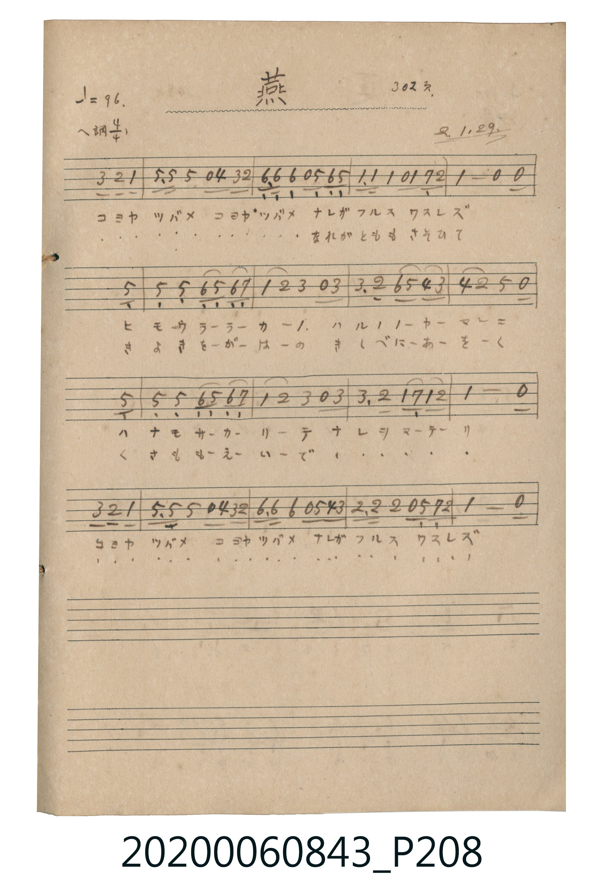

# 燕 (燕子)

> Re:Shōka 使用 AI 協助辨識與重建樂譜，可能會有錯誤。歡迎回報。

- **鋼琴伴奏版**：<br><audio controls src="tsubame.mp3"></audio>

- 詞曲作者：未在 TMD metadata 中提供

## 說明

燕 (燕子)
Source: 唱歌帖 (2020.006.0843), P208.jpg
Marginalia: 302頁. 2.1.29. (昭和2年1月29日)


## 歌詞

```text
1.
コヨヤツバメ コヨヤツバメ ナレガフルス ワスレズ
ヒモウララカノ ハルノヤマニ ハナモサカリテ ナレヲマテリ
コヨヤツバメ コヨヤツバメ ナレガフルス ワスレズ

2.
(こよやつばめ こよやつばめ) なれがともも さそひて
きよきをがはの きしべにあをく くさもえいで (なれをまてり)
(こよやつばめ こよやつばめ なれがふるす わすれず)
```

## ABC

<div class="abc-score" data-abc-src="tsubame.abc" aria-label="五線譜載入中"></div>

[下載 ABC 原始檔](tsubame.abc)

## TMD 檔案連結

- [主旋律 TMD 檔案](tsubame.tmd) [[在 TMD Studio 編輯](https://tmdlang.github.io/Tmd-TS/#tmd=s7IKdvYPcrWy4qpTUCpJTLdSSM7PyUlNLsnMz7MqzsjPTkzOyFeCS5bl55TmploBqXhDA4RwcX5pUXJqfEFieqpVgJGBBboM3KT4vPyS1KT8_GyEioKi_LLUvMQ8oKrcxLzS4uSizIKS-OT8gkqEmtSyzJRUkIrUlMyS_KLMxBwkJ6UWFYMdC3FDSVFiHsQMoCBCVUlGKtDdiXmZuch6gUalZ-ZZlSRmlifmxeenpWUmg83W0lJ43j5VQQNIPF07QVNBS4tL0VbB0ozL3lbBjcvGRN_EjotLX4tLQQFFHYgfDPGwwtMpG5-t7Xm6Y5qChpGBkYGegYGZnoGFibGmjgIohPSyCtJByn0Ti4AuSMzJTLRSMDYwermgUU_BSM9Qz8hST0Hj2Yy1Tyf1GD3ducXw2ZwOI8tn05dqcoF0-VQWZSYXW4GYhnog8nHT5sfNKx43L3nc3PK4ecLj5oVYhZq7Hjevedy05nHz1MfNqx837QQKrQdSYNFdYIOaJz1uXvS4adnj5pUg1LT6cXMfULQfpL65D2zcvMfN3RAhoHFAtVvBqlY9bm6D2dC8CayqDShKPdeBTDIC-1bjcePkx00dj5taHjcuedy44XFTowKmkCZQbNXjpp7HjUC04nFTExABhaY-bpz7uHHT48ZlYKc19oK0gchJYIXrHzeuA4s2Tn_cuPNx4-rHjUCNQLl-oGg_SDvQoEagDqBFy0EuAVsBUrAPaOTjpi5wKiDOhcgOBAZi9-PGmcCAAVoyEyw6S5NLS5-LyzcRmETD8pMTcxxqDGoUqkHmK9gYmmnZgVk1CgYKuhjQGIiNgNgQiGsUTOPBgkAKzAJpMEFSBII1CmYQRUAKzAIpAqsG86AmgNSBjAQZDKJBikC0uQ5IHm4W1GEQlQiI7lC4w3BDqBI0h4BZEDsRCmG2wVwB8h3IRhCN7CoI30jBDGQaEMNCAmESSATZJJAqmrkbLaxwuh7ubkR4g1gw9ahhAIOYIY6cMLA6HOoespMMkkKIIohyIzANT1RoCYaww7lqubh07YDlZWaeApBW5gIA)]
- [鋼琴伴奏 TMD 檔案](tsubame_piano.tmd) [[在 TMD Studio 編輯](https://tmdlang.github.io/Tmd-TS/#tmd=s7IKdvYPcrWy4tLSUnjePlVBA0g8XTtBU-FRwxSFgMzEvHwFx-Tk_NyCxLzM3NS8EgUtLS5FWwVLMy57WwU3LhsTfRM7Li59LS4FBaL0g9QF55cWJadaKTydsvHZ2p6nO6YpaBgZGBnoGRiY6RlYmBhr6igEGBlY6GUVpIOU-yYWpWfmJeZkJlopGBsYvVzQqKdgpGeoZ2Spp6DxbMbap5N6jJ7u3GL4bE6HkeWz6Us1ubT0ubh8EzPzrMLykxNzHGoMahSqQSYp2BiaadmBWTUKBgq6GNAYiI2A2BCIaxRM48GCQArMAmkAYRMkhTUKZhBFQArMgikC6wCLgFk1YCNBBoNomCIQ21wHJA82C-owiEoEhDkURsMdhhsiKYEzEI4BsyD2ImwDuQAWBDDbQGyYqyDiRgpmIFOAGBQKyOpr4CIwk0CqaOZutLDC6Xq4u2EqIfpBPJge3CGOcBZywsDqcKh7KEoySAproK4zAtMoiQopwRBOKly10JwAzopBHmTnBeN4bYTfYBzs3gPKInwI4-DMF2CztGG5A8HDn0eQdeHxPjEpDuEzoCeQ2DjyC5K1QCZQVBue3oEy2riyD5IkMC1qm2jD8pEZ0ABtWNZBMQKUUFDlkG0Ds7XJymOk-RjJA6T4G9XHGLqBDJAAmlGEIhbJD2BjCWdIqqVbJOWQiIH6DMrEmUWJTKmoGdWHlIyKLAYsEmCxCWbAnQV2EUKVCZwPYcFzG6oyogyDFcXoCQ8zN2JzPTJEtxAEEZYhWEjqEIJwIUSYojkM4WkjDE3AAhefjTTwA7rr8PmE9HCBQcycQ9AD6A6jRkKCBy6YgcswwkkIlE107YBNwsw8BSRamQsA)]

## 分析

```text
================================================================================
📊 TMD Song Profile: [ 燕 燕子 ]
================================================================================
⏱  Duration:       0:50 (50.0s), 20 measures total
🎼 Key & Tempo:    首調基準 F, != 96.0 BPM, <4/4>
   - 分析範圍：      由實際發聲的音符與和弦推測調性；播放脈絡另行呈現
🎤 人聲音域:    C4 (MIDI 60) – D5 (MIDI 74) [跨度: 14 個半音 / 1.2 個八度, 難度: moderate]
   - 最低音:  C4 in [Main #1 @ m.2, 0:02]
   - 最高音: D5 in [Main #1 @ m.9, 0:20]
   - 適合: soprano, mezzo-soprano, contralto, tenor, baritone, bass
🏛  結構:      Main (50.0s)
⚡ 編曲密度:        Peak 1 軌道同時演奏
🗝  調性診斷：       F 大調（流行色彩大調，未偵測到可信轉調）
   - 風格氣質:    流行大調（略帶和弦色彩音與裝飾副屬和弦）
   - 轉調歷程:    全曲維持單一推測調性（未偵測到可信轉調）
   - 核心骨幹音:  C, F, G, A, D
   - 調性數值:    F 大調 [相關度: 0.84, 穩定度: Moderate, 自然音純度: 93.3%]
   - 候選調性 (K-S): F 大調 (0.84), C 大調 (0.80), C 小調 (0.64)
   - 五度圈歷程:   -1
   - 各段落調性細節:
     • [Main #1]: F 大調 (r: 0.84, 自然音純度: 93.3%, 調外音: D#)

  [ 五度圈游移軌跡 ]
               C  
        [F ]*          G  
      Bb               D  
      Eb               A  
         Ab           E  
            Db       B  
               F# 
     (* = active key center)

  [ 十二半音累積音高分佈 ]
     C  : ████████████████████████  28.1%
     C# :                            0.0%
     D  : ████████                   8.9%
     D# : ██████                     6.7%
     E  :                            0.0%
     F  : ██████████████████        21.5%
     F# :                            0.0%
     G  : ███████████████           17.0%
     G# :                            0.0%
     A  : ███████████               13.3%
     A# : ████                       4.4%
     B  :                            0.0%
--------------------------------------------------------------------------------
Assignment 軌道音域：
  - Vocal         : C4 – D5 (14 個半音 / 1.2 個八度, 82 個音符)
================================================================================
```


## 原書掃描頁




