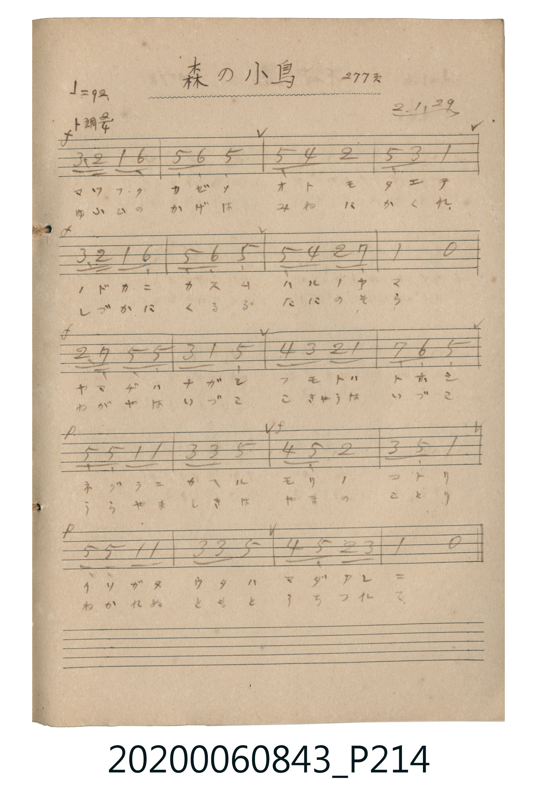

# 森の小鳥 (森林的小鳥)

> Re:Shoka 使用 AI 協助辨識與重建樂譜，可能會有錯誤。歡迎回報。

<audio controls src="mori_no_kotori.mp3"></audio>

- 公學校唱歌帳 (P214, 277頁, 昭和2年1月29日)

## 說明

・出處：公學校唱歌帳 (P214, 277頁, 昭和2年1月29日)
・調性與拍號：調號 ?= G，拍號 <2/4>，速度 != 92

## 歌詞

```text
歌詞：
一、
マツフク カゼノ オトモ タエテ
ノドカニ カスム ハルノ ヤマ
ヤマヂハ ナガシ フモトハ トホシ
ネグラニ カヘル モリノ コトリ
イソガヌ ウタハ マダアレ ニ
二、
ゆふひの かげは みねに かくれ
しづかに くるる たにの そら
わがやは いづこ こきゃうは いづこ
うらやま しきは やまの ことり
わかれぬ ともと うちつれ て
```

## ABC

```abc
X:1
T:森の小鳥 森林的小鳥
M:2/4
L:1/16
Q:1/4=92
K:G
V:V1 name="Vocal" snm="Voc"
[V:V1]
B3 A G2 E2 | D2 E2 D4 | d2 c2 A4 | D2 B2 G4 |
B3 A G2 E2 | D2 E2 D4 | d2 c2 A2 F2 | G4 z4 |
A2 F2 D2 d2 | B2 G2 d4 | c2 B2 A2 G2 | F2 E2 D4 |
D2 D2 G2 G2 | B2 B2 d4 | c2 d2 A4 | B2 D2 G4 |
D2 D2 G2 G2 | B2 B2 d4 | c2 d2 A2 B2 | G4 z4 |
```

## TMD 檔案連結

- [主旋律 TMD 檔案](mori_no_kotori.tmd) [[在 TMD Studio 編輯](https://tmdlang.github.io/Tmd-TS/#tmd=s7IKdvYPcrWy4qpTUCpJTLdSSM7PyUlNLsnMz7MqzsjPTkzOyFeCS5bl55TmploBqXhDA4RwcX5pUXJqfEFieqpVgJGhCboM3KT4vPyS1KT8_GyEioKi_LLUvMQ8oKrcxLzS4uSizIKS-OT8gkqEmtSyzJRUkIrUlMyS_KLMxBwkJ6UWFYMdC3FDSVFiHsQMoCBCVUlGKtDdeYklpUWpSlxaWgrPFq973Lju6Yb-l5uXKmgAec_mTX8-qwUioKmgpcWlaKtgacRlb6vgzmVjpG9iBzLraeuap2t3PFuw8OmUjc_W9jzdsVlBA-RhHQUjc_OXCxp1FJ7NWPt0Uo_R051bDJ_N6TCyfDZ9qaYSF5e-FpeCggJQy4uV897vmQXiPNnR8LihEcR63DzvcXPL4-apj5vWKzxuWv24ac_j5j4ga9Xj5o7HzYuArP2Pm1Y8bm6DqO573NwJUtbcDVG983HzAqBw_-NmoBhQX_MSoIkQpSDW4-YmoCSQ0_W4ac3jpu1A1lSgqWCzQcJAajZQGKKh93HThsfNK2FmN88AGgoUBqoGOgbkps1gDavAqpuWPG7aCzK0uQfIWQZyJthEoJUNj5uAetYAOd1gz-7qgXm2qe1x49bHjZuAwa_wuLH7ceOkx41Abzfuf9y49nEj0DKQWP_jph6w6sbpjxuXgoVAMkDhbiACsuYDBSAmzH3c1AkxuP9xY8_jphaIcUAKqG8ykDX5cSPQV82PG4EWI8lAjG8D6gbr2QexqxesBiwAMR6oe8Xjpi64DUD7ex43Aj0GEm4CkmBDGhc-bgQGBjAYGpdxaelzcfkmZuZZheUnJ-Y41BjUKFSD9CvYGJpp2YFZNQrGCrpAaKRgCCTN4oFEjYIpiAKzwSwQBAoCSROwSrgISBKkHaQVLESBkeYQdTCjDNCMhCsBawdphFgDUg_iQQwEGQYSBakGydRA9KDZCzUSYhKIACmFKAdpBmFUI0E8hLfB8jBtlBkIksHm51ouLl07BVDUKQBpZS4A)]
- [鋼琴伴奏 TMD 檔案](mori_no_kotori_piano.tmd) [[在 TMD Studio 編輯](https://tmdlang.github.io/Tmd-TS/#tmd=s7IKdvYPcrWy4tLSUni2eN3jxnVPN_S_3LxUQQPIezZv-vNZLRABTQVdhZfde55P2PJkz5anS_ufd3YoaGlxKdoqWBpx2dsquHPZGOmb2HHVKSg9bV3zdO2OZwsWPp2y8dnanqc7NitoBBgZmugoGJmbv1zQqKPwbMbap5N6jJ7u3GL4bE6HkeWz6Us1lbi4fBMz86zC8pMTcxxqDGoUqrkUgMDG0EzLDsyqUTAGOkJXwUjBEEiaxQOJGgVTEAVmg1kgCBQEkiZglXARkCRIO0grWIgCI80h6mBGGaAZCVcC1g7SCLEGpB7EgxgIMgwkClINkqmB6EGzF2okxCQQAVIKUQ7SDMKoRoJ4CG-D5WHaKDMQJIPNz7XQeAvITMzLD_LAEXMQfUAfgu00gQSgMZwNZkHsBIcCIvig_oC5FCNkyDYYTEADAlssIhQZwTVCrEMNUIgMPPkgG2uiDteOkuTgDkN2CCwe0AxGDwmQNEIvFYzFHQ4oMeuDErMWiIgFhzyQNNGJh3BBDJAomA8ikTFEA0SFASISqWEIPlUIc4AcYIQASWA-BTNBgigugSMkHomeId8IYJjr2imAgl0BiVbmAgA)]

## 分析

```text
================================================================================
📊 TMD Song Profile: [ 森の小鳥 森林的小鳥 ]
================================================================================
⏱  Duration:       0:26 (26.1s), 20 measures total
🎼 Key & Tempo:    首調基準 G, != 92.0 BPM, <2/4>
   - 分析範圍：      由實際發聲的音符與和弦推測調性；播放脈絡另行呈現
🎤 人聲音域:    D4 (MIDI 62) – D5 (MIDI 74) [跨度: 12 個半音 / 1.0 個八度, 難度: easy]
   - 最低音:  D4 in [Main #1 @ m.2, 0:01]
   - 最高音: D5 in [Main #1 @ m.3, 0:02]
   - 適合: soprano, mezzo-soprano, contralto, tenor, baritone, bass
🏛  結構:      Main (26.1s)
⚡ 編曲密度:        Peak 1 軌道同時演奏
🗝  調性診斷：       G 大調（純淨自然大調，未偵測到可信轉調）
   - 風格氣質:    純淨自然大調（陽光明朗、易唱易記，無明顯調外色彩）
   - 轉調歷程:    全曲維持單一推測調性（未偵測到可信轉調）
   - 核心骨幹音:  D, G, B, A, C
   - 調性數值:    G 大調 [相關度: 0.87, 穩定度: Moderate, 自然音純度: 100.0%]
   - 候選調性 (K-S): G 大調 (0.87), D 大調 (0.83), B 小調 (0.67)
   - 五度圈歷程:   +1
   - 各段落調性細節:
     • [Main #1]: G 大調 (r: 0.87, 自然音純度: 100.0%)

  [ 五度圈游移軌跡 ]
               C  
         F           [G ]*
      Bb               D  
      Eb               A  
         Ab           E  
            Db       B  
               F# 
     (* = active key center)

  [ 十二半音累積音高分佈 ]
     C  : █████                      6.6%
     C# :                            0.0%
     D  : ████████████████████████  34.2%
     D# :                            0.0%
     E  : █████                      6.6%
     F  :                            0.0%
     F# : ███                        3.9%
     G  : ███████████████           21.1%
     G# :                            0.0%
     A  : ████████                  11.8%
     A# :                            0.0%
     B  : ███████████               15.8%
--------------------------------------------------------------------------------
Assignment 軌道音域：
  - Vocal         : D4 – D5 (12 個半音 / 1.0 個八度, 64 個音符)
================================================================================
```


## 原書掃描頁




