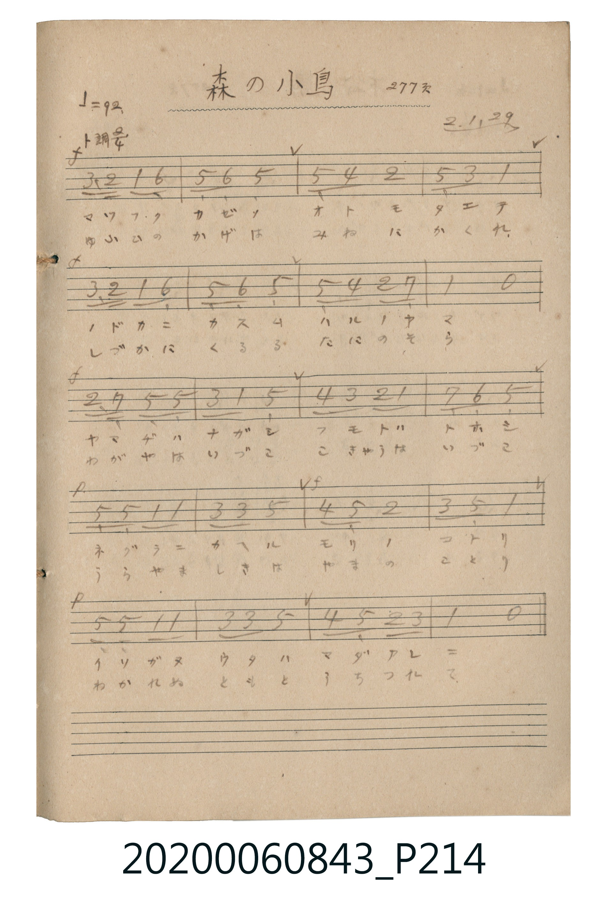

# 森の小鳥 (森林的小鳥)

> Re:Shōka 使用 AI 協助辨識與重建樂譜，可能會有錯誤。歡迎[回報](https://github.com/TMDLang/reshoka/issues)。

- **鋼琴伴奏版**：<br><audio controls src="mori_no_kotori.mp3"></audio>

- 公學校唱歌帳 (P214, 277頁, 昭和2年1月29日)

## 說明


- 出處：公學校唱歌帳 (P214, 277頁, 昭和2年1月29日)
- 調性與拍號：調號 ?= G，拍號 <2/4>，速度 != 92


## 歌詞

```text
歌詞：
一、
マツフク カゼノ オトモ タエテ
ノドカニ カスム ハルノ ヤマ
ヤマヂハ ナガシ フモトハ トホシ
ネグラニ カヘル モリノ コトリ
イソガヌ ウタハ マダアレ ニ
二、
ゆふひの かげは みねに かくれ
しづかに くるる たにの そら
わがやは いづこ こきゃうは いづこ
うらやま しきは やまの ことり
わかれぬ ともと うちつれ て
```

## ABC

<div class="abc-score" data-abc-src="mori_no_kotori.abc" aria-label="五線譜載入中"></div>

[下載 ABC 原始檔](mori_no_kotori.abc)

## TMD 檔案連結

- [主旋律 TMD 檔案](mori_no_kotori.tmd) [[在 TMD Studio 編輯](https://tmdlang.github.io/Tmd-TS/#tmd=s7IKdvYPcrWy4qpTUCpJTLdSSM7PyUlNLsnMz7MqzsjPTkzOyFeCS5bl55TmploBqXhDA4RwcX5pUXJqfEFieqpVgJGhCboM3KT4vPyS1KT8_GyEioKi_LLUvMQ8oKrcxLzS4uSizIKS-OT8gkqEmtSyzJRUkIrUlMyS_KLMxBwkJ6UWFYMdC3FDSVFiHsQMoCBCVUlGKtDdeYklpUWpCFGgUemZeVYliZnliXnx-WlpmckoZucXlWTkpxclFmRUWmVkFoOsTk7Mic9OzEtU4tLSUni2eN3jxnVPN_S_3LxUQQPIezZv-vNZLRABTQUtLS5FWwVLIy57WwV3LhsjfRM7kNFPW9c8Xbvj2YKFT6dsfLa25-mOzQoaoFDTUTAyN3-5oFFH4dmMtU8n9Rg93bnF8NmcDiPLZ9OXaipxcelrcSkoKAC1vFg57_2eWSDOkx0NjxsaQazHzfMeN7c8bp76uGm9wuOm1Y-b9jxu7gOyVj1u7njcvAjI2v-4acXj5jaI6r7HzZ0gZc3dENU7HzcvAAr3P24GigH1NS8BmghRCmI9bm4CSgI5XY-b1jxu2g5kTQWaCjYbJAykZgOFIRp6HzdteNy8EmZ28wygoUBhoGqgY0Bu2gzWsAqsumnJ46a9IEObe4CcZSBngk0EWtnwuAmoZw2Q0w327K4emGeb2h43bn3cuAkY_AqPG7sfN0563Aj0duP-x41rHzcCLQOJ9T9u6gGrbpz-uHEpWAgkAxTuBiIgaz5QAGLC3MdNnRCD-x839jxuaoEYB6SA-iYDWZMfNwJ91fy4EWgxkgzE-DagbrCefRC7esFqwAIQ44G6Vzxu6oLbALS_53Ej0GMg4SYgCTakceHjRmBgAIOhcRmXlj4Xl28iMHUGZCbm5TvUGNRUg7Qr2BiaadmBWTUKxgq6QGikYAgkzeKBRI2CKYgCs8EsEAQKAkkTsEq4CEgSpB2kFSxEgZHmEHUwowzQjIQrAWsHaYRYA1IP4kEMBBkGEgWpBsnUQPSg2Qs1EmISiAAphSgHaQZhVCNBPIS3wfIwbZQZCJLB5udaLi5dOwVQzCkAaWUuAA)]
- [鋼琴伴奏 TMD 檔案](mori_no_kotori_piano.tmd) [[在 TMD Studio 編輯](https://tmdlang.github.io/Tmd-TS/#tmd=s7IKdvYPcrWy4qpTUCpJTLdSyC8qychPL0osyKi0ysgsLskvykxOzInPTsxLVIIrKs4vLUpOjS9ITE-1CjAyNEHIlGSk5qZaJWUWpRQrcWlpKTxbvO5x47qnG_pfbl6qoAHkPZs3_fmsFoiApoKuwsvuPc8nbHmyZ8vTpf3POzsUtLS4FG0VLI247G0V3LlsjPRN7ECGP21d83TtjmcLFj6dsvHZ2p6nOzYraIBs1lEwMjd_uaBRR-HZjLVPJ_UYPd25xfDZnA4jy2fTl2oqcXH5JmbmWQVkJublO9QY1FRzKQCBjaGZlh2YVaNgDHSDroKRgiGQNIsHEjUKpiAKzAazQBAoCCRNwCrhIiBJkHaQVrAQBUaaQ9TBjDJAMxKuBKwdpBFiDUg9iAcxEGQYSBSkGiRTA9GDZi_USIhJIAKkFKIcpBmEUY0E8RDeBsvDtFFmIEgGm59rkaMtyAN7xEG0AT0IttIEEn7GcDaYBbESHAiI0IN6A-ZQjIAh22AwAQ0HbJGIUGQE1wixDjU8ITLw1INsrIk6XDtKioM7DNkhsGhAMxg9JEDSCL1UMBZ3OKBErA9yxFog4hUc8EASGNpgHpCGiIGNhCMklQaIuKNEMw4FMM1AJjDggSQwO4KZQDEUm-EIiUe0s8nRDAxOXTsFUIgqINHKXAA)]

## 分析

```text
================================================================================
📊 TMD Song Profile: [ 森の小鳥 森林的小鳥 ]
================================================================================
⏱  Duration:       0:26 (26.1s), 20 measures total
🎼 Key & Tempo:    首調基準 G, != 92.0 BPM, <2/4>
   - 分析範圍：      由實際發聲的音符與和弦推測調性；播放脈絡另行呈現
🎤 人聲音域:    D4 (MIDI 62) – D5 (MIDI 74) [跨度: 12 個半音 / 1.0 個八度, 難度: easy]
   - 最低音:  D4 in [Main #1 @ m.2, 0:01]
   - 最高音: D5 in [Main #1 @ m.3, 0:02]
   - 適合: soprano, mezzo-soprano, contralto, tenor, baritone, bass
🏛  結構:      Main (26.1s)
⚡ 編曲密度:        Peak 1 軌道同時演奏
🗝  調性診斷：       G 大調（純淨自然大調，未偵測到可信轉調）
   - 風格氣質:    純淨自然大調（陽光明朗、易唱易記，無明顯調外色彩）
   - 轉調歷程:    全曲維持單一推測調性（未偵測到可信轉調）
   - 核心骨幹音:  D, G, B, A, C
   - 調性數值:    G 大調 [相關度: 0.87, 穩定度: Moderate, 自然音純度: 100.0%]
   - 候選調性 (K-S): G 大調 (0.87), D 大調 (0.83), B 小調 (0.67)
   - 五度圈歷程:   +1
   - 各段落調性細節:
     • [Main #1]: G 大調 (r: 0.87, 自然音純度: 100.0%)

  [ 五度圈游移軌跡 ]
               C  
         F           [G ]*
      Bb               D  
      Eb               A  
         Ab           E  
            Db       B  
               F# 
     (* = active key center)

  [ 十二半音累積音高分佈 ]
     C  : █████                      6.6%
     C# :                            0.0%
     D  : ████████████████████████  34.2%
     D# :                            0.0%
     E  : █████                      6.6%
     F  :                            0.0%
     F# : ███                        3.9%
     G  : ███████████████           21.1%
     G# :                            0.0%
     A  : ████████                  11.8%
     A# :                            0.0%
     B  : ███████████               15.8%
--------------------------------------------------------------------------------
Assignment 軌道音域：
  - Piano         : D4 – D5 (12 個半音 / 1.0 個八度, 64 個音符)
================================================================================
```


## 原書掃描頁




