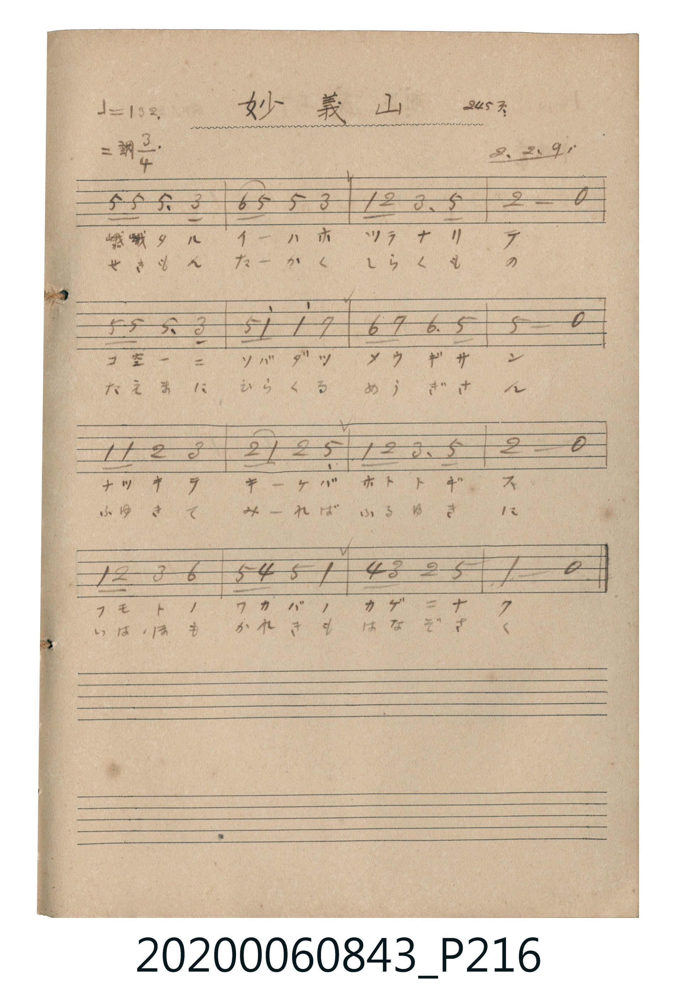

# 妙義山 (妙義山)

> Re:Shōka 使用 AI 協助辨識與重建樂譜，可能會有錯誤。歡迎回報。

- **鋼琴伴奏版**：<br><audio controls src="myogisan.mp3"></audio>

- 公學校唱歌帳 (P216, 245頁, 昭和2年2月9日)

## 說明


- 出處：公學校唱歌帳 (P216, 245頁, 昭和2年2月9日)
- 調性與拍號：調號 ?= D，拍號 <3/4>，速度 != 132


## 歌詞

```text
歌詞：
一、
峨々タル イーハホ ツラナリ テ
コ空ーニ ソバダツ メウギサン
ナツキテ キーケバ ホトトギス
フモトノ ワカバノ カゲニナク
二、
せきもん たーかく しらくもの
たえまに ひらくる めうぎさん
ふゆきて みーれば ふるゆきに
いはほも かれきも はなぞさく
```

## ABC

<div class="abc-score" data-abc-src="myogisan.abc" aria-label="五線譜載入中"></div>

[下載 ABC 原始檔](myogisan.abc)

## TMD 檔案連結

- [主旋律 TMD 檔案](myogisan.tmd) [[在 TMD Studio 編輯](https://tmdlang.github.io/Tmd-TS/#tmd=s7IKdvYPcrWy4qpTUCpJTLdSSM7PyUlNLsnMz7MqzsjPTkzOyFeCS5bl55TmploBqXhDA4RwcX5pUXJqfEFieqpVgJGhGboM3KT4vPyS1KT8_GyEioKi_LLUvMQ8oKrcxLzS4uSizIKS-OT8gkqEmtSyzJRUkIrUlMyS_KLMxBwkJ6UWFYMdC3FDSVFiHsQMoCBCFVBTemaeVW5-XlIp0DGYEqmZWZnxJakVJRDXaWkpPF028_m-lU83blTQgDM1FbS0uBRtFQyNjbjsbRVcuGyM9U3sQIY9bV3zdO2OZwsWPp2y8dnanqc7NitogIJCR8HIxPTlgkYdhWcz1j6d1GP0dOcWo2dzOiyfTV-qqcTFpa_FpaCgANTxYuW893tmgThPdjQ8bmgEsZ5uXvG4ofVx0_7HzasVHjctedy853Fz_-Pm2QqPm1seN6983Nz1uHkVkNMGUv24afPzlbvAarqBnL2Pmyc8bm4AqgQqWPi4adnjpnWPm7Y-bt4MVgzS2vK4aS1QM1AxkNrzuGkjUAtQZvbj5g4QAqnfCVE89XHzIrBoH5Cz_nHTarDhQA6Q1bQJaCHIvKb1YOfv6oE6_3Hj7MeNvY-bmh43TQZy5oPsaOx-3NgP5Ex_3NQJZIEkG9dBFM9_3NjxuHHf40agXxs3weRBXml83Nj2uLHvceNUoEkQxVsfNwGFeh83LgNygOEDdH3P48YNEJlumORqiOKWx43rHzfuBloG5AAlgSpBzgJygMKrHjfOA5nc2M-lpc_F5ZsITA5h-cmJOQ41BjXVIAMUbAzNtOzArBoFUwVdMESljYEyZlAeTMYYStcoGEJZRigypkAZmAgMGsD0ELQNxDKMgxEgaA63D-QSZBEIH2QfzBxc9sFciuxikGshLgWJwlxsGg-3jnzvwQyEBRXM4RCHmoBNQXVQDVgUpB7uEAx3YNpWy8Wla6cAiloFIK3MBQA)]
- [鋼琴伴奏 TMD 檔案](myogisan_piano.tmd) [[在 TMD Studio 編輯](https://tmdlang.github.io/Tmd-TS/#tmd=s7IKdvYPcrWy4tLSUni6bObzfSufbtyooAFnairoKrzs3vN8wpYne7Y8Xdr_vLNDQUuLS9FWwdDYiMveVsGFy8ZY38SOq05B6WnrmqdrdzxbsPDplI3P1vY83bFZQSPAyNBMR8HIxPTlgkYdhWcz1j6d1GP0dOcWo2dzOiyfTV-qqcTF5ZuYmWcVlp-cmONQY1BTzaUABDaGZlp2YFaNginQDSCIShsDZcygPJiMMZSuUTCEsoxQZEyBMjARGDSA6SFoG4hlGAcjQNAcbh_IJcgiED7IPpg5uOyDuRTZxSDXQlwKEoW52DQebh353oMZCAsqmMMhDjUBm4LqoBqwKEg93CEY7sC0rRYarwGZiXn5QR7YYxbd7xDaECoDw6iOgYcCnIHQBRciNrBRLQT5ERYuML9ihjWEbx4PlAIS-O3DdCyYATICKokgwHYgopgifyJMxQxAEAvscJgQUroyw3QS3I94rUWJbh_k6DZBxHY8yAQgAqaoeBAPiCCiOlA2iAEMAhAFjzGEJiDTGMoEKoIgXHpgpoOEYZgYu4AI6DYUI0xwGQHytK6dAsjfCki0MhcA)]

## 分析

```text
================================================================================
📊 TMD Song Profile: [ 妙義山 妙義山 ]
================================================================================
⏱  Duration:       0:21 (21.8s), 16 measures total
🎼 Key & Tempo:    首調基準 D, != 132.0 BPM, <3/4>
   - 分析範圍：      由實際發聲的音符與和弦推測調性；播放脈絡另行呈現
🎤 人聲音域:    A3 (MIDI 57) – D5 (MIDI 74) [跨度: 17 個半音 / 1.4 個八度, 難度: challenging]
   - 最低音:  A3 in [Main #1 @ m.10, 0:13]
   - 最高音: D5 in [Main #1 @ m.6, 0:07]
   - 適合: soprano, mezzo-soprano, contralto, tenor, baritone, bass
🏛  結構:      Main (21.8s)
⚡ 編曲密度:        Peak 1 軌道同時演奏
🗝  調性診斷：       A 大調（純淨自然大調，未偵測到可信轉調）
   - 風格氣質:    純淨自然大調（陽光明朗、易唱易記，無明顯調外色彩）
   - 轉調歷程:    全曲維持單一推測調性（未偵測到可信轉調）
   - 核心骨幹音:  A, D, E, F#, B
   - 調性數值:    A 大調 [相關度: 0.91, 穩定度: Moderate, 自然音純度: 97.7%]
   - 候選調性 (K-S): A 大調 (0.91), D 大調 (0.80), A 小調 (0.57)
   - 五度圈歷程:   +3
   - 各段落調性細節:
     • [Main #1]: A 大調 (r: 0.91, 自然音純度: 97.7%, 調外音: G)

  [ 五度圈游移軌跡 ]
               C  
         F            G  
      Bb               D  
      Eb              [A ]*
         Ab           E  
            Db       B  
               F# 
     (* = active key center)

  [ 十二半音累積音高分佈 ]
     C  :                            0.0%
     C# : ███                        4.5%
     D  : █████████████████         21.6%
     D# :                            0.0%
     E  : █████████████████         21.6%
     F  :                            0.0%
     F# : █████████                 11.4%
     G  : ██                         2.3%
     G# :                            0.0%
     A  : ████████████████████████  31.2%
     A# :                            0.0%
     B  : ██████                     7.4%
--------------------------------------------------------------------------------
Assignment 軌道音域：
  - Vocal         : A3 – D5 (17 個半音 / 1.4 個八度, 52 個音符)
================================================================================
```


## 原書掃描頁




