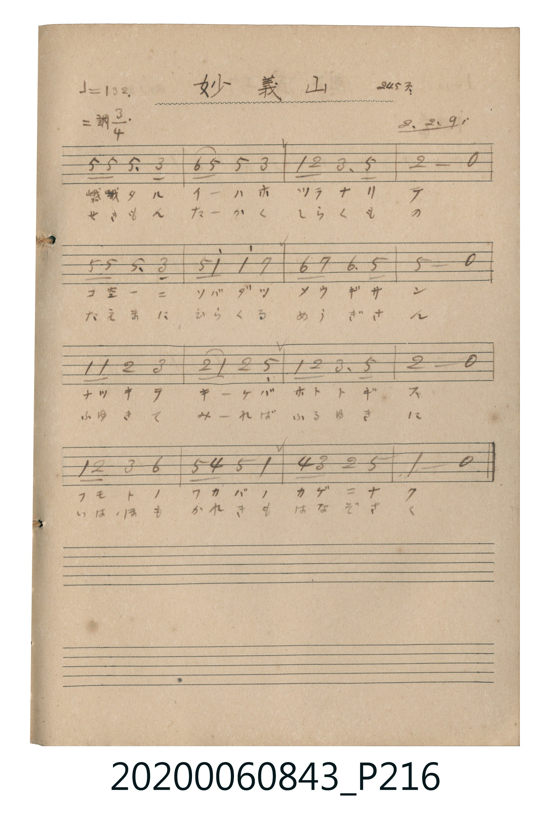

# 妙義山 (妙義山)

> Re:Shoka 使用 AI 協助辨識與重建樂譜，可能會有錯誤。歡迎回報。

<audio controls src="myogisan.mp3"></audio>

- 公學校唱歌帳 (P216, 245頁, 昭和2年2月9日)

## 說明

・出處：公學校唱歌帳 (P216, 245頁, 昭和2年2月9日)
・調性與拍號：調號 ?= D，拍號 <3/4>，速度 != 132

## 跨冊／重複收錄參照

> 同曲（〈妙義山〉；收錄於《新定兒童唱歌》五年級與《唱歌帖》P216《小公學校唱歌教材集》抄譜）

- **[同曲]** 《新定兒童唱歌》尋常科第五學年用（2020.006.0847.0005）：[**〈妙義山〉**](../../../shintei_jido_shoka/grade_5_2020.006.0847.0005/4_04_myogisan/index.md)（`C` / `3/4` — [原始 TMD](../../../shintei_jido_shoka/grade_5_2020.006.0847.0005/4_04_myogisan/myogisan.tmd)）
- 總表：[跨冊重複與同名歌曲總索引](../../../duplicate_songs.md)

## 歌詞

```text
歌詞：
一、
峨々タル イーハホ ツラナリ テ
コ空ーニ ソバダツ メウギサン
ナツキテ キーケバ ホトトギス
フモトノ ワカバノ カゲニナク
二、
せきもん たーかく しらくもの
たえまに ひらくる めうぎさん
ふゆきて みーれば ふるゆきに
いはほも かれきも はなぞさく
```

## ABC

```abc
X:1
T:妙義山 妙義山
M:3/4
L:1/16
Q:1/4=132
K:D
V:V1 name="Vocal" snm="Voc"
[V:V1]
A4 A4 A3 F | B2 A2 A4 F4 | D4 E4 F3 A | E8 z4 |
A4 A4 A3 F | A2 d2 d4 c4 | B4 c4 B3 A | A8 z4 |
D4 D4 E2 F2 | E2 D2 E4 A,4 | D4 E4 F3 A | E8 z4 |
D2 E2 F4 B4 | A2 G2 A4 D4 | G2 F2 E4 A4 | D8 z4 |
A4 A4 A3 F | B2 A2 A4 F4 | D4 E4 F3 A | E8 z4 |
A4 A4 A3 F | A2 d2 d4 c4 | B4 c4 B3 A | A8 z4 |
D4 D4 E2 F2 | E2 D2 E4 A,4 | D4 E4 F3 A | E8 z4 |
D2 E2 F4 B4 | A2 G2 A4 D4 | G2 F2 E4 A4 | D8 z4 |
```

## TMD 檔案連結

- [主旋律 TMD 檔案](myogisan.tmd) [[在 TMD Studio 編輯](https://tmdlang.github.io/Tmd-TS/#tmd=s7IKdvYPcrWy4qpTUCpJTLdSSM7PyUlNLsnMz7MqzsjPTkzOyFeCS5bl55TmploBqXhDA4RwcX5pUXJqfEFieqpVgJGhGboM3KT4vPyS1KT8_GyEioKi_LLUvMQ8oKrcxLzS4uSizIKS-OT8gkqEmtSyzJRUkIrUlMyS_KLMxBwkJ6UWFYMdC3FDSVFiHsQMoKASl5aWwtNlM5_vW_l040YFDThTU0FLi0vRVsHQ2IjL3lbBhcvGWN_EDmTm09Y1T9fueLZg4dMpG5-t7Xm6Y7OCBshLOgpGJqYvFzTqKDybsfbppB6jpzu3GD2b02H5bPpSTSUuLn0tLgUFBaCOFyvnvd8zC8R5sqPhcUMjiPV084rHDa2Pm_Y_bl6t8LhpyePmPY-b-x83z1Z43NzyuHnl4-aux82rgJw2kOrHTZufr9wFVtMN5Ox93DzhcXMDUCVQwcLHTcseN6173LT1cfNmsGKQ1pbHTWuBmoGKgdSex00bgVqAMrMfN3eAEEj9TojiqY-bF4FF-4Cc9Y-bVoMNB3KArKZNQAtB5jWtBzt_Vw_U-Y8bZz9u7H3c1PS4aTKQMx9kR2P348Z-IGf646ZOIAsk2bgOonj-48aOx437HjcC_dq4CSYP8krj48a2x419jxunAk2CKN76uAko1Pu4cRmQAwwfoOt7HjdugMh0wyRXQxS3PG5c_7hxN9AyIAcoCVQJchaQAxRe9bhxHsjkxn4uLX0uLt_EzDyrsPzkxByHGoMahWqQCQo2hmZadmBWjYKpgi4YotLGQBkzKA8mYwylaxQMoSwjFBlToAxMBAYNYHoI2gZiGcbBCBA0h9sHcgmyCIQPsg9mDi77YC5FdjHItRCXgkRhLjaNh1tHvvdgBsKCCuZwiENNwKagOqgGLApSD3cIhjswbavl4tK1UwDFrQISrcwFAA)]
- [鋼琴伴奏 TMD 檔案](myogisan_piano.tmd) [[在 TMD Studio 編輯](https://tmdlang.github.io/Tmd-TS/#tmd=s7IKdvYPcrWy4tLSUni6bObzfSufbtyooAFnairoKrzs3vN8wpYne7Y8Xdr_vLNDQUuLS9FWwdDYiMveVsGFy8ZY38SOq05B6WnrmqdrdzxbsPDplI3P1vY83bFZQSPAyNBMR8HIxPTlgkYdhWcz1j6d1GP0dOcWo2dzOiyfTV-qqcTF5ZuYmWcVlp-cmONQY1CjUM2lAAQ2hmZadmBWjYIp0BEgiEobA2XMoDyYjDGUrlEwhLKMUGRMgTIwERg0gOkhaBuIZRgHI0DQHG4fyCXIIhA-yD6YObjsg7kU2cUg10JcChKFudg0Hm4d-d6DGQgLKpjDIQ41AZuC6qAasChIPdwhGO7AtK0WGrEBmYl5-UEeOKIW3fMQ2hAqA8OoroEHA5yB0AUXIja0US0EeRIWMDDPYgY2hG8eD5QCEvjtw3QsmAEyAiqJIMB2IOKYIn8iTMUMQBAL7HCYEFLCMsN0EtyPeK1FiW8flPg2QUR3PMgIIAKmqXgQD4ggojpQNogBDAMQBY8yhCYg0xjKBCqCIFx6YKaDhGGYGLuACOg2FCNMcBkB8rWunQLI4wpItDIXAA)]

## 分析

```text
================================================================================
📊 TMD Song Profile: [ 妙義山 妙義山 ]
================================================================================
⏱  Duration:       0:43 (43.6s), 32 measures total
🎼 Key & Tempo:    首調基準 D, != 132.0 BPM, <3/4>
   - 分析範圍：      由實際發聲的音符與和弦推測調性；播放脈絡另行呈現
🎤 人聲音域:    A3 (MIDI 57) – D5 (MIDI 74) [跨度: 17 個半音 / 1.4 個八度, 難度: challenging]
   - 最低音:  A3 in [Main #1 @ m.10, 0:13]
   - 最高音: D5 in [Main #1 @ m.6, 0:07]
   - 適合: soprano, mezzo-soprano, contralto, tenor, baritone, bass
🏛  結構:      Main (21.8s) -> Main (21.8s)
⚡ 編曲密度:        Peak 1 軌道同時演奏
🗝  調性診斷：       A 大調（純淨自然大調，未偵測到可信轉調）
   - 風格氣質:    純淨自然大調（陽光明朗、易唱易記，無明顯調外色彩）
   - 轉調歷程:    全曲維持單一推測調性（未偵測到可信轉調）
   - 核心骨幹音:  A, D, E, F#, B
   - 調性數值:    A 大調 [相關度: 0.91, 穩定度: Moderate, 自然音純度: 97.7%]
   - 候選調性 (K-S): A 大調 (0.91), D 大調 (0.80), A 小調 (0.57)
   - 五度圈歷程:   +3 -> +3
   - 各段落調性細節:
     • [Main #1]: A 大調 (r: 0.91, 自然音純度: 97.7%, 調外音: G)
     • [Main #2]: A 大調 (r: 0.91, 自然音純度: 97.7%, 調外音: G)

  [ 五度圈游移軌跡 ]
               C  
         F            G  
      Bb               D  
      Eb              [A ]*
         Ab           E  
            Db       B  
               F# 
     (* = active key center)

  [ 十二半音累積音高分佈 ]
     C  :                            0.0%
     C# : ███                        4.5%
     D  : █████████████████         21.6%
     D# :                            0.0%
     E  : █████████████████         21.6%
     F  :                            0.0%
     F# : █████████                 11.4%
     G  : ██                         2.3%
     G# :                            0.0%
     A  : ████████████████████████  31.2%
     A# :                            0.0%
     B  : ██████                     7.4%
--------------------------------------------------------------------------------
Assignment 軌道音域：
  - Vocal         : A3 – D5 (17 個半音 / 1.4 個八度, 104 個音符)
================================================================================
```


## 原書掃描頁




