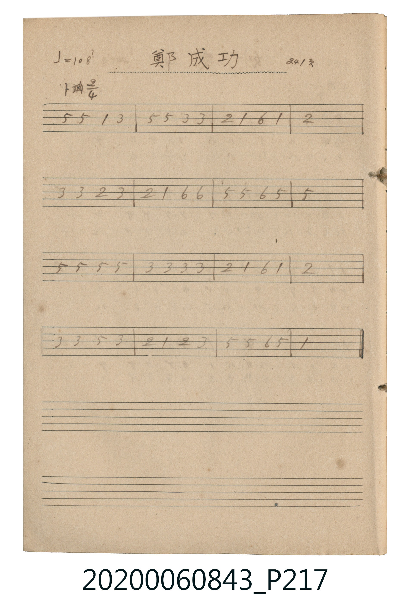

# 鄭成功 (鄭成功 - 未完成草稿)

> Re:Shōka 使用 AI 協助辨識與重建樂譜，可能會有錯誤。歡迎[回報](https://github.com/TMDLang/reshoka/issues)。

- **鋼琴伴奏版**：<br><audio controls src="teiseiko.mp3"></audio>

- 公學校唱歌帳 (P217, 241頁)

## 說明


- 出處：公學校唱歌帳 (P217, 241頁)
- 調性與拍號：調號 ?= G，拍號 <2/4>，速度 != 108


## 歌詞

```text
原稿僅記音高數字，未記節奏底線與歌詞，依 2/4 拍每小節四個八分音符（句尾延長）轉錄
```

## ABC

<div class="abc-score" data-abc-src="teiseiko.abc" aria-label="五線譜載入中"></div>

[下載 ABC 原始檔](teiseiko.abc)

## TMD 檔案連結

- [主旋律 TMD 檔案](teiseiko.tmd) [[在 TMD Studio 編輯](https://tmdlang.github.io/Tmd-TS/#tmd=s7IKdvYPcrWy4qpTUCpJTLdSSM7PyUlNLsnMz7MqzsjPTkzOyFeCS5bl55TmploBqXhDA4RwcX5pUXJqfEFieqpVgJGhOboM3KT4vPyS1KT8_GyEioKi_LLUvMQ8oKrcxLzS4uSizIKS-OT8gkqEmtSyzJRUkIrUlMyS_KLMxBwkJ6UWFYMdC3FDSVFiHsQMoCBCFVBTemaeVUliZnliXnx-WlpmMoop-UUlGfnpRYkFGZVWGZnFIEuSE3PisxPzEhGKSjJSgZ5PTSlNToSYrqWl8LJl7bOOCU-75itoIJi6Cs_mrHq6rgfIfdHb-XzFfk0FLS0uRVsFQwMLLntbBXcuGyN9EzuQwU9b1zxdu-PZgoVPp2x8trbn6Y7NChqgINRRMDIxfLmgUVOJi0tfi0tBQeFp33ygSU-bW1-smPFy_uaXq2c8m7rj6drp7_f0AG0DCj5f3_B0af_TXVOfb5_1oqMdaNqLlfOAsk_2zVUAWqfwrLv32fr-pxv6QQpnz37a0P20dfXTjjagYc_XLHu_p-Np_9KnG_Y93b3t5dTt7_d0vtjb-bKnhUtLn4vLNxEYeAGZiXn5DjUGNdUg5yjYWGjZgRk1CqbxIGSoYAxiA6ExmGUEFDEDCYOYumBYA9UAUmCErAiIYMYAmUASzEPVBJGGIIgRRNkDcg5EEcRGVFsM4Tpqubh07RRAPlUA0spcAA)]
- [鋼琴伴奏 TMD 檔案](teiseiko_piano.tmd) [[在 TMD Studio 編輯](https://tmdlang.github.io/Tmd-TS/#tmd=s7IKdvYPcrWy4qpTUCpJTLdSyC8qychPL0osyKi0ysgsLskvykxOzInPTsxLVIIrKs4vLUpOjS9ITE-1CjAyNEfIlGSk5qZapaaUJieWZObnKXFpaSm8bFn7rGPC0675ChoIpq7Cszmrnq7rAXJf9HY-X7FfEyj0snvP8wlbnuzZ8nRp__PODgUtLS5FWwVDAwsue1sFdy4bI30TO5BVT1vXPF2749mChU-nbHy2tufpjs0KGiB36CgYmRi-XNCoqcTF5ZuYmWcVkJmYl-9QY1BTzaUABDYWWnZgRo2CaTwIGSoYg9hAaAxmGQFFzEDCIKYuGNZANYAUGCErAiKYMUAmkATzUDVBpCEIYgRR9oCcA1EEsRHVFkO4jlpkbwZ5YPWocTwIgf0K0gqBMCNNwAiLw0GKzCF6INbCVEKMAzKBJNCJ6PqAAnBEonXICqHOhVsGNg3IxOpxH2SPm8A9bgg0A-wIKI1kOSgY0VTBZGF8VFWwGCTOLJDrkWRBHAOIo3XtFEDuVgDSylwA)]

## 分析

```text
================================================================================
📊 TMD Song Profile: [ 鄭成功 鄭成功 未完成草稿 ]
================================================================================
⏱  Duration:       0:17 (17.8s), 16 measures total
🎼 Key & Tempo:    首調基準 G, != 108.0 BPM, <2/4>
   - 分析範圍：      由實際發聲的音符與和弦推測調性；播放脈絡另行呈現
🎤 人聲音域:    D4 (MIDI 62) – D5 (MIDI 74) [跨度: 12 個半音 / 1.0 個八度, 難度: easy]
   - 最低音:  D4 in [Main #1 @ m.1, 0:00]
   - 最高音: D5 in [Main #1 @ m.2, 0:01]
   - 適合: soprano, mezzo-soprano, contralto, tenor, baritone, bass
🏛  結構:      Main (17.8s)
⚡ 編曲密度:        Peak 1 軌道同時演奏
🗝  調性診斷：       D 大調（純淨自然大調，未偵測到可信轉調）
   - 風格氣質:    純淨自然大調（陽光明朗、易唱易記，無明顯調外色彩）
   - 轉調歷程:    全曲維持單一推測調性（未偵測到可信轉調）
   - 核心骨幹音:  D, A, B, G, E
   - 調性數值:    D 大調 [相關度: 0.84, 穩定度: Moderate, 自然音純度: 100.0%]
   - 候選調性 (K-S): D 大調 (0.84), G 大調 (0.74), B 小調 (0.68)
   - 五度圈歷程:   +2
   - 各段落調性細節:
     • [Main #1]: D 大調 (r: 0.84, 自然音純度: 100.0%)

  [ 五度圈游移軌跡 ]
               C  
         F            G  
      Bb              [D ]*
      Eb               A  
         Ab           E  
            Db       B  
               F# 
     (* = active key center)

  [ 十二半音累積音高分佈 ]
     C  :                            0.0%
     C# :                            0.0%
     D  : ████████████████████████  29.7%
     D# :                            0.0%
     E  : ████████                   9.4%
     F  :                            0.0%
     F# :                            0.0%
     G  : ██████████████            17.2%
     G# :                            0.0%
     A  : ██████████████████        21.9%
     A# :                            0.0%
     B  : ██████████████████        21.9%
--------------------------------------------------------------------------------
Assignment 軌道音域：
  - Piano         : D4 – D5 (12 個半音 / 1.0 個八度, 52 個音符)
================================================================================
```


## 原書掃描頁




