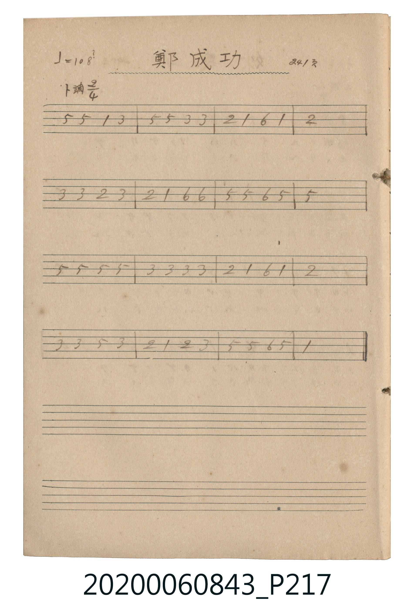

# 鄭成功 (鄭成功 - 未完成草稿)

> Re:Shoka 使用 AI 協助辨識與重建樂譜，可能會有錯誤。歡迎回報。

<audio controls src="teiseiko.mp3"></audio>

- 公學校唱歌帳 (P217, 241頁)

## 說明

・出處：公學校唱歌帳 (P217, 241頁)
・調性與拍號：調號 ?= G，拍號 <2/4>，速度 != 108

## 跨冊／重複收錄參照

> 同曲（〈鄭成功〉；收錄於《新定兒童唱歌》五年級與《唱歌帖》P217《小公學校唱歌教材集》未完簡譜草稿）

- **[同曲]** 《新定兒童唱歌》尋常科第五學年用（2020.006.0847.0005）：[**〈鄭成功〉**](../../../shintei_jido_shoka/grade_5_2020.006.0847.0005/4_06_teiseiko/index.md)（`G` / `2/4` — [原始 TMD](../../../shintei_jido_shoka/grade_5_2020.006.0847.0005/4_06_teiseiko/teiseiko.tmd)）
- 總表：[跨冊重複與同名歌曲總索引](../../../duplicate_songs.md)

## 歌詞

```text
原稿僅記音高數字，未記節奏底線與歌詞，依 2/4 拍每小節四個八分音符（句尾延長）轉錄
```

## ABC

```abc
X:1
T:鄭成功 鄭成功 未完成草稿
M:2/4
L:1/16
Q:1/4=108
K:G
V:V1 name="Vocal" snm="Voc"
[V:V1]
D2 D2 G2 B2 | d2 d2 B2 B2 | A2 G2 E2 G2 | A8 |
B2 B2 A2 B2 | A2 G2 E2 E2 | D2 D2 E2 D2 | D8 |
D2 D2 D2 D2 | B2 B2 B2 B2 | A2 G2 E2 G2 | A8 |
B2 B2 d2 B2 | A2 G2 A2 B2 | D2 D2 E2 D2 | G8 |
```

## TMD 檔案連結

- [主旋律 TMD 檔案](teiseiko.tmd) [[在 TMD Studio 編輯](https://tmdlang.github.io/Tmd-TS/#tmd=s7IKdvYPcrWy4qpTUCpJTLdSSM7PyUlNLsnMz7MqzsjPTkzOyFeCS5bl55TmploBqXhDA4RwcX5pUXJqfEFieqpVgJGhOboM3KT4vPyS1KT8_GyEioKi_LLUvMQ8oKrcxLzS4uSizIKS-OT8gkqEmtSyzJRUkIrUlMyS_KLMxBwkJ6UWFYMdC3FDSVFiHsQMoKASl5aWwsuWtc86Jjztmq-ggWDqKjybs-rpuh4g90Vv5_MV-zUVtLS4FG0VDA0suOxtFdy5bIz0TexAtjxtXfN07Y5nCxY-nbLx2dqepzs2K2iAPKmjYGRi-HJBo6YSF5e-FpeCgsLTvvlAk542t75YMePl_M0vV894NnXH07XT3-_pAdoGFHy-vuHp0v6nu6Y-3z7rRUc70LQXK-cBZZ_sm6sAtE7hWXfvs_X9Tzf0gxTOnv20oftp6-qnHW1Aw56vWfZ-T8fT_qVPN-x7unvby6nb3-_pfLG382VPC5eWPheXb2JmnlVYfnJijkONQY1CNcg9CjYWWnZgRo2CaTwIGSoYg9hAaAxmGQFFzEDCIKYuGNZANYAUGCErAiKYMUAmkATzUDVBpCEIYgRR9oCcA1EEsRHVFkO4jlouLl07BZBXFYC0MhcA)]
- [鋼琴伴奏 TMD 檔案](teiseiko_piano.tmd) [[在 TMD Studio 編輯](https://tmdlang.github.io/Tmd-TS/#tmd=s7IKdvYPcrWy4tLSUnjZsvZZx4SnXfMVNBBMXYVnc1Y9XdcD5L7o7Xy-Yr8mUOhl957nE7Y82bPl6dL-550dClpaXIq2CoYGFlz2tgruXDZG-iZ2XHUKSk9b1zxdu-PZgoVPp2x8trbn6Y7NChoBRobmOgpGJoYvFzRqKnFx-SZm5lmF5Scn5jjUGNQoVHMpAIGNhZYdmFGjYBoPQoYKxiA2EBqDWUZAETOQMIipC4Y1UA0gBUbIioAIZgyQCSTBPFRNEGkIghhBlD0g50AUQWxEtcUQrqMW6s-AzMS8_CAP7D41jgchsGdBeiEQZqYJGGFxOUiROUQPxF6YSohxQCaQBLoRXR9QAI5ItA5ZIdS5cMvApgGZWH3ug-JzE7jPDYGGgF0BpU10gGYBMdASIAnCcOsxVMBE0FXC-SSYChJDNQzENYB4Q9dOAeQTBSCtzAUA)]

## 分析

```text
================================================================================
📊 TMD Song Profile: [ 鄭成功 鄭成功 未完成草稿 ]
================================================================================
⏱  Duration:       0:17 (17.8s), 16 measures total
🎼 Key & Tempo:    首調基準 G, != 108.0 BPM, <2/4>
   - 分析範圍：      由實際發聲的音符與和弦推測調性；播放脈絡另行呈現
🎤 人聲音域:    D4 (MIDI 62) – D5 (MIDI 74) [跨度: 12 個半音 / 1.0 個八度, 難度: easy]
   - 最低音:  D4 in [Main #1 @ m.1, 0:00]
   - 最高音: D5 in [Main #1 @ m.2, 0:01]
   - 適合: soprano, mezzo-soprano, contralto, tenor, baritone, bass
🏛  結構:      Main (17.8s)
⚡ 編曲密度:        Peak 1 軌道同時演奏
🗝  調性診斷：       D 大調（純淨自然大調，未偵測到可信轉調）
   - 風格氣質:    純淨自然大調（陽光明朗、易唱易記，無明顯調外色彩）
   - 轉調歷程:    全曲維持單一推測調性（未偵測到可信轉調）
   - 核心骨幹音:  D, A, B, G, E
   - 調性數值:    D 大調 [相關度: 0.84, 穩定度: Moderate, 自然音純度: 100.0%]
   - 候選調性 (K-S): D 大調 (0.84), G 大調 (0.74), B 小調 (0.68)
   - 五度圈歷程:   +2
   - 各段落調性細節:
     • [Main #1]: D 大調 (r: 0.84, 自然音純度: 100.0%)

  [ 五度圈游移軌跡 ]
               C  
         F            G  
      Bb              [D ]*
      Eb               A  
         Ab           E  
            Db       B  
               F# 
     (* = active key center)

  [ 十二半音累積音高分佈 ]
     C  :                            0.0%
     C# :                            0.0%
     D  : ████████████████████████  29.7%
     D# :                            0.0%
     E  : ████████                   9.4%
     F  :                            0.0%
     F# :                            0.0%
     G  : ██████████████            17.2%
     G# :                            0.0%
     A  : ██████████████████        21.9%
     A# :                            0.0%
     B  : ██████████████████        21.9%
--------------------------------------------------------------------------------
Assignment 軌道音域：
  - Vocal         : D4 – D5 (12 個半音 / 1.0 個八度, 52 個音符)
================================================================================
```


## 原書掃描頁




