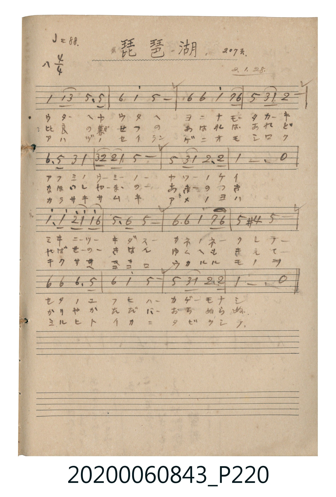

# 琵琶湖

> Re:Shōka 使用 AI 協助辨識與重建樂譜，可能會有錯誤。歡迎回報。

- **鋼琴伴奏版**：<br><audio controls src="biwako.mp3"></audio>

- 日治時期公學校《唱歌帳》第十冊（P220・207頁・昭和2年1月28日抄）
- 原載：一條慎三郎 編《新編 小學校・公學校 唱歌教材集》第 207 頁

## 說明

> [!NOTE]
> **原頁資訊與歌詞全文（對應 P220.jpg）**
> - **出處標註**：標題旁記「207頁 2.1.28.」，即昭和 2 年（1927 年）1 月 28 日抄自《新編 小學校・公學校 唱歌教材集》（1923 年發行）第 207 頁之〈琵琶湖〉（源自納所辨次郎、田村虎藏編《教科統合 唱歌教科書 巻三》，大和田建樹作詞，詠嘆近江八景）。
> - **調性與拍號**：ハ調 4/4 拍（`?= C`, `<4/4>`），速度 `!= 88`。第 12 小節第二拍明確記有 `#4`（`4'`）。
>
> **一、**
> ウターヘヤ　ウタヘ　ヨニナモー　タカーキ
> アフミノ　ウーミーノー　ヤツーノケイ
> 三井ニーツーキダスー　カネノネー　クレテー
> セタノユフヒハー　カゲーモナシ
>
> **二、**
> 比良の暮雪の　あはれはあれど
> なほいしやまの　あきのつき
> やばせのきはん　ゆくへもきえて
> かりやかただに　おちぬらむ
>
> **三、**
> アハヅノセイラン　ゲニオモシロク
> カラサキサムキ　アメノヨハ
> キクサヱココロ　ウカルルモノヲ
> ミルヒトイカニ　タビヲシテ


## 歌詞

```text
（TMD 檔案未包含歌詞註解）
```

## ABC

```abc
X:1
T:琵琶湖
M:4/4
L:1/16
Q:1/4=88
K:C
V:V1 name="Voice" snm="Voi"
[V:V1]
C4 C2 E2 G6 G2 | A4 c4 G8 | A4 A4 c4 B2 A2 | G4 E2 C2 D8 |
w: ウ タ _ ヘ ヤ | ウ タ ヘ | ヨ ニ ナ モ _ | タ カ _ キ
A6 G2 E4 C4 | E2 D2 D2 C2 G8 | G4 E2 C2 D6 D2 | C12 z4 |
w: ア フ ミ ノ | ウ _ ミ _ ノ | ヤ ツ _ ノ ケ | イ
c6 c2 d2 c2 c2 A2 | G6 A2 G8 | A6 A2 c4 B2 A2 | G4 ^F4 G8 |
w: み ゐ ニ _ ツ _ | キ ダ ス | カ _ ノ ネ _ | ク レ テ
A4 A4 A6 G2 | A4 c4 G8 | G4 E2 C2 D6 D2 | C12 z4 |
w: セ タ ノ ユ | フ ヒ ハ | カ ゲ _ モ ナ | シ
C4 C2 E2 G6 G2 | A4 c4 G8 | A4 A4 c4 B2 A2 | G4 E2 C2 D8 |
w: ひ ら _ の ぼ | せ つ の | あ は れ は _ | あ れ _ ど
A6 G2 E4 C4 | E2 D2 D2 C2 G8 | G4 E2 C2 D6 D2 | C12 z4 |
w: な ほ い し | や _ ま _ の | あ き _ の つ | き
c6 c2 d2 c2 c2 A2 | G6 A2 G8 | A6 A2 c4 B2 A2 | G4 ^F4 G8 |
w: や ば せ _ の _ | き は ん | ゆ _ へ も _ | き え て
A4 A4 A6 G2 | A4 c4 G8 | G4 E2 C2 D6 D2 | C12 z4 |
w: か り や か | た だ に | お ち _ ぬ ら | む
C4 C2 E2 G6 G2 | A4 c4 G8 | A4 A4 c4 B2 A2 | G4 E2 C2 D8 |
w: ア ハ _ ヅ ノ | セ イ ラン | ゲ ニ オ モ _ | シ ロ _ ク
A6 G2 E4 C4 | E2 D2 D2 C2 G8 | G4 E2 C2 D6 D2 | C12 z4 |
w: カ ラ サ キ | サ _ ム _ キ | ア メ _ ノ ヨ | ハ
c6 c2 d2 c2 c2 A2 | G6 A2 G8 | A6 A2 c4 B2 A2 | G4 ^F4 G8 |
w: キ ク サ _ ヱ _ | コ コ ロ | ウ _ ル ル _ | モ ノ ヲ
A4 A4 A6 G2 | A4 c4 G8 | G4 E2 C2 D6 D2 | C12 z4 |
w: ミ ル ヒ ト | イ カ ニ | タ ビ _ ヲ シ | テ
```

## TMD 檔案連結

- [主旋律 TMD 檔案](biwako.tmd) [[在 TMD Studio 編輯](https://tmdlang.github.io/Tmd-TS/#tmd=s7IKdvYPcrWy4qpTUCpJTLdSSM7PyUlNLsnMz7MqzsjPTkzOyFeCS5bl55TmploBqXhDA4RwcX5pUXJqfEFieqpVgJERhgzcpPi8_JLUpPz8bISKgqL8stS8xDygqtzEvNLi5KLMgpL45PyCSoSa1LLMlFSQiuLkxLz4stSizLTM1BQkZ6UWFYMdDHFHSVFiHsQcoCBCVUlGKtDtOYl5KUBjClLRJcoTS1KL0AULchKTMVQCzS9LzUGI5hdlpmfmWeWmZmZlxpekVpRAfKilpfB8wtbnE7Y92zlNQUuLS9FWwcKCy95WwZnLxkTfxA6k_9n0pc827X42s-nZnPlPW9c8Xbvj2YKFjxu6nk7Z-Gxtz9Mdmx83dD9fs-Zpb-PTtq73ezpAofu4ebeRgfnLBY1AxrMZa59O6jF6unOL4bM5HUYWIPO6Wt7v6QS77mnf_Bd7Ot_vmfVkR8OzRXOftfY92dH5srlP4fn2FUBLnk3bAGQoPN3QD7W3eTfcDQoQFzybOvPZ3AkvZ7dB3KEAtFgBaLMSF5e-loIttQCXgoKCnUK0op9_iGsshKOlBXQ80KYXm9tfrOh60dEOdMyLlfOetq54Nq0dGBBPN_Q-a-9UAIWHXlZBOtDHwBAG69QF6W3f9WLm1GcrZr5YsVtLCxgAQObLhT3Ppje-WDHjcUMPJPwUjPQM9Yws9B439L7f0_O0dzMkNBWMFIDhCbTD0NLIHMLsNFQABq-CkYUCJIBftK8iPfwgJhqDTHw-c8-LhT1Ac5HC9MnO7scNHfAU87gBGHEdz3ZNANr1fEvvs86GF_tWPFuzEBh9jxsan0_Z8GzuxBcz-15M74dG5tSZz5dPfL5149MJHQjLgULPZu9QeLp9NzDmwW7oebpkOdCTQAOe7t71bMXOJ3vnAMMVKP5i5YKnM9pe7J_4bCMwKa5-NnM90H2PG5oQofpi1f5nDctBcdHd-2LmfHDAPm7uBworANOzAlAU6OIEUAJP0FFIAKfxBKAZQLNfNsx_umuZQgI4CyQADQX52xAYzhv6n69vAHKe7OoBan82o-_5ol3AKHo2p1MhQdkEqLsjwUQdZAjMIbDUAUzRwGCAxfnjpmWPm_Y_bt7zuHnG4-YljxsaYCLA2G543LzicXP34-aux82LQGpAsvsfN60GsZvWwkwASk193Dz_MSh8wdpBpgG5QLIPqgtocnMLVKRp4-OmJRC9wKB9sguoF2gFUAqsoGnt42agITth1gHt6gWbAyQhIusfN6953NwG5MIcsBvsYKAaoNVA0yYBgxahvWkT2HCgI7seN21HDYpdPUhB8Wz9lBed6x83rns2a93L2auADJAJjU2PG9c_buoBkUA2iLESam8jUM3ux40tjxunP24CkvuQtPSC2I1LgAyYI4EKNjxunA0WB8oCzZwMdmHb48b-x407HjdBdHU8blwGM7_7cRPQzUCN3Y8b5z9uXPC4cTXY_K7HjQsfN6553NT5uKkBLXKB8Y0UuUBfA4OiFRzswFACxsLKx83AohFoLzBYgOavAoVM0_bHzWuBAQvTBQzzlY-btoLiAkg2LwAxQFqApgGzKjCcgamiH6YYpBGsDBitm0EIaBQ0FQHNgSCgRqCuTVAtoLQBFARGUwfISSBlwAwMTlrNk4HKwO5pAymmvICEAgUtfS4up8zyxOx8q7D8zORUhxqDmmqQFQo2hmZa4PBTABbMQGcD8X6gG_cA8QwgXqJQgyQ6A8RrXgHE3UDcBcSLwGpBaoDyTashOpvWgiwEmVmjYAgsAUAQRBsDsSmUD4Igdo2CGUxFHJIwMkQowVBqDhWsgWsC2QGyywjdELB7fAwh3oGIgRwNZQG9hlAL8jbITMIqIc4DBQlMthvO6oKzFiFUIswBBhaMtRa7W42A6hs3wVV1wliN65Dd2rgHYnLjbLgIyPWYKqEuaGyCy66Hm92DIYaiEkl-JXa3GoP8BvMnMHvAWa3IbgW2ICChsBtuMtyt4KyJ6dwmeAAggrZpFVwMOWi3w0XXwlXCvIPqXHBSByXdqaDsCHYXNJmDEz5IBESDRYFpAVg2w0WA5TdY7RJEEoelShAEJUNQEgRBWNKvAYuAEiQIg0QxUzi-5AtiIzISOjRA8RkkgcNCBRIaU8HkfDgfFAmwMIMncCzyCNdBMgREtgWrOlCwQEyEqUSH8ajuBCduWDyCTWgEJQpgfQLnT0dyJ0J0H5yFP3H3YlUHyRwglTB5Au4EJ2xYVoX4G5QFgEU-jA_PviCVcNHmBRjySO5EyioL4SyU8AQXKaCQh2Ul_O4Epmhg5acAbE5AC2dQaoWkWpB1a4GsBiC9E8wDFdO9kNQMpiFq1gNZa4C4DanwhpWzIAjmGIEIMAtMoJa9IAgSwV2Aw1TgKcBN1KEMDFMQCbwRVopCAngCiEQqeWGJBeJz5EBtAKvfieE-pNIYGCIwFixCEGKQcIKJroGz2rC7FZTI4UkXrLJxA5hElNWwxImeJCElMbCVhMWtMNuATSc4aweM1QTLAsgmAhtWcBYsy6O5FZzQ1yK7AOxT5CQNyuIwNyAX1RAeothFdiuiBkWEMCYLlNARWQIR7rDCH9Wt4OJ7N7RNAkrEy8AGgJL-JHCOgSZyYN0ByQigor4LWkdgFNvoNAgS3TKhbrmNqBYRzQ3UUgEUnBC_wkQmwVnoJQVKskaqR1FrB1AzBbn2RIfYym1ETQxv5KAlc5AKkEp4rdIILw8bkUtTqDsb4eY0wsvDRlj2gpgPav6A3AnKwkS4E5Sckeo0RJKDhReEB8oWyLUWcjKF-RLJnUjxAsuYqIkUEo4gu9GLBEx31nJx6dopQJrl0T6GsQpIPCMUnjGYp8wFAA)]
- [鋼琴伴奏 TMD 檔案](biwako_piano.tmd) [[在 TMD Studio 編輯](https://tmdlang.github.io/Tmd-TS/#tmd=s7IKdvYPcrWy4qpTUCpJTLdSSM7PyUlNLsnMz7MqzsjPTkzOyFeCS5bl55TmploBqXhDA4RwcX5pUXJqfEFieqpVgJERhgzcpPi8_JLUpPz8bISKgqL8stS8xDygqtzEvNLi5KLMgpL45PyCSoSa1LLMlFSQiuLkxLz4stSizLTM1BQkZ6UWFYMdDHFHSVFiHsQcoCBCVWIRUDw9NTc1r8SqIDMxLz8-MTk5P7cgMS8TJKbEpaWl8HzC1ucTtj3bOe39no6X3XueT9jyZM-Wp0v7n3d2vN_TqaClxaVoq2BhwWVvq-DMZWOib2IHMv7Z9KXPNu1-NrPp2Zz5T1vXPF2749mChY8bup5O2fhsbc_THZsfN3Q_X7PmaW_j07YuoMmgMHrcvNvIwPzlgkYg49mMtU8n9Rg93bnF8NmcDiMLkHldLUALwY5_2jf_xZ7O93tmPdnR8GzR3GetfU92dL5s7lN4vn0F0JJn0zYAGQpPN_RD7W3eDXeDAsQFz6bOfDZ3wsvZbRB3KAAtVgDarMTF5ZRZnpidbxUACo4gD4cag5pqLgUgsDE007IDs_S1FB43LQPi_QqPm_cA8QwgXqJQgyQ6A8RrXgHE3UDcBcSLwGpBaoDyTashOpvWKmjpg82sUTBU0AVDEG0MxKZQPgiC2DUKZjAVcUjCyBChBEOpOVSwBq4JZAfILiN0Q8Du8TGEeAciBnI0lAX0GkItyNsgMwmrhDgPFCQw2W44qwvOWoRQiTAHGFgw1lrsbjUCqm_cBFfVCWM1rkN2a-MeiMmNs-EiINdjqoS6oLEJLrsebnYPhhiKSiT5ldjdagzyG8yfj5v74axWZLcCkzIkFHbDTYa7tXnl4-bNmM5tggcAImibVsHFkIN2O1x0LVwlzDuozgUndVDSnQrE88HugiZzcMIHiYBosCgwLTxuboGLPG7aCFa7BJHEYakSBEHJEJQEQRCW9GvAIqAECcIgUcwUji_5gtiIjIQODVB8BkngsFCBhMZUMDkfzgdFAizM4AkcizzCdZAMAZFtwaoOFCwQE2Eq0WE8qjvBiRsWj2ATGkGJ4nEj3PzG6UjuRIjug7PwJ-5erOogmQOkEiZPwJ3ghA3LqhB_g7LA46atMD48-4JUwkWbF2DII7kTKasshLNQwhNcpIBCHpaV8LsTmKKBdYXCk12gFA0qnEGpFZJqQdatBbIagPROMA9UTPdCUjOYhqhZD2StAeI2pMIbVs6CIJhjBCLALDCBWvaCIEgEdwEOU4GnADdRhzIwTEEk8EZYKQoJ4AkgEqnkhSUWiM-RA7UBrH4nhvuQSmNgiMBYsAhBiEHCCSa6Bs5qw-5WUCKHJ12wysYNYBJRVsMSJ3qShJTEj5smY3ErzLbHjfBytnEHjNUEywLIJj5u7ICzYFkeza3ghL4W2QVgnyInaVAWh7kBuaiG8BDFLrJbETUoIoQxWaCEjsgSiHCHFf6obgUX37uhbRJQIl4GNgCU9CeBcww0kQPrDkhGABX1XdA6AqPYRqdBkOiWCXXLbUS1iGhuoJYKoOCE-BUmMgnOQi8pUJI1Uj2KWjuAminItSc6xFZuI2pieCMHLZmDVIBUwmuVRnh52IhcmkLd2Qg3pxFeHjbCshfEfFDzB-ROUBYmwp2g5IxUpyGSHCy8IDxQtkCutZCTKcyXSO5EihdYxkRNpJBwBNmNXiRgurMWtVXug9wqN0E0yl_0db1s733auuPl7FZIHwWpgI5XiDaMhVE1CiZAhgmCD1UFFYVScF2m8UDaNB5DHdw0IyDDKBeLQgwDkBxiQMhaAo4DW4rbcXB12L1KyGXAMNe1U4AEe7QPUByJB7QViWcM5ilzAQA)]

## 分析

```text
================================================================================
📊 TMD Song Profile: [ 琵琶湖 ]
================================================================================
⏱  Duration:       2:10 (130.9s), 48 measures total
🎼 Key & Tempo:    首調基準 C, != 88.0 BPM, <4/4>
   - 分析範圍：      由實際發聲的音符與和弦推測調性；播放脈絡另行呈現
🎤 人聲音域:    C4 (MIDI 60) – D5 (MIDI 74) [跨度: 14 個半音 / 1.2 個八度, 難度: moderate]
   - 最低音:  C4 in [Biwako[L1] #1 @ m.1, 0:00]
   - 最高音: D5 in [Biwako[L1] #1 @ m.9, 0:23]
   - 適合: soprano, mezzo-soprano, contralto, tenor, baritone, bass
🏛  結構:      Biwako[L1] (43.6s) -> Biwako[L2] (43.6s) -> Biwako[L3] (43.6s)
⚡ 編曲密度:        Peak 1 軌道同時演奏
🗝  調性診斷：       C 大調（純淨自然大調，未偵測到可信轉調）
   - 風格氣質:    純淨自然大調（陽光明朗、易唱易記，無明顯調外色彩）
   - 轉調歷程:    全曲維持單一推測調性（未偵測到可信轉調）
   - 核心骨幹音:  G, C, A, D, E
   - 調性數值:    C 大調 [相關度: 0.82, 穩定度: Moderate, 自然音純度: 98.4%]
   - 候選調性 (K-S): C 大調 (0.82), G 大調 (0.74), A 小調 (0.60)
   - 五度圈歷程:   +0 -> +0 -> +0
   - 各段落調性細節:
     • [Biwako[L1] #1]: C 大調 (r: 0.82, 自然音純度: 98.4%, 調外音: F#)
     • [Biwako[L2] #1]: C 大調 (r: 0.82, 自然音純度: 98.4%, 調外音: F#)
     • [Biwako[L3] #1]: C 大調 (r: 0.82, 自然音純度: 98.4%, 調外音: F#)

  [ 五度圈游移軌跡 ]
              [C ]*
         F            G  
      Bb               D  
      Eb               A  
         Ab           E  
            Db       B  
               F# 
     (* = active key center)

  [ 十二半音累積音高分佈 ]
     C  : ███████████████████████   28.2%
     C# :                            0.0%
     D  : ██████████                12.1%
     D# :                            0.0%
     E  : █████                      5.6%
     F  :                            0.0%
     F# : █                          1.6%
     G  : ████████████████████████  29.8%
     G# :                            0.0%
     A  : █████████████████         21.0%
     A# :                            0.0%
     B  : █                          1.6%
--------------------------------------------------------------------------------
Assignment 軌道音域：
  - Voice         : C4 – D5 (14 個半音 / 1.2 個八度, 186 個音符)
================================================================================
```


## 原書掃描頁




